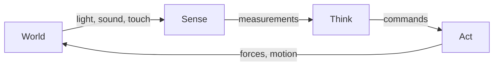
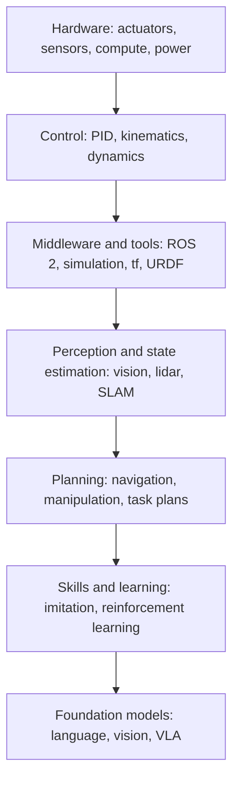

<LessonMeta level="Beginner" time="30 min" prereqs={["How this course works"]} />

A robot vacuum bumps into a chair leg, backs up, turns, and tries again. A warehouse arm lifts a box it has never seen before. A humanoid steps over a cable on the floor. These look like very different machines, but underneath they are all doing the same thing in the same loop. Once you see that loop and the layers around it, every robotics topic you meet later has a place to sit.

<Objectives>

- Define Physical AI and embodied intelligence in your own words.
- Describe the sense, think, act loop and give an example of each stage.
- Name the layers of the Physical AI stack and what each one does.
- Explain where humanoid robots fit and why they are hard.
- Match each Kinemata module to a layer of the stack.

</Objectives>

## What is Physical AI?

Most AI you have used lives on a screen. A chatbot takes text in and returns text. An image model takes a prompt and returns a picture. If it makes a mistake, you read the mistake and try again.

<Term def="Physical AI is artificial intelligence that perceives and acts in the real world through a body, such as a robot, a car or a drone.">Physical AI</Term> is AI with a body. It senses the world through cameras, microphones and touch, decides what to do, and acts through motors. The field is also called <Term def="Embodied intelligence is the idea that intelligence is shaped by having a body that senses and acts in an environment.">embodied intelligence</Term>, because the body is part of how the intelligence works, not an accessory.

The body changes everything about the problem:

- **The world pushes back.** Gravity, friction and collisions are not optional. A wrong move can break something.
- **Sensing is noisy and incomplete.** A camera sees one side of an object, lidar misses glass, and a wheel slips on wet floor.
- **Time is hard.** A balancing robot has a few milliseconds to react. A chatbot can think for seconds.
- **Mistakes cost real things.** You cannot press undo on a dropped plate.

These constraints are why robotics took decades, and why the recent arrival of strong learned models is so exciting. Hard problems that were once hand-coded, such as recognising objects or understanding "bring me the red cup", are now solved well enough to try on real robots.

## The sense, think, act loop

Every robot runs one loop, over and over, many times a second.

**Sense** turns the world into numbers: camera pixels, lidar distances, joint angles, motor currents, the reading of an inertial sensor.

**Think** turns numbers into a decision. This covers state estimation (where am I, what is around me), planning (what path or sequence of steps) and control (what torque this instant).

**Act** turns the decision into motion: motors, grippers, wheels.

The world then changes, partly because of the action, and the loop begins again. That feedback is the defining feature of robotics. A robot does not execute a plan blindly; it checks reality continuously and corrects.

<KeyIdea title="A robot is a feedback loop with a body">
If you remember one picture from this course, make it sense, think, act. Whenever a topic is confusing, ask: which part of the loop is this? A camera driver is sensing. A path planner is thinking. A motor controller is acting. The loop is the same whether the robot is a toy rover or a humanoid.
</KeyIdea>

### Loops inside loops

The loop does not run at one speed. A real robot nests several loops, fast on the inside and slow on the outside.

| Loop | Typical rate | Question it answers |
|---|---|---|
| Motor control | 1,000 Hz or more | How much current to this motor right now? |
| Balance and joint control | 100 to 1,000 Hz | Is the body staying upright? |
| Perception | 10 to 60 Hz | What does the camera see? |
| Motion planning | 1 to 10 Hz | What path avoids the obstacle? |
| Task and language planning | 0.1 to 1 Hz | What should I do next to fulfil the request? |

Fast loops must be simple and reliable. Slow loops can be rich and flexible. A lot of robot design is deciding which loop a problem belongs in.

## The Physical AI stack

Think of the robot as layers, each built on the one below.

Read it from the bottom.

1. **Hardware.** Motors and gearboxes, sensors, batteries, the computer. Everything above has to respect what the hardware can physically do.
2. **Control.** Software that makes joints and wheels do what you ask, using models of the robot's geometry (kinematics) and its forces (dynamics), plus feedback controllers such as PID.
3. **Middleware and tools.** The plumbing that lets many programs share data: **ROS 2** for messages, **tf2** for coordinate frames, **URDF** for describing the robot, and simulators such as **Gazebo** for safe testing.
4. **Perception and state estimation.** Turning raw sensor data into a usable picture: where objects are, where the robot is, and how sure it is.
5. **Planning.** Deciding how to move: finding a collision-free path, driving to a room with **Nav2**, reaching and grasping with **MoveIt 2**.
6. **Skills and learning.** Behaviours that are learned instead of hand-written, from demonstrations (imitation learning) or by trial and error (reinforcement learning).
7. **Foundation models.** Large pre-trained models that understand language and images and can map them to actions. This is the newest layer, and the one moving fastest.

The layers talk to each other. A foundation model might say "pick up the mug", a planner produces an arm trajectory, a controller tracks it, and sensors report whether it worked.

:::note[Layers are not strict]
Modern research blurs the boundaries. A vision-language-action model may go straight from camera pixels and a sentence to motor commands, skipping several layers. You still need to understand the layers, because that is how you debug it and how you judge whether it is safe.
:::

## Where humanoids fit

A <Term def="A humanoid robot has a body shaped roughly like a person: a torso, two arms, two legs and a head.">humanoid</Term> is not a different kind of intelligence. It is a robot that uses every layer of the stack at once, under tough conditions.

Why build one at all? Our world, from stairs to door handles to tools, is designed for the human body. A humanoid could in principle work in it without the environment being rebuilt. The bet is that one general body plus a general brain can do many jobs.

Why is it hard?

- **Balance.** A humanoid is a tall, narrow object standing on two small feet. It is unstable by design, and must keep correcting itself.
- **Many joints.** Dozens of joints that must move together: whole-body control is a large coordination problem.
- **Contact.** Walking and grasping are made of impacts and friction, which are hard to model.
- **Hands.** Human-like dexterity needs many small, strong, sensitive actuators.
- **Safety.** A falling humanoid is heavy and can hurt someone.

That is why Module 08 sits late in the course. Balance, control, perception and learning all feed into it, and you should have them before you try the hardest robot.

## How the 11 modules map onto the stack

| Module | Layer(s) it covers |
|---|---|
| 00 · Start here | Your workstation and this map |
| 01 · Foundations | The math, code and tools every layer uses |
| 02 · Robot fundamentals | Hardware understanding, control |
| 03 · ROS 2 | Middleware and tools |
| 04 · Simulation | Middleware and tools, testing every layer |
| 05 · Perception | Perception and state estimation |
| 06 · Motion | Planning |
| 07 · Robot learning | Skills and learning |
| 08 · Humanoids | All layers, applied to the hardest body |
| 09 · Foundation models | Foundation models and safety |
| 10 · Capstone and career | Integrating all layers on one project |

You can see the shape: the course climbs the stack, with foundations underneath and a capstone on top that uses it all.

## Hands-on lab

You will make your own one-page map and check it against a running ROS 2 system. Use paper or any drawing tool.

<Steps>

1. Draw the sense, think, act loop as three boxes with arrows, and add the world as a fourth box that closes the loop.
2. Draw the seven stack layers as horizontal bars, with hardware at the bottom.
3. Choose a robot you know, such as a robot vacuum, and write one real component beside each layer. For example: wheel motors (hardware), a PID speed loop (control), a bump sensor reading (perception).
4. Mark which Kinemata module teaches each layer, using the table above.
5. Start the demo from the last lesson: `ros2 run demo_nodes_cpp talker` in one terminal and `ros2 run demo_nodes_py listener` in another.
6. On your map, label the talker and the listener. Which stack layer is the message system between them? It is the middleware layer.
7. Save the picture as `map.png` in your `kinemata-workspace` repository, commit it, and write one sentence in `journal.md` about which layer you are most curious about.

</Steps>

The check: every layer on your map has at least one real example, and you can say which layer ROS 2 belongs to without looking.

## Exercises

<Exercise title="Classify the components" level="Beginner">
Place each in the sense, think or act stage: a wheel encoder, a path planner, a gripper motor, a depth camera, an obstacle-avoidance decision, a PID controller sending voltage to a joint.

<Solution>
Sense: wheel encoder, depth camera. Think: path planner, obstacle-avoidance decision (and the PID computation itself). Act: gripper motor and the voltage that the controller sends. Notice the controller sits on the boundary between think and act. Boxes in a diagram are a guide, and real systems often blur them.
</Solution>
</Exercise>

<Exercise title="Which loop is too slow?" level="Beginner">
A teammate proposes running a language model to decide, on every control cycle at 1,000 Hz, whether to apply more torque to a leg joint. Using the loop table, explain why this is a poor design and where the model should run instead.

<Solution>
A language model takes tens or hundreds of milliseconds per answer, far slower than the 1 ms available at 1,000 Hz. It is also not reliable enough for a safety-critical loop. Joint torque belongs in a fast, simple, deterministic controller. The language model belongs in the slow task-planning loop, producing goals such as "walk to the door" that the faster layers then carry out.
</Solution>
</Exercise>

<Exercise title="Trace a request" level="Intermediate">
A user says, "Bring me the water bottle." List, in order, which layers of the stack are involved from the sentence to the bottle in the user's hand.

<Solution>
Foundation models interpret the sentence and produce a task plan. Perception finds the bottle and the robot's position. Planning produces a path for the base and then an arm trajectory. Control tracks those trajectories and keeps the robot balanced, using hardware actuators. Sensors then confirm the grasp, and the loop repeats. Middleware, ROS 2, carries the messages between all of them throughout.
</Solution>
</Exercise>

## Check your understanding

<Quiz questions={[
  {q: "What distinguishes Physical AI from a chatbot?", options: ["It uses larger models", "It senses and acts in the real world through a body", "It never uses language", "It runs only in simulation"], answer: 1, explain: "Physical AI has a body: it perceives the world and acts on it, so physics, noise, time limits and real-world consequences all matter."},
  {q: "Which statement about the nested loops is correct?", options: ["Every loop runs at the same rate", "Fast inner loops handle control, and slower outer loops handle planning", "Language planning is the fastest loop", "Control runs once per minute"], answer: 1, explain: "Control loops run at hundreds or thousands of hertz, while high-level planning runs at around once a second or slower."},
  {q: "In the stack, which layer provides messaging between programs, coordinate frames and robot descriptions?", options: ["Hardware", "Middleware and tools", "Foundation models", "Skills and learning"], answer: 1, explain: "ROS 2, tf2 and URDF live in the middleware and tools layer, together with simulators."},
  {q: "Why are humanoids especially hard?", options: ["They have no sensors", "They are unstable, have many joints, and depend on contact and dexterous hands", "They cannot use ROS 2", "They do not need control"], answer: 1, explain: "Balance on two feet, many coordinated joints, contact-rich motion and hands all stress every layer at once."}
]} />

<Takeaways>

- Physical AI is AI with a body that senses the world and acts on it.
- Every robot runs a sense, think, act loop, and the feedback through the world is what makes it robotics.
- Real robots nest fast control loops inside slower planning loops.
- The stack runs from hardware to control, middleware, perception, planning, learning and foundation models.
- Humanoids use every layer under hard conditions, so they come late in the course.
- The 11 modules climb the stack, and the capstone uses it all together.

</Takeaways>

## Go deeper

- [ROS 2 concepts overview](https://docs.ros.org/en/jazzy/Concepts.html): the official introduction to what ROS 2 provides.
- [Gazebo documentation](https://gazebosim.org/docs): where simulation sits in the toolchain.
- [RT-2: Vision-Language-Action Models Transfer Web Knowledge to Robotic Control](https://arxiv.org/abs/2307.15818): an early, widely cited paper on the foundation-model layer.
- [Probabilistic Robotics (Thrun, Burgard, Fox)](https://mitpress.mit.edu/9780262201629/probabilistic-robotics/): the classic textbook on the sensing and thinking half.

Next: [Python for robotics](../01-foundations/01-python-for-robotics.mdx)
