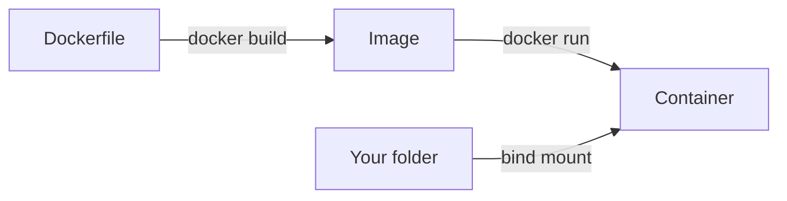

<LessonMeta level="Beginner" time="35 min" prereqs={["Workstation setup"]} />

Your robot's computer has no mouse, no desktop and often no screen. You reach it over a network, through a terminal. When the code that worked yesterday stops working today, you need to know exactly what changed. And when a teammate says "it runs on my machine", you need a way to run it on yours. The shell, Git and Docker are how professional robotics teams solve those three problems, and they are worth an hour of your time now.

<Objectives>

- Navigate the file system and combine commands with pipes and redirection.
- Read and set environment variables, and understand file permissions.
- Use Git to commit, branch, merge, and undo mistakes safely.
- Explain images, containers and volumes, and run a ROS 2 Jazzy container.
- Write a small shell script that automates a setup step.

</Objectives>

## The shell in ten minutes

The <Term def="The shell is a program that reads the commands you type and runs them; on Ubuntu the default is bash.">shell</Term> is a text interface to the computer. A command is a program name followed by options and arguments. These are the ones you will use daily.

| Command | What it does |
|---|---|
| `pwd` | Print the current directory |
| `ls -la` | List files, including hidden ones, with details |
| `cd path` | Change directory (`cd ..` goes up, `cd ~` goes home) |
| `mkdir -p a/b` | Make a directory and any parents |
| `cp a b` / `mv a b` | Copy / move or rename |
| `rm file` / `rm -r dir` | Delete (there is no trash: be careful) |
| `cat file` / `less file` | Show a file / page through it |
| `grep -rn "text" .` | Search for text in files, recursively |
| `find . -name "*.py"` | Find files by name |
| `man ls` or `ls --help` | Read the manual |

Two features make the shell powerful. A **pipe** (`|`) feeds one command's output into another, and **redirection** (`>`, `>>`) sends output to a file.

```bash title="terminal"
# Count how many Python files are in this project
find . -name "*.py" | wc -l

# Find every line mentioning "lidar", save the results
grep -rn "lidar" . > lidar_mentions.txt

# Append a timestamped note to a log
echo "$(date) calibrated camera" >> notes.log
```

Pressing the up arrow recalls earlier commands, Tab completes names, and Ctrl+C stops a running program. Learn those three and you will move twice as fast.

:::tip[Never copy a command you do not understand]
Before you paste a command from the internet, especially one with `sudo`, `rm` or `curl ... | bash`, read it. If you cannot explain what it does, ask Rivet or look it up with `man`. A bad command run as root can break your system.
:::

## Environment variables, PATH and permissions

An <Term def="An environment variable is a named value, such as PATH or ROS_DISTRO, that the shell passes on to every program it starts.">environment variable</Term> is a named setting. You saw `ROS_DISTRO` earlier. Two important ones:

- `PATH` is the list of folders the shell searches when you type a command. That is why `source /opt/ros/jazzy/setup.bash` makes `ros2` work: it adds folders to `PATH`.
- `ROS_DOMAIN_ID` separates robot networks.

```bash title="terminal"
echo $PATH                    # show it
export MY_ROBOT=proprio1      # set it for this shell and its children
printenv MY_ROBOT             # proprio1
```

A variable set with `export` disappears when you close the terminal. To keep it, add the line to `~/.bashrc`, which runs for every new terminal.

**Permissions** decide who can read, write or run a file. List them with `ls -l`. A line such as `-rwxr-xr-x` means the owner can read, write and execute, and others can read and execute. To make a script runnable:

```bash title="terminal"
chmod +x setup.sh
./setup.sh
```

Use `sudo` (run as administrator) only when a command truly needs it, such as `apt install`. Running your own code with `sudo` creates root-owned files that cause confusing errors later.

### Processes and packages

`ps aux | grep python` lists running programs. `top` shows live usage, and `kill PID` stops a process by number. To install software, `sudo apt install name` fetches a package, and `apt search word` looks for one. You did this in the last lesson.

## Git: a time machine for your code

<Term def="Git is a version control system: it records snapshots of your project so you can see what changed, return to an earlier state, and work on several versions in parallel.">Git</Term> records snapshots of your project, called **commits**. Each commit has a message saying why you made the change. Nothing is lost: you can always go back.

<KeyIdea title="Commit small, commit often, explain why">
A commit is a save point you can return to. Make one after every working step, with a message that says what and why, such as "Add inverse transform and test". When a robot breaks after a change, a clean history lets you find the guilty commit in minutes instead of hours.
</KeyIdea>

The core loop has four commands:

```bash title="terminal"
git init                       # start tracking this folder (once)
git status                     # what has changed?
git add transforms.py          # stage a file for the next commit
git commit -m "Add transform helpers"   # save the snapshot
git log --oneline              # show the history
```

Staging with `git add` lets you choose exactly what goes into each commit. `git diff` shows changes you have not staged yet.

### Branches

A **branch** is a separate line of work. You use branches to try an idea without risking your working code.

```bash title="terminal"
git switch -c try-kalman-filter     # create and move to a new branch
# ...edit, add, commit...
git switch main                     # go back
git merge try-kalman-filter         # bring the work in
git branch -d try-kalman-filter     # tidy up
```

If two branches change the same lines, Git stops and asks you to resolve a **conflict**: it marks both versions in the file, you edit to the one you want, then `git add` and `git commit`.

### Undoing things

Mistakes happen. These are the safe ways out:

| Situation | Command |
|---|---|
| Discard changes in one file | `git restore file.py` |
| Unstage a file | `git restore --staged file.py` |
| Undo a commit but keep a new commit as the record | `git revert <commit>` |
| See an old version | `git show <commit>:file.py` |

Be careful with commands that rewrite history, such as `git reset --hard` and `git push --force`. They can destroy work.

### Remotes and what not to commit

A **remote** such as GitHub is a copy of your repository on a server. Use `git remote add origin URL` once, then `git push` and `git pull`. Create a `.gitignore` file listing things Git must skip:

```text title=".gitignore"
__pycache__/
*.pyc
.venv/
build/
install/
log/
*.bag
.env
```

Never commit secrets such as passwords or API keys, and keep large generated files (ROS 2 `build/`, `install/`, `log/`, and recorded data) out of the repository.

## Docker: the same environment everywhere

A robotics project depends on an operating system, ROS 2, libraries and exact versions. <Term def="Docker packages an application together with its operating-system files and dependencies into an image, which runs as an isolated container.">Docker</Term> lets you bundle all of it, so a project that runs in your container also runs in a teammate's, on a server, or on the robot.

Three words to know:

- An **image** is a frozen recipe: files plus the settings to run them.
- A **container** is a running instance of an image. You can start and throw away containers freely.
- A **volume** or bind mount shares a folder between your computer and a container, so work survives after the container is gone.



Install Docker following the official guide at docs.docker.com for Ubuntu (follow the current instructions there), then try an official ROS 2 Jazzy image:

```bash title="terminal"
docker run --rm -it ros:jazzy
# inside the container:
ros2 --help
exit
```

`--rm` deletes the container when it exits, and `-it` gives you an interactive terminal. To share your project folder:

```bash title="terminal"
docker run --rm -it -v "$PWD":/work -w /work ros:jazzy bash
```

Here `-v` mounts the current folder at `/work` and `-w` starts you in it. Files you create there stay on your computer.

To make your own image, write a `Dockerfile`:

```dockerfile title="Dockerfile"
FROM ros:jazzy
RUN apt-get update && apt-get install -y python3-numpy && rm -rf /var/lib/apt/lists/*
WORKDIR /work
CMD ["bash"]
```

Build and run it:

```bash title="terminal"
docker build -t proprio-dev .
docker run --rm -it -v "$PWD":/work proprio-dev
```

:::note[Containers and graphics]
Running Gazebo or RViz from a container needs extra display settings. We will return to that in the simulation module. For now, containers are for command-line work and for reproducible builds.
:::

## A tiny script that ties it together

A <Term def="A shell script is a text file of commands that the shell runs in order, so a multi-step task becomes one command.">shell script</Term> turns a routine into one command. This one prints a quick health report for a robotics workstation:

```bash title="check_env.sh"
#!/usr/bin/env bash
set -e   # stop at the first error

echo "OS:       $(lsb_release -ds)"
echo "Python:   $(python3 --version)"
echo "Git:      $(git --version)"

if command -v ros2 >/dev/null 2>&1; then
  echo "ROS 2:    ${ROS_DISTRO:-not sourced}"
else
  echo "ROS 2:    not found (did you source setup.bash?)"
fi

if command -v docker >/dev/null 2>&1; then
  echo "Docker:   $(docker --version)"
else
  echo "Docker:   not installed"
fi
```

Make it executable with `chmod +x check_env.sh` and run `./check_env.sh`. The first line, the **shebang**, says which program runs the file. `set -e` makes the script stop at the first failure, which stops mistakes from piling up silently.

## Hands-on lab

You will make a scripted, versioned workspace and run a ROS 2 container.

<Steps>

1. In `proprio-workspace`, create `tools/check_env.sh` with the script above, make it executable, and run it. Fix anything it flags as missing.
2. Create a `.gitignore` with the entries above and commit it.
3. Create a branch with `git switch -c add-tools`, commit the script on that branch, then merge it into `main` with `git switch main` and `git merge add-tools`.
4. Run `git log --oneline` and confirm you see at least three commits from this module.
5. Install Docker (following the official guide), then run `docker run --rm -it ros:jazzy`. Inside, run `ros2 --help`, then `exit`.
6. Run the container with your folder mounted, create a file called `from_container.txt` inside `/work`, exit, and confirm the file exists on your host with `ls`.
7. The check: `git log --oneline` shows several clear commit messages, `check_env.sh` reports your versions, and `from_container.txt` is in your folder.

</Steps>

## Exercises

<Exercise title="Pipe it" level="Beginner">
Write one command that shows the five largest files in the current directory tree.

<Solution>
```bash
find . -type f -printf "%s %p\n" | sort -nr | head -5
```
`find` prints each file with its size, `sort -nr` orders numerically with the biggest first, and `head -5` keeps five lines. Each piece does one job and the pipe joins them.
</Solution>
</Exercise>

<Exercise title="Recover a deleted file" level="Intermediate">
You committed `notes.md`, then accidentally ran `rm notes.md`. How do you get it back without searching the internet?

<Solution>
Run `git restore notes.md`. Git copies the file back from the last commit. If the deletion was already committed, find the commit with `git log --oneline -- notes.md` and restore from the one before it with `git restore --source=<commit>~1 notes.md`. This is exactly why you commit often.
</Solution>
</Exercise>

<Exercise title="Why a bind mount?" level="Intermediate">
You run `docker run --rm -it ros:jazzy`, write code inside, and exit. Your code is gone. Explain why and give the fix.

<Solution>
The `--rm` flag deletes the container, and files written inside a container's own file system go with it. Mount a folder from your computer with `-v "$PWD":/work`, and write inside `/work`. Those files live on your host and survive after the container is removed.
</Solution>
</Exercise>

## Check your understanding

<Quiz questions={[
  {q: "What does the pipe in find . -name \"*.py\" | wc -l do?", options: ["Saves output to a file", "Feeds the output of find into wc", "Runs two commands at the same time on different machines", "Deletes the files"], answer: 1, explain: "A pipe connects one program's output to the next program's input, so wc counts the lines that find produced."},
  {q: "Why does sourcing a ROS setup script make ros2 available?", options: ["It installs ROS", "It adds ROS folders to PATH and sets other variables in the current shell", "It starts a ROS node", "It changes file permissions"], answer: 1, explain: "Sourcing sets environment variables such as PATH for the current shell, so the shell can find ROS programs."},
  {q: "What is the main reason to commit small and often?", options: ["Git requires it", "Each commit is a save point, so you can find and undo a bad change quickly", "It makes files smaller", "It hides your changes"], answer: 1, explain: "Small commits with clear messages give a precise history, which makes finding and reverting a problem fast."},
  {q: "What is the difference between a Docker image and a container?", options: ["They are the same", "An image is a frozen recipe and a container is a running instance of it", "A container is a recipe and an image is running", "An image is a folder on your host"], answer: 1, explain: "You build an image once and can start many disposable containers from it."}
]} />

<Takeaways>

- The shell connects small commands with pipes and redirection, and PATH decides which programs it can find.
- Use sudo sparingly, and do not paste commands you cannot explain.
- Git commits are save points: commit small, write the why, and use branches to experiment safely.
- Keep secrets and generated files such as build folders out of Git with .gitignore.
- Docker packages an environment into an image that runs as disposable containers.
- Bind-mount your project folder so your work survives the container.

</Takeaways>

## Go deeper

- [Pro Git, the book](https://git-scm.com/book/en/v2): free and complete, with the first three chapters enough for this course.
- [The Linux command line (linuxcommand.org)](https://linuxcommand.org/tlcl.php): a free beginner book on the shell.
- [Docker get started](https://docs.docker.com/get-started/): the official walkthrough of images and containers.
- [Official ROS images on Docker Hub](https://hub.docker.com/_/ros): the page for the `ros:jazzy` image used in this lesson.

Next: [Anatomy of a robot](../02-robot-fundamentals/01-anatomy-of-a-robot.mdx)
