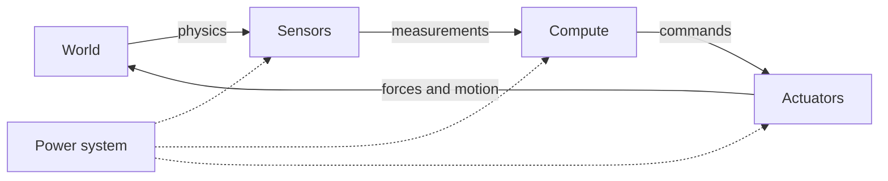

<LessonMeta level="Beginner" time="30 min" prereqs={["Python basics", "High-school physics"]} />

Picture a small delivery robot rolling down a corridor. A person steps out of a doorway. Within a fraction of a second the robot must notice them, decide to brake, and cut power to its wheels, all without browning out its own computer. Behind that one smooth stop sits a whole chain of parts: something that senses, something that thinks, something that moves, and something that feeds them all. This lesson gives you the map of that chain, so every later lesson has somewhere to attach.

<Objectives>

- Name the four subsystems of a robot (sensing, compute, actuation, power) and say what each one does.
- Distinguish proprioceptive from exteroceptive sensors and give two examples of each.
- Trace a signal around the sense-think-act loop and say where delay and noise enter.
- Estimate a rough power budget and data-rate budget for a small mobile robot.

</Objectives>

## A robot is a loop, not a machine

Strip away the metal and a robot is one idea repeated: **sense, think, act**. It measures the world, decides what to do, pushes on the world, then measures again to see what happened. The world changes, so the loop never stops.



Four physical subsystems make that loop real:

1. **Sensors** turn the physical world into numbers.
2. **Compute** turns numbers into decisions.
3. **Actuators** turn decisions into forces.
4. **Power** keeps the other three alive.

Everything in robotics, from a toy line-follower to a humanoid, is a different answer to "which parts, and how are they wired together?"

<KeyIdea title="The loop is the robot">
A robot is not defined by its body. It is defined by a closed loop: measure, decide, act, repeat. A great body with a slow or noisy loop behaves badly. A modest body with a fast, clean loop can look magical.
</KeyIdea>

## Sensors: how a robot knows things

A <Term def="a device that converts a physical quantity such as light, motion or force into an electrical signal">sensor</Term> never gives you "the truth". It gives you a number that is related to the truth, plus noise, plus delay. Sensors fall into two families, and the names come from the same Latin root as this course.

**Proprioceptive** sensors measure the robot itself: how far a joint has turned, how fast a wheel spins, how much current a motor draws. This is the robot's inner sense of its own body, the thing the name *Kinemata* points at.

**Exteroceptive** sensors measure the outside world: a camera, a lidar, a microphone, a bump switch.

| Sensor | Measures | Family | Typical rate |
|---|---|---|---|
| Joint encoder | Shaft angle | Proprioceptive | 1 kHz and up |
| IMU (gyro + accelerometer) | Angular rate, acceleration | Proprioceptive | 100 Hz to 1 kHz |
| Motor current sense | Torque (indirectly) | Proprioceptive | 1 kHz to 20 kHz |
| Force/torque sensor | Contact forces | Proprioceptive (at the wrist) | 100 Hz to 1 kHz |
| Camera | Light intensity (a grid of pixels) | Exteroceptive | 15 to 120 Hz |
| Lidar | Distance along many rays | Exteroceptive | 5 to 40 Hz |
| Depth camera | Distance per pixel | Exteroceptive | 15 to 90 Hz |

Two properties matter more than any datasheet headline:

- **Rate**: how many measurements per second. A fast controller needs fast feedback.
- **Latency**: how old the number already is when it reaches your code. A camera frame that was exposed 80 ms ago describes a world that has moved on.

:::note
"Typical rate" figures are ballpark values to build intuition. Always read the datasheet of the actual part you buy.
:::

## Compute: where decisions are made

Robots usually have more than one computer, because different jobs have different demands.

- **Microcontrollers (MCUs)** run tight, fast, predictable loops: reading an encoder, closing a motor current loop at several kilohertz. They are simple, cheap and have no operating system getting in the way.
- **Single-board computers and embedded GPUs** (a Raspberry Pi class board, or an NVIDIA Jetson class module) run an operating system, ROS 2, perception and planning.
- **Workstations or the cloud** train big models and run heavy offline jobs.

The key word is <Term def="behaviour in which a result is guaranteed to arrive within a fixed time limit, not merely on average">real-time</Term>. A joint controller that is usually on time but occasionally 50 ms late can make an arm shake. That is why low-level control lives on MCUs or on a carefully configured real-time thread, while "slow thinking" such as route planning lives on the bigger computer. You will meet this split again in the ROS 2 module.

## Actuators: how a robot pushes back

An <Term def="a device that converts energy, usually electrical, into mechanical motion or force">actuator</Term> is anything that makes the robot move. The common ones:

- **Brushed DC motors**: cheap and simple. Fine for wheels and toys.
- **Brushless DC (BLDC) motors**: efficient, long-lived, the standard choice for drones, gimbals and modern robot joints.
- **Servo motors**: a motor bundled with an encoder and a small controller so you command a position.
- **Stepper motors**: move in fixed angular steps, popular for 3D printers.
- **Hydraulic and pneumatic actuators**: fluids give huge force for their weight, but add pumps, hoses and leaks.

Motors spin fast and weakly; robots usually need slow and strong. A **gearbox** trades speed for torque. A gear ratio of $N$ multiplies torque by about $N$ and divides speed by $N$, minus friction losses:

$$\tau_{\text{out}} \approx N\,\eta\,\tau_{\text{motor}}, \qquad \omega_{\text{out}} = \frac{\omega_{\text{motor}}}{N}$$

where $\eta$ is the gearbox efficiency (a number below 1). Gearing has a catch: a high ratio makes the joint hard to back-drive, which is great for holding a load but poor for gentle contact with people. Many modern legged robots use low ratios on purpose, so they can feel the ground.

## Power: the quiet subsystem that limits everything

Batteries store energy (watt-hours); loads draw power (watts). Runtime is roughly their ratio:

$$t_{\text{run}} \approx \frac{E_{\text{battery}}}{P_{\text{avg}}}$$

Three habits will save you pain:

- **Peak is not average.** A motor accelerating a heavy arm can pull several times its idle current for a moment. Size wiring and the battery's maximum discharge rate for the peak.
- **Separate noisy and quiet rails.** Motors create electrical noise and voltage dips. Put them on a different regulator from your computer and sensors, or a motor surge will reboot the brain.
- **Have an emergency stop.** A hardware path that cuts motor power must not depend on software being alive.

:::warning
Lithium batteries can start fires if shorted, over-discharged or punctured. Use a battery management system (BMS), fuse the main supply, and never charge unattended.
:::

## How the parts connect

Parts talk over **buses**, shared wires with agreed rules (a protocol). You will see these constantly:

| Bus | Typical use | Notes |
|---|---|---|
| I²C, SPI | Chips on one board (IMUs, small sensors) | Short distance, simple |
| UART / serial | MCU to computer, GPS | Easy, slow |
| CAN / CAN FD | Motor drivers, vehicles | Robust against noise, multi-drop |
| EtherCAT | Fast joint networks in arms and humanoids | Tight timing |
| USB | Cameras, lidar | Convenient, shared bandwidth |
| Ethernet | Lidar, cameras, computers | High bandwidth, long runs |

The bus must carry the data fast enough. A $640 \times 480$ colour camera at 30 frames per second with 3 bytes per pixel produces about $640 \cdot 480 \cdot 3 \cdot 30 \approx 27.6$ MB/s. That fills an old USB 2 link and is why compressed streams and hardware encoders exist.

## A budget you can compute

Let us turn this into code. The script below builds a tiny budget for a mobile robot: average power, runtime, and raw sensor data rate.

```python title="budget.py"
from dataclasses import dataclass


@dataclass
class Load:
    name: str
    watts: float          # average draw
    duty: float = 1.0     # fraction of time it is on (0 to 1)

    @property
    def average(self) -> float:
        return self.watts * self.duty


@dataclass
class Stream:
    name: str
    bytes_per_sample: int
    rate_hz: float

    @property
    def megabytes_per_s(self) -> float:
        return self.bytes_per_sample * self.rate_hz / 1e6


loads = [
    Load("drive motors", watts=60.0, duty=0.5),
    Load("compute (SBC + GPU)", watts=15.0),
    Load("lidar", watts=8.0),
    Load("camera", watts=2.5),
    Load("microcontroller + sensors", watts=1.5),
]

streams = [
    Stream("camera 640x480 RGB", 640 * 480 * 3, 30),
    Stream("lidar 1080 pts x 8 B", 1080 * 8, 10),
    Stream("IMU 6 floats", 6 * 4, 200),
    Stream("wheel encoders", 2 * 4, 1000),
]

battery_wh = 100.0
usable = 0.8  # never plan to drain a battery to zero

p_avg = sum(load.average for load in loads)
print(f"Average power: {p_avg:.1f} W")
print(f"Runtime: {battery_wh * usable / p_avg:.2f} h")

total = 0.0
for s in streams:
    print(f"{s.name:<24} {s.megabytes_per_s:8.3f} MB/s")
    total += s.megabytes_per_s
print(f"Total raw sensor data: {total:.2f} MB/s")
```

Run it and you will see two lessons at once: the drive motors dominate the power budget, and the camera dominates the data budget. Real design is mostly noticing which single item dominates and attacking that.

## Where delay and noise sneak into the loop

Walk back through the loop and ask "what can go wrong here?"

- **Sensing**: noise (random jitter), bias (a steady offset), and latency.
- **Compute**: processing time, and scheduling jitter if the operating system pauses your code.
- **Communication**: bus delay, dropped messages.
- **Actuation**: the motor cannot change torque instantly, gears have backlash (a little free play), and limits clip your command.

Add those delays up and you have the **loop latency**. As a rule of thumb, the feedback loop should be much faster than the thing it controls. That is the seed of the control lesson later in this module.

## Hands-on lab

You will turn the budget script into a design tool.

<Steps>

1. Save the script as `budget.py` and run it with `python budget.py`. Note the average power and the largest data stream.
2. Change the battery to 50 Wh and the drive-motor duty to 0.8. Predict the new runtime before you run it, then check your prediction.
3. Add a second camera stream (a stereo pair) and a 3D lidar that produces 300,000 points per second at 16 bytes per point. Does your total still fit a gigabit Ethernet link (about 100 MB/s of useful throughput)?
4. Add a `Load` called "emergency stop relay" with 0.5 W and write one sentence on why it must not be powered through the compute board.

</Steps>

You know it worked when you can explain, in one sentence, which component limits your runtime and which limits your bandwidth.

## Exercises

<Exercise title="Gear it down" level="Beginner">
A motor produces 0.05 N·m at 6,000 rpm. A gearbox with ratio 50 and efficiency 0.8 sits on its shaft. What torque and speed come out?

<Solution>
Torque: $0.05 \times 50 \times 0.8 = 2.0$ N·m. Speed: $6000 / 50 = 120$ rpm. You traded 50 times less speed for about 40 times more torque (the missing 20 percent is lost to friction).
</Solution>
</Exercise>

<Exercise title="Sort the sensors" level="Beginner">
Classify each as proprioceptive or exteroceptive: wheel encoder, lidar, motor current sensor, microphone, IMU in the torso, contact switch on a bumper.

<Solution>
Proprioceptive: wheel encoder, motor current sensor, IMU. Exteroceptive: lidar, microphone, bumper contact switch. (A contact switch touches the world, so it senses something outside the robot's own body.)
</Solution>
</Exercise>

<Exercise title="Will it fit on the bus?" level="Intermediate">
Your arm has 7 joints. Each joint sends 12 bytes of state at 1,000 Hz over a single CAN FD bus. How many megabits per second is that, and is it comfortable for a bus rated at 5 Mbit/s (ignoring protocol overhead)?

<Solution>
$7 \times 12 \times 1000 = 84{,}000$ bytes/s, which is $0.672$ Mbit/s. That is about 13 percent of 5 Mbit/s before overhead, so it fits, but real frames add headers, so leave generous margin and check the actual frame format.
</Solution>
</Exercise>

## Check your understanding

<Quiz questions={[
  {q: "Which of these is a proprioceptive sensor?", options: ["A lidar scanning a room", "A camera watching a door", "A joint encoder measuring shaft angle", "A microphone listening for a voice"], answer: 2, explain: "Proprioceptive sensors measure the robot itself. A joint encoder reports the robot’s own joint angle; the other three measure the outside world."},
  {q: "Why do robot designers often put low-level motor control on a microcontroller instead of the main computer?", options: ["Microcontrollers are always faster than GPUs", "They run tight loops with predictable timing and no operating-system delays", "ROS 2 cannot run on bigger computers", "Microcontrollers need no power"], answer: 1, explain: "The advantage is predictable, real-time timing for fast loops. The main computer is better for heavy perception and planning."},
  {q: "A gearbox with ratio 20 and efficiency 0.9 is attached to a motor that makes 1 N·m. Roughly what torque comes out?", options: ["0.05 N·m", "1 N·m", "18 N·m", "20 N·m"], answer: 2, explain: "Output torque is about N × efficiency × motor torque: 20 × 0.9 × 1 = 18 N·m."},
  {q: "Which statement about the sense-think-act loop is most accurate?", options: ["It runs once at start-up", "Delay and noise can enter at every stage, not just at the sensor", "Only sensors add delay", "Actuators respond instantly to commands"], answer: 1, explain: "Sensors, compute, communication and actuators all add delay or noise. The total loop latency is what the controller has to live with."}
]} />

<Takeaways>

- A robot is a closed loop of sensing, compute, actuation and power; the body is only one part of it.
- Proprioceptive sensors measure the robot itself; exteroceptive sensors measure the world.
- Rate and latency matter as much as accuracy when you choose a sensor.
- Gearboxes trade speed for torque; power budgets must plan for peaks, not just averages.
- Split fast, predictable control (MCU) from slow, heavy thinking (main computer), and keep a hardware emergency stop.
- Do the arithmetic early: one component usually dominates both the power and the data budget.

</Takeaways>

Stuck? Ask **Rivet**, the course assistant, bottom-right.

## Go deeper

- [ROS 2 documentation](https://docs.ros.org/en/jazzy/): the software side of connecting all these parts together.
- [Introduction to Autonomous Mobile Robots (Siegwart, Nourbakhsh, Scaramuzza)](https://mitpress.mit.edu/9780262015356/introduction-to-autonomous-mobile-robots/): a classic textbook on sensors, locomotion and navigation.
- [Modern Robotics (Lynch and Park)](https://modernrobotics.northwestern.edu/): free book and video course; its early chapters match the next lessons.

Next: [Frames and rigid transforms](./02-frames-and-rigid-transforms.mdx)
