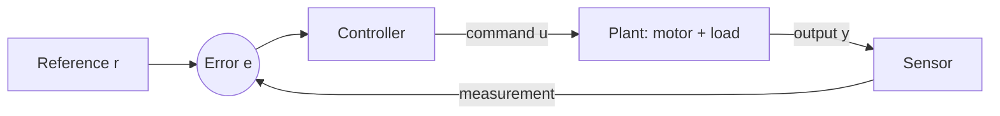
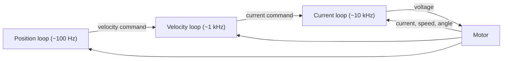

<LessonMeta level="Intermediate" time="45 min" prereqs={["Dynamics essentials", "Python and NumPy", "Basic calculus"]} />

You command a robot arm to move to 1 radian. It overshoots to 1.2, swings back to 0.9, and wobbles for a few seconds before settling. Or worse, it never quite reaches 1 because of a stubborn gravity load. The motors are fine; the commands are just badly chosen. Control is the craft of choosing commands, many times per second, so the robot does what you asked and not something near it.

<Objectives>

- Explain open-loop versus closed-loop (feedback) control and why feedback wins in the real world.
- Write a PID controller and test it against a simulated DC motor.
- Describe what each of P, I and D does, tune them step by step, and read overshoot, settling time and steady-state error from a response.
- Add anti-windup and a filtered derivative, and say why each matters.
- Describe cascaded control and impedance control at a conceptual level.

</Objectives>

## Open loop versus closed loop

An **open-loop** controller sends a command and hopes. "Run the motor at 6 V for 2 seconds" is open loop. It works only if the world is exactly as you assumed: no extra load, no friction change, a full battery. Real robots break those assumptions constantly.

A **closed-loop** or <Term def="control that measures the result and uses the error between the goal and the measurement to adjust the next command">feedback control</Term> system measures what actually happened and corrects. The error is

$$e(t) = r(t) - y(t)$$

where $r$ is the reference (the goal) and $y$ is the measured output. The controller turns $e$ into a command $u$.



Feedback has one big gift: it makes a system **robust**. Whatever disturbs the output, the error grows and the controller pushes back. It also has one big danger: a loop with too much correction or too much delay can start to oscillate, or even run away. Most of control engineering is balancing those two.

## The PID controller

The most used controller in industry is almost embarrassingly simple. It combines three terms:

$$u(t) = K_p\,e(t) + K_i\int_0^t e(\tau)\,d\tau + K_d\,\frac{de}{dt}$$

Each term has a personality.

- **P (proportional)** reacts to the error now. Big error, big push. Like a spring pulling you to the goal. Too little gives sluggishness and leaves a steady-state error under load; too much causes oscillation.
- **I (integral)** reacts to the error's history. A small error that lasts keeps adding up until the push is big enough to remove it. It eliminates steady-state error but can add overshoot and, as we will see, windup.
- **D (derivative)** reacts to how fast the error changes. It acts like a shock absorber: it predicts where you are heading and brakes early. It reduces overshoot but amplifies sensor noise.

<KeyIdea title="P is the spring, D is the damper, I is the patience">
Think of a mass on a spring with a damper. P is the spring stiffness, D is the damping, and I is a slowly growing force that wins against any constant disturbance, such as gravity or a heavy payload.
</KeyIdea>

## A motor to control

To practise safely we simulate a **DC motor** with a voltage input and shaft angle output. Electrically, the armature current is $i = (V - K_e\omega)/R$, where $K_e\omega$ is the back-EMF (the motor acts as a generator that opposes the voltage). The torque is $K_t i$, and the rotor obeys $J\dot\omega = K_t i - b\omega - \tau_{\text{load}}$. The code below integrates this with a small time step.

Then comes the controller, built the way real firmware builds it. Two practical touches are included from the start, and both are explained below the code: a **filtered derivative on the measurement**, and **anti-windup** by conditional integration.

```python title="pid_motor.py"
import numpy as np


class DCMotor:
    """A DC motor + gearbox lumped into a few parameters. Voltage in, shaft angle out."""

    def __init__(self, J=0.01, b=0.1, Kt=0.05, R=1.0, Ke=0.05):
        self.J, self.b, self.Kt, self.R, self.Ke = J, b, Kt, R, Ke
        self.theta = 0.0   # shaft angle (rad)
        self.omega = 0.0   # shaft speed (rad/s)

    def step(self, volts, dt, load_torque=0.0):
        current = (volts - self.Ke * self.omega) / self.R
        torque = self.Kt * current - load_torque
        alpha = (torque - self.b * self.omega) / self.J
        self.omega += alpha * dt
        self.theta += self.omega * dt
        return self.theta


class PID:
    def __init__(self, kp, ki, kd, out_limit=12.0, dt=0.001, anti_windup=True, tau_d=0.01):
        self.kp, self.ki, self.kd = kp, ki, kd
        self.limit = out_limit      # the supply voltage: the actuator cannot do more
        self.dt = dt
        self.anti_windup = anti_windup
        self.tau_d = tau_d          # derivative filter time constant (s)
        self.integral = 0.0
        self.prev_meas = None
        self.d_filtered = 0.0

    def update(self, setpoint, measurement):
        error = setpoint - measurement

        # Derivative on the MEASUREMENT (not the error) so a setpoint jump does not
        # cause a huge spike, then low-pass filtered to tame sensor noise.
        if self.prev_meas is None:
            self.prev_meas = measurement
        raw_d = -(measurement - self.prev_meas) / self.dt
        alpha = self.dt / (self.tau_d + self.dt)
        self.d_filtered += alpha * (raw_d - self.d_filtered)
        self.prev_meas = measurement

        unsaturated = self.kp * error + self.integral + self.kd * self.d_filtered
        output = float(np.clip(unsaturated, -self.limit, self.limit))

        # Conditional integration: only keep adding to the integral if the output is
        # not saturated, or if the error is trying to pull the output back out of it.
        saturated = output != unsaturated
        if (not self.anti_windup) or (not saturated) or (error * unsaturated < 0):
            self.integral += self.ki * error * self.dt
        return output


def run(pid, motor, setpoint=1.0, t_end=3.0, dt=0.001, load=0.0, load_time=1.5):
    """Simulate; apply a constant load torque after load_time. Returns the angle history."""
    n = int(t_end / dt)
    history = np.zeros(n)
    for i in range(n):
        volts = pid.update(setpoint, motor.theta)
        extra = load if i * dt > load_time else 0.0
        motor.step(volts, dt, load_torque=extra)
        history[i] = motor.theta
    return history


def metrics(history, setpoint=1.0, dt=0.001):
    overshoot = max(0.0, (history.max() - setpoint) / setpoint * 100.0)
    outside = np.where(np.abs(history - setpoint) > 0.02 * setpoint)[0]
    settle = (outside[-1] + 1) * dt if len(outside) else 0.0
    return overshoot, settle, abs(setpoint - history[-1])


if __name__ == "__main__":
    configs = {
        "P only": (20.0, 0.0, 0.0),
        "PD":     (20.0, 0.0, 1.5),
        "PID":    (20.0, 10.0, 1.5),
    }
    print(f"{'controller':<8} {'overshoot %':>12} {'settle (s)':>11} {'final error':>12}")
    for name, (kp, ki, kd) in configs.items():
        history = run(PID(kp, ki, kd), DCMotor(), load=0.05)
        os_, settle, err = metrics(history)
        print(f"{name:<8} {os_:12.2f} {settle:11.3f} {err:12.4f}")
```

Run it. A load of 0.05 N·m hits the motor at 1.5 s. Look at the final error column: with P or PD the motor ends up slightly short of the goal because the spring term needs a persistent error to produce the holding voltage. With the integral term the error is far smaller and still shrinking when the run ends (give it more time and it reaches zero). That is the integral's whole job.

## Tuning: a practical recipe

There is theory for tuning (Ziegler-Nichols, loop shaping, model-based design), but a patient engineer with a plot can tune by hand using the personalities above.

1. **Start with $K_i = K_d = 0$.** Raise $K_p$ until the response is fast but overshoots a bit.
2. **Add $K_d$** until the overshoot shrinks to acceptable levels. If the output gets jittery, lower $K_d$ or raise the derivative filter's time constant.
3. **Add $K_i$** slowly, just enough to remove the steady-state error in the time you can afford. Too much brings back overshoot.
4. **Test with disturbances,** not just step moves: a load, a payload change, a bump.

Read the response with three numbers: **overshoot** (how far past the goal), **settling time** (when it stays within a small band, often 2 percent), and **steady-state error** (what remains forever). Speed, smoothness and accuracy trade against each other, and the right balance depends on your robot.

:::tip[Pro tip]
Tune in the same control loop rate that you will deploy. A controller tuned at 1 kHz can go unstable at 100 Hz, because the delay between measuring and acting grew.
:::

## Integral windup and anti-windup

Real actuators saturate: a 12 V supply cannot give 40 V. While the output is stuck at its limit, the error stays large, and a naive integral term keeps accumulating, "winding up" a huge value. When the robot finally reaches the goal, the stored integral keeps pushing it past, causing big overshoot.

Anti-windup stops that. Our code uses **conditional integration**: skip integrating while the output is saturated (unless the error would pull it back). Other methods include clamping the integral and "back-calculation". You can see the effect by commanding a large move:

```python title="windup_demo.py"
from pid_motor import PID, DCMotor, run, metrics

big_move = 30.0  # rad: the 12 V supply saturates for a long time
for anti_windup in (False, True):
    history = run(PID(20.0, 60.0, 1.0, anti_windup=anti_windup), DCMotor(),
                  setpoint=big_move, t_end=6.0)
    overshoot, _, final_error = metrics(history, setpoint=big_move)
    print(f"anti_windup={anti_windup!s:<5}  overshoot {overshoot:5.1f} %   final error {final_error:.3f} rad")
```

Without anti-windup the motor overshoots by many percent. With it, the overshoot nearly vanishes.

## Beyond a single loop: cascaded control

Real joints rarely use one loop. They nest several, each faster than the one outside it:



This is **cascaded control**. The inner current loop makes the motor behave like a clean torque source. The velocity loop above it makes speed follow its command. The position loop at the top makes the angle follow the goal. Each loop sees a simpler system below it, and the inner loops can reject disturbances (a sudden load) before they reach the outer one. The rule of thumb: each inner loop should be several times faster than the one it serves.

## Impedance control: making a robot behave like a spring

Position control tries to reach a point no matter what. That is dangerous when the robot touches things: a stiff controller will push through a person's hand or a fragile object. **Impedance control** instead gives the hand the behaviour of a virtual spring and damper:

$$F = K\,(x_d - x) + D\,(\dot x_d - \dot x)$$

where $K$ is the stiffness and $D$ the damping. Using $\tau = J^{\mathsf T}F$ from the dynamics lesson, you can turn this hand force into joint torques. Low stiffness makes the robot soft and compliant; high stiffness makes it precise. Collaborative robots, legged robots, and almost any robot that must touch the world use some version of this idea.

## Hands-on lab

You will tune the controller and see what each term does.

<Steps>

1. Save `pid_motor.py` and run it. Record overshoot, settling time and final error for each controller.
2. Change `PID(20, 10, 1.5)` to a higher proportional gain, such as 50. What happens to overshoot and to the noise in the derivative term? (Print `np.std(np.diff(history))` as a quick roughness measure.)
3. Make the derivative unfiltered by setting `tau_d=1e-6`, and add measurement noise: replace `motor.theta` with `motor.theta + np.random.normal(0, 0.002)` inside `run`. What does the voltage output look like?
4. Save `windup_demo.py` and confirm the effect of anti-windup. Try an integral gain of 100.
5. Open question: lower the loop rate by calling the PID every 10 ms instead of every 1 ms. Does the same tuning still behave?

</Steps>

You know it worked when you can predict, before running, whether a change to $K_p$, $K_i$ or $K_d$ will make the response faster, smoother or more accurate, and the plots or metrics agree.

## Exercises

<Exercise title="Spot the controller" level="Beginner">
A robot arm reaches its target but sags 3 degrees below it whenever it holds a heavy tool. Which PID term fixes that, and why?

<Solution>
The integral term. A constant disturbance (gravity on the tool) needs a constant holding torque. A P-only controller only produces that torque if a constant error remains. The integral accumulates the small error until the holding torque is supplied, driving the error to zero.
</Solution>
</Exercise>

<Exercise title="Why measure, not error, in the D term?" level="Intermediate">
When the operator suddenly changes the setpoint from 0 to 1, what happens to a derivative computed on the error, and why does the code differentiate the measurement instead?

<Solution>
The error jumps from 0 to 1 in a single step, so $de/dt$ is enormous for one sample: a "derivative kick" that slams the actuator. The measurement does not jump (the motor has inertia), so differentiating it avoids the spike. In steady operation the two are the same except for sign, because $e = r - y$ and the reference is constant between changes.
</Solution>
</Exercise>

<Exercise title="Conditional integration by hand" level="Advanced">
Describe in words what the code in `update` does with `error * unsaturated < 0`, and why that condition is needed.

<Solution>
When the output is saturated the integrator is normally frozen. But if the error has the opposite sign from the unsaturated output (for example, the output is stuck at +12 V but the error has gone negative because we overshot), then integrating would *help* pull the output out of saturation, so the code allows it. Without that exception the integrator could stay frozen while the robot overshoots, and the output would never come off its limit.
</Solution>
</Exercise>

## Check your understanding

<Quiz questions={[
  {q: "Which statement best describes why feedback beats open-loop control on real robots?", options: ["Feedback needs no sensors", "Feedback measures the result and corrects errors from disturbances and modelling mistakes", "Open loop is always less accurate in simulation", "Feedback makes the robot lighter"], answer: 1, explain: "Real robots face friction, loads and model errors that open-loop commands cannot know about. Feedback measures what actually happens and corrects it."},
  {q: "Which PID term eliminates a steady-state error caused by a constant load?", options: ["Proportional", "Integral", "Derivative", "None of them"], answer: 1, explain: "The integral term accumulates error over time and keeps increasing the output until the error is removed."},
  {q: "What is integral windup?", options: ["The integral term growing very large while the actuator is saturated, causing overshoot later", "A motor winding that overheats", "Noise in the derivative term", "A sensor that stops updating"], answer: 0, explain: "While the output is clipped, a naive integrator keeps accumulating. When the error finally shrinks, the stored value drives the system past the target."},
  {q: "What does impedance control make a robot behave like?", options: ["A rigid position source", "A virtual spring and damper at the hand", "An open-loop system", "A thermostat"], answer: 1, explain: "Impedance control relates hand force to position and velocity error with a stiffness and damping, so the robot is compliant when it contacts things."}
]} />

<Takeaways>

- Feedback control measures the output and corrects the error, which is how robots cope with disturbances and unknowns.
- PID adds three behaviours: P is the spring, I removes steady-state error, D damps and predicts.
- Tune step by step (P, then D, then I) and test with disturbances, judging overshoot, settling time and steady-state error.
- Anti-windup, derivative on measurement and a filtered derivative are standard practice, not extras.
- Real joints nest fast inner loops (current, velocity) inside slower outer ones (position).
- Impedance control gives a robot a tunable spring and damper at the hand so that it can touch the world safely.

</Takeaways>

Stuck? Ask **Rivet**, the course assistant, bottom-right.

## Go deeper

- [Åström and Murray, Feedback Systems](https://www.cds.caltech.edu/~murray/amwiki/): a free, rigorous introduction to feedback and control.
- [Modern Robotics, chapters 9 to 11](https://modernrobotics.northwestern.edu/): trajectory generation, motion control and force control, including impedance.
- [Brian Douglas, Control Systems Lectures (YouTube)](https://www.youtube.com/@ControlSystemsLectures): clear visual explanations of feedback and PID.

Next: [ROS 2 architecture and DDS](../03-ros2/01-ros2-architecture-and-dds.mdx)
