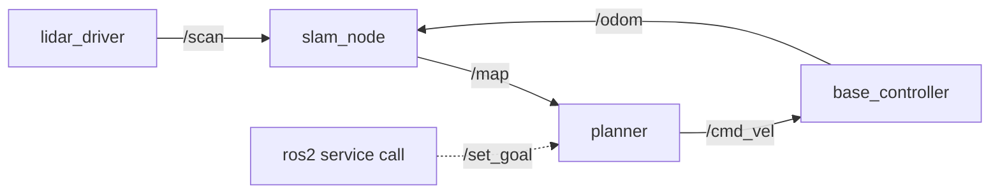
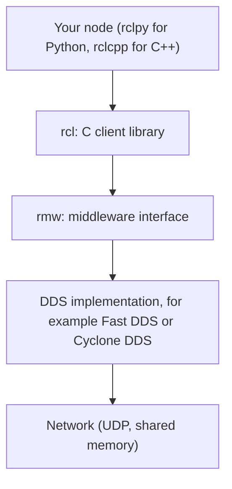

<LessonMeta level="Intermediate" time="40 min" prereqs={["Python basics", "Linux terminal", "Robot fundamentals module"]} />

Your robot has a lidar driver, a map builder, a planner and a motor controller. Written as one giant program, a crash in the lidar code takes down the wheels with it, and nobody else can reuse your planner. Split into separate programs that talk to each other, each piece can be tested, restarted and swapped on its own. ROS 2 is the plumbing that lets those programs find each other and exchange data reliably, even over a flaky Wi-Fi link.

This lesson explains how that plumbing works, so the code you write in the next lessons never feels like magic. We use **ROS 2 Jazzy Jalisco** on Ubuntu 24.04 throughout.

<Objectives>

- Describe the ROS 2 graph: nodes, topics, services, actions and parameters.
- Explain what DDS is, how nodes discover each other, and what ROS_DOMAIN_ID does.
- Pick a QoS profile (reliability, durability, history) and predict whether a publisher and subscriber will connect.
- Explain executors and callback groups, and when a node needs a multi-threaded executor.

</Objectives>

## ROS 2 is not an operating system

<Term def="Robot Operating System: an open-source set of libraries, tools and conventions for building robot software as many cooperating programs">ROS</Term> is a middleware framework: libraries, tools and conventions that run on top of Linux. Its core idea is the **computation graph**: a network of small programs, each doing one job, wired together by named channels.



The building blocks:

- **Node**: one process (or part of one) with a single responsibility, such as `lidar_driver`.
- **Topic**: a named, typed stream. Publishers write to it, subscribers read from it, and neither knows about the other. Many-to-many.
- **Service**: request and response, like a function call across processes. Good for quick questions: "reset the odometry".
- **Action**: a long-running goal with feedback and cancellation: "navigate to the kitchen".
- **Parameter**: a named setting owned by a node, readable and changeable at run time.

Each topic has a **message type**, such as `sensor_msgs/msg/LaserScan`. Types are defined in simple text files, and ROS generates the code for each language from them. You will use the standard ones (`geometry_msgs`, `sensor_msgs`, `std_msgs`) far more often than you will invent your own.

<KeyIdea title="Decoupling is the point">
A publisher never calls a subscriber. It just publishes to a name. That is why you can swap a real lidar for a recording or a simulator without touching the code that consumes the data.
</KeyIdea>

## The layers under your code

When you call `publisher.publish(msg)` in Python, the message passes through several layers:



- **rclpy / rclcpp** give you a friendly API in your language.
- **rcl** is a common C core, so both languages behave the same way.
- **rmw** (ROS middleware interface) is a thin adapter. It is what lets ROS 2 swap DDS vendors without changing your code.
- **DDS** does the real work of finding peers and moving bytes.

## DDS in plain words

<Term def="Data Distribution Service: an industry standard for publish-subscribe communication, with built-in discovery and quality-of-service controls">DDS</Term> is a standard created for demanding systems such as aircraft and defence. It gives ROS 2 three things ROS 1 lacked: **no central master**, **discovery** and **configurable reliability**.

**Discovery.** There is no master process holding a phone book. When a node starts, it announces itself on the network (using multicast by default). Other nodes hear it, compare topics and types, and connect directly. If one node dies, nothing else needs restarting. The cost is some network chatter, which is why large systems tune discovery.

**Domains.** Nodes only discover peers in the same <Term def="an integer from 0 to 101 that partitions DDS traffic so separate groups of robots on one network do not hear each other">domain</Term>, set by the environment variable `ROS_DOMAIN_ID`. If ten students share a classroom network, give each their own ID or their robots will drive each other's nodes:

```bash
export ROS_DOMAIN_ID=7
```

In Jazzy you can also restrict discovery to the local machine with `export ROS_AUTOMATIC_DISCOVERY_RANGE=LOCALHOST`, which is handy on a laptop with simulations.

**Choosing a DDS.** Jazzy ships with eProsima Fast DDS (`rmw_fastrtps_cpp`) as the default. Eclipse Cyclone DDS (`rmw_cyclonedds_cpp`) is a popular alternative. Switch with an environment variable, after installing the package:

```bash
sudo apt install ros-jazzy-rmw-cyclonedds-cpp
export RMW_IMPLEMENTATION=rmw_cyclonedds_cpp
```

All nodes on a robot should use the same RMW. Mixing vendors usually works for basic topics but can cause odd problems, so test before you rely on it.

## Quality of Service (QoS)

Different data deserves different treatment. A laser scan at 10 Hz is useless if it arrives late, so dropping an old one is fine. A map, published once, must reach every late joiner. QoS lets you state those needs. The main knobs:

| Setting | Options | Meaning |
|---|---|---|
| Reliability | `RELIABLE`, `BEST_EFFORT` | Retry lost messages, or send and forget |
| Durability | `VOLATILE`, `TRANSIENT_LOCAL` | Forget after sending, or keep the last messages for late subscribers |
| History | `KEEP_LAST` (with depth), `KEEP_ALL` | How many messages to queue |
| Deadline, Lifespan, Liveliness | durations | Warn if data is late, discard if stale, detect dead publishers |

Presets cover most needs. In `rclpy.qos`: the default (reliable, volatile, keep last 10); `qos_profile_sensor_data` (best effort, volatile, small queue) for high-rate sensors; and a latched-style profile (reliable plus transient local) for things like maps and static configuration.

### Compatibility: will they connect?

A subscriber only receives messages if its request is no stricter than what the publisher offers. The rules you must remember:

| Publisher offers | Subscriber requests | Connects? |
|---|---|---|
| `RELIABLE` | `RELIABLE` | Yes |
| `RELIABLE` | `BEST_EFFORT` | Yes |
| `BEST_EFFORT` | `BEST_EFFORT` | Yes |
| `BEST_EFFORT` | `RELIABLE` | **No** |
| `TRANSIENT_LOCAL` | `VOLATILE` | Yes |
| `VOLATILE` | `TRANSIENT_LOCAL` | **No** |

:::warning
The number one ROS 2 beginner problem: "my subscriber receives nothing". Very often a camera or lidar driver publishes `BEST_EFFORT`, while your subscriber used the default `RELIABLE`. The two silently refuse to connect. Check with `ros2 topic info /topic --verbose` and match the QoS.
:::

Here are two small scripts that show durability in action. They run as plain Python after you `source /opt/ros/jazzy/setup.bash`.

```python title="latched_pub.py"
import rclpy
from rclpy.node import Node
from rclpy.executors import ExternalShutdownException
from rclpy.qos import QoSProfile, DurabilityPolicy, ReliabilityPolicy
from std_msgs.msg import String


class MapAnnouncer(Node):
    """Publishes once. A late subscriber still receives it (TRANSIENT_LOCAL)."""

    def __init__(self):
        super().__init__("map_announcer")
        qos = QoSProfile(
            depth=1,
            reliability=ReliabilityPolicy.RELIABLE,
            durability=DurabilityPolicy.TRANSIENT_LOCAL,
        )
        self.pub = self.create_publisher(String, "map_info", qos)
        msg = String()
        msg.data = "map v1: 4000 cells"
        self.pub.publish(msg)
        self.get_logger().info("published map info once")


def main():
    rclpy.init()
    node = MapAnnouncer()
    try:
        rclpy.spin(node)
    except (KeyboardInterrupt, ExternalShutdownException):
        pass
    finally:
        node.destroy_node()
        rclpy.try_shutdown()


if __name__ == "__main__":
    main()
```

```python title="late_sub.py"
import sys

import rclpy
from rclpy.node import Node
from rclpy.executors import ExternalShutdownException
from rclpy.qos import QoSProfile, DurabilityPolicy, ReliabilityPolicy
from std_msgs.msg import String


class LateListener(Node):
    def __init__(self, durability):
        super().__init__("late_listener")
        qos = QoSProfile(
            depth=1,
            reliability=ReliabilityPolicy.RELIABLE,
            durability=durability,
        )
        self.create_subscription(String, "map_info", self.on_msg, qos)
        self.get_logger().info(f"subscribed with {durability.name}")

    def on_msg(self, msg):
        self.get_logger().info(f"got: {msg.data}")


def main():
    mode = sys.argv[1] if len(sys.argv) > 1 else "transient"
    durability = DurabilityPolicy.TRANSIENT_LOCAL if mode == "transient" else DurabilityPolicy.VOLATILE
    rclpy.init()
    node = LateListener(durability)
    try:
        rclpy.spin(node)
    except (KeyboardInterrupt, ExternalShutdownException):
        pass
    finally:
        node.destroy_node()
        rclpy.try_shutdown()


if __name__ == "__main__":
    main()
```

Start `latched_pub.py` first, wait a few seconds, then run `python3 late_sub.py transient`. It receives the message it "missed". Run `python3 late_sub.py volatile` and it hears nothing, because the publisher's last message is only delivered to subscribers that ask for it.

## Executors and callback groups

A node's callbacks (timers, subscriptions, services) do not run by themselves. An <Term def="the part of rclpy that waits for events and runs the matching callbacks, on one or several threads">executor</Term> waits for events and calls them.

- **`SingleThreadedExecutor`** (what `rclpy.spin` uses) runs callbacks one at a time. Simple and predictable. The catch: a slow callback blocks everything else, including other timers and incoming messages.
- **`MultiThreadedExecutor`** runs callbacks on a pool of threads, so a slow callback no longer blocks the rest.

Having threads is not enough. **Callback groups** tell the executor which callbacks may run at the same moment:

- `MutuallyExclusiveCallbackGroup` (the default): callbacks in the group never run in parallel.
- `ReentrantCallbackGroup`: callbacks in the group may all run in parallel.

Callbacks in different groups can run in parallel on a multi-threaded executor. The classic use case is calling a service from inside a callback: the response needs another callback to run, and with one group and one thread you get a deadlock.

```python title="two_speeds.py"
import time

import rclpy
from rclpy.node import Node
from rclpy.callback_groups import MutuallyExclusiveCallbackGroup
from rclpy.executors import MultiThreadedExecutor, ExternalShutdownException


class TwoSpeeds(Node):
    def __init__(self):
        super().__init__("two_speeds")
        # Separate groups, so the slow job cannot block the fast loop.
        self.fast_group = MutuallyExclusiveCallbackGroup()
        self.slow_group = MutuallyExclusiveCallbackGroup()
        self.create_timer(0.1, self.fast_tick, callback_group=self.fast_group)
        self.create_timer(1.0, self.slow_job, callback_group=self.slow_group)
        self.count = 0

    def fast_tick(self):
        self.count += 1
        if self.count % 5 == 0:
            self.get_logger().info(f"fast loop alive (tick {self.count})")

    def slow_job(self):
        self.get_logger().info("slow job started (0.5 s of work)")
        time.sleep(0.5)  # stands in for a heavy computation
        self.get_logger().info("slow job finished")


def main():
    rclpy.init()
    node = TwoSpeeds()
    executor = MultiThreadedExecutor(num_threads=2)
    executor.add_node(node)
    try:
        executor.spin()
    except (KeyboardInterrupt, ExternalShutdownException):
        pass
    finally:
        node.destroy_node()
        rclpy.try_shutdown()


if __name__ == "__main__":
    main()
```

Run it as written, then change the executor to `SingleThreadedExecutor` and watch the fast ticks stall for half a second at every slow job. That stall is exactly what would make a real controller stutter.

:::tip[Pro tip]
Python's global interpreter lock (GIL) means a multi-threaded rclpy executor helps with waiting (sleeps, I/O) far more than with heavy number crunching. For serious computation, put it in its own node, in C++, or in NumPy code that releases the GIL.
:::

## Hands-on lab

You will observe discovery, domains and QoS compatibility yourself.

<Steps>

1. Open two terminals and in both run `source /opt/ros/jazzy/setup.bash`. In the first run `ros2 run demo_nodes_cpp talker`, in the second `ros2 run demo_nodes_py listener`. You should see matching lines.
2. In a third terminal run `ros2 node list`, `ros2 topic list -t`, and `ros2 topic info /chatter --verbose`. Find the QoS values of both endpoints.
3. Stop the listener, set `export ROS_DOMAIN_ID=5` in its terminal and start it again. It no longer hears the talker. Set the ID back and it reconnects.
4. Save `latched_pub.py` and `late_sub.py`. Run the publisher, wait, then run the subscriber once with `transient` and once with `volatile`. Confirm the different results.
5. Edit `late_sub.py` to request `BEST_EFFORT` reliability. Does it still connect to the reliable publisher? Now make the publisher best effort and the subscriber reliable. Check `ros2 topic info /map_info -v` for the reported incompatibility.

</Steps>

You know it worked when you can predict, from the QoS tables, which pairs connect before you run them.

## Exercises

<Exercise title="Will it connect?" level="Beginner">
A camera driver publishes `BEST_EFFORT`, `VOLATILE`, depth 5. Your node subscribes with the default QoS (reliable, volatile, depth 10). Does it receive images? What is the fix?

<Solution>
No. A reliable subscriber cannot connect to a best-effort publisher. Fix: subscribe with `qos_profile_sensor_data` (best effort), or any profile that requests `BEST_EFFORT`.
</Solution>
</Exercise>

<Exercise title="Deadlock hunt" level="Intermediate">
A node with the default callback group, running on `rclpy.spin`, calls a service synchronously with `client.call(req)` inside a timer callback. Why can this hang, and how do you fix it?

<Solution>
The reply arrives as an event that a callback must process. With a single-threaded executor the timer callback is occupying the only thread, so the response callback can never run, and `call` waits forever. Fix: use `client.call_async(req)` and handle the future (or add a done callback), or run a `MultiThreadedExecutor` and put the client in a different callback group from the timer.
</Solution>
</Exercise>

<Exercise title="Design the QoS" level="Intermediate">
Choose QoS for three topics: a 30 Hz camera stream, a robot's static map, and an emergency-stop command.

<Solution>
Camera: `BEST_EFFORT`, `VOLATILE`, `KEEP_LAST` depth 1 to 5 (fresh frames matter, old ones do not). Map: `RELIABLE`, `TRANSIENT_LOCAL`, depth 1 (late joiners must still get it). Emergency stop: `RELIABLE`, `VOLATILE`, depth 1 to 10, optionally with a deadline or liveliness policy so a silent publisher is detected. Reliability matters more than latency here, and a hardware stop should back it up.
</Solution>
</Exercise>

## Check your understanding

<Quiz questions={[
  {q: "What does DDS provide to ROS 2 that removes the need for a central master process?", options: ["A cloud server", "Decentralised discovery between nodes", "A graphical interface", "A faster Python interpreter"], answer: 1, explain: "DDS nodes announce themselves and discover each other directly, so there is no single process whose crash takes down the graph."},
  {q: "A publisher offers BEST_EFFORT and a subscriber requests RELIABLE. What happens?", options: ["Messages are delivered reliably", "Messages are delivered best effort", "They do not connect, and no messages arrive", "The publisher crashes"], answer: 2, explain: "A subscriber cannot ask for more than the publisher offers. The endpoints are incompatible and ROS reports a QoS incompatibility event."},
  {q: "What is TRANSIENT_LOCAL durability useful for?", options: ["Sending data faster", "Letting late-joining subscribers receive the last published messages", "Encrypting messages", "Reducing CPU use"], answer: 1, explain: "The publisher keeps its recent messages and hands them to subscribers that join later. It is the usual choice for maps and static data."},
  {q: "Why use callback groups with a MultiThreadedExecutor?", options: ["To pick the DDS vendor", "To define which callbacks may run in parallel", "To make messages smaller", "To change the domain ID"], answer: 1, explain: "Threads alone do not allow parallelism: callbacks in the same mutually exclusive group still run one at a time. Groups say what may overlap."}
]} />

<Takeaways>

- ROS 2 is a graph of small programs (nodes) that talk through topics, services, actions and parameters.
- Your code sits on rcl and rmw, which sit on a DDS implementation; Jazzy defaults to Fast DDS.
- DDS discovers peers without a master; ROS_DOMAIN_ID separates groups on one network.
- QoS controls reliability, durability and history; a subscriber may not request more than the publisher offers.
- The default executor runs callbacks one at a time; use multi-threading plus callback groups to keep slow work from blocking fast loops.
- When messages do not arrive, check QoS compatibility first.

</Takeaways>

Stuck? Ask **Rivet**, the course assistant, bottom-right.

## Go deeper

- [ROS 2 Jazzy documentation](https://docs.ros.org/en/jazzy/): the official home for tutorials, concepts and API references.
- [About Quality of Service settings (Jazzy)](https://docs.ros.org/en/jazzy/Concepts/Intermediate/About-Quality-of-Service-Settings.html): the full QoS list and compatibility tables.
- [Executors (Jazzy)](https://docs.ros.org/en/jazzy/Concepts/Intermediate/About-Executors.html): how executors schedule callbacks.

Next: [Nodes, topics and services](./02-nodes-topics-services.mdx)
