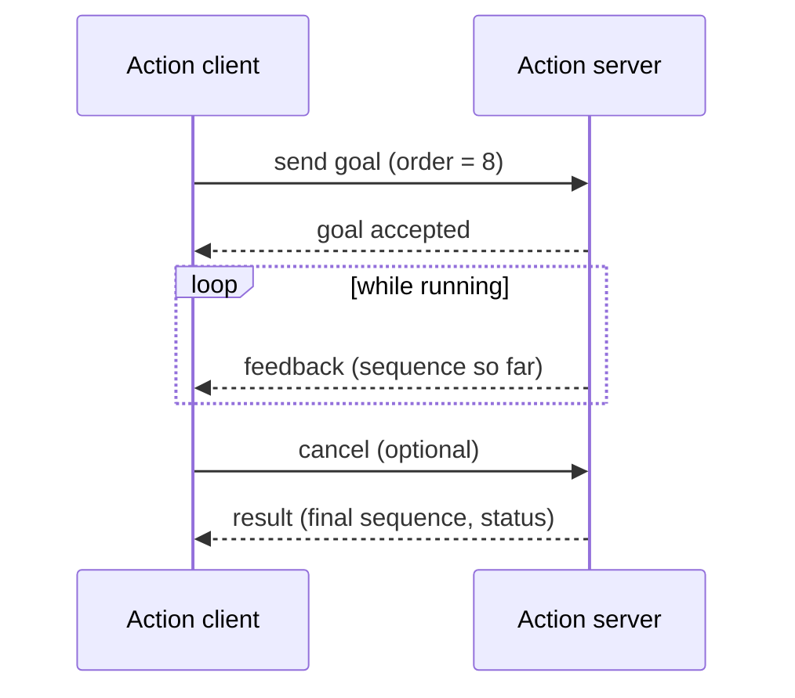

<LessonMeta level="Intermediate" time="45 min" prereqs={["Nodes, topics and services with rclpy", "Python classes and callbacks"]} />

Telling a robot "go to the kitchen" is not a quick question. It may take a minute, you want progress updates along the way, and you need a way to say "stop, forget it" mid-journey. A service cannot do that. Meanwhile, hard-coding a speed limit inside a node means editing code for every robot, and starting ten nodes by hand in ten terminals gets old fast. This lesson fixes all three problems with **actions**, **parameters** and **launch files**.

We extend the `proprio_basics` package from the previous lesson, so keep your workspace handy.

<Objectives>

- Explain when to choose an action over a service or topic, and read the goal, feedback and result of an action.
- Write an action server and client in `rclpy` that supports feedback and cancellation.
- Declare, read, validate and change parameters at run time, and load them from a YAML file.
- Write a Python launch file with arguments, remapping, namespaces and parameter files.

</Objectives>

## Actions: long jobs with feedback

An <Term def="a ROS 2 communication type for long-running tasks: the client sends a goal, receives periodic feedback, can cancel, and eventually receives a result">action</Term> has three message parts, all defined in one `.action` file:

- **Goal**: what you want ("compute the first 10 Fibonacci numbers", "drive to x=3, y=2").
- **Feedback**: periodic progress while the job runs ("sequence so far: 0, 1, 1, 2").
- **Result**: the final outcome.

Underneath, an action is just a bundle of services (send goal, cancel, get result) and a feedback topic, so it needs no new machinery. Use this rule of thumb:

| You want to… | Use |
|---|---|
| Stream data continuously | Topic |
| Ask a quick question and get an answer | Service |
| Run something that takes seconds or minutes, with progress and the ability to cancel | Action |



A goal moves through states: accepted, executing, then succeeded, aborted or canceled. We use the `Fibonacci` action from `example_interfaces`: goal `int32 order`, feedback and result both `int32[] sequence`.

### The server

```python title="proprio_basics/fibonacci_server.py"
import time

import rclpy
from example_interfaces.action import Fibonacci
from rclpy.action import ActionServer, CancelResponse, GoalResponse
from rclpy.callback_groups import ReentrantCallbackGroup
from rclpy.executors import ExternalShutdownException, MultiThreadedExecutor
from rclpy.node import Node


class FibonacciServer(Node):
    def __init__(self):
        super().__init__("fibonacci_server")
        self.action_server = ActionServer(
            self,
            Fibonacci,
            "fibonacci",
            execute_callback=self.execute,
            goal_callback=self.on_goal,
            cancel_callback=self.on_cancel,
            callback_group=ReentrantCallbackGroup(),
        )

    def on_goal(self, goal_request):
        """Accept or reject a goal before any work starts."""
        if not 1 <= goal_request.order <= 50:
            self.get_logger().warn(f"rejecting order {goal_request.order}")
            return GoalResponse.REJECT
        return GoalResponse.ACCEPT

    def on_cancel(self, goal_handle):
        self.get_logger().info("cancel requested")
        return CancelResponse.ACCEPT

    def execute(self, goal_handle):
        order = goal_handle.request.order
        self.get_logger().info(f"executing goal: order={order}")

        feedback = Fibonacci.Feedback()
        feedback.sequence = [0, 1]

        for i in range(1, order):
            if goal_handle.is_cancel_requested:
                goal_handle.canceled()
                result = Fibonacci.Result()
                result.sequence = feedback.sequence
                self.get_logger().info("goal canceled")
                return result

            feedback.sequence.append(feedback.sequence[i] + feedback.sequence[i - 1])
            goal_handle.publish_feedback(feedback)
            time.sleep(0.5)  # stand-in for slow work

        goal_handle.succeed()
        result = Fibonacci.Result()
        result.sequence = feedback.sequence
        return result


def main(args=None):
    rclpy.init(args=args)
    node = FibonacciServer()
    executor = MultiThreadedExecutor()
    executor.add_node(node)
    try:
        executor.spin()
    except (KeyboardInterrupt, ExternalShutdownException):
        pass
    finally:
        node.destroy_node()
        rclpy.try_shutdown()


if __name__ == "__main__":
    main()
```

Three details matter. The **goal callback** decides acceptance *before* work starts, so bad requests fail fast. The **loop checks `is_cancel_requested`** regularly; cancellation is a polite request, and your code must honour it. And the server uses a **multi-threaded executor with a reentrant group** so that a cancel request can be handled while the long `execute` callback is still running, which is the same executor lesson from the first lesson of this module.

### The client

```python title="proprio_basics/fibonacci_client.py"
import sys

import rclpy
from example_interfaces.action import Fibonacci
from rclpy.action import ActionClient
from rclpy.node import Node


class FibonacciClient(Node):
    def __init__(self):
        super().__init__("fibonacci_client")
        self.action_client = ActionClient(self, Fibonacci, "fibonacci")

    def send_goal(self, order):
        self.action_client.wait_for_server()
        goal = Fibonacci.Goal()
        goal.order = order
        future = self.action_client.send_goal_async(goal, feedback_callback=self.on_feedback)
        future.add_done_callback(self.on_goal_response)

    def on_goal_response(self, future):
        goal_handle = future.result()
        if not goal_handle.accepted:
            self.get_logger().error("goal rejected")
            rclpy.shutdown()
            return
        self.get_logger().info("goal accepted")
        goal_handle.get_result_async().add_done_callback(self.on_result)

    def on_feedback(self, feedback_msg):
        self.get_logger().info(f"feedback: {list(feedback_msg.feedback.sequence)}")

    def on_result(self, future):
        result = future.result().result
        self.get_logger().info(f"result: {list(result.sequence)}")
        rclpy.shutdown()


def main(args=None):
    rclpy.init(args=args)
    node = FibonacciClient()
    node.send_goal(int(sys.argv[1]) if len(sys.argv) > 1 else 8)
    try:
        rclpy.spin(node)
    except KeyboardInterrupt:
        pass
    finally:
        node.destroy_node()
        rclpy.try_shutdown()


if __name__ == "__main__":
    main()
```

Everything here is asynchronous: `send_goal_async` returns a future, whose done-callback fires when the server answers, which in turn asks for the result future. No call blocks.

## Parameters: settings without code edits

A <Term def="a named, typed value owned by a node that can be set at startup, from a file, or changed while the node is running">parameter</Term> lets you change a node's behaviour without editing its code: a speed limit, a topic name, a PID gain, a camera exposure. Declare each parameter with a default and type, read it, and optionally react to changes.

```python title="proprio_basics/speed_limiter.py"
import rclpy
from geometry_msgs.msg import Twist
from rcl_interfaces.msg import FloatingPointRange, ParameterDescriptor, SetParametersResult
from rclpy.executors import ExternalShutdownException
from rclpy.node import Node
from rclpy.parameter import Parameter


class SpeedLimiter(Node):
    """Clamps forward speed. Subscribes to cmd_vel_in, republishes on cmd_vel."""

    def __init__(self):
        super().__init__("speed_limiter")

        descriptor = ParameterDescriptor(
            description="Maximum forward speed in m/s",
            floating_point_range=[FloatingPointRange(from_value=0.0, to_value=2.0, step=0.0)],
        )
        self.declare_parameter("max_speed", 0.5, descriptor)
        self.declare_parameter("robot_name", "proprio_bot")

        self.max_speed = self.get_parameter("max_speed").value
        name = self.get_parameter("robot_name").value
        self.get_logger().info(f"{name}: limiting speed to {self.max_speed} m/s")

        # Called before a change is applied; lets us accept or reject it.
        self.add_on_set_parameters_callback(self.on_parameters)

        self.pub = self.create_publisher(Twist, "cmd_vel", 10)
        self.sub = self.create_subscription(Twist, "cmd_vel_in", self.on_cmd, 10)

    def on_parameters(self, params):
        for p in params:
            if p.name == "max_speed":
                if p.type_ != Parameter.Type.DOUBLE:
                    return SetParametersResult(successful=False, reason="max_speed must be a float")
                self.max_speed = p.value
                self.get_logger().info(f"max_speed is now {self.max_speed}")
        return SetParametersResult(successful=True)

    def on_cmd(self, msg):
        out = Twist()
        out.linear.x = max(-self.max_speed, min(self.max_speed, msg.linear.x))
        out.angular.z = msg.angular.z
        self.pub.publish(out)


def main(args=None):
    rclpy.init(args=args)
    node = SpeedLimiter()
    try:
        rclpy.spin(node)
    except (KeyboardInterrupt, ExternalShutdownException):
        pass
    finally:
        node.destroy_node()
        rclpy.try_shutdown()


if __name__ == "__main__":
    main()
```

The range in the descriptor means ROS itself rejects a `max_speed` of 5.0. The callback adds your own rules. Parameters are inspected and changed from the command line while the node runs:

```bash
ros2 param list
ros2 param get /speed_limiter max_speed
ros2 param set /speed_limiter max_speed 0.3
ros2 param dump /speed_limiter           # prints the node's parameters as YAML
```

Parameters can also come from a YAML file, where the top-level key is the node name:

```yaml title="config/limits.yaml"
speed_limiter:
  ros__parameters:
    max_speed: 0.8
    robot_name: "proprio_bot"
```

:::note
You must **declare** a parameter in the node before you can set it from outside. Declaration also gives it a type, and the value you pass in YAML or on the command line must match that type. `0.5` is a float; `1` would be an integer and the callback above would reject it for `max_speed`.
:::

## Launch files: starting a whole system

Opening a terminal per node does not scale. A <Term def="a Python (or XML/YAML) script that starts a set of nodes with their parameters, remappings and arguments in one command">launch file</Term> starts everything together, restarts nothing you did not ask for, and shuts it all down on Ctrl+C. Python launch files are the most flexible: they are ordinary code that returns a `LaunchDescription`.

This one builds a small pipeline: `circle_driver` makes raw commands, `speed_limiter` clamps them, and `turtlesim` obeys.

```python title="launch/demo.launch.py"
import os

from ament_index_python.packages import get_package_share_directory
from launch import LaunchDescription
from launch.actions import DeclareLaunchArgument, LogInfo
from launch.substitutions import LaunchConfiguration
from launch_ros.actions import Node
from launch_ros.parameter_descriptions import ParameterValue


def generate_launch_description():
    config = os.path.join(get_package_share_directory("proprio_basics"), "config", "limits.yaml")

    max_speed = LaunchConfiguration("max_speed")

    return LaunchDescription([
        DeclareLaunchArgument("max_speed", default_value="0.5",
                              description="Forward speed limit in m/s"),
        LogInfo(msg=["Launching with max_speed=", max_speed]),

        Node(package="turtlesim", executable="turtlesim_node", name="sim"),

        Node(
            package="proprio_basics",
            executable="circle_driver",
            name="circle_driver",
            remappings=[("turtle1/cmd_vel", "raw_cmd")],
        ),

        Node(
            package="proprio_basics",
            executable="speed_limiter",
            name="speed_limiter",
            parameters=[
                config,                                              # base values from the file
                {"max_speed": ParameterValue(max_speed, value_type=float)},  # launch argument wins
            ],
            remappings=[("cmd_vel_in", "raw_cmd"), ("cmd_vel", "turtle1/cmd_vel")],
        ),
    ])
```

Things to notice:

- **Arguments** (`DeclareLaunchArgument`, `LaunchConfiguration`) let you configure the launch from the command line: `ros2 launch proprio_basics demo.launch.py max_speed:=0.3`.
- **Remappings** rewire topics without changing node code. The driver's output and the limiter's input are connected through `raw_cmd`, and the limiter's output goes to the turtle.
- **Parameters** accept a file and a dictionary; later entries override earlier ones. `ParameterValue(..., value_type=float)` makes sure the string coming from the launch argument becomes a real float.
- **Namespaces** (not used here) are one more argument, `namespace="robot1"`, that prefixes every name so you can run several robots side by side.

To install the launch and config files and the new executables, update the data files and entry points in `setup.py`:

```python title="setup.py (the parts that change)"
import os
from glob import glob
from setuptools import find_packages, setup

package_name = "proprio_basics"

setup(
    # ...name, version, packages as before...
    data_files=[
        ("share/ament_index/resource_index/packages", ["resource/" + package_name]),
        ("share/" + package_name, ["package.xml"]),
        (os.path.join("share", package_name, "launch"), glob("launch/*.launch.py")),
        (os.path.join("share", package_name, "config"), glob("config/*.yaml")),
    ],
    entry_points={
        "console_scripts": [
            # ...the five from the last lesson, plus:
            "fibonacci_server = proprio_basics.fibonacci_server:main",
            "fibonacci_client = proprio_basics.fibonacci_client:main",
            "speed_limiter = proprio_basics.speed_limiter:main",
        ],
    },
)
```

Also add `<exec_depend>launch</exec_depend>`, `<exec_depend>launch_ros</exec_depend>`, `<exec_depend>turtlesim</exec_depend>` and `<depend>rcl_interfaces</depend>` to `package.xml`. Without the `data_files` lines the launch file is never installed and `ros2 launch` reports that it cannot find it.

<KeyIdea title="Configuration belongs outside the code">
Hard-code nothing you might change between robots, worlds or days: speeds, gains, topic names, frame names. Put them in parameters, give them defaults, load overrides from YAML, and expose the important ones as launch arguments. The same code then runs a toy robot and a real one.
</KeyIdea>

## Hands-on lab

<Steps>

1. Add the new files (`fibonacci_server.py`, `fibonacci_client.py`, `speed_limiter.py`, `launch/demo.launch.py`, `config/limits.yaml`), update `setup.py` and `package.xml`, and rebuild: `colcon build --packages-select proprio_basics --symlink-install` then `source install/setup.bash`.
2. Run `ros2 run proprio_basics fibonacci_server` in one terminal. In another run `ros2 run proprio_basics fibonacci_client 10` and watch the feedback arrive twice a second.
3. Try the CLI: `ros2 action list`, `ros2 action info /fibonacci`, and `ros2 action send_goal /fibonacci example_interfaces/action/Fibonacci "{order: 20}" --feedback`. Press Ctrl+C partway through to see the cancel.
4. Run `ros2 launch proprio_basics demo.launch.py` and watch the turtle trace a tight circle. In another terminal run `ros2 param set /speed_limiter max_speed 1.5` and watch the circle grow.
5. Try the bad values: `ros2 param set /speed_limiter max_speed 5.0` and `ros2 param set /speed_limiter max_speed 1`. Read the error messages. Launch again with `max_speed:=0.2`.

</Steps>

You know it worked when you can cancel an action mid-run, change a parameter live and see its effect, and start the whole demo with one command.

## Exercises

<Exercise title="Reject bad goals" level="Beginner">
The action server accepts orders 1 to 50. How would you also reject a new goal while another one is running?

<Solution>
Keep a flag or the current goal handle on the node. In `on_goal`, return `GoalResponse.REJECT` if a goal is active, and clear the flag when `execute` finishes (use `try/finally` so it clears even after cancellation). Alternatively, use `GoalResponse.ACCEPT` and cancel the old goal first, if the newest request should win.
</Solution>
</Exercise>

<Exercise title="A parameter for the loop delay" level="Intermediate">
Make the 0.5 s delay in the Fibonacci server a parameter named `step_delay` with a default of 0.5. What do you need to change?

<Solution>
In `__init__` add `self.declare_parameter("step_delay", 0.5)`. In `execute`, read it each time with `self.get_parameter("step_delay").value` and use it in `time.sleep(...)`, so changes with `ros2 param set` apply to the next step. Declaring it with a float default makes ROS expect a float, so set it with a decimal such as `0.2` rather than `1`.
</Solution>
</Exercise>

<Exercise title="Two robots, one launch file" level="Advanced">
Change the launch file to start two limiters for two turtles, in namespaces `robot1` and `robot2`, each with its own speed. Describe your approach.

<Solution>
Wrap each group of nodes in a `GroupAction` containing `PushRosNamespace("robot1")` (from `launch_ros.actions`), or give each `Node` a `namespace="robot1"` argument. Define the arguments `speed1` and `speed2` with `DeclareLaunchArgument`, and pass each to the matching limiter. Because names resolve relative to the namespace, `cmd_vel` becomes `/robot1/cmd_vel`. Use a second turtle (spawned with the `/spawn` service) or a second simulation instance for the second robot, and double check the remappings point inside the right namespace.
</Solution>
</Exercise>

## Check your understanding

<Quiz questions={[
  {q: "Which communication type best fits \"navigate to the kitchen\" with progress updates and a cancel button?", options: ["Topic", "Service", "Action", "Parameter"], answer: 2, explain: "Actions are designed for long-running goals with feedback and cancellation. A service returns a single response, and a topic has no notion of a goal."},
  {q: "Why does the Fibonacci server use a MultiThreadedExecutor and a ReentrantCallbackGroup?", options: ["To make Fibonacci numbers faster", "So cancel requests can be handled while execute is still running", "Because actions do not work otherwise", "To avoid declaring parameters"], answer: 1, explain: "A long execute callback would otherwise occupy the only thread, and the cancel request could not be processed until it finished."},
  {q: "You launch with max_speed:=0.3 but the node still uses the YAML value of 0.8. What is the most likely cause?", options: ["Launch arguments cannot set parameters", "The argument was not passed in the node’s parameters list after the YAML file", "The node name is too long", "YAML always wins"], answer: 1, explain: "Later entries in the parameters list override earlier ones. The launch argument must be passed to the Node, and placed after the file, to take effect."},
  {q: "What must you do before you can set a parameter on a node from the command line?", options: ["Restart ROS", "Declare it in the node", "Rebuild the whole workspace", "Create a service"], answer: 1, explain: "In ROS 2 parameters must be declared. Declaration gives each one a name, a type and a default."}
]} />

<Takeaways>

- Use actions for long-running jobs: a goal, periodic feedback, a result, and optional cancellation.
- Action servers accept or reject goals up front, check for cancel requests in their loop, and report success, abort or cancel.
- Parameters make nodes configurable; declare them with types and defaults, validate changes with a callback, and load them from YAML.
- Launch files start whole systems; use arguments, remappings, namespaces and parameter files instead of editing code.
- Put every launch and config file in `data_files` in `setup.py`, or it will not be installed.
- Keep configuration out of code so the same nodes work on different robots.

</Takeaways>

Stuck? Ask **Rivet**, the course assistant, bottom-right.

## Go deeper

- [Writing an action server and client in Python (Jazzy)](https://docs.ros.org/en/jazzy/Tutorials/Intermediate/Writing-an-Action-Server-Client/Py.html): the official tutorial with the same structure.
- [Understanding ROS 2 parameters (Jazzy)](https://docs.ros.org/en/jazzy/Tutorials/Beginner-CLI-Tools/Understanding-ROS2-Parameters/Understanding-ROS2-Parameters.html): the CLI side of parameters.
- [Creating launch files (Jazzy)](https://docs.ros.org/en/jazzy/Tutorials/Intermediate/Launch/Creating-Launch-Files.html): launch-file features in depth.

Next: [TF2 and URDF](./04-tf2-and-urdf.mdx)
