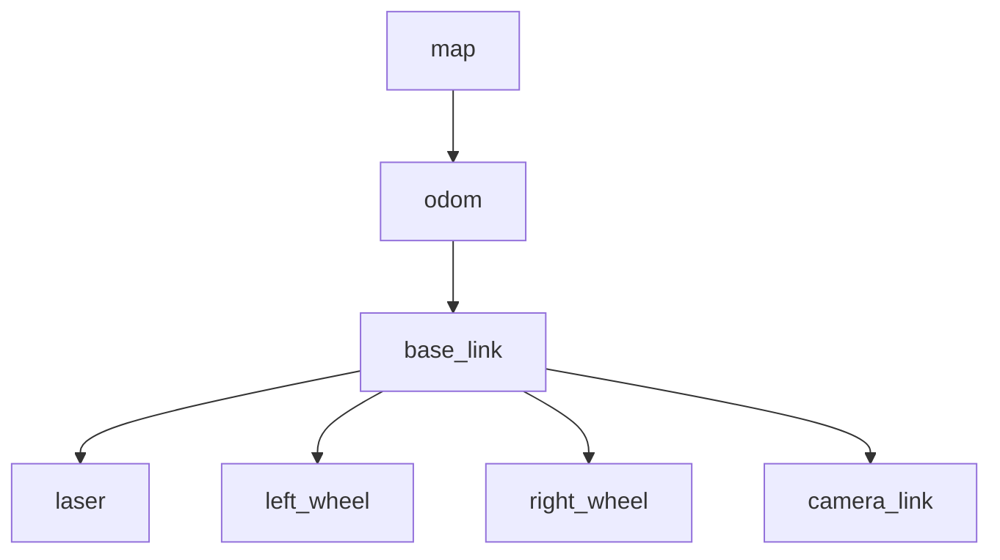

<LessonMeta level="Intermediate" time="45 min" prereqs={["Frames and rigid transforms", "Nodes, topics and services with rclpy", "Actions, parameters and launch files"]} />

A lidar on your robot reports an obstacle 2 m ahead of the lidar. The planner needs to know where that obstacle is on the map. In between sit a lidar mount, the robot body, the wheels' odometry estimate, and the map. Each step is a rigid transform from the frames lesson. Doing it by hand for every sensor and every message would be a nightmare. TF2 is the ROS 2 library that remembers all those transforms for you, and URDF is the file that tells ROS what your robot looks like.

<Objectives>

- Describe the TF tree and the standard frames `map`, `odom` and `base_link`.
- Publish a dynamic transform and a static transform, and look transforms up with a TF2 listener in Python.
- Write a URDF/xacro description of a two-wheeled robot with links, joints, a lidar and a caster.
- Launch `robot_state_publisher`, view the robot in RViz, and inspect the frame tree.

</Objectives>

## TF2: the frame bookkeeper

<Term def="the ROS 2 library that tracks the poses of many coordinate frames over time, and answers questions like where is frame A relative to frame B at time t">TF2</Term> keeps a **tree** of coordinate frames. Each frame has exactly one parent, and a transform that says where it sits relative to that parent. Ask for the transform between any two frames, and TF2 walks up and down the tree, multiplying the transforms along the way, just like the chain multiplication in the frames lesson.



Three standard frames, from REP 105, appear in nearly every mobile robot:

- **`map`**: a fixed, world-anchored frame. It does not drift, but its pose estimate can jump when the robot re-localises.
- **`odom`**: a frame that moves smoothly (it is built by integrating wheel and IMU data), but drifts slowly away from the truth.
- **`base_link`**: rigidly attached to the robot body, usually at its centre.

Why both `map` and `odom`? Smooth but drifting data is best for control; jump-corrected but discontinuous data is best for planning against a map. The localisation system publishes `map → odom`, odometry publishes `odom → base_link`, and everything is consistent.

Two topics carry the transforms: `/tf` for moving ones, at a steady rate, and `/tf_static` for fixed ones (a lidar bolted on a chassis), published once and kept. A transform has a **timestamp**. TF2 stores a short history, so it can answer "where was the arm 100 ms ago, when the camera frame was taken?"

<KeyIdea title="One parent, no loops">
The TF tree must be a tree: every frame has one parent and there are no cycles. If two nodes publish different parents for the same child frame, TF2 jumps between them and everything wobbles. When something looks "jittery" in RViz, check who publishes what with `ros2 run tf2_tools view_frames`.
</KeyIdea>

### Broadcasting a transform

This node simulates a robot driving round a circle of radius 1 m and broadcasts `odom → base_link`. A quaternion for a pure yaw rotation $\psi$ is $(0, 0, \sin\tfrac{\psi}{2}, \cos\tfrac{\psi}{2})$.

```python title="kinemata_basics/odom_broadcaster.py"
import math

import rclpy
from geometry_msgs.msg import TransformStamped
from rclpy.executors import ExternalShutdownException
from rclpy.node import Node
from tf2_ros import TransformBroadcaster


class OdomBroadcaster(Node):
    def __init__(self):
        super().__init__("odom_broadcaster")
        self.br = TransformBroadcaster(self)
        self.start = self.get_clock().now()
        self.timer = self.create_timer(0.05, self.tick)  # 20 Hz

    def tick(self):
        now = self.get_clock().now()
        t = (now - self.start).nanoseconds * 1e-9
        radius, omega = 1.0, 0.5            # m, rad/s
        angle = omega * t
        heading = angle + math.pi / 2       # tangent to the circle

        tf = TransformStamped()
        tf.header.stamp = now.to_msg()
        tf.header.frame_id = "odom"         # parent
        tf.child_frame_id = "base_link"     # child
        tf.transform.translation.x = radius * math.cos(angle)
        tf.transform.translation.y = radius * math.sin(angle)
        tf.transform.translation.z = 0.0
        tf.transform.rotation.x = 0.0
        tf.transform.rotation.y = 0.0
        tf.transform.rotation.z = math.sin(heading / 2)
        tf.transform.rotation.w = math.cos(heading / 2)
        self.br.sendTransform(tf)


def main(args=None):
    rclpy.init(args=args)
    node = OdomBroadcaster()
    try:
        rclpy.spin(node)
    except (KeyboardInterrupt, ExternalShutdownException):
        pass
    finally:
        node.destroy_node()
        rclpy.try_shutdown()


if __name__ == "__main__":
    main()
```

For a transform that never changes, use the command-line static publisher. It places a laser 0.15 m ahead of and 0.10 m above `base_link`:

```bash
ros2 run tf2_ros static_transform_publisher --x 0.15 --y 0 --z 0.10 --yaw 0 --pitch 0 --roll 0 --frame-id base_link --child-frame-id laser
```

### Looking a transform up

The listener owns a `Buffer` that collects every transform it hears, and a `TransformListener` that feeds the buffer. `lookup_transform(target, source, time)` returns the pose of `source` expressed in `target`. Using `Time()` (zero) means "the latest available".

```python title="kinemata_basics/laser_pose_reporter.py"
import rclpy
from rclpy.executors import ExternalShutdownException
from rclpy.node import Node
from rclpy.time import Time
from tf2_ros import TransformException
from tf2_ros.buffer import Buffer
from tf2_ros.transform_listener import TransformListener


class LaserPoseReporter(Node):
    def __init__(self):
        super().__init__("laser_pose_reporter")
        self.tf_buffer = Buffer()
        self.tf_listener = TransformListener(self.tf_buffer, self)
        self.timer = self.create_timer(1.0, self.tick)

    def tick(self):
        try:
            t = self.tf_buffer.lookup_transform("odom", "laser", Time())
        except TransformException as ex:
            self.get_logger().info(f"waiting for transform: {ex}")
            return
        p = t.transform.translation
        self.get_logger().info(f"laser in odom: x={p.x:.2f} y={p.y:.2f} z={p.z:.2f}")


def main(args=None):
    rclpy.init(args=args)
    node = LaserPoseReporter()
    try:
        rclpy.spin(node)
    except (KeyboardInterrupt, ExternalShutdownException):
        pass
    finally:
        node.destroy_node()
        rclpy.try_shutdown()


if __name__ == "__main__":
    main()
```

Register both nodes in the `console_scripts` list of `kinemata_basics/setup.py` (`odom_broadcaster` and `laser_pose_reporter`), add `<depend>tf2_ros</depend>` to its `package.xml`, rebuild, and run the broadcaster, the static publisher and the reporter. You should see the laser position circling in `odom`. It is the frame-chain maths from the previous module, done by a library.

## URDF: describing the robot

The <Term def="Unified Robot Description Format: an XML format that describes a robot as links (rigid bodies) connected by joints">URDF</Term> describes a robot's body as a tree of **links** (rigid parts) connected by **joints**. Each link can hold:

- `visual`: what it looks like, for RViz and Gazebo.
- `collision`: a simpler shape used for collision checks.
- `inertial`: mass and inertia, which physics simulators need (recall the dynamics lesson).

Each joint names a parent, a child, an `origin` (the child frame's pose in the parent frame, as `xyz` and `rpy` in metres and radians) and a type: `fixed`, `revolute` (limited angle), `continuous` (unlimited rotation, like a wheel), `prismatic` (sliding) and a few others.

Plain URDF has no loops or variables, which gets repetitive fast. **xacro** is an XML macro language that adds properties, maths and macros, and expands to plain URDF. Here is a two-wheeled robot. Notice how a single `wheel` macro builds both wheels.

```xml title="urdf/kinemata_bot.urdf.xacro"
<?xml version="1.0"?>
<robot xmlns:xacro="http://www.ros.org/wiki/xacro" name="kinemata_bot">

  <!-- Dimensions in metres -->
  <xacro:property name="base_length" value="0.30"/>
  <xacro:property name="base_width"  value="0.20"/>
  <xacro:property name="base_height" value="0.08"/>
  <xacro:property name="wheel_radius" value="0.05"/>
  <xacro:property name="wheel_width"  value="0.03"/>
  <xacro:property name="caster_radius" value="0.02"/>

  <material name="body"><color rgba="0.20 0.35 0.85 1.0"/></material>
  <material name="tyre"><color rgba="0.10 0.10 0.10 1.0"/></material>
  <material name="sensor"><color rgba="0.90 0.30 0.20 1.0"/></material>

  <!-- Inertia helpers: m = mass, others = size -->
  <xacro:macro name="box_inertia" params="m x y z">
    <inertia ixx="${m*(y*y+z*z)/12}" ixy="0" ixz="0"
             iyy="${m*(x*x+z*z)/12}" iyz="0" izz="${m*(x*x+y*y)/12}"/>
  </xacro:macro>
  <xacro:macro name="cylinder_inertia" params="m r h">
    <inertia ixx="${m*(3*r*r+h*h)/12}" ixy="0" ixz="0"
             iyy="${m*(3*r*r+h*h)/12}" iyz="0" izz="${m*r*r/2}"/>
  </xacro:macro>

  <!-- A frame on the ground under the robot (used by navigation) -->
  <link name="base_footprint"/>

  <link name="base_link">
    <visual>
      <geometry><box size="${base_length} ${base_width} ${base_height}"/></geometry>
      <material name="body"/>
    </visual>
    <collision>
      <geometry><box size="${base_length} ${base_width} ${base_height}"/></geometry>
    </collision>
    <inertial>
      <mass value="2.0"/>
      <xacro:box_inertia m="2.0" x="${base_length}" y="${base_width}" z="${base_height}"/>
    </inertial>
  </link>

  <joint name="base_footprint_joint" type="fixed">
    <parent link="base_footprint"/>
    <child link="base_link"/>
    <origin xyz="0 0 ${wheel_radius}" rpy="0 0 0"/>
  </joint>

  <!-- One wheel macro for both sides. side_y is the wheel's y position. -->
  <xacro:macro name="wheel" params="name side_y">
    <link name="${name}">
      <visual>
        <geometry><cylinder radius="${wheel_radius}" length="${wheel_width}"/></geometry>
        <material name="tyre"/>
      </visual>
      <collision>
        <geometry><cylinder radius="${wheel_radius}" length="${wheel_width}"/></geometry>
      </collision>
      <inertial>
        <mass value="0.2"/>
        <xacro:cylinder_inertia m="0.2" r="${wheel_radius}" h="${wheel_width}"/>
      </inertial>
    </link>
    <!-- The wheel link's z axis is rotated to point along the robot's +y axis,
         so a positive rotation about it rolls the robot forward. -->
    <joint name="${name}_joint" type="continuous">
      <parent link="base_link"/>
      <child link="${name}"/>
      <origin xyz="0 ${side_y} 0" rpy="${-pi/2} 0 0"/>
      <axis xyz="0 0 1"/>
    </joint>
  </xacro:macro>

  <xacro:wheel name="left_wheel"  side_y="${ base_width/2 + wheel_width/2}"/>
  <xacro:wheel name="right_wheel" side_y="${-(base_width/2 + wheel_width/2)}"/>

  <!-- Rear caster ball: a fixed, frictionless-looking third contact point -->
  <link name="caster">
    <visual>
      <geometry><sphere radius="${caster_radius}"/></geometry>
      <material name="tyre"/>
    </visual>
    <collision>
      <geometry><sphere radius="${caster_radius}"/></geometry>
    </collision>
    <inertial>
      <mass value="0.05"/>
      <inertia ixx="1e-5" ixy="0" ixz="0" iyy="1e-5" iyz="0" izz="1e-5"/>
    </inertial>
  </link>
  <joint name="caster_joint" type="fixed">
    <parent link="base_link"/>
    <child link="caster"/>
    <origin xyz="${-base_length/2 + 0.03} 0 ${-(wheel_radius - caster_radius)}" rpy="0 0 0"/>
  </joint>

  <!-- A lidar on top, at the front -->
  <link name="laser">
    <visual>
      <geometry><cylinder radius="0.03" length="0.04"/></geometry>
      <material name="sensor"/>
    </visual>
  </link>
  <joint name="laser_joint" type="fixed">
    <parent link="base_link"/>
    <child link="laser"/>
    <origin xyz="0.08 0 ${base_height/2 + 0.02}" rpy="0 0 0"/>
  </joint>

</robot>
```

Four design points worth noticing. The wheels are `continuous` joints, so they can spin without limit. The `caster` holds the third point of contact so the robot does not tip. The `base_footprint` sits on the floor, with `base_link` raised by one wheel radius, so wheel bottoms touch the ground. And the macro means a wheel change happens in one place.

:::tip[Pro tip]
Check a URDF before you launch anything. Run `xacro urdf/kinemata_bot.urdf.xacro > /tmp/kinemata_bot.urdf`, then `check_urdf /tmp/kinemata_bot.urdf` (install it with `sudo apt install liburdfdom-tools`). It prints the link tree and complains about missing parents or duplicate names.
:::

## `robot_state_publisher` and RViz

`robot_state_publisher` reads the URDF from a parameter called `robot_description`. It listens to the `/joint_states` topic for the angles of the joints that move, and publishes the matching transforms: fixed ones on `/tf_static` and moving ones on `/tf`. So the whole chain `base_footprint → base_link → left_wheel, right_wheel, laser` appears in the TF tree without a line of broadcasting code. For testing, `joint_state_publisher_gui` gives you sliders that publish `/joint_states`.

```python title="launch/display.launch.py"
import os

from ament_index_python.packages import get_package_share_directory
from launch import LaunchDescription
from launch.actions import DeclareLaunchArgument
from launch.conditions import IfCondition
from launch.substitutions import Command, LaunchConfiguration
from launch_ros.actions import Node
from launch_ros.parameter_descriptions import ParameterValue


def generate_launch_description():
    pkg = get_package_share_directory("kinemata_description")
    xacro_file = os.path.join(pkg, "urdf", "kinemata_bot.urdf.xacro")
    robot_description = ParameterValue(Command(["xacro ", xacro_file]), value_type=str)

    return LaunchDescription([
        DeclareLaunchArgument("gui", default_value="true",
                              description="Show joint sliders"),
        Node(
            package="robot_state_publisher",
            executable="robot_state_publisher",
            parameters=[{"robot_description": robot_description}],
        ),
        Node(
            package="joint_state_publisher_gui",
            executable="joint_state_publisher_gui",
            condition=IfCondition(LaunchConfiguration("gui")),
        ),
        Node(package="rviz2", executable="rviz2", name="rviz2"),
    ])
```

This lives in its own package, `kinemata_description`. Create it with `ros2 pkg create --build-type ament_python kinemata_description`, add folders `urdf/` and `launch/`, and use these two files.

```python title="kinemata_description/setup.py"
import os
from glob import glob

from setuptools import find_packages, setup

package_name = "kinemata_description"

setup(
    name=package_name,
    version="0.1.0",
    packages=find_packages(exclude=["test"]),
    data_files=[
        ("share/ament_index/resource_index/packages", ["resource/" + package_name]),
        ("share/" + package_name, ["package.xml"]),
        (os.path.join("share", package_name, "urdf"), glob("urdf/*.xacro")),
        (os.path.join("share", package_name, "launch"), glob("launch/*.launch.py")),
    ],
    install_requires=["setuptools"],
    zip_safe=True,
    maintainer="Your Name",
    maintainer_email="you@example.com",
    description="URDF and launch files for the Kinemata two-wheeled robot.",
    license="Apache-2.0",
    tests_require=["pytest"],
)
```

In its `package.xml`, add these dependencies next to the generated `ament_python` export: `<exec_depend>robot_state_publisher</exec_depend>`, `<exec_depend>joint_state_publisher_gui</exec_depend>`, `<exec_depend>rviz2</exec_depend>`, `<exec_depend>xacro</exec_depend>`, `<exec_depend>launch</exec_depend>`, `<exec_depend>launch_ros</exec_depend>`. Then build and launch:

```bash
cd ~/ros2_ws
colcon build --packages-select kinemata_description --symlink-install
source install/setup.bash
ros2 launch kinemata_description display.launch.py
```

In RViz, set **Fixed Frame** to `base_footprint`, click **Add**, and add `RobotModel` (set its Description Topic to `/robot_description`) and `TF`. You should see the blue body, the dark wheels, the caster and the red lidar. Move the sliders in the joint state GUI and the wheels spin.

## Hands-on lab

<Steps>

1. Add `odom_broadcaster.py` and `laser_pose_reporter.py` to `kinemata_basics`, register their entry points, and rebuild. Run the broadcaster, the static publisher command above, and the reporter. Read the circling coordinates.
2. In a fourth terminal run `ros2 run tf2_ros tf2_echo odom laser` and `ros2 run tf2_tools view_frames`. Open the generated `frames_*.pdf` and confirm the tree `odom → base_link → laser`.
3. Create the `kinemata_description` package with the xacro and launch file, run `check_urdf` on the expanded file, then launch the display.
4. In RViz, enable the TF display. Compare its frames to what `view_frames` shows for the robot tree.
5. Extend the xacro with a `camera_link` fixed to `base_link` at the front, 0.15 m forward and 0.05 m up. Rebuild and confirm the new frame appears.

</Steps>

You know it worked when the robot model appears in RViz, wheel sliders rotate the wheels, and `tf2_echo` prints a sensible laser pose.

## Exercises

<Exercise title="Where is the laser?" level="Intermediate">
At some moment `odom → base_link` is at $(2, 1, 0)$ with a yaw of 90°. The laser sits at $(0.15, 0, 0.10)$ in `base_link`. Where is the laser in `odom`?

<Solution>
Rotate the offset by 90° about $z$: $(0.15, 0, 0.10) \to (0, 0.15, 0.10)$. Add the base position: $(2, 1.15, 0.10)$. TF2 does exactly this by multiplying `odom → base_link` with `base_link → laser`.
</Solution>
</Exercise>

<Exercise title="Two parents" level="Intermediate">
Two nodes both publish a transform with child `base_link`, but one uses parent `odom` and the other uses parent `map`. What happens, and how do you find the culprit?

<Solution>
A frame can have only one parent. TF2 will warn and the transform will flicker between the two sources, so the robot appears to jump in RViz. Find the publishers with `ros2 topic info /tf --verbose` and with `ros2 run tf2_tools view_frames`, which lists each transform's broadcaster. Fix it by making only the odometry node publish `odom → base_link`, and the localisation node publish `map → odom`.
</Solution>
</Exercise>

<Exercise title="Wheel direction" level="Advanced">
In the xacro, the wheel joint has `rpy="${-pi/2} 0 0"` and `axis="0 0 1"`. Explain why a positive rotation of the wheel joint rolls the robot forward, and what would change if you used `rpy="${pi/2} 0 0"`.

<Solution>
Rotating the wheel frame by −90° about $x$ turns its $z$ axis into the robot’s $+y$ axis. By the right-hand rule, a positive rotation about $+y$ carries the top of the wheel toward $+x$ and the bottom toward $-x$. The bottom is pressed against the floor, so the axle, and the robot with it, moves toward $+x$: forward. With $+90°$ the wheel’s $z$ axis becomes $-y$, so the same positive joint value would roll the robot backward. Keeping both wheels on the same convention means equal positive joint speeds drive straight ahead.
</Solution>
</Exercise>

## Check your understanding

<Quiz questions={[
  {q: "What does the TF tree guarantee about every frame?", options: ["It has exactly one parent, and there are no cycles", "It has many parents", "It has no parent", "It has a mesh attached"], answer: 0, explain: "TF is a tree. A frame with two parents, or a loop, makes the transform lookup ambiguous."},
  {q: "Which standard frame is smooth over time but drifts, built from wheel odometry?", options: ["map", "odom", "base_link", "laser"], answer: 1, explain: "The odom frame is continuous (no jumps) but accumulates drift. The map frame is drift-free but can jump when localisation corrects itself."},
  {q: "What does robot_state_publisher need in order to publish the wheel transforms?", options: ["The URDF in robot_description, and joint angles on /joint_states", "A camera", "Gazebo", "A map"], answer: 0, explain: "It combines the URDF’s fixed geometry with live joint values to produce all transforms between the robot’s links."},
  {q: "What is xacro for?", options: ["Compiling URDF to binary", "Adding properties, maths and macros to URDF, which it expands to plain URDF", "Running physics", "Drawing meshes"], answer: 1, explain: "Xacro is a macro language that removes repetition from URDF files."}
]} />

<Takeaways>

- TF2 stores a tree of coordinate frames with timestamps and answers "where is A relative to B" by chaining transforms.
- Use the standard frames `map`, `odom`, `base_link`, and give each frame exactly one parent.
- Broadcast moving transforms on `/tf` and fixed ones on `/tf_static`; look them up with a `Buffer` and `TransformListener`.
- URDF describes links and joints; xacro adds properties, maths and macros so you do not repeat yourself.
- `robot_state_publisher` turns the URDF and joint states into the TF tree automatically.
- Always validate with `check_urdf`, and inspect the tree with `view_frames` and RViz.

</Takeaways>

Stuck? Ask **Rivet**, the course assistant, bottom-right.

## Go deeper

- [Writing a TF2 broadcaster and listener in Python (Jazzy)](https://docs.ros.org/en/jazzy/Tutorials/Intermediate/Tf2/Writing-A-Tf2-Broadcaster-Py.html): the official tutorials this lesson follows.
- [URDF tutorials (Jazzy)](https://docs.ros.org/en/jazzy/Tutorials/Intermediate/URDF/URDF-Main.html): building a visual robot model with URDF, xacro and RViz.
- [REP 105: coordinate frames for mobile platforms](https://www.ros.org/reps/rep-0105.html): the rules behind map, odom and base_link.

Next: [Packages, debugging and bags](./05-packages-debugging-and-bags.mdx)
