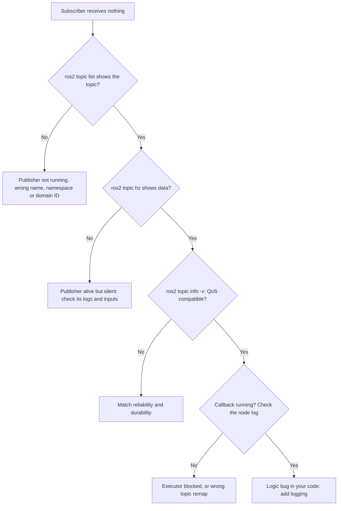

<LessonMeta level="Intermediate" time="40 min" prereqs={["Nodes, topics and services with rclpy", "TF2 and URDF"]} />

Your robot worked yesterday. Today the listener hears nothing, RViz shows nothing, and a teammate says "it works on my machine". The difference between a frustrating afternoon and a five-minute fix is whether you have a method: a clean workspace, a toolbox of inspection commands, and a way to capture what happened so you can replay it later. This lesson gives you all three.

<Objectives>

- Explain the colcon workspace layout, underlay and overlay, and build, test and clean packages with confidence.
- Use `ros2` command-line tools to inspect nodes, topics, services, actions and parameters.
- Diagnose the common failures systematically, using `rqt` tools and log levels.
- Record, inspect and replay a rosbag2 bag, and read messages from a bag in Python.

</Objectives>

## Workspaces and colcon

A <Term def="a folder that holds the source of one or more ROS 2 packages and the folders produced by building them">workspace</Term> is where you build your own packages. <Term def="colcon, the collective construction tool: builds many packages in the right order, in parallel">colcon</Term> does the building. A workspace looks like this after the first build:

```text
ros2_ws/
  src/        <- YOU edit this. One folder per package (or a git repo of packages).
  build/      <- temporary build files. Safe to delete.
  install/    <- the finished packages, plus setup scripts. Safe to delete.
  log/        <- build and test logs. Safe to delete.
```

Only `src/` is precious: commit it to git and ignore the other three (`build/`, `install/`, `log/` in `.gitignore`).

### Underlay and overlay

Sourcing `setup.bash` adds a set of packages to your environment. ROS itself is the **underlay**; your workspace, sourced afterwards, is the **overlay**. The overlay is layered on top, so your package of the same name wins over the system one. The order matters, and a very common mistake is forgetting the second line in a new terminal:

```bash
source /opt/ros/jazzy/setup.bash     # underlay: ROS itself
source ~/ros2_ws/install/setup.bash  # overlay: your workspace
```

Put both lines in `~/.bashrc` if you work in one workspace most of the time.

### Daily commands

```bash
cd ~/ros2_ws

# Install the system packages your code declares in package.xml
rosdep install --from-paths src --ignore-src -r -y

# Build everything, or just what you changed
colcon build --symlink-install
colcon build --symlink-install --packages-select kinemata_basics
colcon build --packages-up-to kinemata_description    # a package and its dependencies

# See compiler output live, not buried in the log
colcon build --event-handlers console_direct+

# Run the package tests and show the results
colcon test --packages-select kinemata_basics
colcon test-result --verbose

# Start fresh when things act strangely
rm -rf build install log
```

`rosdep` reads every `package.xml`, works out which system libraries are missing, and installs them. That is why accurate `<depend>` tags matter: they are how a teammate gets a working copy with a single command. For Python packages, `colcon test` runs `ament_flake8`, `ament_pep257` and `ament_copyright` (the test dependencies you saw in `package.xml`), plus any pytest files you add in `test/`. Style warnings can be noisy; fix them, or deliberately configure them, but do not ignore real failures.

:::note
If you create a C++ package, use `ros2 pkg create --build-type ament_cmake my_cpp_pkg`. It builds with CMake instead of `setup.py`, but the workspace, colcon and `ros2 run` commands are identical.
:::

### When the build fails

Most failures fall into a few buckets, and the error message usually says which:

| Symptom | Likely cause | Fix |
|---|---|---|
| `No executable found` from `ros2 run` | Entry point missing in `setup.py`, or workspace not sourced | Add the line, rebuild, `source install/setup.bash` |
| `Package 'x' not found` | Wrong terminal, or the overlay is not sourced | Source the overlay |
| `ModuleNotFoundError` | Missing `<depend>` or a Python package not installed | Add to `package.xml`, run `rosdep`, or `pip`/`apt` install |
| Launch file not found | Not listed in `data_files` | Add it, rebuild |
| Old code still runs | Stale `install/`, or a different package shadows yours | `ros2 pkg prefix <pkg>`; clean and rebuild |

## The CLI inspection toolbox

Every `ros2` verb answers a different question. Memorise these, because you will use them daily.

| Question | Command |
|---|---|
| What nodes are running? | `ros2 node list`, `ros2 node info /node_name` |
| What topics, and what types? | `ros2 topic list -t` |
| Is data flowing? How fast? | `ros2 topic echo /t`, `ros2 topic hz /t`, `ros2 topic bw /t`, `ros2 topic delay /t` |
| Who publishes and subscribes, with what QoS? | `ros2 topic info /t --verbose` |
| What is inside a message type? | `ros2 interface show geometry_msgs/msg/Twist` |
| Send a test message | `ros2 topic pub --once /t pkg/msg/Type "{field: value}"` |
| What services? Call one | `ros2 service list -t`, `ros2 service call /s pkg/srv/Type "{...}"` |
| What actions? Send a goal | `ros2 action list`, `ros2 action send_goal /a pkg/action/Type "{...}" --feedback` |
| Read or change settings | `ros2 param list`, `ros2 param get /n p`, `ros2 param set /n p v` |
| Which packages and executables exist? | `ros2 pkg list`, `ros2 pkg executables kinemata_basics` |
| Is my installation healthy? | `ros2 doctor --report` |

`ros2 topic echo` with the option `--once` is handy for a quick peek. For a big message such as an image, use `ros2 topic hz` instead of `echo`, or your terminal will flood.

<KeyIdea title="Diagnose by walking the data path">
When something does not work, follow the data from source to sink and check each hop: Is the publisher running? Is it publishing (`hz`)? Does the subscriber exist and use a compatible QoS (`info -v`)? Is the name right, with any remapping and namespace? Is the TF frame present? You find the broken link by testing hops one at a time, not by staring at code.
</KeyIdea>



## Logging and rqt

`self.get_logger().info(...)` is your best friend, and it has levels: `debug`, `info`, `warn`, `error`, `fatal`. Raise or lower the verbosity per node at launch:

```bash
ros2 run kinemata_basics listener --ros-args --log-level debug
ros2 run kinemata_basics listener --ros-args --log-level listener:=warn
```

`rqt` is a collection of graphical tools. Install them with `sudo apt install '~nros-jazzy-rqt*'` if they are missing, and start any one from the terminal:

- **`rqt_graph`** draws the node and topic graph, which is the quickest way to spot a missing or misrouted connection. Tick "Nodes/Topics (all)" to include topics without subscribers.
- **`rqt_console`** collects log messages from all nodes with filters by level and node.
- **`rqt_plot`** plots numeric message fields over time, such as `/odom/twist/twist/linear/x`.
- **`rqt_reconfigure`** gives sliders for parameters, like a graphical `ros2 param set`.

For heavier plotting, many teams use PlotJuggler, and Foxglove Studio for visualising MCAP bags. They are optional extras.

## rosbag2: record the world, replay it later

Real robots are expensive, shared, and slow to set up, and a bug that appeared once in the field is hard to catch again. A <Term def="rosbag2 file: a recording of messages published on chosen topics, with timestamps, which can be replayed later as if the sensors were running live">bag</Term> records topic traffic so you can replay it into the same nodes on your laptop. It is the ROS equivalent of a flight recorder, and a pillar of debugging, testing and dataset building.

```bash
# Record specific topics into a bag folder called demo_bag
ros2 bag record -o demo_bag /chatter /tf /tf_static

# Record everything (large!)
ros2 bag record -a -o everything

# Inspect a bag: duration, message counts, types, storage format
ros2 bag info demo_bag

# Replay at normal speed, looping, and publish a /clock
ros2 bag play demo_bag --loop --clock

# Replay at half speed, and only some topics
ros2 bag play demo_bag --rate 0.5 --topics /chatter
```

Jazzy writes MCAP files by default (a compact, widely supported container; `-s sqlite3` selects the older SQLite format). A bag is a **folder** containing a `metadata.yaml` and one or more data files. Always record `/tf_static` together with `/tf`, since static transforms are published only once and a late-starting replay would otherwise never see them.

### Simulated time

During replay, you want nodes to use the **bag's** timestamps instead of the wall clock, so a time-dependent node behaves as it did originally. Play with `--clock`, and start the consuming nodes with the parameter `use_sim_time:=true`:

```bash
ros2 run kinemata_basics laser_pose_reporter --ros-args -p use_sim_time:=true
```

When `use_sim_time` is true, `self.get_clock().now()` follows the `/clock` topic that the player publishes. Forgetting this is the classic reason that TF lookups "from the future" or "from the past" fail during replay. You will meet it again in simulation.

### Reading a bag in Python

For offline analysis, you can read messages directly with `rosbag2_py`, without any node:

```python title="read_bag.py"
import sys

import rosbag2_py
from rclpy.serialization import deserialize_message
from rosidl_runtime_py.utilities import get_message

STORAGE = "mcap"  # use "sqlite3" if ros2 bag info says the bag was recorded as sqlite3


def main(bag_path):
    reader = rosbag2_py.SequentialReader()
    reader.open(
        rosbag2_py.StorageOptions(uri=bag_path, storage_id=STORAGE),
        rosbag2_py.ConverterOptions(
            input_serialization_format="cdr", output_serialization_format="cdr"
        ),
    )
    topic_types = {t.name: t.type for t in reader.get_all_topics_and_types()}

    count = 0
    while reader.has_next():
        topic, data, stamp_ns = reader.read_next()
        msg = deserialize_message(data, get_message(topic_types[topic]))
        if count < 5:
            print(f"{stamp_ns * 1e-9:.3f}s  {topic}: {msg}")
        count += 1
    print(f"{count} messages in total")


if __name__ == "__main__":
    main(sys.argv[1] if len(sys.argv) > 1 else "demo_bag")
```

Run it with the ROS environment sourced: `python3 read_bag.py demo_bag`. Because messages come out as normal Python objects, you can compute statistics, plot with matplotlib, or convert a bag to a training dataset for the robot-learning module.

:::tip[Pro tip]
A bag is the best bug report. When a teammate says "the robot did something weird", ask for a bag of the relevant topics. You can replay it, step through it, and test a fix against exactly the same input.
:::

## Hands-on lab

<Steps>

1. Do a clean build: `rm -rf build install log`, then `colcon build --symlink-install`. Source the overlay. Run `ros2 pkg executables kinemata_basics` and check that all your executables are listed.
2. Start the talker. In a second terminal record it: `ros2 bag record -o demo_bag /chatter`. Stop after about 10 seconds with Ctrl+C. Run `ros2 bag info demo_bag` and read the message count and duration.
3. Stop the talker. Run the listener, then in another terminal `ros2 bag play demo_bag --loop`. The listener hears the recorded messages with nothing live publishing.
4. Run `rqt_graph` while the replay is going. Find the player node and its link to the listener.
5. Break something on purpose: stop the replay and publish `/chatter` with `ros2 topic pub /chatter std_msgs/msg/Int32 "{data: 1}"`. What does `ros2 topic info /chatter -v` show (look at the type), and what does the listener do? Which hop of the data path is broken?
6. Run `read_bag.py` against your bag and confirm the first five messages and the total.

</Steps>

You know it worked when the listener prints messages while only the bag player is publishing, and you can explain the failure in step 5 using the diagnose-by-hops method.

## Exercises

<Exercise title="Why no output?" level="Beginner">
`ros2 topic list` shows `/scan`, `ros2 topic hz /scan` prints data, but your Python node's subscription callback never runs. Give two likely causes.

<Solution>
First, a QoS mismatch: the driver publishes best effort, and the node subscribed with the default reliable QoS, so they never connect; check `ros2 topic info /scan --verbose` and use `qos_profile_sensor_data`. Second, a wrong name or namespace in the subscription, or an executor that is blocked by another long callback, so the callback never gets its turn.
</Solution>
</Exercise>

<Exercise title="Record smartly" level="Intermediate">
You want a replayable bag of a mobile robot navigating. List the topic categories you must include and one you should not.

<Solution>
Include: sensor data (`/scan`, camera topics if needed), odometry (`/odom`), the transforms (`/tf` and `/tf_static`), commands (`/cmd_vel`), and the map or goal topics the node needs. Avoid recording raw uncompressed camera streams unless needed, because they fill the disk in minutes; record compressed image topics instead. A bag that omits `/tf_static` will fail to replay correctly.
</Solution>
</Exercise>

<Exercise title="Reproducible environments" level="Advanced">
A teammate cannot build your workspace. List the minimum they need to run, and which file keeps the dependency list.

<Solution>
They need ROS 2 Jazzy installed, the `src/` folder from git, `rosdep` initialised (`sudo rosdep init` once, then `rosdep update`), then `rosdep install --from-paths src --ignore-src -r -y` and `colcon build --symlink-install`. The dependency list lives in each package's `package.xml`, which is why every import must have a matching `<depend>` or `<exec_depend>` tag.
</Solution>
</Exercise>

## Check your understanding

<Quiz questions={[
  {q: "Which folder in a colcon workspace do you edit and commit to git?", options: ["build", "install", "log", "src"], answer: 3, explain: "src holds your packages. build, install and log are generated output that can be deleted and rebuilt."},
  {q: "What is the difference between underlay and overlay?", options: ["The underlay is ROS itself; the overlay is your workspace sourced on top", "The underlay is faster", "The overlay is read-only", "They are the same thing"], answer: 0, explain: "You source the base ROS installation first (underlay), then your workspace (overlay). Packages in the overlay take precedence."},
  {q: "Why record /tf_static along with /tf?", options: ["It is smaller", "Static transforms are published only once, so a replay would miss them otherwise", "It speeds up the replay", "ROS requires it"], answer: 1, explain: "Static transforms are latched and published a single time. Without recording them, a replay has no fixed transforms."},
  {q: "A node replaying a bag shows time errors in TF lookups. What should you check first?", options: ["That use_sim_time is true and the player publishes /clock", "That the bag file is not empty", "The Wi-Fi password", "The battery level"], answer: 0, explain: "During replay, nodes should use the bag’s clock. Otherwise timestamps from the recording look far in the past compared with the wall clock."}
]} />

<Takeaways>

- Edit only `src/`; `build/`, `install/` and `log/` are generated, so delete and rebuild when things act strangely.
- Source the underlay first and your overlay second, in every new terminal.
- Declare every dependency in `package.xml` so `rosdep` can set up a teammate's machine in one command.
- Debug by walking the data path hop by hop with `ros2 topic list`, `hz`, `info -v` and logs.
- `rqt_graph`, `rqt_console` and `rqt_plot` show the graph, logs and values visually.
- Bags record topics for replay; record `/tf_static` too, and replay with `--clock` and `use_sim_time`.

</Takeaways>

Stuck? Ask **Rivet**, the course assistant, bottom-right.

## Go deeper

- [Creating a workspace (Jazzy)](https://docs.ros.org/en/jazzy/Tutorials/Beginner-Client-Libraries/Creating-A-Workspace/Creating-A-Workspace.html): the official workspace and overlay tutorial.
- [Recording and playing back data (Jazzy)](https://docs.ros.org/en/jazzy/Tutorials/Beginner-CLI-Tools/Recording-And-Playing-Back-Data/Recording-And-Playing-Back-Data.html): rosbag2 in the official tutorials.
- [Using rqt_console to view logs (Jazzy)](https://docs.ros.org/en/jazzy/Tutorials/Beginner-CLI-Tools/Using-Rqt-Console/Using-Rqt-Console.html): logs and logger levels from the GUI.

Next: [Why simulate?](../04-simulation/01-why-simulate.mdx)
