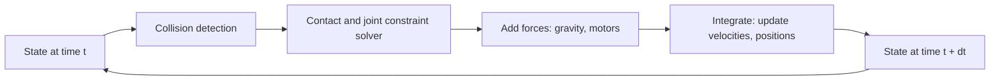

<LessonMeta level="Beginner" time="30 min" prereqs={["Python basics", "Basic calculus (derivative as a rate of change)"]} />

Imagine you have written a walking controller for a 40 kg humanoid. The first time you run it on the real robot, it falls forward and cracks a hip actuator that costs more than your laptop. Now imagine you could have run the same controller ten thousand times, in parallel, overnight, with every failure costing you nothing. That is what simulation buys you, and it is why nearly every robot you have seen in a lab video was first a program in a virtual world.

<Objectives>

- List the four big reasons robotics teams simulate: cost, safety, data and parallelism.
- Describe how a physics engine advances the world one small timestep at a time.
- Show with code how a bad integrator or a large timestep quietly breaks a simulation.
- Name the main approximations in contact, friction and sensors, and say when not to trust a result.

</Objectives>

## Four reasons to simulate

**Cost.** Hardware breaks, wears out and needs a person to reset it. A simulated robot respawns in milliseconds. You can also try robots that do not exist yet: a different arm length, a wheelbase that is 10 cm wider, a sensor you have not bought.

**Safety.** Early controllers are wrong. A controller that sends a torque command with the wrong sign is a bug in simulation and a hazard on a real robot next to a person. Simulation is where you are allowed to be wrong.

**Data.** Machine-learning models need huge amounts of labelled data. In simulation the labels are free: the simulator already knows where every object is, so it can output perfect bounding boxes, depth maps and segmentation masks with every frame.

**Parallelism.** A real robot gives you one experiment at a time, in real time. A simulator can run faster than real time, and a GPU simulator can run thousands of copies of the world at once. This is what made modern reinforcement learning for robots practical (you will use it in the robot learning module).

:::note
Simulation is not a replacement for the real robot. It is a filter: it lets you throw away the 95% of ideas that are obviously bad before they touch hardware. The last stretch always needs reality.
:::

## What a physics engine actually does

A <Term def="Software that advances the state of simulated rigid or soft bodies through time by solving the laws of motion, handling collisions and contact forces">physics engine</Term> does one job over and over. Given the current state of the world (positions and velocities of every body) and the forces on it, it computes the state a tiny moment later. That tiny moment is the <Term def="The fixed slice of simulated time, in seconds, that the engine advances per step; typical values for robots are 1 ms to 10 ms">timestep</Term>, written $\Delta t$.



Each loop has three ingredients:

1. **Dynamics.** Newton’s second law, $m\ddot{x} = F$, for each body, extended to rotation and to bodies connected by joints (you met the equations in [Dynamics essentials](../02-robot-fundamentals/04-dynamics-essentials.mdx)).
2. **Collision detection.** Find which shapes overlap or touch. Simple shapes (boxes, spheres, cylinders) are fast. Detailed triangle meshes are slow, which is why robot models use a simple "collision" shape and a pretty "visual" one.
3. **Constraint solving.** Contacts and joints are rules ("this foot cannot go through the floor", "this hinge only rotates around one axis"). The engine finds forces that satisfy those rules.

Common engines you will meet: **ODE**, **Bullet**, **DART** (the engines Gazebo can use), **MuJoCo** (popular for learning research) and **PhysX** (used by NVIDIA Isaac Sim). They make different trade-offs between speed, accuracy and how they treat contact.

## Time is chopped into steps, and that has consequences

The simplest way to move forward in time is **explicit Euler**: use the current velocity to update position, and the current acceleration to update velocity, all based on the old state. A tiny change, **semi-implicit Euler**, updates velocity first and then uses the *new* velocity for the position. That one change makes a big difference for anything that oscillates, like a swinging leg or a spring.

Let us see it. A pendulum of length $L$ has $\ddot\theta = -\frac{g}{L}\sin\theta$ and, per unit mass, energy $E = \tfrac12 L^2\dot\theta^2 + gL(1-\cos\theta)$. In a perfect world that energy never changes.

```python title="integrators.py"
import math

G, L = 9.81, 1.0


def energy(theta: float, omega: float) -> float:
    """Total energy per unit mass of a pendulum."""
    return 0.5 * L**2 * omega**2 + G * L * (1.0 - math.cos(theta))


def simulate(method: str, dt: float, seconds: float = 20.0) -> float:
    """Return the final energy divided by the initial energy (ideal answer: 1.0)."""
    theta, omega = 1.0, 0.0
    e0 = energy(theta, omega)
    for _ in range(int(seconds / dt)):
        alpha = -(G / L) * math.sin(theta)
        if method == "explicit":
            theta, omega = theta + omega * dt, omega + alpha * dt
        elif method == "semi-implicit":
            omega = omega + alpha * dt
            theta = theta + omega * dt
        else:
            raise ValueError(method)
    return energy(theta, omega) / e0


for dt in (0.001, 0.01, 0.05):
    for method in ("explicit", "semi-implicit"):
        print(f"dt={dt:<5} {method:<14} energy ratio = {simulate(method, dt):.3f}")
```

Run it. With explicit Euler the energy ratio climbs well above 1.0 as `dt` grows: the pendulum gains energy from nothing, and with a large enough step it swings higher and higher until the simulation "explodes". Semi-implicit Euler keeps the ratio close to 1.0 and wobbles around instead of drifting away. This is why most engines use a semi-implicit scheme.

<KeyIdea title="A simulator is a numerical approximation, not reality">
Every simulator has a timestep and a solver, and both introduce error. Smaller timesteps are more accurate but slower. If your robot behaves strangely, the first debugging question is always "does it still do this at half the timestep?"
</KeyIdea>

## Where physics engines cut corners

Knowing the limits is what separates someone who uses a simulator from someone who is fooled by one.

- **Contact.** Real contact is messy: surfaces deform, micro-slip, stick-slip friction. Engines model it with simplified rules, often a Coulomb friction coefficient and a bit of "softness". Feet on a floor and fingers on a cup are exactly where those simplifications bite.
- **Friction and restitution values.** The engine needs numbers for how slippery and bouncy surfaces are. You will usually guess them. A wheel that grips perfectly in simulation may slip on a real tile floor.
- **Actuators.** A simulated joint often obeys a perfect torque or position command. Real motors have limited bandwidth, backlash, heating and gearbox friction.
- **Flexible and soft things.** Cables, cloth, liquids, food and rubber are hard. Most robot simulators treat everything as rigid.
- **Sensors.** A simulated camera has no motion blur or lens dirt unless you add it. A simulated lidar sees a perfect surface unless you add noise.
- **Determinism and time.** Simulation time and wall-clock time are different things. ROS 2 nodes in simulation use `use_sim_time:=true` so that they follow the simulator’s clock, not your computer’s.

:::warning
A controller that works with a 1 ms timestep and perfect friction may fail on hardware for reasons that have nothing to do with the controller. Never celebrate a result in simulation as if it were a result on the robot. Lesson five of this module is entirely about closing that gap.
:::

## Fidelity is a budget, not a goal

You can always make a simulation more realistic, but it gets slower and harder to set up. The right question is "what is the cheapest simulation that still answers my question?". Testing a navigation stack needs correct geometry and lidar, but not accurate wheel physics. Training a walking policy needs accurate contact, but not pretty graphics. Generating images for a vision model needs rich graphics, but may not need physics at all.

## Hands-on lab

<Steps>

1. Save the code above as `integrators.py` and run `python integrators.py`. Write down the energy ratio for each row.
2. Change the number of seconds to `60.0` and re-run. Notice which method drifts further as time passes.
3. Add a third method named `"rk4"` (fourth-order Runge-Kutta, a more accurate integrator) or simply try `dt = 0.0001` with explicit Euler. Compare cost (run time) against accuracy.
4. Decide, from your numbers, the largest `dt` you would be willing to use for each method if you needed the energy ratio to stay between 0.99 and 1.01.

</Steps>

You know it worked when you can explain, in one sentence, why the explicit method gains energy and the semi-implicit one does not.

## Exercises

<Exercise title="Cost of accuracy" level="Beginner">

Running 20 simulated seconds at `dt = 0.001` takes 20,000 steps. How many steps does it take at `dt = 0.01`? If a step costs the same, how much faster is the coarser run?

<Solution>

At `dt = 0.01` it takes 2,000 steps, which is 10 times fewer, so about 10 times faster. The price is accuracy: in the pendulum experiment, the larger step can make explicit Euler drift in energy.

</Solution>
</Exercise>

<Exercise title="Pick the fidelity" level="Intermediate">

For each task, say which parts of the simulator must be accurate: (a) testing a lidar-based obstacle-avoidance planner, (b) training a robot hand to grasp a mug, (c) generating 50,000 labelled photos of warehouse shelves for a detector.

<Solution>

(a) Geometry and lidar ray casting; wheel physics only roughly. (b) Contact and friction; also the object’s mass and shape. Graphics hardly matter. (c) Rendering quality and variation (lighting, textures, camera pose); physics can be nearly ignored.

</Solution>
</Exercise>

<Exercise title="Spot the physics bug" level="Intermediate">

A simulated robot arm jitters violently when it presses on a table, although a real one would press quietly. Name two simulator-side settings you would check first.

<Solution>

The timestep (too large for stiff contacts) and the contact parameters (stiffness and damping, or the solver iteration count). Collision geometry that is slightly overlapping at rest can also cause jitter.

</Solution>
</Exercise>

## Check your understanding

<Quiz questions={[
  {q: "Why is simulation especially valuable for training machine-learning models?", options: ["It makes the real robot lighter", "Labels such as depth and object positions are free and perfect", "It removes the need for any real data ever", "It guarantees the model works on hardware"], answer: 1, explain: "The simulator knows the true state of the world, so it can emit perfect labels automatically. It does not guarantee transfer to hardware."},
  {q: "In the pendulum experiment, what happens to explicit Euler as the timestep grows?", options: ["Energy stays exactly constant", "Energy is lost to friction", "Energy drifts upward and can blow up", "The pendulum stops moving"], answer: 2, explain: "Explicit Euler adds a little energy each step for oscillating systems, and larger steps add more."},
  {q: "Which is a typical weak spot of rigid-body physics engines?", options: ["Gravity", "Contact and friction modelling", "Adding two vectors", "Printing log messages"], answer: 1, explain: "Real contact is complicated, and engines approximate it with simple friction and softness models."},
  {q: "What does use_sim_time:=true tell a ROS 2 node to do?", options: ["Run twice as fast", "Follow the simulator’s clock instead of the wall clock", "Disable all sensors", "Use the GPU"], answer: 1, explain: "Nodes subscribe to the /clock topic published by the simulator, so their notion of time matches the simulated world."}
]} />

<Takeaways>

- Teams simulate for cost, safety, free labelled data and massive parallelism.
- A physics engine repeats one loop: detect collisions, solve constraints, integrate forward by a small timestep.
- Timestep and integrator choice change results; semi-implicit schemes are stable where explicit Euler drifts.
- Contact, friction, actuators and sensors are the usual places where simulation and reality disagree.
- Choose the cheapest simulation that still answers your question.
- Simulation filters out bad ideas; it does not prove an idea works on hardware.

</Takeaways>

## Go deeper

- Gazebo documentation and tutorials: [gazebosim.org/docs](https://gazebosim.org/docs)
- MuJoCo documentation, for a clear view of how contact is modelled: [mujoco.readthedocs.io](https://mujoco.readthedocs.io)
- ROS 2 documentation on simulated time: [docs.ros.org](https://docs.ros.org)

Stuck? Ask **Rivet**, the course assistant, bottom-right.

Next: [Gazebo worlds and robots](./02-gazebo-worlds-and-robots.mdx)
