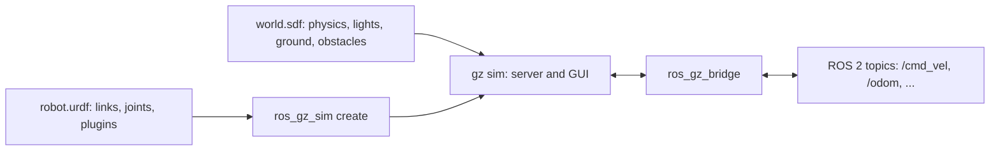

<LessonMeta level="Intermediate" time="40 min" prereqs={["ROS 2 nodes and topics", "URDF basics", "Linux terminal"]} />

You have a URDF for your robot and a ROS 2 workspace, but no floor to drive on, no walls to bump into and no physics. Before you can test navigation or a grasp, you need a world and a way to drop your robot into it. Gazebo is the simulator the ROS community uses for exactly this, and in this lesson you will build a world from scratch and drive a robot around it.

<Objectives>

- Explain how Gazebo, SDF and URDF relate to each other.
- Write a Gazebo Harmonic world in SDF with physics, a ground, lights and obstacles.
- Spawn a URDF robot with `ros_gz_sim` and give it a differential-drive controller plugin.
- Launch everything from one ROS 2 launch file and drive the robot with a `Twist` command.

</Objectives>

## The pieces and how they fit

<Term def="The modern Gazebo simulator (formerly Ignition), a modular set of libraries for physics, rendering, sensors and a GUI">Gazebo</Term> is the simulator. We use the **Harmonic** release, which is the one that pairs with ROS 2 Jazzy. Its command line tool is `gz`, and you start a simulation with `gz sim`.

<Term def="Simulation Description Format: Gazebo’s XML file format for worlds, models, lights, sensors and plugins">SDF</Term> is the file format Gazebo reads natively. A **world** is an SDF file describing everything: physics settings, lights, ground, and models. A **model** is a thing in the world (a robot, a table) made of **links** (rigid bodies) connected by **joints**.

You already know URDF from ROS 2. URDF describes only a robot, and it has no way to describe worlds, lights or sensors in detail. Gazebo converts a URDF to SDF on the fly when you spawn it, and lets you add Gazebo-only extras inside `<gazebo>` tags.



Gazebo has its own message system (called Gazebo Transport) that is separate from ROS 2. A **bridge** translates between the two. We will meet the bridge properly in the next lesson, but you will already use it here.

## Install and smoke test

On Ubuntu 24.04 with ROS 2 Jazzy:

```bash title="terminal"
sudo apt install ros-jazzy-ros-gz
gz sim shapes.sdf
```

`shapes.sdf` is a demo world that ships with Gazebo. Press the play button at the bottom left of the window. If a box, sphere and cylinder fall and the physics runs, you are set. Quit with Ctrl+C in the terminal.

## Writing a world

Create a folder `proprio_sim/` and the following file. Read the comments: every block matters.

```xml title="proprio_world.sdf"
<?xml version="1.0"?>
<sdf version="1.10">
  <world name="proprio_world">

    <!-- Physics: step 1 ms, try to run in real time -->
    <physics name="1ms" type="ignored">
      <max_step_size>0.001</max_step_size>
      <real_time_factor>1.0</real_time_factor>
    </physics>

    <!-- Systems: Gazebo is built from plugins that you opt into -->
    <plugin filename="gz-sim-physics-system" name="gz::sim::systems::Physics"/>
    <plugin filename="gz-sim-user-commands-system" name="gz::sim::systems::UserCommands"/>
    <plugin filename="gz-sim-scene-broadcaster-system" name="gz::sim::systems::SceneBroadcaster"/>
    <plugin filename="gz-sim-sensors-system" name="gz::sim::systems::Sensors">
      <render_engine>ogre2</render_engine>
    </plugin>
    <plugin filename="gz-sim-imu-system" name="gz::sim::systems::Imu"/>

    <light type="directional" name="sun">
      <cast_shadows>true</cast_shadows>
      <pose>0 0 10 0 0 0</pose>
      <diffuse>0.9 0.9 0.9 1</diffuse>
      <specular>0.2 0.2 0.2 1</specular>
      <direction>-0.5 0.1 -0.9</direction>
    </light>

    <model name="ground_plane">
      <static>true</static>
      <link name="link">
        <collision name="collision">
          <geometry><plane><normal>0 0 1</normal><size>100 100</size></plane></geometry>
        </collision>
        <visual name="visual">
          <geometry><plane><normal>0 0 1</normal><size>100 100</size></plane></geometry>
          <material>
            <ambient>0.7 0.7 0.7 1</ambient>
            <diffuse>0.7 0.7 0.7 1</diffuse>
          </material>
        </visual>
      </link>
    </model>

    <!-- An obstacle: a static box 2 m in front of the origin -->
    <model name="box_obstacle">
      <static>true</static>
      <pose>2 0 0.25 0 0 0</pose>
      <link name="link">
        <collision name="collision">
          <geometry><box><size>0.5 0.5 0.5</size></box></geometry>
        </collision>
        <visual name="visual">
          <geometry><box><size>0.5 0.5 0.5</size></box></geometry>
          <material>
            <ambient>0.8 0.2 0.2 1</ambient>
            <diffuse>0.8 0.2 0.2 1</diffuse>
          </material>
        </visual>
      </link>
    </model>

  </world>
</sdf>
```

A few things to notice:

- **Plugins are the engine.** Physics, user commands from the GUI, the scene broadcaster (which feeds the GUI), and the sensors system are all separate plugins. If you forget one, that feature silently does not exist. Missing the `Sensors` plugin is the most common reason a simulated camera is blank.
- **`<pose>`** is `x y z roll pitch yaw`, in metres and radians, relative to the parent frame.
- **`<static>true</static>`** tells the engine this model never moves, which saves computation.
- **Each link usually has two shapes**: a `<collision>` (what physics sees, kept simple) and a `<visual>` (what you see).

Run it:

```bash title="terminal"
gz sim -r proprio_world.sdf
```

The `-r` flag starts the simulation running; without it the world starts paused.

<KeyIdea title="Worlds are built from opt-in systems">
Gazebo Harmonic has almost no built-in behaviour. Physics, sensors, controllers and the GUI link are all plugins listed in your world or robot file. When something does nothing, check that its plugin is loaded before you check anything else.
</KeyIdea>

## A robot to spawn

Here is a small two-wheeled robot as URDF. It has a body, two driven wheels and two caster balls, and one Gazebo plugin that turns `cmd_vel` messages into wheel motion.

```xml title="proprio_bot.urdf"
<?xml version="1.0"?>
<robot name="proprio_bot">

  <link name="base_link">
    <inertial>
      <mass value="5.0"/>
      <inertia ixx="0.0302" iyy="0.0708" izz="0.0927" ixy="0" ixz="0" iyz="0"/>
    </inertial>
    <visual>
      <geometry><box size="0.4 0.25 0.1"/></geometry>
      <material name="blue"><color rgba="0.2 0.3 0.8 1"/></material>
    </visual>
    <collision>
      <geometry><box size="0.4 0.25 0.1"/></geometry>
    </collision>
  </link>

  <!-- Wheels: cylinders rotated so their axis points along the robot's y axis -->
  <link name="left_wheel">
    <inertial>
      <mass value="0.5"/>
      <inertia ixx="0.001317" iyy="0.0025" izz="0.001317" ixy="0" ixz="0" iyz="0"/>
    </inertial>
    <visual>
      <origin rpy="1.5708 0 0"/>
      <geometry><cylinder radius="0.1" length="0.04"/></geometry>
    </visual>
    <collision>
      <origin rpy="1.5708 0 0"/>
      <geometry><cylinder radius="0.1" length="0.04"/></geometry>
    </collision>
  </link>
  <joint name="left_wheel_joint" type="continuous">
    <parent link="base_link"/>
    <child link="left_wheel"/>
    <origin xyz="0 0.15 0"/>
    <axis xyz="0 1 0"/>
  </joint>

  <link name="right_wheel">
    <inertial>
      <mass value="0.5"/>
      <inertia ixx="0.001317" iyy="0.0025" izz="0.001317" ixy="0" ixz="0" iyz="0"/>
    </inertial>
    <visual>
      <origin rpy="1.5708 0 0"/>
      <geometry><cylinder radius="0.1" length="0.04"/></geometry>
    </visual>
    <collision>
      <origin rpy="1.5708 0 0"/>
      <geometry><cylinder radius="0.1" length="0.04"/></geometry>
    </collision>
  </link>
  <joint name="right_wheel_joint" type="continuous">
    <parent link="base_link"/>
    <child link="right_wheel"/>
    <origin xyz="0 -0.15 0"/>
    <axis xyz="0 1 0"/>
  </joint>

  <!-- Frictionless casters keep the body level -->
  <link name="caster_front">
    <inertial>
      <mass value="0.1"/>
      <inertia ixx="0.0001" iyy="0.0001" izz="0.0001" ixy="0" ixz="0" iyz="0"/>
    </inertial>
    <collision><geometry><sphere radius="0.05"/></geometry></collision>
    <visual><geometry><sphere radius="0.05"/></geometry></visual>
  </link>
  <joint name="caster_front_joint" type="fixed">
    <parent link="base_link"/>
    <child link="caster_front"/>
    <origin xyz="0.15 0 -0.05"/>
  </joint>

  <link name="caster_rear">
    <inertial>
      <mass value="0.1"/>
      <inertia ixx="0.0001" iyy="0.0001" izz="0.0001" ixy="0" ixz="0" iyz="0"/>
    </inertial>
    <collision><geometry><sphere radius="0.05"/></geometry></collision>
    <visual><geometry><sphere radius="0.05"/></geometry></visual>
  </link>
  <joint name="caster_rear_joint" type="fixed">
    <parent link="base_link"/>
    <child link="caster_rear"/>
    <origin xyz="-0.15 0 -0.05"/>
  </joint>

  <gazebo reference="caster_front">
    <mu1>0.0</mu1><mu2>0.0</mu2>
  </gazebo>
  <gazebo reference="caster_rear">
    <mu1>0.0</mu1><mu2>0.0</mu2>
  </gazebo>

  <gazebo>
    <plugin filename="gz-sim-diff-drive-system" name="gz::sim::systems::DiffDrive">
      <left_joint>left_wheel_joint</left_joint>
      <right_joint>right_wheel_joint</right_joint>
      <wheel_separation>0.3</wheel_separation>
      <wheel_radius>0.1</wheel_radius>
      <odom_publish_frequency>30</odom_publish_frequency>
      <topic>cmd_vel</topic>
      <odom_topic>odom</odom_topic>
      <tf_topic>tf</tf_topic>
      <frame_id>odom</frame_id>
      <child_frame_id>base_link</child_frame_id>
    </plugin>
    <plugin filename="gz-sim-joint-state-publisher-system"
            name="gz::sim::systems::JointStatePublisher"/>
  </gazebo>
</robot>
```

Three details worth understanding:

- **Inertia values must be present and plausible.** A link with zero mass or zero inertia is a classic cause of robots that explode or sink through the floor. The numbers above come from the formulas for a box and a cylinder.
- **Wheel axis.** A URDF cylinder points along its local z axis. We rotate the shape by 90 degrees (`rpy="1.5708 0 0"`) and spin the joint about y.
- **Friction.** `mu1` and `mu2` are friction coefficients that Gazebo carries over when converting to SDF. Casters should slide freely, so we set them to zero.

The `DiffDrive` plugin listens on `cmd_vel`, converts the linear and angular velocity into left and right wheel speeds using the wheel separation $b$ and radius $r$ ($v_{L,R} = (v \mp \omega b/2)/r$, the standard differential-drive kinematics; see [Anatomy of a robot](../02-robot-fundamentals/01-anatomy-of-a-robot.mdx) for the robot parts involved), and publishes `odom` and the `odom` to `base_link` transform.

## Spawning and launching

With the world already running, you can spawn the robot from another terminal:

```bash title="terminal"
ros2 run ros_gz_sim create -file proprio_bot.urdf -name proprio_bot -z 0.12
```

`-name` is the model name inside Gazebo, and `-z` lifts it a little so the wheels do not start inside the floor. You can also spawn from a ROS parameter with `-topic robot_description`, which is what you do when a `robot_state_publisher` already holds the URDF.

Now put it all in one launch file so that starting the whole thing is a single command.

```python title="sim.launch.py"
import os

from launch import LaunchDescription
from launch.actions import IncludeLaunchDescription
from launch.launch_description_sources import PythonLaunchDescriptionSource
from launch_ros.actions import Node
from launch_ros.substitutions import FindPackageShare

HERE = os.path.dirname(os.path.abspath(__file__))


def generate_launch_description():
    gz_sim = IncludeLaunchDescription(
        PythonLaunchDescriptionSource(
            [FindPackageShare("ros_gz_sim"), "/launch/gz_sim.launch.py"]
        ),
        launch_arguments={"gz_args": f"-r {HERE}/proprio_world.sdf"}.items(),
    )

    spawn = Node(
        package="ros_gz_sim",
        executable="create",
        arguments=[
            "-file", f"{HERE}/proprio_bot.urdf",
            "-name", "proprio_bot",
            "-z", "0.12",
        ],
        output="screen",
    )

    bridge = Node(
        package="ros_gz_bridge",
        executable="parameter_bridge",
        arguments=[
            "/clock@rosgraph_msgs/msg/Clock[gz.msgs.Clock",
            "/cmd_vel@geometry_msgs/msg/Twist]gz.msgs.Twist",
            "/odom@nav_msgs/msg/Odometry[gz.msgs.Odometry",
        ],
        output="screen",
    )

    return LaunchDescription([gz_sim, spawn, bridge])
```

Run it with `ros2 launch ./sim.launch.py`. The symbols `[` and `]` in the bridge arguments set the direction of travel; the next lesson explains them in detail.

:::tip[Pro tip]
Gazebo finds models referenced as `model://name` through the environment variable `GZ_SIM_RESOURCE_PATH`, a colon-separated list of folders. You can also pull ready-made models from Gazebo Fuel, the online model library, using an `<include>` with a `<uri>` that points at a Fuel model. Look up the exact model URL on the Fuel website rather than guessing it.
:::

## Hands-on lab

<Steps>

1. Create `proprio_sim/` and save `proprio_world.sdf`, `proprio_bot.urdf` and `sim.launch.py` into it.
2. Run `ros2 launch ./sim.launch.py` from inside the folder. The Gazebo window should open with the robot sitting on the ground, 2 m from the red box.
3. In a second terminal, run `ros2 topic list`. You should see `/clock`, `/cmd_vel` and `/odom`.
4. Drive forward: `ros2 topic pub --rate 10 /cmd_vel geometry_msgs/msg/Twist "{linear: {x: 0.3}}"`.
5. Watch `ros2 topic echo /odom --field pose.pose.position` and confirm `x` grows while the robot rolls toward the box, and stops when you press Ctrl+C on the publisher.

</Steps>

It worked if the robot drives straight, hits the box and stops, and the `x` in odometry matches roughly what you see in the window.

## Exercises

<Exercise title="Make a corridor" level="Beginner">

Add two long thin static boxes to the world to form a corridor 1.2 m wide, starting 3 m from the robot. What do you change to place them?

<Solution>

Copy the `box_obstacle` model, rename each copy (model names must be unique), change the `<size>` to something like `4 0.1 0.5`, and set `<pose>` so that their centres are at y = +0.65 and y = -0.65. The inner faces are then 1.2 m apart (0.65 minus half of the 0.1 thickness, times two).

</Solution>
</Exercise>

<Exercise title="Debug a sinking robot" level="Intermediate">

You spawn your robot at `-z 0` and it tumbles and jitters. List three things to check.

<Solution>

(1) The wheels start inside the ground, so spawn higher. (2) Missing or tiny inertia values in a link. (3) Collision shapes that overlap each other inside the robot body, which makes the solver push them apart.

</Solution>
</Exercise>

<Exercise title="Turn in place" level="Intermediate">

What `Twist` do you send to rotate on the spot at 1 rad/s, and what wheel speeds result with $b = 0.3$ m and $r = 0.1$ m?

<Solution>

Send linear x = 0 and angular z = 1.0. Then $v_L = -\omega b/(2r) = -1.5$ rad/s and $v_R = +1.5$ rad/s, so the wheels spin in opposite directions.

</Solution>
</Exercise>

## Check your understanding

<Quiz questions={[
  {q: "What is the relationship between URDF and SDF?", options: ["They are the same format with different file extensions", "URDF describes a robot only; SDF can describe whole worlds and Gazebo converts URDF to SDF", "SDF is only for cameras", "URDF replaces SDF in Gazebo Harmonic"], answer: 1, explain: "URDF is robot-only and is converted to SDF when spawned. SDF also covers worlds, lights, physics and sensors."},
  {q: "Your simulated camera shows a black image even though it is in the model. Which is a likely cause?", options: ["The Sensors system plugin is missing from the world", "The ground plane is static", "The robot has two wheels", "The world file ends with a newline"], answer: 0, explain: "Sensors are produced by the Sensors system plugin; without it, no rendering sensors run."},
  {q: "What does the -r flag of gz sim do?", options: ["Records a video", "Starts the simulation running instead of paused", "Restarts the world every minute", "Removes the GUI"], answer: 1, explain: "Worlds start paused by default; -r begins stepping physics immediately."},
  {q: "Why do links have separate collision and visual geometry?", options: ["Visuals are for physics and collisions for rendering", "To let collisions be simple and fast while visuals can be detailed", "Because SDF forbids reusing shapes", "It is only a naming convention"], answer: 1, explain: "Physics needs cheap shapes; you can render a detailed mesh without slowing contact calculations."}
]} />

<Takeaways>

- Gazebo Harmonic is the simulator; `gz sim` runs it; SDF describes worlds and models.
- A world file chooses the physics step and lists the system plugins you want.
- URDF robots are converted to SDF when spawned with `ros_gz_sim create`; Gazebo-only extras live in `<gazebo>` tags.
- Inertia, wheel axes and friction values are the usual sources of strange behaviour.
- The `DiffDrive` plugin turns `cmd_vel` into wheel motion and publishes odometry.
- One launch file should start the world, spawn the robot and start the bridge.

</Takeaways>

## Go deeper

- Gazebo Harmonic documentation: [gazebosim.org/docs/harmonic](https://gazebosim.org/docs/harmonic)
- SDF format reference: [sdformat.org/spec](http://sdformat.org/spec)
- ROS 2 and Gazebo integration (`ros_gz`): [gazebosim.org/docs/harmonic/ros2_integration](https://gazebosim.org/docs/harmonic/ros2_integration)

Stuck? Ask **Rivet**, the course assistant, bottom-right.

Next: [Simulated sensors and ros_gz](./03-simulated-sensors-and-ros-gz.mdx)
