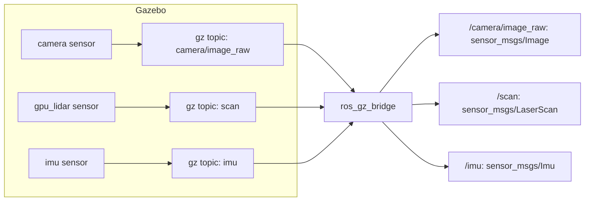

<LessonMeta level="Intermediate" time="45 min" prereqs={["Gazebo worlds and robots", "ROS 2 topics and QoS", "TF2 basics"]} />

Your robot now drives, but it is blind and deaf. It cannot tell a wall from open floor, and nothing you have learned about perception or navigation can be tested yet. In simulation, a sensor is just a few lines of XML on a link, and a bridge process that copies its messages into ROS 2. Once you do this, your simulated robot looks, to your ROS code, exactly like a real one.

<Objectives>

- Add camera, depth camera, lidar and IMU sensors to a robot with SDF sensor blocks.
- Read and write `ros_gz_bridge` argument syntax, including direction symbols and YAML configuration.
- Explain how noise models and update rates affect what your code sees.
- Visualise images, laser scans, point clouds and TF in RViz, with the right QoS and simulated time.

</Objectives>

## A sensor is a link plus a recipe

In Gazebo, a sensor is attached to a link, like a physical camera is bolted to a robot. The `Sensors` system plugin (which we already loaded in the world) renders the cameras and ray-casts the lidar every step according to the sensor’s `<update_rate>`, and publishes the result on a Gazebo Transport topic.



Add each sensor to `kinemata_bot.urdf` from the last lesson: a new link and a fixed joint to hold it, plus a `<gazebo reference="...">` block that carries the sensor definition.

### Camera

```xml title="kinemata_bot.urdf (add inside <robot>)"
<link name="camera_link">
  <inertial>
    <mass value="0.05"/>
    <inertia ixx="1e-5" iyy="1e-5" izz="1e-5" ixy="0" ixz="0" iyz="0"/>
  </inertial>
  <visual><geometry><box size="0.03 0.06 0.03"/></geometry></visual>
</link>
<joint name="camera_joint" type="fixed">
  <parent link="base_link"/>
  <child link="camera_link"/>
  <origin xyz="0.2 0 0.08"/>
</joint>

<gazebo reference="camera_link">
  <sensor name="camera" type="camera">
    <always_on>true</always_on>
    <update_rate>30</update_rate>
    <topic>camera/image_raw</topic>
    <gz_frame_id>camera_link</gz_frame_id>
    <camera>
      <horizontal_fov>1.047</horizontal_fov>
      <image>
        <width>640</width>
        <height>480</height>
        <format>R8G8B8</format>
      </image>
      <clip><near>0.1</near><far>20</far></clip>
      <noise>
        <type>gaussian</type>
        <mean>0.0</mean>
        <stddev>0.007</stddev>
      </noise>
    </camera>
  </sensor>
</gazebo>
```

Look at what each part controls. `horizontal_fov` is the field of view in radians (1.047 is about 60 degrees). `width` and `height` set the resolution, which with the field of view fixes the intrinsics you will study in the next module. `clip` sets the nearest and farthest distances that are rendered. The `noise` block adds Gaussian noise to each pixel, so your vision code does not get unrealistically clean images.

### Depth camera

A depth camera has the same structure, with `type="depth_camera"` and a floating-point image format:

```xml title="kinemata_bot.urdf (depth camera sensor block)"
<gazebo reference="camera_link">
  <sensor name="depth" type="depth_camera">
    <always_on>true</always_on>
    <update_rate>15</update_rate>
    <topic>depth_camera</topic>
    <gz_frame_id>camera_link</gz_frame_id>
    <camera>
      <horizontal_fov>1.047</horizontal_fov>
      <image>
        <width>320</width>
        <height>240</height>
        <format>R_FLOAT32</format>
      </image>
      <clip><near>0.2</near><far>8</far></clip>
    </camera>
  </sensor>
</gazebo>
```

It publishes a depth image and also a point cloud on a topic ending in `/points`. Use `gz topic -l` while the simulation runs to see the exact topic names your version creates.

### Lidar

A <Term def="Light detection and ranging: a sensor that measures distance by timing laser pulses; a 2D lidar sweeps one plane and returns a list of ranges">lidar</Term> in simulation is done by ray casting: Gazebo shoots virtual rays from the sensor and measures where each hits.

```xml title="kinemata_bot.urdf (lidar)"
<link name="lidar_link">
  <inertial>
    <mass value="0.1"/>
    <inertia ixx="1e-4" iyy="1e-4" izz="1e-4" ixy="0" ixz="0" iyz="0"/>
  </inertial>
  <visual><geometry><cylinder radius="0.04" length="0.05"/></geometry></visual>
</link>
<joint name="lidar_joint" type="fixed">
  <parent link="base_link"/>
  <child link="lidar_link"/>
  <origin xyz="0 0 0.1"/>
</joint>

<gazebo reference="lidar_link">
  <sensor name="lidar" type="gpu_lidar">
    <always_on>true</always_on>
    <update_rate>10</update_rate>
    <topic>scan</topic>
    <gz_frame_id>lidar_link</gz_frame_id>
    <lidar>
      <scan>
        <horizontal>
          <samples>360</samples>
          <resolution>1</resolution>
          <min_angle>-3.14159</min_angle>
          <max_angle>3.14159</max_angle>
        </horizontal>
      </scan>
      <range><min>0.12</min><max>10.0</max><resolution>0.01</resolution></range>
      <noise>
        <type>gaussian</type>
        <mean>0.0</mean>
        <stddev>0.01</stddev>
      </noise>
    </lidar>
  </sensor>
</gazebo>
```

360 samples over a full circle gives one ray per degree. Values returned for rays that hit nothing come back as infinity, and your code must handle that.

### IMU

An <Term def="Inertial measurement unit: a sensor that measures angular velocity with gyroscopes and linear acceleration with accelerometers">IMU</Term> reports angular velocity and linear acceleration. The `Imu` system plugin (also loaded in the world) drives it.

```xml title="kinemata_bot.urdf (IMU)"
<gazebo reference="base_link">
  <sensor name="imu" type="imu">
    <always_on>true</always_on>
    <update_rate>100</update_rate>
    <topic>imu</topic>
    <gz_frame_id>base_link</gz_frame_id>
    <imu>
      <angular_velocity>
        <x><noise type="gaussian"><mean>0.0</mean><stddev>0.0002</stddev></noise></x>
        <y><noise type="gaussian"><mean>0.0</mean><stddev>0.0002</stddev></noise></y>
        <z><noise type="gaussian"><mean>0.0</mean><stddev>0.0002</stddev></noise></z>
      </angular_velocity>
      <linear_acceleration>
        <x><noise type="gaussian"><mean>0.0</mean><stddev>0.017</stddev></noise></x>
        <y><noise type="gaussian"><mean>0.0</mean><stddev>0.017</stddev></noise></y>
        <z><noise type="gaussian"><mean>0.0</mean><stddev>0.017</stddev></noise></z>
      </linear_acceleration>
    </imu>
  </sensor>
</gazebo>
```

:::info[Where noise values come from]
The numbers above are plausible, not magic. For a real robot you copy them from the sensor’s datasheet or measure them: record the sensor sitting still and compute the standard deviation. Honest noise in simulation is a big part of closing the sim-to-real gap, which is the topic of lesson five.
:::

## The ros_gz_bridge

Gazebo’s sensor topics are not ROS 2 topics. `ros_gz_bridge` is a node that subscribes on one side and republishes on the other, converting message types. The command-line form is:

```text
TOPIC@ROS_TYPE@GZ_TYPE      bidirectional
TOPIC@ROS_TYPE[GZ_TYPE      Gazebo to ROS 2 only
TOPIC@ROS_TYPE]GZ_TYPE      ROS 2 to Gazebo only
```

Think of the bracket as an arrow head: `[` points toward ROS (it "opens" on the Gazebo side) and `]` points toward Gazebo. A simple way to remember it: sensors go **out** of Gazebo (`[`) and commands go **in** (`]`).

Here is the full set for our robot:

```bash title="terminal"
ros2 run ros_gz_bridge parameter_bridge \
  /clock@rosgraph_msgs/msg/Clock[gz.msgs.Clock \
  /cmd_vel@geometry_msgs/msg/Twist]gz.msgs.Twist \
  /odom@nav_msgs/msg/Odometry[gz.msgs.Odometry \
  /tf@tf2_msgs/msg/TFMessage[gz.msgs.Pose_V \
  /joint_states@sensor_msgs/msg/JointState[gz.msgs.Model \
  /camera/image_raw@sensor_msgs/msg/Image[gz.msgs.Image \
  /camera/camera_info@sensor_msgs/msg/CameraInfo[gz.msgs.CameraInfo \
  /depth_camera/points@sensor_msgs/msg/PointCloud2[gz.msgs.PointCloudPacked \
  /scan@sensor_msgs/msg/LaserScan[gz.msgs.LaserScan \
  /imu@sensor_msgs/msg/Imu[gz.msgs.IMU
```

| Sensor | ROS 2 message | Gazebo message |
|---|---|---|
| Camera image | `sensor_msgs/msg/Image` | `gz.msgs.Image` |
| Camera info | `sensor_msgs/msg/CameraInfo` | `gz.msgs.CameraInfo` |
| Lidar | `sensor_msgs/msg/LaserScan` | `gz.msgs.LaserScan` |
| Point cloud | `sensor_msgs/msg/PointCloud2` | `gz.msgs.PointCloudPacked` |
| IMU | `sensor_msgs/msg/Imu` | `gz.msgs.IMU` |
| Odometry | `nav_msgs/msg/Odometry` | `gz.msgs.Odometry` |

For more than a handful of topics, a YAML file is neater and easier to review:

```yaml title="bridge.yaml"
- ros_topic_name: "scan"
  gz_topic_name: "scan"
  ros_type_name: "sensor_msgs/msg/LaserScan"
  gz_type_name: "gz.msgs.LaserScan"
  direction: GZ_TO_ROS

- ros_topic_name: "cmd_vel"
  gz_topic_name: "cmd_vel"
  ros_type_name: "geometry_msgs/msg/Twist"
  gz_type_name: "gz.msgs.Twist"
  direction: ROS_TO_GZ
```

```bash title="terminal"
ros2 run ros_gz_bridge parameter_bridge --ros-args -p config_file:=bridge.yaml
```

Images are bulky. The `ros_gz_image` package offers an image bridge that publishes through ROS 2’s image transport, so compressed streams are possible:

```bash title="terminal"
ros2 run ros_gz_image image_bridge /camera/image_raw
```

<KeyIdea title="The bridge only carries what you list">
Nothing crosses the bridge by itself. If a topic does not appear in ROS 2, check three things in order: does the topic exist on the Gazebo side (`gz topic -l`), is it in your bridge arguments with the right type pair, and is the direction symbol the right way round.
</KeyIdea>

## TF and time

Sensors need frames. Your lidar scan is "in the `lidar_link` frame", and Nav2 or SLAM must know where that frame sits relative to `base_link`. Run a `robot_state_publisher` with the URDF so that all the fixed-joint transforms exist, and make everything follow the simulator clock:

```bash title="terminal"
ros2 run robot_state_publisher robot_state_publisher \
  --ros-args -p robot_description:="$(cat kinemata_bot.urdf)" -p use_sim_time:=true
```

The `/tf` bridged from Gazebo carries `odom` to `base_link`; `robot_state_publisher` adds `base_link` to `camera_link` and `lidar_link`. The frame id inside each sensor message must match a real TF frame, which is why we set `gz_frame_id` in each sensor block.

:::warning
If RViz or Nav2 complain about "extrapolation into the future" or messages being dropped, the usual cause is a node not using simulated time. Pass `use_sim_time:=true` to **every** node, including RViz, and bridge `/clock`.
:::

## Looking at the data in RViz

```bash title="terminal"
rviz2 --ros-args -p use_sim_time:=true
```

Set **Fixed Frame** to `odom`. Then use **Add** to create displays: **TF**, **LaserScan** on `/scan`, **Image** on `/camera/image_raw`, **PointCloud2** on `/depth_camera/points`. If a sensor display stays empty even though `ros2 topic hz` shows data, open the display’s **Topic** settings and change **Reliability** to *Best Effort*. Sensor topics normally use the "sensor data" QoS profile, and a display that asks for reliable delivery will not match it.

## Reading sensors from your own node

Here is a node that prints the closest obstacle seen by the lidar. It is the first piece of a reactive "stop before the wall" behaviour.

```python title="closest_obstacle.py"
import math

import rclpy
from rclpy.node import Node
from rclpy.qos import qos_profile_sensor_data
from sensor_msgs.msg import LaserScan


class ClosestObstacle(Node):
    def __init__(self):
        super().__init__("closest_obstacle")
        self.create_subscription(LaserScan, "/scan", self.on_scan, qos_profile_sensor_data)

    def on_scan(self, msg: LaserScan):
        valid = [
            (r, msg.angle_min + i * msg.angle_increment)
            for i, r in enumerate(msg.ranges)
            if math.isfinite(r) and msg.range_min <= r <= msg.range_max
        ]
        if not valid:
            self.get_logger().info("no returns")
            return
        r, angle = min(valid)
        self.get_logger().info(f"closest: {r:.2f} m at {math.degrees(angle):.0f} deg")


def main():
    rclpy.init()
    rclpy.spin(ClosestObstacle())


if __name__ == "__main__":
    main()
```

Notice the two filters: infinite ranges (rays that hit nothing) and values outside `range_min` and `range_max`. Real lidars return both kinds of junk, and your code must treat them the same way.

## Hands-on lab

<Steps>

1. Add the camera, lidar and IMU blocks to `kinemata_bot.urdf`. Keep the `Sensors` and `Imu` plugins in the world file.
2. Extend `sim.launch.py` with the bridge arguments from this lesson and a `robot_state_publisher` node with `use_sim_time` set to true.
3. Launch, then run `ros2 topic hz /scan` and `ros2 topic hz /camera/image_raw`. The rates should be close to 10 Hz and 30 Hz.
4. Start `rviz2 --ros-args -p use_sim_time:=true`, set Fixed Frame to `odom`, and add TF, LaserScan and Image displays. Drive toward the box with `teleop_twist_keyboard` and watch the scan points in front of the robot move closer.
5. Run `closest_obstacle.py` and compare its printed distance with what RViz shows.

</Steps>

You know it worked when the scan outlines the red box, the camera image shows it growing as you approach, and `closest_obstacle.py` prints a distance that shrinks.

## Exercises

<Exercise title="Pick the arrow" level="Beginner">

Write the bridge argument that sends `/cmd_vel` from ROS 2 into Gazebo only. Which bracket do you use, and why?

<Solution>

`/cmd_vel@geometry_msgs/msg/Twist]gz.msgs.Twist`. The `]` means ROS 2 to Gazebo, and a velocity command is something ROS sends into the simulator.

</Solution>
</Exercise>

<Exercise title="Narrow the view" level="Intermediate">

Change the lidar so it only scans the front 180 degrees with 180 samples. Which fields change, and what happens to the `ranges` array length?

<Solution>

Set `min_angle` to -1.5708 and `max_angle` to 1.5708 and `samples` to 180. The `ranges` array then has 180 entries, with `angle_min` and `angle_max` in the message set accordingly. Your code should always compute angles from `angle_min` and `angle_increment`, not from a hard-coded assumption.

</Solution>
</Exercise>

<Exercise title="Why is my scan frame wrong?" level="Intermediate">

RViz shows the lidar points rotated 90 degrees from where the wall is. Give two possible causes.

<Solution>

The lidar link is mounted with the wrong orientation in the URDF joint origin (a yaw error), or the `frame_id` in the scan message does not match the intended link so the TF lookup resolves to a different frame. Check the joint `rpy` and the sensor’s `gz_frame_id`.

</Solution>
</Exercise>

## Check your understanding

<Quiz questions={[
  {q: "In the bridge syntax, which symbol sends data from Gazebo to ROS 2 only?", options: ["]", "[", "@ alone", ">"], answer: 1, explain: "[ means Gazebo to ROS 2 and ] means ROS 2 to Gazebo. Sensors normally use [."},
  {q: "A lidar ray that hits nothing within range appears as what in a LaserScan?", options: ["Zero", "Negative one", "Infinity", "The maximum range as a finite number, always"], answer: 2, explain: "Rays with no return are typically reported as infinity, so code must test with isfinite."},
  {q: "RViz shows nothing for /scan although the topic has data. Which setting is a likely culprit?", options: ["Fixed Frame is blank", "Display reliability does not match the sensor QoS", "The robot has too many wheels", "Gazebo is in dark mode"], answer: 1, explain: "Sensor topics use best-effort QoS; a display set to reliable will not connect."},
  {q: "Why do you add noise to simulated sensors?", options: ["To slow down the simulator", "Because real sensors are noisy and your code should be tested against that", "Because Gazebo cannot render clean images", "Noise is required by SDF"], answer: 1, explain: "Clean simulated data hides problems that real noise would reveal."}
]} />

<Takeaways>

- A Gazebo sensor is an SDF block attached to a link, driven by the `Sensors` or `Imu` system plugins.
- Update rate, field of view, resolution, range and noise are the settings that shape what your code receives.
- `ros_gz_bridge` copies listed topics between Gazebo and ROS 2; `[` goes to ROS, `]` goes to Gazebo, `@` is both.
- Use a YAML file for larger bridges and `ros_gz_image` for efficient image streams.
- Frames and clocks must be right: publish TF, match `frame_id`, and set `use_sim_time:=true` everywhere.
- Handle infinite and out-of-range lidar values in your own code.

</Takeaways>

## Go deeper

- Gazebo sensors tutorial: [gazebosim.org/docs/harmonic/sensors](https://gazebosim.org/docs/harmonic/sensors)
- ROS 2 and Gazebo bridge documentation: [gazebosim.org/docs/harmonic/ros2_integration](https://gazebosim.org/docs/harmonic/ros2_integration)
- RViz user guide on docs.ros.org: [docs.ros.org](https://docs.ros.org)

Stuck? Ask **Rivet**, the course assistant, bottom-right.

Next: [Isaac Sim essentials](./04-isaac-sim-essentials.mdx)
