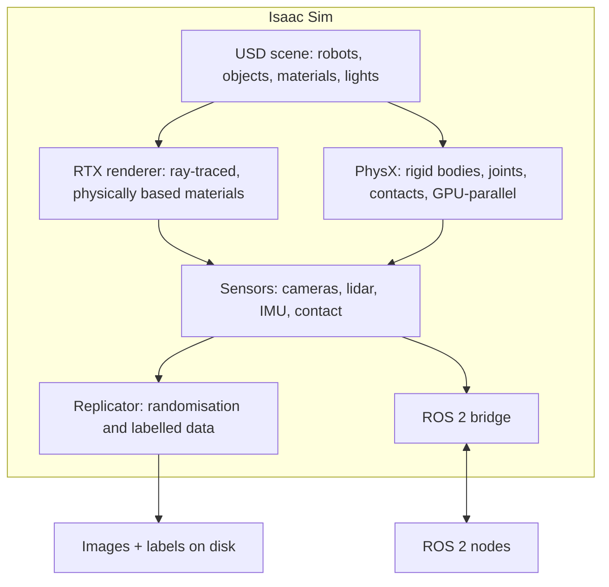
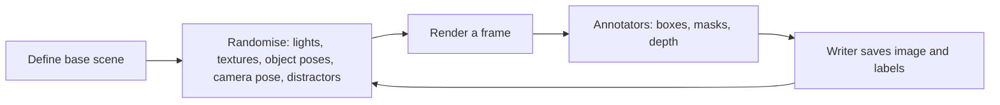

<LessonMeta level="Intermediate" time="30 min" prereqs={["Gazebo worlds and robots", "Simulated sensors and ros_gz"]} />

Your vision team needs 200,000 labelled images of cluttered shelves, each with a different lighting setup, camera angle and set of boxes. A real photoshoot would take months. Gazebo could render the scenes, but the images would look flat and the labelling would be work you have to build yourself. This is the job Isaac Sim was made for: photorealistic scenes, automatic labels, and thousands of robots training in parallel on one GPU.

<Objectives>

- Describe what Isaac Sim is built from: Omniverse, USD, PhysX and RTX rendering.
- Explain what a USD stage, prim and layer are, and author a small USD scene in Python.
- Describe how Replicator produces labelled synthetic data with domain randomization.
- Explain how Isaac Sim talks to ROS 2, and decide when to pick Isaac Sim versus Gazebo.

</Objectives>

:::info[A note on versions]
Isaac Sim and its companion libraries change quickly. Menu names, extension names and Python APIs move between releases. This lesson teaches the stable ideas. For exact steps, always follow the documentation for the release you install, at docs.nvidia.com. We deliberately do not quote version numbers or menu paths here.
:::

## What it is, in one picture

<Term def="A robotics simulator from NVIDIA, built on the Omniverse platform, with GPU-accelerated physics (PhysX) and ray-traced rendering">Isaac Sim</Term> is a robot simulator that runs on NVIDIA GPUs. It sits on top of **Omniverse**, NVIDIA’s platform for building and connecting 3D applications. Four ingredients matter.



1. **USD (Universal Scene Description).** The scene format. Everything, from the robot to the lighting, is a USD file.
2. **PhysX.** The physics engine. It can simulate many environments on the GPU at the same time, which is what makes reinforcement learning at scale feasible.
3. **RTX rendering.** Ray-traced graphics. Images look like photographs, with believable reflections, shadows and materials, which matters when you train a vision model on them.
4. **Python and extensions.** You script scenes and experiments in Python, and add features through extensions.

## USD in ten minutes

<Term def="Universal Scene Description: an open file format and library, originally from Pixar, for describing 3D scenes as a hierarchy of typed objects with properties">USD</Term> describes a scene as a tree. The whole tree is a **stage**. Each node is a **prim** (short for primitive), such as a transform, a cube, a camera, a light or a robot. Prims have **attributes** (size, position, colour) and live at a **path** like `/World/Box`.

USD files are built from **layers**, stacked on top of each other like transparent sheets. A base layer might hold the factory building; an upper layer moves one shelf. Because layers compose rather than overwrite, a team can share one robot file and each person can add their own changes without touching the original. Files come in a readable text form (`.usda`) and a compact binary form (`.usdc`), and `.usd` can be either.

You can try this without installing Isaac Sim. The USD library is available on its own:

```bash title="terminal"
pip install usd-core
```

```python title="make_scene.py"
from pxr import Gf, Usd, UsdGeom

stage = Usd.Stage.CreateNew("scene.usda")
UsdGeom.SetStageUpAxis(stage, UsdGeom.Tokens.z)
UsdGeom.SetStageMetersPerUnit(stage, 1.0)

world = UsdGeom.Xform.Define(stage, "/World")
stage.SetDefaultPrim(world.GetPrim())

box = UsdGeom.Cube.Define(stage, "/World/Box")
box.GetSizeAttr().Set(0.5)
UsdGeom.XformCommonAPI(box).SetTranslate(Gf.Vec3d(2.0, 0.0, 0.25))

stage.GetRootLayer().Save()
print(stage.GetRootLayer().ExportToString())
```

Run it and open the printed text. You will see a `def Xform "World"` containing a `def Cube "Box"` with `size = 0.5` and a translate operation. This is exactly the same format Isaac Sim loads. It is the equivalent of the SDF world you wrote for Gazebo, but USD is also used by film studios, game engines and digital-twin tools, which is why robotics adopted it.

<KeyIdea title="USD is the one shared language">
In Isaac Sim, the robot, the world, the materials, the lights and even physics settings are all USD. Learn to read a `.usda` file and you can debug almost any problem in the simulator by looking at what the scene actually contains.
</KeyIdea>

## Getting a robot in

You rarely write robot USD by hand. Isaac Sim includes importers that convert a **URDF** (or MJCF, the format used by MuJoCo) into USD, creating articulations, joints, colliders and physics properties. It also ships with libraries of ready-made robots, props and environments that you can reference into your stage.

After importing, check three things, the same ones that broke your Gazebo robot: mass and inertia, joint limits and drive settings (stiffness and damping for each joint), and collision shapes. A robot imported with the wrong joint drive gains will flop or vibrate.

## Sensors and synthetic data

Cameras in Isaac Sim are rendered by the RTX renderer, so you can get realistic reflections, motion blur and lens effects. Lidar can be simulated with ray tracing against the scene. Because the simulator knows the full truth of the scene, it can also give you **annotators**: extra outputs that come for free with each frame.

- 2D and 3D bounding boxes with class labels
- Semantic segmentation (a class for every pixel) and instance segmentation (an id for every object)
- Depth and surface normals
- Object poses

<Term def="NVIDIA’s Isaac Sim toolkit for generating synthetic data: it randomises scene properties and writes images with automatic labels">Replicator</Term> is the Isaac Sim toolkit that automates this. You describe a scene, declare what should vary, and ask for N frames. The loop looks like this:



That "randomise" step is called <Term def="Training on data where scene properties such as colours, lighting and positions are varied widely, so the model cannot rely on details that differ in the real world">domain randomization</Term>. If every simulated image has the same lighting, your detector may learn "boxes are the things lit from the left". If lighting, colours and clutter are random, the detector has to learn what a box really is. You will see this idea again in lesson five.

:::tip[Pro tip]
Randomise the things you do not know, and keep fixed the things you do. If your real cameras are always 1.5 m above the floor, do not randomise camera height over 0 to 5 m: you waste training capacity on views that never occur.
:::

## Talking to ROS 2

Isaac Sim includes a **ROS 2 bridge**: an extension that publishes simulated sensor data as standard ROS 2 messages and subscribes to ROS 2 commands. You configure which topics to publish using a visual graph system called OmniGraph, or through Python. Typical bridged data includes the clock, camera images and camera info, lidar scans or point clouds, TF, joint states and odometry, and the commands you send back are joint targets or `cmd_vel`.

The result is the same as in Gazebo: your Nav2 or perception nodes run unmodified against a simulated robot. Separately from the simulator, NVIDIA publishes **Isaac ROS**, a set of GPU-accelerated ROS 2 packages (for example, for stereo depth and visual SLAM) that you can run on real hardware. Do not confuse the two: Isaac Sim is the world, Isaac ROS is software that runs on the robot.

Isaac Sim also forms the base for **Isaac Lab**, a framework for robot learning that runs thousands of environments in parallel. You will use it in [RL in simulation with Isaac Lab](../07-robot-learning/04-rl-in-simulation-isaac-lab.mdx).

## Choosing between Gazebo and Isaac Sim

| Question | Gazebo Harmonic | Isaac Sim |
|---|---|---|
| Hardware needed | Any reasonable laptop | A recent NVIDIA RTX GPU (check the current requirements) |
| Image realism | Good enough for navigation | Photorealistic ray-traced |
| Synthetic data and labels | You build it | Built in (Replicator) |
| Massive parallel RL | Not its focus | A core use case |
| ROS 2 integration | Native with `ros_gz` | Via the ROS 2 bridge extension |
| Learning curve | Gentle, XML files | Steeper, USD and extensions |
| Cost and licensing | Open source | Free to use for many users, but check the current licence terms |

A sensible rule: start in Gazebo for navigation, control and integration work, and reach for Isaac Sim when you need photorealistic synthetic data, large-scale learning or a digital twin of a factory.

## Hands-on lab

<Steps>

1. Install the standalone USD library with `pip install usd-core` and run `make_scene.py`. Open `scene.usda` in a text editor.
2. Add a second prim: a sphere of radius 0.2 at position (1.0, 1.0, 0.2), using `UsdGeom.Sphere.Define`. Print the file again and find it in the output.
3. Write a plan (no code needed) for a synthetic dataset for your capstone idea: what objects, what randomisation (list at least five things that vary), what labels, and how many images.
4. If you have an NVIDIA RTX machine, install Isaac Sim following the current NVIDIA documentation and load one of the bundled example robots. If you do not, read the "Getting started" section of the docs and note down the system requirements.

</Steps>

You know it worked when your `scene.usda` contains both prims and you can explain, in your own words, what each layer of the Isaac Sim stack does.

## Exercises

<Exercise title="Read a USD file" level="Beginner">

In the text output of `make_scene.py`, what is the full path of the cube prim, and what attribute holds its edge length?

<Solution>

The path is `/World/Box` and the attribute is `size`, set to 0.5. Its position comes from an `xformOp:translate` attribute.

</Solution>
</Exercise>

<Exercise title="Design the randomisation" level="Intermediate">

You are generating images to detect cardboard boxes on warehouse shelves with a camera mounted at a fixed height. List four properties to randomise and one to keep fixed.

<Solution>

Randomise: lighting direction and brightness, box textures and colours, box positions and counts, distractor objects, camera yaw and small pose changes. Keep fixed: the camera height and approximate pitch, since the real camera does not change them.

</Solution>
</Exercise>

<Exercise title="Gazebo or Isaac?" level="Intermediate">

For each project, pick a simulator and justify it: (a) testing a Nav2 configuration on a laptop, (b) training a quadruped to walk using 4,096 parallel environments, (c) producing a photorealistic dataset for a segmentation model.

<Solution>

(a) Gazebo: light, native ROS 2, geometry and lidar are enough. (b) Isaac Sim with Isaac Lab: GPU-parallel physics is designed for this. (c) Isaac Sim with Replicator: ray-traced images and automatic masks.

</Solution>
</Exercise>

## Check your understanding

<Quiz questions={[
  {q: "What is a USD prim?", options: ["A compiled GPU shader", "A node in the scene tree, such as a transform, mesh, camera or light", "A ROS 2 message type", "A physics solver setting only"], answer: 1, explain: "A prim is a typed node in the USD stage hierarchy, identified by a path such as /World/Box."},
  {q: "What does Replicator mainly provide?", options: ["Faster URDF parsing", "Randomisation of scenes and automatic labelled data generation", "A replacement for ROS 2", "Hardware drivers for lidar"], answer: 1, explain: "Replicator randomises scene properties and writes images together with labels from annotators."},
  {q: "Why randomise lighting and textures in synthetic data?", options: ["To make files smaller", "So the model cannot overfit to details that differ in the real world", "Because PhysX requires it", "To avoid using a GPU"], answer: 1, explain: "Variation forces the model to learn what really identifies an object."},
  {q: "What is the relationship between Isaac Sim and Isaac ROS?", options: ["They are the same product", "Isaac Sim is a simulator; Isaac ROS is a set of GPU-accelerated ROS 2 packages", "Isaac ROS is the renderer inside Isaac Sim", "Isaac Sim runs only on the robot"], answer: 1, explain: "Isaac Sim simulates the world. Isaac ROS provides accelerated perception packages that can run on the robot."}
]} />

<Takeaways>

- Isaac Sim = USD scenes + PhysX physics + RTX rendering + Python, built on Omniverse.
- USD describes everything as a tree of prims with attributes, composed from layers.
- Replicator generates labelled synthetic data and applies domain randomization.
- The ROS 2 bridge lets your ROS nodes run unchanged against Isaac Sim.
- Gazebo is lighter and ROS-native; Isaac Sim wins on realism, synthetic data and parallel learning.
- Always follow the documentation for the release you install; details change quickly.

</Takeaways>

## Go deeper

- NVIDIA Isaac Sim documentation: [developer.nvidia.com/isaac/sim](https://developer.nvidia.com/isaac/sim) (it links to the current documentation)
- OpenUSD introduction and the `pxr` Python API: [openusd.org](https://openusd.org)
- Domain randomization paper: Tobin et al., "Domain Randomization for Transferring Deep Neural Networks from Simulation to the Real World", [arxiv.org/abs/1703.06907](https://arxiv.org/abs/1703.06907)

Stuck? Ask **Rivet**, the course assistant, bottom-right.

Next: [The sim-to-real gap](./05-sim-to-real-gap.mdx)
