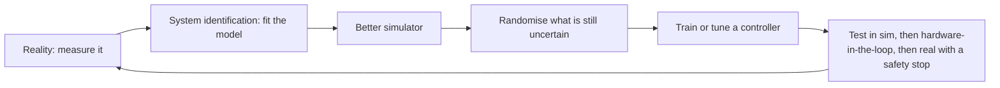

<LessonMeta level="Advanced" time="40 min" prereqs={["Why simulate", "Simulated sensors and ros_gz", "Basic probability (mean, standard deviation)", "Python and NumPy"]} />

Your walking policy runs for ten flawless minutes in simulation. You load it on the real robot, and it takes two steps and falls over. Nothing is "wrong" with the policy: the real motors are slower than the simulated ones, the floor is a bit slicker, and the camera image arrives 80 milliseconds late. This disagreement between the virtual and the real world is called the <Term def="The difference in behaviour between a robot controller or learned policy in simulation and on real hardware, caused by modelling errors and unmodelled effects">sim-to-real gap</Term>, and managing it is half of modern robotics.

<Objectives>

- List the main sources of the sim-to-real gap: dynamics, actuators, sensors, latency and visuals.
- Fit a simulation model to real measurements with system identification.
- Use domain randomization to produce controllers that survive uncertainty, and see the effect in code.
- Add realistic noise and latency models to a simulation, and plan a safe ladder of tests from sim to hardware.

</Objectives>

## Where the gap comes from

Think of the simulator as a guess about the world. Each part of that guess can be wrong.

| Source | What the simulator assumes | What reality does |
|---|---|---|
| Rigid-body parameters | Exact mass, centre of mass, inertia | Cables, batteries and paint change them |
| Contact and friction | One friction coefficient, ideal contact | Surfaces vary, wear, get dusty and wet |
| Actuators | Instant, perfect torque or position tracking | Limited bandwidth, saturation, backlash, heating, voltage sag |
| Sensors | Clean, or lightly noisy | Bias that drifts, dropouts, motion blur, lens dirt, rolling shutter |
| Latency | Zero or a fixed small delay | Variable delays through drivers, networks and compute |
| Visuals | Clean render, perfect textures | Glare, shadows, reflections, camera auto-exposure |
| World | Exactly as modelled | People, clutter and surprises |



There are four broad strategies, and good teams use all of them together:

1. **Make the simulator more accurate** (system identification).
2. **Make the controller robust to what is still wrong** (domain randomization, robust control).
3. **Adapt on the real robot** (online adaptation, fine-tuning with a small amount of real data).
4. **Make the real test safe** (staged testing, limits and an emergency stop).

<KeyIdea title="You cannot make the simulator perfect, so make the controller tolerant">
The goal is not a flawless simulator. The goal is a controller that works across a whole *range* of plausible worlds that contains reality. That is the core of domain randomization.
</KeyIdea>

## System identification: measure, then fit

<Term def="Estimating the parameters of a mathematical model by fitting its output to measurements from the real system">System identification</Term> means measuring the real system and tuning simulator parameters until the simulation reproduces it. The mathematical form is simple. Given a model with parameters $\theta$, input signals $u_k$ and measured outputs $y_k$, find

$$
\hat{\theta} = \arg\min_{\theta} \sum_{k} \left\| y_k - \hat{y}_k(\theta) \right\|^2 ,
$$

where $\hat{y}_k(\theta)$ is what the simulator predicts. That is nonlinear least squares.

A motor is a good first example. Apply a step of voltage and record the speed. A common model is first-order: $\tau \dot{\omega} = K u - \omega$, with gain $K$ (steady-state speed per volt) and time constant $\tau$ (how quickly it responds). The code below fakes "real" measurements from known values, then recovers them. You can replace the fake data with a real logged step response. It needs `pip install numpy scipy`.

```python title="sysid.py"
import numpy as np
from scipy.optimize import least_squares


def simulate(params, u, dt):
    gain, tau = params
    w = np.zeros_like(u)
    for k in range(1, len(u)):
        w[k] = w[k - 1] + dt * (gain * u[k - 1] - w[k - 1]) / tau
    return w


rng = np.random.default_rng(0)
dt = 0.01
t = np.arange(0.0, 3.0, dt)
u = np.where(t > 0.5, 6.0, 0.0)
true_params = (2.0, 0.25)
measured = simulate(true_params, u, dt) + rng.normal(0.0, 0.05, t.shape)

fit = least_squares(
    lambda p: simulate(p, u, dt) - measured,
    x0=[1.0, 0.1],
    bounds=([0.01, 0.01], [10.0, 2.0]),
)
print("true params :", true_params)
print("fitted      : gain=%.3f tau=%.3f" % tuple(fit.x))
```

Run it. It prints fitted values very close to the true ones. In real life three rules make system identification work:

- **Excite the system.** Use inputs that move the robot through the range you care about; a robot that never moves tells you nothing.
- **Fit what matters.** Fit the parameters that change behaviour a lot (actuator lag, friction, mass), not everything.
- **Validate on new data.** Check the fitted model against a recording it was *not* fitted to, just like any machine-learning model.

Typical quantities worth identifying: motor gain and time constant, joint friction and damping, link masses, ground friction, sensor noise standard deviations, and total latency from command to motion.

## Domain randomization: train for a range of worlds

Even after system identification, parameters stay uncertain and some drift over time. <Term def="Varying simulator parameters (physics, sensors, visuals) randomly during development so the result works across many possible worlds, including the real one">Domain randomization</Term> treats this honestly: instead of one simulator with fixed numbers, use many simulators with numbers drawn from plausible ranges. If $\xi$ is the vector of uncertain parameters with distribution $p(\xi)$, you tune a controller or policy $\pi$ to do well on average:

$$
\max_{\pi} \; \mathbb{E}_{\xi \sim p(\xi)} \left[ J(\pi ; \xi) \right] ,
$$

where $J$ is the performance score (reward, or negative error). A policy that scores well across the whole range is unlikely to be surprised by the real values.

What do you randomise?

- **Dynamics:** mass, friction, restitution, joint damping, motor strength.
- **Actuators:** gain error, delay, saturation.
- **Sensors:** noise level, bias, dropout, calibration error.
- **Visuals** (for camera inputs): lighting, textures, colours, camera pose, distractors, as in the Replicator workflow from the previous lesson.
- **Disturbances:** random pushes, payload changes.

Here is a complete, runnable example. A cart is driven by a PD controller. In the "nominal" simulator, mass, friction and gain are exact and there is no delay. In the randomised one, they vary, and observations are delayed by 0 to 7 steps and are noisy. We pick the controller gains twice (once per simulator) and test both on a held-out randomised "reality".

```python title="randomization_demo.py"
from collections import deque

import numpy as np


class CartEnv:
    """A 1D cart: m * x'' = f - c * x'. Parameters are re-drawn on every reset."""

    def __init__(self, randomize: bool, seed: int = 0):
        self.randomize = randomize
        self.rng = np.random.default_rng(seed)
        self.dt = 0.01

    def reset(self):
        r = self.rng
        if self.randomize:
            self.m = r.uniform(0.7, 1.5)            # mass error
            self.c = r.uniform(0.0, 1.0)            # friction error
            self.gain = r.uniform(0.8, 1.2)         # actuator strength
            self.delay = int(r.integers(0, 8))      # sensor latency in steps
            self.noise = r.uniform(0.0, 0.01)       # sensor noise std (m)
        else:
            self.m, self.c, self.gain, self.delay, self.noise = 1.0, 0.2, 1.0, 0, 0.0
        self.x, self.v = 0.0, 0.0
        self.buf = deque([(0.0, 0.0)] * (self.delay + 1), maxlen=self.delay + 1)
        return self._observe()

    def _observe(self):
        x_old, v_old = self.buf[0]
        if self.noise > 0:
            nx, nv = self.rng.normal(0.0, self.noise, 2)
        else:
            nx = nv = 0.0
        return x_old + nx, v_old + nv

    def step(self, f):
        f = float(np.clip(f, -50.0, 50.0)) * self.gain
        a = (f - self.c * self.v) / self.m
        self.v += a * self.dt
        self.x += self.v * self.dt
        self.buf.append((self.x, self.v))
        return self._observe()


def run_episode(env, kp, kd, steps=400):
    """Return the integrated absolute error: lower is better."""
    obs = env.reset()
    cost = 0.0
    for _ in range(steps):
        x, v = obs
        obs = env.step(kp * (1.0 - x) - kd * v)
        cost += abs(1.0 - env.x) * env.dt
        if abs(env.x) > 50:      # diverged: stop early with a big penalty
            return 50.0
    return cost


def score(env, kp, kd, episodes=100):
    return float(np.mean([run_episode(env, kp, kd) for _ in range(episodes)]))


candidates = [(kp, 0.8 * 2 * np.sqrt(kp)) for kp in (20, 80, 300, 1000, 3000)]

nominal_env = CartEnv(randomize=False)
random_env = CartEnv(randomize=True, seed=1)
reality = CartEnv(randomize=True, seed=999)      # held-out "real world"

best_nom = min(candidates, key=lambda g: score(nominal_env, *g, episodes=1))
best_dr = min(candidates, key=lambda g: score(random_env, *g))

for name, g in (("tuned on nominal sim", best_nom), ("tuned with randomisation", best_dr)):
    cost = score(reality, *g, episodes=300)
    print(f"{name:26s} kp={g[0]:5.0f} kd={g[1]:5.1f}  cost in 'reality' = {cost:.3f}")
```

Run it. The controller tuned only on the perfect simulator picks stiff, high gains, because with no delay a stiff controller looks best. In the delayed and noisy "reality" those gains oscillate. The controller tuned with randomisation picks gentler gains and scores far better on the held-out worlds (when we ran it, the cost was about three times lower). You have just seen the sim-to-real gap, and a cure, in 70 lines.

:::warning[Randomisation has a cost]
Randomise too little and the real world falls outside your range. Randomise too much and the task becomes impossible or the controller becomes timid and slow. Start with ranges you can justify from measurements, and widen them only when real tests demand it.
:::

## Noise and latency are not optional

Two effects deserve their own models because they break so many controllers.

**Sensor noise.** Real sensors are not just Gaussian. A better IMU model adds a slowly drifting bias, $b_{k+1} = b_k + \eta_k$, to the white noise $w_k$, so the reading is $z_k = x_k + b_k + w_k$. In Gazebo, noise blocks inside sensors (as in the previous lesson) give you the white-noise part; for biases, you can post-process in a bridge node or in your own wrapper.

**Latency.** Every real loop has delay between sensing and acting: camera exposure, USB transfer, image processing, network hops, motor drivers. A feedback loop with a delay of $T_d$ has extra phase lag of $\omega T_d$ at frequency $\omega$, which eats into its stability margin. That is why the delay in the cart example mattered so much. Measure the true end-to-end latency on your robot (for example, flash an LED on command and film it, or timestamp messages at each stage), then put that delay into your simulation as a buffer.

## Closing the gap on hardware

Even good randomisation does not remove the need for careful real tests. Climb a ladder, never skipping a rung:

1. **Software in the loop:** the real code against the simulator (what you have been doing).
2. **Hardware in the loop:** the real controller computer or motor drivers, with the plant still simulated. This finds timing and driver problems.
3. **Real robot, restrained:** on a stand or a tether, wheels or feet off the ground, with torque limits reduced.
4. **Real robot, free:** with an emergency stop within reach, conservative limits, and a clear area.

Log everything. When the real robot disagrees with the simulator, record the same signal in both and compare. That difference is the data that drives your next round of system identification.

## Hands-on lab

<Steps>

1. Run `sysid.py`. Change the noise standard deviation from 0.05 to 0.5 and see how the fitted values degrade. Then lengthen the recording from 3 s to 10 s and see how they recover.
2. Run `randomization_demo.py` and record the costs for both rows.
3. In `CartEnv`, widen the randomised delay from `integers(0, 8)` to `integers(0, 20)` and re-run. What happens to the best randomised gains?
4. Add a second uncertain parameter of your own choice, such as a random constant disturbance force, and re-run.

</Steps>

You know it worked when you can explain why the randomised-tuned controller picks lower gains than the nominal-tuned one.

## Exercises

<Exercise title="Which strategy?" level="Beginner">

Your robot arm’s real joint lags behind the commanded position by about 60 ms, but in simulation it tracks instantly. Name the simplest first fix.

<Solution>

Identify the lag by recording a step response on the real joint, fit a first-order model (or a pure delay), and add it to the simulation as a dynamics model or a delay buffer. Then re-tune or retrain against the corrected simulator.

</Solution>
</Exercise>

<Exercise title="Estimate latency stability" level="Intermediate">

A feedback loop has a crossover frequency of 5 Hz and a total delay of 40 ms. How much extra phase lag does the delay add at crossover?

<Solution>

Phase lag in radians is $\omega T_d = 2\pi \cdot 5 \cdot 0.04 \approx 1.26$ rad, which is about 72 degrees. That is large enough to remove most of a typical 60 degree phase margin, so the loop would be close to unstable.

</Solution>
</Exercise>

<Exercise title="Design the ranges" level="Advanced">

You are training a policy for a robot that carries between 0 and 3 kg of payload on a floor you have measured to have a friction coefficient between 0.5 and 0.9. State the ranges you would randomise for payload and friction, and one parameter you would keep fixed.

<Solution>

Randomise payload uniformly from 0 to 3 kg (perhaps slightly wider, such as 0 to 3.5 kg, for margin) and friction from about 0.4 to 1.0. Keep the robot’s own link geometry fixed, since you know it from the CAD or measurements. Document the ranges and widen them only if real tests fail outside them.

</Solution>
</Exercise>

## Check your understanding

<Quiz questions={[
  {q: "What is system identification?", options: ["Naming every part of a robot", "Fitting a simulation model’s parameters to real measurements", "Rendering the robot in 3D", "Logging in to the robot over SSH"], answer: 1, explain: "It estimates model parameters by minimising the difference between measured and simulated outputs."},
  {q: "Why can a controller tuned on a perfect simulator oscillate on hardware?", options: ["Hardware has no gravity", "It ignores delay, noise and parameter errors that real systems have", "Simulators always use smaller numbers", "Python is slower on robots"], answer: 1, explain: "High gains tuned without delay or noise can lose stability once real latency and noise are present."},
  {q: "What does domain randomization optimise for?", options: ["Best performance in a single exact simulator", "Good average performance across many plausible worlds", "The smallest possible model", "Fastest rendering"], answer: 1, explain: "It maximises expected performance over a distribution of simulator parameters."},
  {q: "In the testing ladder, which step comes right before running the robot freely?", options: ["Writing the paper", "Real robot, restrained, with reduced limits", "Deleting the simulator", "Skipping hardware-in-the-loop"], answer: 1, explain: "Restrained tests with reduced limits find hardware problems at low risk before free operation."}
]} />

<Takeaways>

- The sim-to-real gap comes from imperfect dynamics, actuators, sensors, latency, visuals and the world itself.
- System identification fits simulator parameters to real data with least squares; validate on held-out data.
- Domain randomization trains for a range of worlds, so the controller tolerates the real one.
- Model noise (including bias) and latency explicitly; latency eats stability margin.
- Randomise what you are unsure about, not everything, and justify your ranges with measurements.
- Move from simulation to hardware in stages, logging both sides to keep improving the model.

</Takeaways>

## Go deeper

- Tobin et al., "Domain Randomization for Transferring Deep Neural Networks from Simulation to the Real World": [arxiv.org/abs/1703.06907](https://arxiv.org/abs/1703.06907)
- Peng et al., "Sim-to-Real Transfer of Robotic Control with Dynamics Randomization": [arxiv.org/abs/1710.06537](https://arxiv.org/abs/1710.06537)
- Gazebo documentation on sensor noise models: [gazebosim.org/docs](https://gazebosim.org/docs)

Stuck? Ask **Rivet**, the course assistant, bottom-right.

Next: [Cameras and image processing](../05-perception/01-cameras-and-image-processing.mdx)
