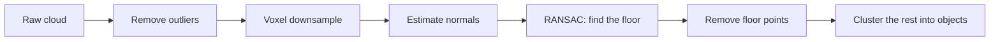

<LessonMeta level="Intermediate" time="45 min" prereqs={["Cameras and image processing", "NumPy", "Frames and rigid transforms"]} />

A camera image tells your robot what things look like. To pick up a mug, or to avoid walking into a table, it also needs to know how far away things are, and where they sit in three dimensions. This is the job of depth sensors and lidar. They give you a **point cloud**: thousands of 3D points on the surfaces around the robot. In this lesson you will build a point cloud, find the floor in it, and pull out the objects standing on it.

<Objectives>

- Explain how stereo cameras, structured light or time-of-flight cameras, and lidar measure distance.
- Convert a depth image or a laser scan to 3D points with NumPy.
- Downsample, clean and estimate normals for a point cloud with Open3D.
- Find a ground plane with RANSAC and separate objects with clustering.

</Objectives>

## Four ways to measure depth

**Stereo.** Two cameras a distance $B$ apart (the **baseline**) see the same point at slightly different columns. The difference is the <Term def="The horizontal pixel offset of the same scene point between the left and right images of a stereo pair; larger disparity means closer">disparity</Term> $d = u_L - u_R$. Similar triangles give

$$
Z = \frac{f\,B}{d}.
$$

Near things have a large disparity, far things a small one. Differentiating shows the catch: a depth error of $\delta Z \approx Z^2\,\delta d / (f B)$, so stereo accuracy **degrades with the square of distance**. Stereo needs texture to match points, so blank white walls are a problem.

**Structured light and time-of-flight (ToF) cameras.** These are *active*: the camera projects a known infrared pattern, or pulses of light, and works out distance from the pattern’s distortion or the light’s travel time. They work on blank walls but struggle in strong sunlight and on shiny or transparent surfaces.

**Lidar.** A <Term def="Light detection and ranging: measures distance by timing the return of laser pulses">lidar</Term> spins a laser and measures the return time of each pulse. A **2D lidar** scans one plane and returns a ring of ranges, which is perfect for navigation on flat floors. A **3D lidar** has many beams stacked vertically and returns a full cloud, common on outdoor robots and cars.

**Learned depth.** Neural networks can estimate depth from a single image. The result is plausible but not metrically reliable, so treat it as a hint rather than a measurement.

| Sensor | Range | Strengths | Weak spots |
|---|---|---|---|
| Stereo | a few metres | Cheap, works outdoors | Needs texture, error grows with distance squared |
| Structured light / ToF | 0.3 to ~8 m | Dense depth, indoors | Sunlight, glass, black or shiny surfaces |
| 2D lidar | 10 m and up | Accurate, fast, simple | Only one plane |
| 3D lidar | tens to hundreds of m | Full 3D, long range | Cost, sparse data |

## From depth image to point cloud

A depth image stores, for each pixel, the distance $Z$ along the optical axis. In ROS, depth is either `32FC1` in metres or `16UC1` in millimetres (check the encoding). Reusing the pinhole model from the last lesson, a pixel $(u, v)$ with depth $Z$ becomes

$$
X = \frac{(u - c_x)\,Z}{f_x}, \quad Y = \frac{(v - c_y)\,Z}{f_y}.
$$

```python title="depth_to_points.py"
import numpy as np


def depth_to_points(depth_m: np.ndarray, fx, fy, cx, cy) -> np.ndarray:
    """HxW depth image in metres -> Nx3 points in the camera optical frame."""
    h, w = depth_m.shape
    u, v = np.meshgrid(np.arange(w), np.arange(h))
    z = depth_m
    valid = np.isfinite(z) & (z > 0.1)          # drop NaN, zero and too-close values
    x = (u - cx) * z / fx
    y = (v - cy) * z / fy
    return np.column_stack([x[valid], y[valid], z[valid]])


# A flat wall 2 m in front of a 640x480 camera:
depth = np.full((480, 640), 2.0)
pts = depth_to_points(depth, fx=600, fy=600, cx=320, cy=240)
print(pts.shape, pts[:, 2].min(), pts[:, 2].max())    # (307200, 3) 2.0 2.0
```

A **2D lidar** is even simpler. A `LaserScan` message gives you a list of ranges $r_i$ at angles $\theta_i = \theta_\text{min} + i\,\Delta\theta$, and the points are

$$
x_i = r_i \cos\theta_i, \qquad y_i = r_i \sin\theta_i .
$$

```python title="scan_to_points.py"
import numpy as np


def scan_to_points(ranges, angle_min, angle_increment, range_min, range_max) -> np.ndarray:
    """Convert LaserScan fields to Nx2 points in the sensor frame, dropping invalid returns."""
    r = np.asarray(ranges, dtype=float)
    theta = angle_min + angle_increment * np.arange(len(r))
    ok = np.isfinite(r) & (r >= range_min) & (r <= range_max)
    return np.column_stack([r[ok] * np.cos(theta[ok]), r[ok] * np.sin(theta[ok])])


# A fake scan of a circular room of radius 3 m:
angles = np.linspace(-np.pi, np.pi, 360, endpoint=False)
pts = scan_to_points([3.0] * 360, -np.pi, angles[1] - angles[0], 0.12, 10.0)
print(pts.shape, np.round(np.hypot(pts[:, 0], pts[:, 1]).mean(), 3))   # (360, 2) 3.0
```

In ROS 2 a 3D cloud arrives as `sensor_msgs/msg/PointCloud2`, a packed binary buffer. The helper in `sensor_msgs_py` unpacks it:

```python title="cloud_listener.py"
import numpy as np
import rclpy
from rclpy.node import Node
from rclpy.qos import qos_profile_sensor_data
from sensor_msgs.msg import PointCloud2
from sensor_msgs_py import point_cloud2


class CloudListener(Node):
    def __init__(self):
        super().__init__("cloud_listener")
        self.create_subscription(PointCloud2, "/depth_camera/points", self.on_cloud, qos_profile_sensor_data)

    def on_cloud(self, msg: PointCloud2):
        pts = point_cloud2.read_points(msg, field_names=("x", "y", "z"), skip_nans=True)
        xyz = np.column_stack([pts["x"], pts["y"], pts["z"]])
        self.get_logger().info(f"{len(xyz)} points, nearest {np.linalg.norm(xyz, axis=1).min():.2f} m")


def main():
    rclpy.init()
    rclpy.spin(CloudListener())


if __name__ == "__main__":
    main()
```

:::note
Every cloud lives in a frame, given by `msg.header.frame_id`. Before you combine clouds from two sensors, or combine one with a map, transform them into a common frame using TF. Mixing frames is the most common point-cloud bug.
:::

## Stereo in OpenCV

If you have two rectified images (left and right, same row alignment), OpenCV can compute disparity, and you apply $Z = fB/d$:

```python title="stereo.py"
import cv2
import numpy as np

left = cv2.imread("left.png", cv2.IMREAD_GRAYSCALE)
right = cv2.imread("right.png", cv2.IMREAD_GRAYSCALE)

matcher = cv2.StereoSGBM_create(minDisparity=0, numDisparities=64, blockSize=5)
disparity = matcher.compute(left, right).astype(np.float32) / 16.0   # SGBM returns fixed point x16

FOCAL_PX, BASELINE_M = 600.0, 0.12                                  # from your calibration
with np.errstate(divide="ignore"):
    depth = np.where(disparity > 0, FOCAL_PX * BASELINE_M / disparity, np.nan)
print("median depth:", np.nanmedian(depth), "m")
```

"Rectified" means calibration has removed distortion and aligned the two image planes so that matching points lie on the same row. Calibrate a stereo pair with `cv2.stereoCalibrate` and `cv2.stereoRectify`, or use a camera that ships with factory calibration.

## Working with point clouds in Open3D

<Term def="An open-source library for 3D data processing, with point cloud, mesh and registration tools in Python and C++">Open3D</Term> (`pip install open3d`; check that your Python version is supported by the current release) gives you fast, simple tools. The workflow almost every perception pipeline follows is:



Each step earns its place:

- **Outlier removal.** Stray points from reflections or noise confuse everything after. A *statistical* filter drops points whose neighbours are unusually far away.
- **Voxel downsampling.** Divide space into small cubes (voxels) and keep one point per cube. Clouds of a million points become tens of thousands, and density becomes even.
- **Normals.** The <Term def="A unit vector perpendicular to a surface at a point; estimated from the neighbours of each point">surface normal</Term> at each point tells you which way the surface faces. Normals help segment surfaces, align clouds and plan grasps.
- **RANSAC plane fit.** Find the biggest flat thing, usually the floor.
- **Clustering.** Group the remaining points into separate objects.

<KeyIdea title="RANSAC: guess, check, repeat">
<Term def="Random Sample Consensus: repeatedly fit a model to a tiny random subset of the data and keep the model that most of the data agrees with">RANSAC</Term> is the standard way to fit a model to data that contains many outliers. To find a plane: pick 3 random points, compute the plane through them, count how many points lie within a small distance of it, and repeat. Keep the plane with the most inliers. Least squares would be pulled off by the boxes; RANSAC ignores them.
</KeyIdea>

Here is RANSAC from scratch in NumPy so you can see the idea. It makes its own data: a flat floor plus a box.

```python title="ransac_plane.py"
import numpy as np


def ransac_plane(points, threshold=0.02, iterations=200, seed=0):
    """Fit a plane n.x + d = 0 to Nx3 points. Returns (normal, d, inlier_mask)."""
    rng = np.random.default_rng(seed)
    best_mask, best_model = None, None
    for _ in range(iterations):
        a, b, c = points[rng.choice(len(points), 3, replace=False)]
        n = np.cross(b - a, c - a)
        norm = np.linalg.norm(n)
        if norm < 1e-9:                      # the three points were collinear
            continue
        n /= norm
        d = -n @ a
        mask = np.abs(points @ n + d) < threshold
        if best_mask is None or mask.sum() > best_mask.sum():
            best_mask, best_model = mask, (n, d)
    return best_model[0], best_model[1], best_mask


rng = np.random.default_rng(0)
floor = np.column_stack([rng.uniform(-3, 3, (6000, 2)), rng.normal(0, 0.005, 6000)])
box = rng.uniform(-0.5, 0.5, (800, 3)) * [0.4, 0.4, 0.5] + [1.0, 0.5, 0.25]
cloud = np.vstack([floor, box])

n, d, inliers = ransac_plane(cloud)
print("normal:", np.round(n, 3), "d:", round(d, 3), "inliers:", inliers.sum(), "of", len(cloud))
```

The printed normal is close to $(0, 0, \pm 1)$ and $d$ close to 0: the floor, found even though the box sits on it. (The sign of a plane normal is arbitrary.) The number of iterations needed is $N \approx \log(1-p)/\log(1-w^3)$, where $w$ is the fraction of inliers and $p$ the desired confidence; with 88% inliers, 200 iterations is far more than enough.

Now the full pipeline in Open3D, on a similar synthetic scene:

```python title="pipeline.py"
import numpy as np
import open3d as o3d

rng = np.random.default_rng(0)
floor = np.column_stack([rng.uniform(-3, 3, (6000, 2)), rng.normal(0, 0.005, 6000)])
box1 = rng.uniform(-0.5, 0.5, (1500, 3)) * [0.4, 0.4, 0.5] + [1.0, 0.5, 0.25]
box2 = rng.uniform(-0.5, 0.5, (700, 3)) * [0.3, 0.3, 0.3] + [-1.0, -1.0, 0.15]
stray = rng.uniform(-3, 3, (40, 3)) * [1, 1, 0.5] + [0, 0, 0.8]          # flying outliers

pcd = o3d.geometry.PointCloud()
pcd.points = o3d.utility.Vector3dVector(np.vstack([floor, box1, box2, stray]))
print("raw points:", len(pcd.points))

# 1. Remove outliers: drop points far from their 20 nearest neighbours
pcd, _ = pcd.remove_statistical_outlier(nb_neighbors=20, std_ratio=2.0)

# 2. Voxel downsample to 3 cm
pcd = pcd.voxel_down_sample(voxel_size=0.03)
print("after filtering:", len(pcd.points))

# 3. Normals from the 30 nearest neighbours within 10 cm
pcd.estimate_normals(search_param=o3d.geometry.KDTreeSearchParamHybrid(radius=0.1, max_nn=30))

# 4. RANSAC: the biggest plane is the floor
(a, b, c, d), floor_idx = pcd.segment_plane(distance_threshold=0.02, ransac_n=3, num_iterations=1000)
print(f"floor plane: {a:.2f}x + {b:.2f}y + {c:.2f}z + {d:.2f} = 0, {len(floor_idx)} points")

# 5. Keep everything that is not floor, then cluster with DBSCAN
objects = pcd.select_by_index(floor_idx, invert=True)
labels = np.array(objects.cluster_dbscan(eps=0.1, min_points=10))

pts = np.asarray(objects.points)
for k in range(labels.max() + 1):
    cluster = pts[labels == k]
    print(f"object {k}: {len(cluster)} points, centre {np.round(cluster.mean(axis=0), 2)}, "
          f"size {np.round(np.ptp(cluster, axis=0), 2)}")
```

Run it and you should see two objects, near (1.0, 0.5, 0.25) and (-1.0, -1.0, 0.15), with sizes close to the boxes’ dimensions. (Points with label -1 are noise.) Add `o3d.visualization.draw_geometries([objects])` to view them in 3D, if you have a display.

DBSCAN grows a cluster from any point that has at least `min_points` neighbours within distance `eps`. Choose `eps` a little bigger than the point spacing on an object, and smaller than the gap between objects.

## Hands-on lab

<Steps>

1. Run `depth_to_points.py` and `scan_to_points.py`. Confirm the printed shapes and values.
2. Run `ransac_plane.py`. Change `threshold` to 0.2 and see how many points become inliers, then change it to 0.001 and see what happens.
3. Install Open3D and run `pipeline.py`. Verify that you get two clusters with centres near the boxes.
4. In your Gazebo world from the simulation module, run `cloud_listener.py` on `/depth_camera/points` and check that the nearest-point distance matches the distance you see in the simulator. Optional: save one cloud to a `.npy` file and run the Open3D pipeline on it.

</Steps>

It worked if the pipeline finds exactly the number of objects you placed, and the floor plane normal is vertical.

## Exercises

<Exercise title="Stereo depth" level="Beginner">

A stereo camera has $f = 700$ px and baseline $B = 0.10$ m. A point has disparity 14 px. How far away is it, and how much does the depth change if the disparity is off by 1 px?

<Solution>

$Z = fB/d = 700 \cdot 0.10 / 14 = 5$ m. With $d = 13$, $Z = 70/13 \approx 5.38$ m, an error of about 0.38 m. With $d = 15$, $Z \approx 4.67$ m. This is why stereo at long range is imprecise.

</Solution>
</Exercise>

<Exercise title="Lidar to a wall" level="Intermediate">

A 2D lidar reports a range of 2.0 m at angle 30 degrees to the left of straight ahead (take the sensor’s x axis forward and y to the left). Where is that point in the sensor frame?

<Solution>

$x = 2.0\cos 30^\circ \approx 1.73$ m and $y = 2.0 \sin 30^\circ = 1.0$ m. So the point is 1.73 m ahead and 1.0 m to the left.

</Solution>
</Exercise>

<Exercise title="Choosing the voxel size" level="Intermediate">

Your cloud has a 5 mm spacing, the smallest object you care about is a 4 cm cube, and you need real-time speed. Suggest a voxel size and explain the trade-off.

<Solution>

Something like 1 cm to 2 cm. It reduces the point count by roughly 4x to 16x per axis-pair (fewer points), while a 4 cm cube still keeps several points per side. A 10 cm voxel would erase the cube’s shape; a 5 mm voxel would barely downsample at all.

</Solution>
</Exercise>

## Check your understanding

<Quiz questions={[
  {q: "How does stereo depth error change with distance?", options: ["It is constant", "It grows roughly with the square of the distance", "It shrinks with distance", "It depends only on the colour of objects"], answer: 1, explain: "Since Z = fB/d, a fixed disparity error produces a depth error proportional to Z squared."},
  {q: "Why use RANSAC instead of ordinary least squares to find the floor?", options: ["It is always faster", "It ignores the many points that are not on the floor", "It needs no data", "It guarantees an exact fit"], answer: 1, explain: "RANSAC fits to the consensus set and is robust to large numbers of outliers such as objects on the floor."},
  {q: "What does voxel downsampling do?", options: ["Colours the cloud", "Keeps roughly one point per small cube, reducing and evening out density", "Rotates the cloud", "Removes the floor"], answer: 1, explain: "It replaces the points in each voxel by one representative point."},
  {q: "A LaserScan range of inf means what?", options: ["A very close object", "No return within range, so it must be filtered out", "A sensor fault that crashes ROS", "An object exactly at the maximum range"], answer: 1, explain: "Infinite values mean no echo was received, so valid-range filtering is required."}
]} />

<Takeaways>

- Depth comes from stereo, active infrared sensors, lidar or learned estimates, each with different strengths and failure cases.
- A depth pixel becomes a 3D point with $X = (u-c_x)Z/f_x$ and $Y = (v-c_y)Z/f_y$; a laser scan becomes points with cosine and sine.
- Stereo depth error grows with $Z^2$; lidar and active depth are better at range, at a cost.
- Standard pipeline: remove outliers, voxel downsample, estimate normals, RANSAC the floor, cluster the rest.
- Always know which frame a cloud is in, and transform with TF before combining sensors.
- Filter invalid ranges and NaNs before doing any maths.

</Takeaways>

## Go deeper

- Open3D documentation: [open3d.org/docs](https://www.open3d.org/docs/release/)
- ROS 2 `sensor_msgs` message reference: [docs.ros.org](https://docs.ros.org)
- OpenCV stereo tutorials: [docs.opencv.org](https://docs.opencv.org)
- Point Cloud Library, a C++ alternative: [pointclouds.org](https://pointclouds.org)

Stuck? Ask **Rivet**, the course assistant, bottom-right.

Next: [Deep learning for detection and segmentation](./03-deep-learning-detection-segmentation.mdx)
