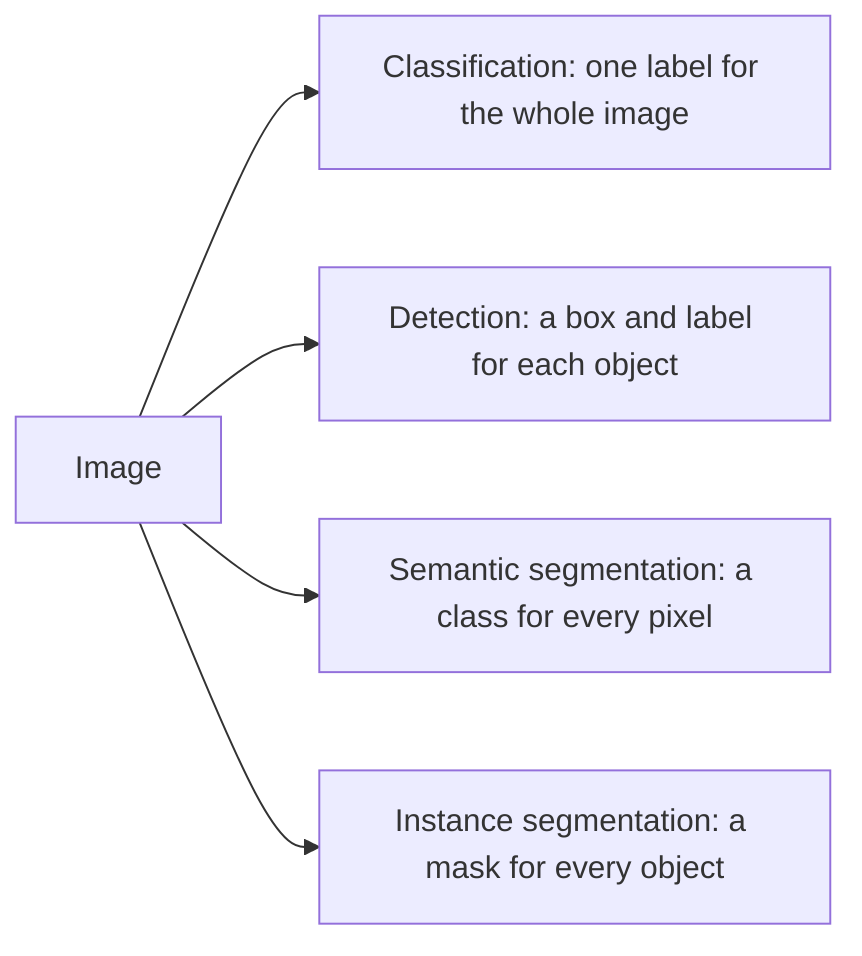

<LessonMeta level="Intermediate" time="40 min" prereqs={["Cameras and image processing", "Python and NumPy", "Basic idea of a neural network"]} />

Colour thresholding found the red ball in the last lesson, but real robots must find mugs, people, doors and pallets, in every kind of light and from every angle. No hand-written rule covers that. This is where deep learning changed robotics: a neural network trained on millions of labelled images can look at a photo and say "a mug here, a person there", and today you can use such a network in ten lines of Python without training anything.

<Objectives>

- Explain in plain words what a convolutional neural network (CNN) computes, and why it suits images.
- Distinguish classification, detection, semantic segmentation and instance segmentation.
- Run a pretrained detector and a segmentation model with torchvision, and a YOLO-style detector with ultralytics.
- Measure detections with IoU, apply non-maximum suppression, and convert a detection plus depth into a 3D position.

</Objectives>

## What a CNN does

An image is a grid of numbers. A <Term def="Convolutional neural network: a network built from small learned filters slid across the image, so the same pattern detector is applied at every location">convolutional neural network</Term> processes it with **filters**: tiny grids (say 3 by 3) that slide across the image, computing a weighted sum at each position. You already know one filter: the Sobel kernel that finds vertical edges. In a CNN, the filter weights are *learned* from data rather than written by hand.

```python title="conv_demo.py"
import numpy as np


def conv2d(image, kernel):
    """Valid cross-correlation of a 2D image with a small kernel (what CNN layers compute)."""
    kh, kw = kernel.shape
    h, w = image.shape
    out = np.zeros((h - kh + 1, w - kw + 1))
    for i in range(out.shape[0]):
        for j in range(out.shape[1]):
            out[i, j] = np.sum(image[i:i + kh, j:j + kw] * kernel)
    return out


image = np.zeros((8, 8))
image[:, 4:] = 1.0                                   # dark left half, bright right half
sobel_x = np.array([[-1, 0, 1], [-2, 0, 2], [-1, 0, 1]], float)
print(conv2d(image, sobel_x)[0])                     # [0. 0. 4. 4. 0. 0.]: it fires at the edge
```

Stack many layers and something remarkable happens. The first layers learn edges and colour blobs. Middle layers combine them into corners, textures and parts (a wheel, an eye). Late layers recognise whole objects. Between layers, pooling or strided convolutions shrink the image so that later filters "see" larger regions: the <Term def="The region of the input image that can influence one value inside the network">receptive field</Term> grows with depth.

<KeyIdea title="Features are learned, not designed">
Classical vision (the last lesson) asks you to choose the features: edges, colour ranges, corners. A deep network learns the features that best solve the task from labelled examples. That is why it can handle variety that no hand-written rule can, and also why it can fail in surprising ways on images unlike its training data.
</KeyIdea>

## The tasks



- **Classification:** "this is a kitchen". Rarely enough for a robot.
- **Detection:** boxes with class labels and confidence scores. The workhorse for finding things to avoid or grasp.
- **Semantic segmentation:** every pixel gets a class (floor, wall, person), but two people merge into one blob. Good for "where can I drive?".
- **Instance segmentation:** a separate mask per object. Good for grasping, since the mask outlines the object.

### Detector families

- **Two-stage detectors** (the R-CNN family such as Faster R-CNN, 2015) first propose regions that might hold objects, then classify and refine each one. Accurate, slower.
- **One-stage detectors** (the YOLO family, "You Only Look Once", and SSD) predict boxes and classes for all locations in a single pass. Fast enough for real time on a robot, and the usual first choice.
- **Transformer-based detectors** treat detection as set prediction and are strong but often heavier.

Check the current documentation for the latest model names and speed-accuracy numbers; they change every few months.

## Boxes: IoU and non-maximum suppression

A detector often fires several overlapping boxes on the same object. Two tools clean this up. <Term def="Intersection over union: the area where two boxes overlap divided by the area they cover together, from 0 (disjoint) to 1 (identical)">IoU</Term> measures how much two boxes overlap, and <Term def="Non-maximum suppression: keep the highest-scoring box and discard other boxes that overlap it strongly">non-maximum suppression (NMS)</Term> keeps the best box and drops its near-duplicates.

$$
\text{IoU}(A, B) = \frac{|A \cap B|}{|A \cup B|}.
$$

```python title="iou_nms.py"
import numpy as np


def iou(a, b):
    """Boxes are [x1, y1, x2, y2] in pixels."""
    x1, y1 = max(a[0], b[0]), max(a[1], b[1])
    x2, y2 = min(a[2], b[2]), min(a[3], b[3])
    inter = max(0.0, x2 - x1) * max(0.0, y2 - y1)
    area = lambda r: (r[2] - r[0]) * (r[3] - r[1])
    return inter / (area(a) + area(b) - inter)


def nms(boxes, scores, iou_threshold=0.5):
    order = np.argsort(scores)[::-1]               # best first
    keep = []
    while len(order):
        i = order[0]
        keep.append(int(i))
        order = np.array([j for j in order[1:] if iou(boxes[i], boxes[j]) < iou_threshold], dtype=int)
    return keep


boxes = np.array([[10, 10, 110, 110], [12, 14, 112, 108], [200, 200, 260, 280]], float)
scores = np.array([0.90, 0.80, 0.70])
print("IoU of first two:", round(iou(boxes[0], boxes[1]), 3))     # 0.904
print("kept:", nms(boxes, scores))                                # [0, 2]
```

IoU is also how detectors are scored. A prediction counts as correct if its IoU with a true box exceeds a threshold, and the standard metric **mAP** (mean average precision) summarises precision and recall over all classes. For a robot, also measure what matters in your task: how often a grasp target is missed, and how often it hallucinates an obstacle that is not there.

## A pretrained detector with torchvision

Training from scratch needs huge data. Instead you start from a model trained on a large dataset (COCO, with 80 everyday object classes) and use it directly or fine-tune it. Install the libraries with `pip install torch torchvision`.

```python title="detect_torchvision.py"
import torch
from torchvision.io import read_image, write_png
from torchvision.models.detection import FasterRCNN_ResNet50_FPN_Weights, fasterrcnn_resnet50_fpn
from torchvision.utils import draw_bounding_boxes

weights = FasterRCNN_ResNet50_FPN_Weights.DEFAULT
model = fasterrcnn_resnet50_fpn(weights=weights, box_score_thresh=0.6).eval()
preprocess = weights.transforms()
categories = weights.meta["categories"]

image = read_image("street.jpg")                    # uint8 tensor, shape [3, H, W], RGB
with torch.no_grad():
    pred = model([preprocess(image)])[0]            # a list of images in, a list of dicts out

labels = [f"{categories[int(i)]} {float(s):.2f}" for i, s in zip(pred["labels"], pred["scores"])]
for lab, box in zip(labels, pred["boxes"].tolist()):
    print(lab, [round(v) for v in box])

annotated = draw_bounding_boxes(image, pred["boxes"], labels, colors="red", width=3)
write_png(annotated, "street_detected.png")
```

Use any photo of a street or room as `street.jpg`. The first run downloads the weights. Things to notice: the model takes a **list** of images; `weights.transforms()` applies the exact preprocessing the model was trained with (skipping it is a classic source of bad results); and `box_score_thresh` hides low-confidence boxes. Runs on CPU, slowly; add `.to("cuda")` on the model and input tensors if you have a GPU.

## A YOLO-style detector with ultralytics

For real-time work, a one-stage detector is the usual choice. The `ultralytics` package wraps the YOLO family with a very short interface (`pip install ultralytics`):

```python title="detect_yolo.py"
from ultralytics import YOLO

model = YOLO("yolo11n.pt")                  # small pretrained model, downloaded on first use
results = model("street.jpg", conf=0.4)     # run inference

for box in results[0].boxes:
    cls_id = int(box.cls[0])
    x1, y1, x2, y2 = box.xyxy[0].tolist()
    print(f"{model.names[cls_id]:<12} {float(box.conf[0]):.2f}  "
          f"({x1:.0f}, {y1:.0f}) to ({x2:.0f}, {y2:.0f})")

results[0].save(filename="street_yolo.jpg")  # draws the boxes
```

Model names, sizes and speeds change with releases, so check the ultralytics documentation for the current ones. The small "n" models run on modest hardware, and larger ones are more accurate. The same API gives you instance segmentation (use a `-seg` checkpoint) and, with `model.train(data="mydata.yaml", epochs=50)`, fine-tuning on your own labelled images.

:::tip[Pro tip]
Fine-tuning a pretrained model on 200 to 500 images of *your* objects in *your* lighting usually beats a bigger generic model. Generating those images in simulation, as in the Isaac Sim lesson, is a good way to bootstrap, but always mix in real photos.
:::

## Segmentation

A segmentation network outputs, for every pixel, a score for each class. Take the highest per pixel and you have a label map.

```python title="segment_torchvision.py"
import torch
from torchvision.io import read_image
from torchvision.models.segmentation import DeepLabV3_ResNet50_Weights, deeplabv3_resnet50

weights = DeepLabV3_ResNet50_Weights.DEFAULT
model = deeplabv3_resnet50(weights=weights).eval()
preprocess = weights.transforms()
categories = weights.meta["categories"]

image = read_image("street.jpg")
batch = preprocess(image).unsqueeze(0)               # [1, 3, H', W']
with torch.no_grad():
    scores = model(batch)["out"][0]                  # [num_classes, H', W']

labels = scores.argmax(dim=0)                        # [H', W'] class id per pixel
total = labels.numel()
for class_id in labels.unique():
    share = float((labels == class_id).sum()) / total
    print(f"{categories[int(class_id)]:<12} {share:5.1%}")
```

This prints the fraction of the image covered by each class (this particular model uses a small set of 21 classes, including person and car, plus background). For driving or floor-finding you would use a model trained on classes such as road, sidewalk and obstacle. Foundation models such as Segment Anything (arXiv 2304.02643) can segment objects from simple prompts like a clicked point or a box, which is useful for labelling and for grasp targeting.

## From pixels to the world

A detection is a box in the image. The robot needs a position in 3D. Combine what you have learned: take the box centre, read the depth there (the median of a small patch, which resists holes), and unproject with the camera intrinsics.

```python title="box_to_3d.py"
import numpy as np


def box_to_point(box, depth_m, K):
    """box = [x1, y1, x2, y2] pixels; depth_m = HxW depth in metres; K = 3x3 intrinsics."""
    u = int((box[0] + box[2]) / 2)
    v = int((box[1] + box[3]) / 2)
    patch = depth_m[max(v - 2, 0):v + 3, max(u - 2, 0):u + 3]
    z = float(np.nanmedian(patch[patch > 0.1]))
    x = (u - K[0, 2]) * z / K[0, 0]
    y = (v - K[1, 2]) * z / K[1, 1]
    return np.array([x, y, z])


K = np.array([[600.0, 0, 320], [0, 600.0, 240], [0, 0, 1]])
depth = np.full((480, 640), 2.0)
print(box_to_point([400, 200, 500, 300], depth, K))     # about [0.433 0.033 2.0]
```

Then use TF to transform that point from the camera frame into `base_link` or `map`, as you learned in the ROS 2 module. Better still, use the segmentation mask instead of the box centre: take the median over the mask’s pixels, which is not fooled by background showing inside the box.

## Practical limits

- **Latency.** A detector at 5 frames per second means decisions on stale data. Measure end-to-end latency, and use smaller models, lower resolution, half precision or GPU inference runtimes when needed.
- **Distribution shift.** Models fail on lighting, camera angles or object types unlike their training data. Test on images from *your* robot early.
- **Confidence is not truth.** Scores are often over-confident. Track detections over time, and require a few consecutive frames before acting.
- **Safety.** Never let a detector be the only thing that stops a robot from hitting a person. Use it alongside lidar-based obstacle avoidance and hardware limits.

## Hands-on lab

<Steps>

1. Run `conv_demo.py` and `iou_nms.py` to see the building blocks work on tiny examples.
2. Take three photos with your phone (a desk, a street, a room). Run `detect_torchvision.py` on each. Note what it finds and what it misses.
3. Install ultralytics and run `detect_yolo.py` on the same photos. Compare the time taken and the boxes found with the torchvision model.
4. Run `segment_torchvision.py` on the street photo and print the class shares.
5. Using a depth camera in your Gazebo world (or a made-up depth image), run `box_to_3d.py` on a detection and check that the answer is plausible.

</Steps>

It worked if both detectors label the obvious objects and your 3D point is in front of the camera at a believable distance.

## Exercises

<Exercise title="Compute an IoU" level="Beginner">

Box A is [0, 0, 10, 10] and box B is [5, 0, 15, 10]. What is their IoU?

<Solution>

The overlap is x from 5 to 10 and y from 0 to 10: area 50. Each box has area 100, so the union is 100 + 100 - 50 = 150. IoU = 50 / 150 = 1/3, about 0.33.

</Solution>
</Exercise>

<Exercise title="Tune the threshold" level="Intermediate">

Your detector keeps producing two boxes on every large object. Which parameter do you adjust, and in which direction? What goes wrong if you overdo it?

<Solution>

Lower the NMS IoU threshold (for example from 0.7 to 0.5) so overlapping boxes are suppressed more aggressively. If you overdo it, two genuinely different objects that overlap in the image, such as two people standing close together, get merged into one detection.

</Solution>
</Exercise>

<Exercise title="Pick the task" level="Intermediate">

For each robot job, choose detection, semantic segmentation or instance segmentation: (a) deciding where a wheelchair-sized robot can drive, (b) counting boxes on a pallet, (c) picking one specific bolt out of a bin of identical bolts.

<Solution>

(a) Semantic segmentation of the drivable floor. (b) Detection or instance segmentation; detection is enough to count. (c) Instance segmentation, because you need the outline of the individual bolt to plan a grasp.

</Solution>
</Exercise>

## Check your understanding

<Quiz questions={[
  {q: "What does a CNN filter do?", options: ["It deletes pixels at random", "It slides over the image computing weighted sums, with weights learned from data", "It converts images to text", "It stores the image on disk"], answer: 1, explain: "Convolutional layers apply learned filters at every position, so one pattern detector works anywhere in the image."},
  {q: "What is the purpose of non-maximum suppression?", options: ["To increase image resolution", "To remove duplicate overlapping boxes for the same object", "To compute depth", "To train the network faster"], answer: 1, explain: "NMS keeps the highest-scoring box and removes boxes that overlap it strongly."},
  {q: "Which task gives a separate mask for each individual object?", options: ["Classification", "Semantic segmentation", "Instance segmentation", "Calibration"], answer: 2, explain: "Instance segmentation separates objects of the same class, which semantic segmentation merges."},
  {q: "Why use the median depth of a patch rather than one pixel?", options: ["It is required by PyTorch", "Single pixels can be holes or noise in depth images", "Patches are always larger objects", "The median is faster than reading one pixel"], answer: 1, explain: "Depth images contain missing values and noise, and a median over a small patch is robust to them."}
]} />

<Takeaways>

- CNNs learn their own filters; early layers find edges, later layers find parts and objects.
- Detection gives boxes and labels, semantic segmentation labels pixels, instance segmentation separates objects.
- Pretrained models from torchvision or ultralytics work in a few lines; always use the matching preprocessing.
- IoU measures box overlap, NMS removes duplicates, and mAP is the standard accuracy score.
- Combine a detection with depth and intrinsics to get a 3D position, then use TF to move it into a useful frame.
- Check latency, test on your own camera images, and never rely on a detector alone for safety.

</Takeaways>

## Go deeper

- PyTorch and torchvision models and weights: [pytorch.org/vision/stable/models.html](https://pytorch.org/vision/stable/models.html)
- Ultralytics documentation: [docs.ultralytics.com](https://docs.ultralytics.com)
- Ren et al., "Faster R-CNN": [arxiv.org/abs/1506.01497](https://arxiv.org/abs/1506.01497)
- Redmon et al., "You Only Look Once": [arxiv.org/abs/1506.02640](https://arxiv.org/abs/1506.02640)

Stuck? Ask **Rivet**, the course assistant, bottom-right.

Next: [State estimation and Kalman filters](./04-state-estimation-and-kalman-filters.mdx)
