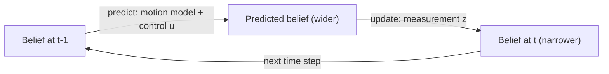

<LessonMeta level="Advanced" time="45 min" prereqs={["Probability for robots", "Linear algebra and transforms", "Python and NumPy", "ROS 2 topics and parameters"]} />

Your robot has wheel encoders that say it moved 1.00 m, an IMU that says it turned 3 degrees, and a lidar that says the wall is 2.31 m away. None of them agrees exactly with the others, and none is the truth. Wheels slip, gyros drift, lidars have noise. The robot still has to decide, many times a second, "where am I and how fast am I going?". The tool for this is **state estimation**, and its most famous member is the Kalman filter, which flew astronauts to the Moon and now runs inside almost every robot.

<Objectives>

- Explain the Bayes filter as a loop of predict and update, and run a simple discrete version.
- Derive the intuition behind the Kalman gain and write predict and update steps in NumPy.
- Implement a 2D Kalman filter and an extended Kalman filter (EKF) for a robot with range and bearing measurements.
- Fuse an IMU with an absolute heading, and configure `robot_localization` for wheel odometry plus IMU in ROS 2.

</Objectives>

## State, belief and the Bayes filter

The <Term def="The set of numbers that describes everything about the robot you need to predict its future, such as position, heading and velocity">state</Term> $x_t$ is what you want to know: for a ground robot, maybe $(x, y, \theta)$. You never see it directly. You see **measurements** $z_t$ (sensor readings) and you know the **controls** $u_t$ (what you commanded). So instead of one answer you keep a <Term def="A probability distribution over the possible states, given everything the robot has measured and commanded so far">belief</Term>: a probability distribution over where the robot could be.

Every estimator you will meet repeats two steps.

1. **Predict.** Use the motion model to push the belief forward in time. Because motion is noisy, the belief gets *wider* (more uncertain).
2. **Update.** A measurement arrives. Multiply the belief by how likely that measurement would be in each possible state, and normalise. The belief gets *narrower*.



In symbols, with $\eta$ a normalising constant:

$$
\overline{bel}(x_t) = \int p(x_t \mid x_{t-1}, u_t)\, bel(x_{t-1})\, dx_{t-1}, \qquad
bel(x_t) = \eta\, p(z_t \mid x_t)\, \overline{bel}(x_t).
$$

You can run this loop on a tiny problem. A robot is in a corridor of 10 cells with doors (D) and walls (W). It can only sense "door" or "wall", with an 80% accurate sensor, and its moves sometimes slip.

```python title="histogram_filter.py"
import numpy as np

# A 1D corridor of 10 cells. D = door, W = wall.
world = np.array(list("WDWWDWWWDW"))
belief = np.full(len(world), 1.0 / len(world))          # start: no idea where we are

P_HIT, P_MISS = 0.8, 0.2                                # sensor is right 80% of the time


def sense(belief, reading):
    likelihood = np.where(world == reading, P_HIT, P_MISS)
    posterior = belief * likelihood                     # Bayes: prior x likelihood
    return posterior / posterior.sum()                  # normalise


def move(belief, steps):
    moved = np.roll(belief, steps)                      # shift right (the corridor wraps)
    return 0.8 * moved + 0.1 * np.roll(moved, 1) + 0.1 * np.roll(moved, -1)   # slip blur


for reading, step in [("D", 1), ("W", 1), ("W", 1), ("W", 1), ("D", 0)]:
    belief = sense(belief, reading)
    print("sense", reading, "->", np.round(belief, 2))
    belief = move(belief, step)

print("most likely cell now:", int(np.argmax(belief)))   # 8
```

Watch the belief. After the first "door" it has three bumps (one per door). Each further reading kills the bumps that do not fit, until one remains. That is localization in a nutshell, and it is exactly what AMCL does with particles in the next lesson.

<KeyIdea title="Every filter is predict, then update">
Prediction spends information (uncertainty grows because the world is noisy). Measurement buys it back (uncertainty shrinks). A good estimator is one that trusts each source exactly as much as its accuracy deserves.
</KeyIdea>

## The Kalman filter

The histogram filter stores a number per cell, which explodes in many dimensions. The <Term def="An optimal recursive estimator for linear systems with Gaussian noise; it tracks a mean and a covariance instead of a full distribution">Kalman filter</Term> makes a bargain: assume everything is a Gaussian and the models are linear. Then the belief is described by just two things: a mean $\hat{x}$ (best guess) and a covariance $P$ (how unsure, and how the errors in different variables relate).

### The one-dimensional intuition

Say your prediction of a position is $\mu_1$ with variance $\sigma_1^2$, and a sensor says $\mu_2$ with variance $\sigma_2^2$. The fused estimate is a weighted average, weighted by confidence:

$$
\mu = \mu_1 + K(\mu_2 - \mu_1), \quad K = \frac{\sigma_1^2}{\sigma_1^2 + \sigma_2^2}, \quad
\sigma^2 = (1-K)\,\sigma_1^2 .
$$

Read $K$ as "how much do I trust the new measurement?". If the sensor is very precise ($\sigma_2^2 \to 0$), $K \to 1$ and you jump to its value. If the sensor is junk ($\sigma_2^2 \to \infty$), $K \to 0$ and you ignore it. The fused variance is always smaller than either input: combining two imperfect sources beats both.

### The full filter

Now use vectors. The model is

$$
x_k = F x_{k-1} + w_k, \quad w_k \sim \mathcal{N}(0, Q), \qquad
z_k = H x_k + v_k, \quad v_k \sim \mathcal{N}(0, R).
$$

$F$ is how the state evolves (for example, position gains velocity times $\Delta t$), $H$ picks out what the sensor measures, $Q$ is **process noise** (how much you distrust your motion model) and $R$ is **measurement noise** (how much you distrust the sensor; usually from the datasheet). The filter is:

| Step | Equation |
|---|---|
| Predict state | $\hat{x}^- = F \hat{x}$ |
| Predict covariance | $P^- = F P F^T + Q$ |
| Innovation | $y = z - H\hat{x}^-$ |
| Innovation covariance | $S = H P^- H^T + R$ |
| Kalman gain | $K = P^- H^T S^{-1}$ |
| Update state | $\hat{x} = \hat{x}^- + K y$ |
| Update covariance | $P = (I - KH)\,P^-$ |

The matrix gain is the 1D weighting in disguise: $P^- H^T$ is "how uncertain the prediction is in the measured directions" and $S^{-1}$ divides by total uncertainty. The **innovation** $y$ is the surprise: how far the measurement is from what you predicted. Large surprises are also a diagnostic for sensor faults.

### Code: tracking a moving target

State $[x, y, v_x, v_y]$, and a sensor that reports only noisy position. The filter has to infer velocity, which it never sees directly.

```python title="kalman_filter.py"
import numpy as np


class KalmanFilter:
    """Linear Kalman filter: x_k = F x_{k-1} + w (cov Q), z_k = H x_k + v (cov R)."""

    def __init__(self, F, H, Q, R, x0, P0):
        self.F, self.H, self.Q, self.R = F, H, Q, R
        self.x, self.P = x0.astype(float), P0.astype(float)

    def predict(self):
        self.x = self.F @ self.x
        self.P = self.F @ self.P @ self.F.T + self.Q

    def update(self, z):
        y = z - self.H @ self.x                       # innovation
        S = self.H @ self.P @ self.H.T + self.R       # innovation covariance
        K = self.P @ self.H.T @ np.linalg.inv(S)      # Kalman gain
        self.x = self.x + K @ y
        I_KH = np.eye(len(self.x)) - K @ self.H
        self.P = I_KH @ self.P @ I_KH.T + K @ self.R @ K.T   # Joseph form: stays symmetric
        return K


rng = np.random.default_rng(1)
dt = 0.1
F = np.array([[1, 0, dt, 0], [0, 1, 0, dt], [0, 0, 1, 0], [0, 0, 0, 1]], float)
H = np.array([[1, 0, 0, 0], [0, 1, 0, 0]], float)
Q = np.diag([1e-4, 1e-4, 1e-2, 1e-2])
R = np.eye(2) * 0.5**2

kf = KalmanFilter(F, H, Q, R, x0=np.zeros(4), P0=np.eye(4) * 10.0)

truth = np.array([0.0, 0.0, 1.0, 0.5])
meas_err, est_err = [], []
for _ in range(200):
    truth = F @ truth
    z = H @ truth + rng.normal(0, 0.5, 2)
    kf.predict()
    kf.update(z)
    meas_err.append(np.linalg.norm(z - truth[:2]))
    est_err.append(np.linalg.norm(kf.x[:2] - truth[:2]))

print("RMS position error, raw measurement: %.3f m" % np.sqrt(np.mean(np.square(meas_err))))
print("RMS position error, Kalman filter  : %.3f m" % np.sqrt(np.mean(np.square(est_err))))
print("estimated velocity: %.2f, %.2f (true 1.00, 0.50)" % tuple(kf.x[2:]))
```

Run it: the filter’s position error is about a third of the raw sensor’s, and it recovers the velocity (to within a bit of lag) from positions alone. The initial covariance $P_0 = 10 I$ says "I know nothing", so the first few measurements dominate.

:::tip[Pro tip: tuning Q and R]
$R$ comes from the sensor’s spec or from measuring it at rest. $Q$ is the knob you tune. Too small and the filter becomes stubborn and lags behind real manoeuvres; too large and it just copies the noisy measurements. Plot the innovations: if they look like zero-mean noise with the spread the filter predicts ($S$), you are close.
:::

## The extended Kalman filter

Robots are not linear. A wheeled robot moves along $x = v\cos\theta$, and a range-bearing sensor involves square roots and arctangents. The <Term def="Extended Kalman filter: a Kalman filter that handles nonlinear models by linearising them around the current estimate with Jacobians">EKF</Term> keeps the same steps but replaces $F$ and $H$ by the **Jacobians** (matrices of partial derivatives) of the nonlinear functions $f$ and $h$, evaluated at the current estimate:

$$
\hat{x}^- = f(\hat{x}, u), \quad P^- = F_J P F_J^T + Q, \qquad
y = z - h(\hat{x}^-), \quad H_J = \frac{\partial h}{\partial x}\Big|_{\hat{x}^-} .
$$

For a unicycle robot with state $(x, y, \theta)$, speed $v$ and turn rate $\omega$:

$$
f = \begin{bmatrix} x + v\cos\theta\,\Delta t \\ y + v\sin\theta\,\Delta t \\ \theta + \omega\,\Delta t \end{bmatrix}, \qquad
F_J = \begin{bmatrix} 1 & 0 & -v\sin\theta\,\Delta t \\ 0 & 1 & v\cos\theta\,\Delta t \\ 0 & 0 & 1 \end{bmatrix}.
$$

The sensor measures range $r$ and bearing $\varphi$ to a landmark at a known position $(l_x, l_y)$. With $d_x = l_x - x$ and $d_y = l_y - y$:

$$
h = \begin{bmatrix} \sqrt{d_x^2 + d_y^2} \\ \operatorname{atan2}(d_y, d_x) - \theta \end{bmatrix}, \qquad
H_J = \begin{bmatrix} -d_x/r & -d_y/r & 0 \\ d_y/r^2 & -d_x/r^2 & -1 \end{bmatrix}.
$$

```python title="ekf_landmarks.py"
import numpy as np

LANDMARKS = [np.array([5.0, 3.0]), np.array([-2.0, 4.0])]


def wrap(a):
    """Wrap an angle to (-pi, pi]."""
    return (a + np.pi) % (2 * np.pi) - np.pi


def motion(x, u, dt):
    """Unicycle model: state (x, y, theta), control (v, omega)."""
    v, w = u
    return np.array([x[0] + v * np.cos(x[2]) * dt,
                     x[1] + v * np.sin(x[2]) * dt,
                     wrap(x[2] + w * dt)])


def motion_jacobian(x, u, dt):
    v, _ = u
    return np.array([[1, 0, -v * np.sin(x[2]) * dt],
                     [0, 1, v * np.cos(x[2]) * dt],
                     [0, 0, 1]])


def measure(x, lm):
    """Range and bearing from the robot to a landmark at a known position."""
    dx, dy = lm - x[:2]
    return np.array([np.hypot(dx, dy), wrap(np.arctan2(dy, dx) - x[2])])


def measure_jacobian(x, lm):
    dx, dy = lm - x[:2]
    r2 = dx**2 + dy**2
    r = np.sqrt(r2)
    return np.array([[-dx / r, -dy / r, 0.0],
                     [dy / r2, -dx / r2, -1.0]])


rng = np.random.default_rng(3)
dt = 0.1
Q = np.diag([0.02, 0.02, 0.01]) ** 2          # process noise added per step
R = np.diag([0.2, np.radians(3)]) ** 2        # range (m) and bearing (rad) noise

truth = np.array([0.0, 0.0, 0.0])
x = np.array([0.5, -0.5, 0.2])                 # deliberately wrong initial guess
P = np.diag([1.0, 1.0, 0.3])
dead = x.copy()                                # same odometry, no landmark corrections

err_ekf, err_dead = [], []
for k in range(300):
    u = np.array([1.0, 0.3])                   # true command: drive in a circle
    truth = motion(truth, u, dt)
    u_odom = u + rng.normal(0, [0.05, 0.02])   # what the wheels report (noisy)

    F = motion_jacobian(x, u_odom, dt)         # predict
    x = motion(x, u_odom, dt)
    P = F @ P @ F.T + Q
    dead = motion(dead, u_odom, dt)

    if k % 2 == 0:                             # update with every landmark we can see
        for lm in LANDMARKS:
            z = measure(truth, lm) + rng.normal(0, [0.2, np.radians(3)])
            H = measure_jacobian(x, lm)
            S = H @ P @ H.T + R
            K = P @ H.T @ np.linalg.inv(S)
            innovation = z - measure(x, lm)
            innovation[1] = wrap(innovation[1])
            x = x + K @ innovation
            x[2] = wrap(x[2])
            P = (np.eye(3) - K @ H) @ P

    err_ekf.append(np.linalg.norm(x[:2] - truth[:2]))
    err_dead.append(np.linalg.norm(dead[:2] - truth[:2]))

print("final position error, dead reckoning: %.2f m" % err_dead[-1])
print("final position error, EKF           : %.2f m" % err_ekf[-1])
print("mean position error over the run    : %.2f m (EKF) vs %.2f m (dead reckoning)"
      % (np.mean(err_ekf), np.mean(err_dead)))
```

Run it. The EKF starts with a wrong guess and recovers within a few updates, then stays within centimetres of the truth, while pure odometry ("dead reckoning") wanders away. Two details are easy to forget and cause real bugs: **angles must be wrapped** (the innovation between 179 degrees and -179 degrees is 2 degrees, not 358), and the Jacobians are evaluated at the current *estimate*, not the truth.

The EKF is only as good as its linearisation. When the estimate is far off or the models are very curved, it can become overconfident and diverge. Alternatives include the unscented Kalman filter and particle filters, which you meet next lesson.

## Fusing an IMU with another sensor

A gyroscope measures turn rate. Integrating it gives heading, but a small constant <Term def="A slowly varying offset in a sensor’s output that persists even when the true quantity is zero">bias</Term> accumulates into a large drift. A heading from another source (wheel odometry, a compass, scan matching) has no drift but is noisy or occasionally wrong. Together they are far better than either. The trick is to put the bias in the state, so the filter *learns* it:

```python title="yaw_fusion.py"
import numpy as np

rng = np.random.default_rng(0)
dt = 0.01
true_rate = 0.2                      # rad/s, the robot turns slowly
gyro_bias = 0.05                     # rad/s of constant gyro bias
gyro_noise, heading_noise = 0.01, 0.1

# State: [yaw, gyro bias]. The gyro is the control input; an absolute heading
# (e.g. wheel odometry, a compass, or scan matching) is the measurement.
F = np.array([[1.0, -dt], [0.0, 1.0]])
B = np.array([dt, 0.0])
H = np.array([[1.0, 0.0]])
Q = np.diag([1e-6, 1e-8])
R = np.array([[heading_noise**2]])

x = np.zeros(2)
P = np.diag([1.0, 0.1])
yaw_true = 0.0
yaw_gyro_only = 0.0

for k in range(6000):               # 60 seconds
    yaw_true += true_rate * dt
    gyro = true_rate + gyro_bias + rng.normal(0, gyro_noise)
    yaw_gyro_only += gyro * dt
    x = F @ x + B * gyro
    P = F @ P @ F.T + Q
    if k % 10 == 0:                  # heading arrives at 10 Hz
        z = yaw_true + rng.normal(0, heading_noise)
        S = H @ P @ H.T + R
        K = P @ H.T / S
        x = x + (K * (z - H @ x)).ravel()
        P = (np.eye(2) - K @ H) @ P

print("yaw error, gyro integration only: %.3f rad" % abs(yaw_gyro_only - yaw_true))
print("yaw error, fused with heading   : %.3f rad" % abs(x[0] - yaw_true))
print("estimated gyro bias: %.3f rad/s (true %.3f)" % (x[1], gyro_bias))
```

After 60 seconds the gyro-only yaw is about 3 radians off, while the fused estimate is within a hundredth of a radian and has discovered the bias. This idea (put slowly varying errors in the state) is the heart of every serious IMU fusion system.

## robot_localization in ROS 2

You rarely write your own filter for a real robot. The `robot_localization` package provides `ekf_node` (and `ukf_node`), which fuses any mix of odometry, IMU and pose sources according to a YAML file. The key is the 15-element boolean list per sensor, in this order: position $x, y, z$; orientation roll, pitch, yaw; linear velocity $x, y, z$; angular velocity roll, pitch, yaw; linear acceleration $x, y, z$. `true` means "use this value from this sensor".

```yaml title="ekf.yaml"
ekf_filter_node:
  ros__parameters:
    use_sim_time: true
    frequency: 30.0
    two_d_mode: true              # planar robot: ignore z, roll, pitch
    publish_tf: true

    map_frame: map
    odom_frame: odom
    base_link_frame: base_link
    world_frame: odom             # this filter produces the odom -> base_link transform

    odom0: /odom                  # wheel odometry
    odom0_config: [false, false, false,
                   false, false, false,
                   true,  true,  false,     # use vx, vy
                   false, false, true,      # use yaw rate
                   false, false, false]
    odom0_differential: false

    imu0: /imu
    imu0_config: [false, false, false,
                  false, false, false,
                  false, false, false,
                  false, false, true,       # use yaw rate from the gyro
                  true,  false, false]      # use forward acceleration
    imu0_differential: false
    imu0_remove_gravitational_acceleration: true
```

```bash title="terminal"
ros2 run robot_localization ekf_node --ros-args --params-file ekf.yaml \
  -r odometry/filtered:=/odom/filtered
```

:::warning
In the simulator from the previous module, the `DiffDrive` plugin already publishes an `odom` to `base_link` transform. If `ekf_node` publishes the same transform, two sources fight and RViz flickers. Either do not bridge the simulator’s `/tf`, or set `publish_tf: false` on the EKF and keep its output topic only.
:::

Common settings that matter: give each sensor a proper covariance in its message (the filter trusts the numbers it is given, so a message with all-zero covariance is trusted absolutely), use `_differential: true` to fuse a pose sensor as velocity changes if it jumps, and set `world_frame: map` in a second filter instance that also fuses GPS or localization pose.

## Hands-on lab

<Steps>

1. Run `histogram_filter.py`. Change the sensor accuracy `P_HIT` to 0.6 and see how many steps it takes before one cell clearly wins.
2. Run `kalman_filter.py`. Increase the measurement noise in the simulation (the `0.5` inside `rng.normal`) but leave `R` unchanged, and watch the filter become over-confident. Then fix `R` to match.
3. Run `ekf_landmarks.py`. Remove the second landmark and compare the error. Then remove all updates after step 100 (set `LANDMARKS = []`) and watch the error grow again.
4. Run `yaw_fusion.py`. Set `gyro_bias` to 0.2 and confirm the filter still learns it.
5. In your Gazebo world, start `ekf_node` with `ekf.yaml`, drive the robot with the keyboard, and compare `/odom` with `/odom/filtered` in RViz or with `ros2 topic echo`.

</Steps>

It worked if fused estimates are visibly steadier than any single sensor and you can explain which of `Q` and `R` you changed and why.

## Exercises

<Exercise title="Scalar Kalman gain" level="Beginner">

Your prediction says the robot is at 10.0 m with variance 4.0. A sensor reads 12.0 m with variance 1.0. What are the fused estimate and its variance?

<Solution>

$K = 4 / (4 + 1) = 0.8$. Estimate $= 10 + 0.8(12 - 10) = 11.6$ m. Variance $= (1 - 0.8) \cdot 4 = 0.8$, smaller than both inputs.

</Solution>
</Exercise>

<Exercise title="Debug a stubborn filter" level="Intermediate">

Your filter follows the robot smoothly but takes several seconds to notice that the robot turned sharply. Which matrix is probably too small, and what would you change?

<Solution>

The process noise $Q$ is too small, so the filter overtrusts its smooth motion model and under-weights the measurements. Increase $Q$ (especially for the velocity terms). Check by plotting innovations: they would show a long run of the same sign during the turn.

</Solution>
</Exercise>

<Exercise title="Pick the config" level="Advanced">

A robot has wheel odometry (reliable velocities, slow drift in heading when wheels slip) and an IMU with a gyro. In `robot_localization`, which yaw-related inputs would you use from each, and why not use absolute yaw from both?

<Solution>

Use yaw rate from the gyro (smooth and responsive) and the linear velocities from odometry; take yaw rate from odometry only if its covariance is honest. Fusing absolute yaw from both can make the filter trust drifting heading twice; if the IMU provides a calibrated absolute orientation (with a magnetometer), use that for yaw. Always check the covariances in each message.

</Solution>
</Exercise>

## Check your understanding

<Quiz questions={[
  {q: "In the Kalman filter, what does the process noise Q represent?", options: ["Sensor inaccuracy", "How much you distrust the motion model between steps", "The size of the map", "The loop frequency"], answer: 1, explain: "Q is added to the covariance in prediction, expressing uncertainty in how the state evolves. R is for the sensor."},
  {q: "What happens to uncertainty during the predict step and the update step?", options: ["Grows in predict, shrinks in update", "Shrinks in predict, grows in update", "Stays constant in both", "Grows in both"], answer: 0, explain: "Moving adds noise, so the covariance grows. A measurement adds information, so it shrinks."},
  {q: "Why does the EKF use Jacobians?", options: ["To make code shorter", "To linearise nonlinear motion and measurement models around the current estimate", "To remove the need for noise models", "To speed up the camera"], answer: 1, explain: "The Kalman equations need linear models, so the EKF approximates f and h by their local linearisation."},
  {q: "Why include gyro bias in the state of an IMU fusion filter?", options: ["Because bias is random each step", "So the filter can estimate and cancel the slowly drifting offset", "To make the state vector larger", "Because bias equals yaw"], answer: 1, explain: "A constant offset integrates into drift. With bias in the state, an absolute measurement lets the filter learn and remove it."}
]} />

<Takeaways>

- State estimation keeps a belief about the state and repeats predict (uncertainty grows) and update (uncertainty shrinks).
- The Kalman gain weights prediction and measurement by their confidence; the fused variance is lower than either source.
- $Q$ encodes distrust of the model, $R$ distrust of the sensor; tune $Q$, measure $R$.
- The EKF linearises nonlinear models with Jacobians; wrap angles and expect trouble if the estimate is far off.
- Put slowly varying errors, such as gyro bias, in the state so the filter learns them.
- In ROS 2, `robot_localization` fuses odometry and IMU from a YAML file; avoid two nodes publishing the same TF.

</Takeaways>

## Go deeper

- `robot_localization` documentation: [docs.ros.org/en/jazzy](https://docs.ros.org/en/jazzy/)
- Thrun, Burgard and Fox, *Probabilistic Robotics* (MIT Press), the standard textbook for this whole area.
- Roger Labbe, *Kalman and Bayesian Filters in Python*, a free book of notebooks on GitHub.
- Kalman, "A New Approach to Linear Filtering and Prediction Problems" (1960), the original paper.

Stuck? Ask **Rivet**, the course assistant, bottom-right.

Next: [SLAM and localization](./05-slam-and-localization.mdx)
