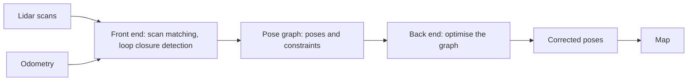
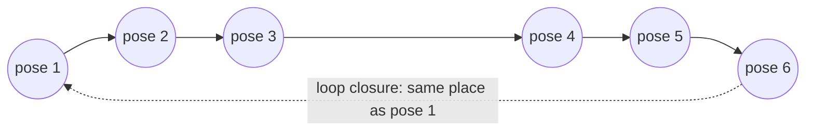
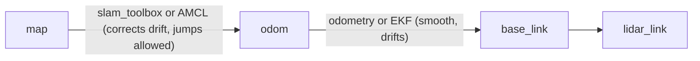

<LessonMeta level="Advanced" time="45 min" prereqs={["State estimation and Kalman filters", "Depth, point clouds and lidar", "TF2 and URDF", "NumPy"]} />

You drop a robot into a building it has never seen and ask it to fetch something from the kitchen. It has no map. To build a map it needs to know where it has been; to know where it has been, it needs a map. This chicken-and-egg puzzle is called **SLAM**, simultaneous localization and mapping, and solving it is what lets a vacuum cleaner remember your living room and a warehouse robot find its shelf.

<Objectives>

- Explain the difference between mapping, localization and SLAM, and why drift makes SLAM hard.
- Build an occupancy grid from lidar scans using log-odds, and align two scans with ICP.
- Localize with a particle filter and explain how AMCL works.
- Describe graph SLAM and loop closure, and run `slam_toolbox` and AMCL in ROS 2.

</Objectives>

## Three related problems

- **Mapping:** the robot’s pose is known, build the map. Easy.
- **Localization:** the map is known, find the robot’s pose. Done with a particle filter or EKF.
- **SLAM:** neither is known; estimate both at once. Hard, because errors in one corrupt the other.

Every robot has **odometry**: an estimate of motion from wheel encoders or an IMU. It is smooth and quick but **drifts**, because small errors add up without bound. Drive around a room and come back, and the odometry says you are 40 cm from where you started. The map built from drifting poses would show a double wall. SLAM uses what the sensors see (the walls themselves) to correct the drift.



## Occupancy grids

The most common map for a ground robot is an <Term def="A map that divides space into a grid of cells, each holding the probability that the cell is occupied by an obstacle">occupancy grid</Term>. Each cell holds a probability of being occupied. Unknown cells start at 0.5.

When a lidar beam travels from the robot to a hit point, every cell the beam passes through is probably free, and the end cell is probably occupied. Rather than multiply probabilities, we add **log-odds**, $l = \log\frac{p}{1-p}$, which turns the Bayes update into a sum:

$$
l_t(\text{cell}) = l_{t-1}(\text{cell}) + l_\text{sensor}, \qquad
p = 1 - \frac{1}{1 + e^{l}} .
$$

A hit adds a positive number, a pass-through adds a negative number, and cells that are repeatedly observed become confident. The code below ray-marches a simulated lidar in an 8 m room with a box, and builds a grid from five scans taken at known poses.

```python title="occupancy_grid.py"
import numpy as np


# ---------- a tiny world: an 8 m x 8 m room with a box obstacle ----------
def is_occupied(p):
    x, y = p
    outside = not (0.0 < x < 8.0 and 0.0 < y < 8.0)
    in_box = 5.0 < x < 6.0 and 2.0 < y < 4.0
    return outside or in_box


def true_scan(pose, angles, max_range=10.0, step=0.02):
    """Ray-march a simulated lidar from pose = (x, y, theta)."""
    ranges = np.full(len(angles), max_range)
    for i, a in enumerate(angles):
        d = np.array([np.cos(pose[2] + a), np.sin(pose[2] + a)])
        for r in np.arange(step, max_range, step):
            if is_occupied(pose[:2] + r * d):
                ranges[i] = r
                break
    return ranges


# ---------- occupancy grid with log-odds ----------
class OccupancyGrid:
    def __init__(self, size_m=8.0, resolution=0.2):
        self.res = resolution
        n = int(size_m / resolution)
        self.logodds = np.zeros((n, n))          # 0 = unknown (p = 0.5)
        self.L_OCC, self.L_FREE = 0.85, -0.40    # evidence per hit / pass-through

    def cell(self, x, y):
        return int(y / self.res), int(x / self.res)          # (row, col)

    def _line(self, r0, c0, r1, c1):
        """Bresenham: all cells on the line from (r0, c0) to (r1, c1)."""
        cells = []
        dr, dc = abs(r1 - r0), abs(c1 - c0)
        sr, sc = (1 if r1 > r0 else -1), (1 if c1 > c0 else -1)
        err = dc - dr
        while True:
            cells.append((r0, c0))
            if (r0, c0) == (r1, c1):
                return cells
            e2 = 2 * err
            if e2 > -dr:
                err -= dr
                c0 += sc
            if e2 < dc:
                err += dc
                r0 += sr

    def integrate_scan(self, pose, angles, ranges, max_range=10.0):
        r0, c0 = self.cell(pose[0], pose[1])
        n = self.logodds.shape[0]
        for a, r in zip(angles, ranges):
            hit = r < max_range
            ex = pose[0] + r * np.cos(pose[2] + a)
            ey = pose[1] + r * np.sin(pose[2] + a)
            r1, c1 = self.cell(ex, ey)
            r1, c1 = min(max(r1, 0), n - 1), min(max(c1, 0), n - 1)
            ray = self._line(r0, c0, r1, c1)
            for (rr, cc) in ray[:-1]:
                self.logodds[rr, cc] += self.L_FREE          # the beam passed through: free
            if hit:
                self.logodds[r1, c1] += self.L_OCC           # the beam ended here: occupied

    def probability(self):
        return 1.0 - 1.0 / (1.0 + np.exp(self.logodds))


grid = OccupancyGrid()
angles = np.radians(np.arange(-180, 180, 2))
for pose in [(2.0, 2.0, 0.0), (2.0, 6.0, 1.0), (4.0, 4.0, 2.0), (6.5, 6.0, -1.0), (6.5, 1.0, 3.0)]:
    pose = np.array(pose)
    grid.integrate_scan(pose, angles, true_scan(pose, angles))

p = grid.probability()
for row in range(p.shape[0] - 1, -1, -2):                    # north at the top
    print("".join("#" if p[row, c] > 0.65 else ("." if p[row, c] < 0.35 else " ")
                  for c in range(p.shape[1])))
```

The printed map shows `#` for occupied, `.` for free and a space for unknown. You will see the room outline and the box’s visible sides; the inside of the box stays unknown because no beam ever got there. This is exactly what the `/map` topic (`nav_msgs/msg/OccupancyGrid`) contains, as integers from 0 to 100 with -1 for unknown.

## Scan matching

The code above assumed known poses. In real SLAM you estimate the pose change between two consecutive scans by **scan matching**: find the rotation $R$ and translation $t$ that best lay one scan on top of the other. The classic method is <Term def="Iterative Closest Point: repeatedly match each point to its nearest neighbour in the other cloud, solve for the best rigid transform, apply it, and repeat">ICP</Term>. Given matched pairs $p_i \leftrightarrow q_i$, it minimises

$$
\min_{R, t} \sum_i \left\| R\,p_i + t - q_i \right\|^2 ,
$$

which has a closed-form solution through the singular value decomposition: subtract the centroids, build $H = \sum (p_i - \bar{p})(q_i - \bar{q})^T$, take $H = U \Sigma V^T$, and then $R = V U^T$ and $t = \bar{q} - R\bar{p}$.

```python title="icp.py"
import numpy as np


def icp_2d(source, target, iterations=30):
    """Align Nx2 `source` points to `target` points. Returns R (2x2), t (2,)."""
    R_total, t_total = np.eye(2), np.zeros(2)
    current = source.copy()
    for _ in range(iterations):
        # 1. match every source point to its nearest target point (brute force)
        d2 = ((current[:, None, :] - target[None, :, :]) ** 2).sum(axis=2)
        matched = target[d2.argmin(axis=1)]
        # 2. best rigid transform for these matches (Kabsch / SVD)
        mu_s, mu_t = current.mean(axis=0), matched.mean(axis=0)
        H = (current - mu_s).T @ (matched - mu_t)
        U, _, Vt = np.linalg.svd(H)
        R = Vt.T @ U.T
        if np.linalg.det(R) < 0:                 # avoid a reflection
            Vt[-1] *= -1
            R = Vt.T @ U.T
        t = mu_t - R @ mu_s
        # 3. apply and accumulate
        current = current @ R.T + t
        R_total, t_total = R @ R_total, R @ t_total + t
    return R_total, t_total


def rot(a):
    return np.array([[np.cos(a), -np.sin(a)], [np.sin(a), np.cos(a)]])


# A scan of an L-shaped corridor, then the same scan after the robot moved
rng = np.random.default_rng(0)
wall1 = np.column_stack([np.linspace(0, 4, 80), np.zeros(80)])
wall2 = np.column_stack([np.zeros(60), np.linspace(0, 3, 60)])
wall3 = np.column_stack([np.linspace(0, 2, 40), np.full(40, 3.0)])
scan_a = np.vstack([wall1, wall2, wall3]) + rng.normal(0, 0.005, (180, 2))

true_R, true_t = rot(np.radians(8)), np.array([0.15, -0.10])
scan_b = scan_a @ true_R.T + true_t + rng.normal(0, 0.005, scan_a.shape)

# Find the transform that maps scan_b back onto scan_a
R, t = icp_2d(scan_b, scan_a)
print("recovered rotation: %.2f deg (the scan was rotated by +8, so we expect -8)"
      % np.degrees(np.arctan2(R[1, 0], R[0, 0])))
print("recovered translation:", np.round(t, 3))
print("mean alignment error after ICP: %.4f m" % np.mean(np.linalg.norm(scan_b @ R.T + t - scan_a, axis=1)))
```

The recovered motion is the inverse of the one we applied, and the residual error drops to a few millimetres. ICP has a weakness: it needs a decent starting guess (odometry provides one), and it can slide along a featureless corridor because every position looks the same along its length. Production systems use faster variants (correlative scan matching, NDT) but the idea is identical.

:::warning[The long-corridor problem]
In a long straight corridor with smooth walls, scan matching cannot tell how far you moved along the corridor, because the scans look identical. Fusing wheel odometry or an IMU (previous lesson) is what keeps SLAM from getting stuck there.
:::

## Drift, loop closure and graph SLAM

Chaining scan matches gives smooth local motion but still accumulates error. The cure is **loop closure**: when the robot returns to a place it has seen before, it recognises it, and adds a constraint that pulls the trajectory back into agreement.

<Term def="A SLAM formulation where robot poses are nodes and measurements (odometry, scan matches, loop closures) are edges, and the best set of poses is found by least squares">Graph SLAM</Term> represents this cleanly. Each robot pose is a **node**. Each measurement of relative motion between two poses is an **edge**, a constraint of the form "pose $j$ should be at $T_{ij}$ relative to pose $i$". Because measurements are noisy, the constraints disagree slightly, and we look for the poses that disagree least:

$$
\min_{x_1, \dots, x_n} \sum_{(i,j)} e_{ij}(x_i, x_j)^T \, \Omega_{ij} \, e_{ij}(x_i, x_j),
$$

where $e_{ij}$ is the mismatch between predicted and measured relative pose, and $\Omega_{ij}$ (the information matrix) says how much to trust that edge.



Think of the graph as springs. Odometry edges are soft springs, and the loop-closure edge is a spring that yanks pose 6 back to pose 1; the optimiser relaxes all the springs together, spreading the error evenly along the loop. The part that finds scan matches and detects loops is called the **front end**; the optimiser is the **back end**. `slam_toolbox` uses a sparse solver (Ceres) for the back end.

## Particle filters and AMCL

When you already have a map, localization is a Bayes filter again, but with strongly non-Gaussian beliefs (a robot in a long hallway of identical doors could be in many places). A <Term def="A Bayes filter that represents the belief by many weighted random samples of the state, called particles">particle filter</Term> keeps hundreds of guesses ("particles"), each a full pose. Every step:

1. **Move** each particle with the motion model plus random noise.
2. **Weight** each particle by how well the real scan matches the map as seen from that pose.
3. **Resample**: copy likely particles, drop unlikely ones.

This is **Monte Carlo localization**. The code below localizes a robot from range readings to three known landmarks, starting with particles spread over the whole room (global localization):

```python title="particle_filter.py"
import numpy as np

rng = np.random.default_rng(4)
LANDMARKS = np.array([[1.0, 1.0], [7.0, 1.5], [4.0, 7.0]])      # known map, 8 m x 8 m room
N = 1000
SIGMA_RANGE = 0.3


def motion(poses, v, w, dt, noise=(0.15, 0.1)):
    """Move Nx3 poses (x, y, theta) with noisy unicycle motion."""
    v_n = v + rng.normal(0, noise[0], len(poses))
    w_n = w + rng.normal(0, noise[1], len(poses))
    poses[:, 0] += v_n * np.cos(poses[:, 2]) * dt
    poses[:, 1] += v_n * np.sin(poses[:, 2]) * dt
    poses[:, 2] += w_n * dt
    return poses


def ranges_to_landmarks(pose):
    return np.linalg.norm(LANDMARKS - pose[:2], axis=1)


def systematic_resample(weights):
    positions = (rng.random() + np.arange(len(weights))) / len(weights)
    return np.searchsorted(np.cumsum(weights), positions)


# Global localization: start with particles spread over the whole room
particles = np.column_stack([rng.uniform(0, 8, N), rng.uniform(0, 8, N), rng.uniform(-np.pi, np.pi, N)])
truth = np.array([4.0, 3.0, 0.0])
dt = 0.1

for step in range(100):
    v, w = 0.8, 0.4
    truth = motion(truth[None, :].copy(), v, w, dt, noise=(0, 0))[0]
    particles = motion(particles, v, w, dt)

    z = ranges_to_landmarks(truth) + rng.normal(0, SIGMA_RANGE, len(LANDMARKS))
    expected = np.linalg.norm(particles[:, None, :2] - LANDMARKS[None, :, :], axis=2)     # N x 3
    log_w = -0.5 * (((expected - z) / SIGMA_RANGE) ** 2).sum(axis=1)
    weights = np.exp(log_w - log_w.max())
    weights /= weights.sum()

    particles = particles[systematic_resample(weights)]
    particles += rng.normal(0, [0.03, 0.03, 0.02], particles.shape)      # roughening keeps diversity
    if step % 20 == 0 or step == 99:
        est = particles[:, :2].mean(axis=0)
        print(f"step {step:3d}: estimate ({est[0]:.2f}, {est[1]:.2f}), "
              f"spread {particles[:, :2].std(axis=0).mean():.2f} m, "
              f"error {np.linalg.norm(est - truth[:2]):.2f} m")
```

Run it. The particle cloud collapses onto the true position within a handful of steps (three ranges pin down a position quickly) and then tracks it with an error of a few centimetres. Heading is not measured directly here; the filter learns it from how the position changes as the robot moves. Remove the "roughening" line to see a classic failure, **particle depletion**, where all particles collapse onto one wrong guess and never recover.

<KeyIdea title="Why particles beat a single Gaussian for global localization">
A Kalman filter holds one bump. If the robot could be in either of two identical corridors, one bump cannot represent that. A particle filter happily holds two clusters until the evidence favours one. That is why the standard ROS 2 localizer, **AMCL** (adaptive Monte Carlo localization), is a particle filter. "Adaptive" means it uses more particles when it is confused and fewer when it is confident.
</KeyIdea>

## SLAM and localization in ROS 2

The two standard packages are `slam_toolbox` for mapping and AMCL (from Nav2) for localization.

### Frames first



The robot’s pose in the world is split in two on purpose. `odom` to `base_link` is smooth and continuous but drifts (from wheel odometry or your EKF). `map` to `odom` is published by SLAM or AMCL and holds the *correction*; it may jump when the estimate is corrected. Navigation uses the smooth one for control and the corrected one for goals.

### Mapping with slam_toolbox

```bash title="terminal"
sudo apt install ros-jazzy-slam-toolbox ros-jazzy-nav2-map-server
ros2 launch slam_toolbox online_async_launch.py use_sim_time:=true
```

With your Gazebo robot running (lidar bridged as `/scan`, TF from `odom` to `base_link`), `slam_toolbox` publishes `/map` and the `map` to `odom` transform. Add a **Map** display in RViz and drive around with `teleop_twist_keyboard`: the map grows as you move. "Online" means it processes live data, and "async" means it processes scans as fast as it can rather than every one.

Its behaviour is set through a YAML file passed as `slam_params_file:=my_slam.yaml`. The important settings:

```yaml title="my_slam.yaml (excerpt)"
slam_toolbox:
  ros__parameters:
    use_sim_time: true
    odom_frame: odom
    map_frame: map
    base_frame: base_link
    scan_topic: /scan
    mode: mapping              # or: localization
    resolution: 0.05           # map cell size in metres
    max_laser_range: 10.0
    minimum_travel_distance: 0.3
    minimum_travel_heading: 0.3
    do_loop_closing: true
```

Drive slowly and make loops: revisit the start so a loop closure can fire. When the map looks good, save it:

```bash title="terminal"
ros2 run nav2_map_server map_saver_cli -f my_map
```

This writes `my_map.pgm` (the image) and `my_map.yaml` (resolution, origin, thresholds).

### Localizing with AMCL

```bash title="terminal"
ros2 launch nav2_bringup localization_launch.py map:=my_map.yaml use_sim_time:=true
```

In RViz set the Fixed Frame to `map`, add the Map display on `/map` and a PoseArray on `/particle_cloud`, then use the **2D Pose Estimate** tool to click an approximate starting pose and drag the arrow in the heading direction. You will see the particle cloud appear around that pose. Drive the robot and watch the cloud tighten as the lidar matches the map. If you give a wildly wrong initial pose, the cloud will not recover, which is the <Term def="The failure case where a robot is moved or starts with a completely wrong pose estimate, and must re-localize from scratch">kidnapped robot problem</Term>; AMCL can also be asked to spread particles globally for this case.

:::tip[Pro tip]
Most "my SLAM is bad" problems are not SLAM problems. Check, in order: is `use_sim_time` consistent everywhere, is the TF tree complete and does `ros2 run tf2_tools view_frames` show one tree, are the lidar frame and its mounting height correct, and is the odometry reasonably smooth? Fix those before touching any SLAM parameter.
:::

### Visual SLAM

Cameras can do SLAM too, by tracking features (like the ORB features from lesson one) across frames. Visual and visual-inertial SLAM systems exist in open source, and NVIDIA publishes GPU-accelerated versions in Isaac ROS. They need good lighting and texture, and monocular systems cannot recover true scale without extra information such as an IMU. Check the current documentation of whichever system you adopt.

## Hands-on lab

<Steps>

1. Run `occupancy_grid.py` and `icp.py`. Change the ICP starting offset to 30 degrees and see whether it still converges. Where does it break down?
2. Run `particle_filter.py`. Reduce `N` to 50 and then comment out the roughening line. Describe what changes.
3. In your Gazebo world, start the simulation, the bridge and `slam_toolbox`. Drive around the box and back to the start. Save the map with `map_saver_cli`.
4. Stop SLAM. Launch `localization_launch.py` with your saved map, set a deliberately slightly wrong initial pose in RViz, drive forward and watch the particle cloud converge.
5. Record a bag during step 4 with `ros2 bag record /scan /odom /tf /particle_cloud` for the module project.

</Steps>

It worked if the saved map has straight walls (no ghost or doubled walls) and AMCL’s particles tighten around the robot within a few metres of driving.

## Exercises

<Exercise title="Log-odds update" level="Beginner">

A cell has log-odds 0 (unknown). Three beams end in it (hits, each +0.85). One beam then passes through it (free, -0.40). What is its log-odds and its probability of being occupied?

<Solution>

Log-odds $= 3 \cdot 0.85 - 0.40 = 2.15$. Probability $= 1 - 1/(1 + e^{2.15}) \approx 1 - 1/9.59 \approx 0.90$. The cell is quite confidently occupied.

</Solution>
</Exercise>

<Exercise title="Why did the map double?" level="Intermediate">

You map a square room, return to the start, and the walls appear twice, offset by 30 cm. Name the cause and two ways to improve it.

<Solution>

Accumulated drift with no loop closure, so the second pass was placed using drifted poses. Improve it by making sure loop closure is enabled and that the robot revisits the start before finishing, by driving more slowly and smoothly, and by improving odometry (fuse an IMU with an EKF).

</Solution>
</Exercise>

<Exercise title="Particles or Kalman?" level="Advanced">

A warehouse has many identical aisles. A robot is switched on at an unknown position. Would you use an EKF or a particle filter for the initial localization, and what would you use once it is confident?

<Solution>

A particle filter such as AMCL for global localization, because the belief is multimodal (many identical aisles). Once the particles have converged to one cluster, the posterior is close to Gaussian, so an EKF fusing odometry, IMU and the AMCL pose gives smooth, low-latency tracking.

</Solution>
</Exercise>

## Check your understanding

<Quiz questions={[
  {q: "Why are log-odds used for occupancy grids?", options: ["They make cells bigger", "Bayes updates become simple additions", "They avoid needing a lidar", "They compress the map to fewer bytes"], answer: 1, explain: "In log-odds form, combining independent evidence is just adding numbers."},
  {q: "What does loop closure do?", options: ["Closes the lidar shutter", "Adds a constraint when the robot revisits a place, reducing accumulated drift", "Stops the robot at the end of a loop", "Doubles the map resolution"], answer: 1, explain: "Recognising a previously seen place lets the optimiser pull the trajectory into consistency."},
  {q: "Which transform does SLAM or AMCL publish in ROS 2?", options: ["odom to base_link", "map to odom", "base_link to lidar_link", "world to map"], answer: 1, explain: "map to odom carries the drift correction; odom to base_link comes from odometry or the EKF."},
  {q: "Why is a particle filter good for global localization?", options: ["It needs no map", "It can represent several hypotheses at once", "It is exact", "It ignores sensor noise"], answer: 1, explain: "A set of particles can form multiple clusters, unlike a single Gaussian."}
]} />

<Takeaways>

- Mapping needs poses, localization needs a map, SLAM estimates both and fights odometry drift.
- Occupancy grids store cell probabilities as log-odds, updated by adding evidence along each beam.
- Scan matching (ICP and relatives) estimates motion between scans; it needs a good initial guess and can fail in featureless corridors.
- Graph SLAM treats poses as nodes and measurements as edges, and loop closures remove accumulated drift.
- Particle filters (AMCL) hold multiple hypotheses and are the standard way to localize in a known map.
- In ROS 2: `slam_toolbox` to map, `map_saver_cli` to save, Nav2 AMCL to localize; check TF, time and odometry before tuning.

</Takeaways>

## Go deeper

- `slam_toolbox` repository and documentation: [github.com/SteveMacenski/slam_toolbox](https://github.com/SteveMacenski/slam_toolbox)
- Nav2 documentation on AMCL and map management: [navigation.ros.org](https://navigation.ros.org)
- Grisetti et al., "A Tutorial on Graph-Based SLAM": widely available online and a clear introduction to the back end.
- Besl and McKay, "A Method for Registration of 3-D Shapes" (1992), the original ICP paper.

Stuck? Ask **Rivet**, the course assistant, bottom-right.

Next: [Path planning algorithms](../06-motion/01-path-planning-algorithms.mdx)
