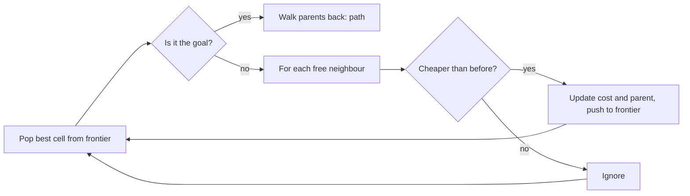

<LessonMeta level="Intermediate" time="40 min" prereqs={["Python basics", "Forward and inverse kinematics", "Frames and transforms"]} />

A warehouse robot has to cross a floor full of shelves. A robot arm has to reach into a bin without clipping its edge. In both cases someone has to answer the same question: out of the infinite ways to move, which one gets there without hitting anything? That is **motion planning**, and almost every robot you will build relies on it.

<Objectives>

- Describe a robot's configuration space and explain why obstacles become regions in it.
- Implement breadth-first search, Dijkstra and A\* on a grid and explain how they differ.
- Explain how RRT and RRT\* explore high-dimensional spaces and what "asymptotically optimal" means.
- Turn a jagged path into a smooth trajectory with timing, using shortcutting and a velocity profile.

</Objectives>

## Planning in configuration space

A robot is not a point. A two-link arm is a long shape that sweeps through the room. Checking "does the arm hit the box?" for every candidate motion is awkward. The trick is to change the question so the robot becomes a single point.

<Term def="The set of all possible poses of the robot, described by one number per degree of freedom">Configuration space</Term> (often written C-space, with points called $q$) does exactly that. A planar two-link arm has two joint angles, so its C-space is a 2D plane with axes $\theta_1$ and $\theta_2$. Every point in that plane is one full arm pose. A mobile robot driving on a floor has a C-space of $(x, y, \theta)$.

Now obstacles transform too. A configuration is in the **obstacle region** $C_{obs}$ if the robot, placed in that pose, overlaps anything in the world. Everything else is **free space** $C_{free}$. Planning becomes: find a continuous curve $q(t)$ from $q_{start}$ to $q_{goal}$ that stays inside $C_{free}$.

<KeyIdea title="Plan for a point, not a body">
Configuration space folds the robot's shape into the obstacles. The robot becomes a single point and the world becomes a set of forbidden regions. The cost is dimension: a 7-joint arm lives in a 7D space, which you cannot draw or enumerate. Choosing an algorithm is mostly about how well it copes as dimension grows.
</KeyIdea>

For a small mobile robot you can often cheat: **inflate** every obstacle by the robot's radius and treat the robot as a point on a 2D map. That is what costmaps do in Nav2, which you meet in the next lesson.

## Graph search on a grid

The simplest planner chops the free space into a grid. Each cell is a node, and edges connect neighbouring cells. Planning is now a graph-search problem, and three classic algorithms solve it with the same skeleton: keep a **frontier** of cells to explore, pull one out, add its neighbours, repeat.

- **Breadth-first search (BFS)** pulls cells in the order they were discovered (a queue). It finds the path with the fewest steps, but treats every step as equal cost.
- **Dijkstra's algorithm** pulls the cell with the lowest cost-so-far $g(n)$ (a priority queue). It finds the cheapest path when moves have different costs, for example a step through a risky area costs more.
- **A\*** (pronounced "A-star") also uses a **heuristic** $h(n)$, an optimistic guess of the remaining cost. It pulls the cell with the lowest

$$
f(n) = g(n) + h(n)
$$

If $h$ never overestimates the true remaining cost (it is **admissible**), A\* still returns an optimal path, but it usually explores far fewer cells than Dijkstra because it leans towards the goal. On a 4-connected grid, Manhattan distance is a good admissible heuristic.



Here is a complete, runnable implementation. Setting the heuristic to zero turns A\* into Dijkstra, which makes the comparison honest.

```python title="astar_grid.py"
import heapq

MAP = [
    "S...#.....",
    ".##.#.###.",
    ".#......#.",
    ".#.####.#.",
    "...#.....G",
]


def parse(rows):
    walls, start, goal = set(), None, None
    for r, row in enumerate(rows):
        for c, ch in enumerate(row):
            if ch == "#":
                walls.add((r, c))
            elif ch == "S":
                start = (r, c)
            elif ch == "G":
                goal = (r, c)
    return walls, start, goal, len(rows), len(rows[0])


def manhattan(a, b):
    return abs(a[0] - b[0]) + abs(a[1] - b[1])


def search(rows, use_heuristic=True):
    """Dijkstra when use_heuristic is False, A* when True. Returns (path, expanded)."""
    walls, start, goal, h, w = parse(rows)
    frontier = [(0, start)]            # (priority, cell)
    cost = {start: 0}                  # best known cost-to-come g(n)
    parent = {start: None}
    expanded = 0
    while frontier:
        _, cell = heapq.heappop(frontier)
        expanded += 1
        if cell == goal:
            path = []
            while cell is not None:
                path.append(cell)
                cell = parent[cell]
            return path[::-1], expanded
        r, c = cell
        for nxt in ((r + 1, c), (r - 1, c), (r, c + 1), (r, c - 1)):
            nr, nc = nxt
            if not (0 <= nr < h and 0 <= nc < w) or nxt in walls:
                continue
            new_cost = cost[cell] + 1
            if nxt not in cost or new_cost < cost[nxt]:
                cost[nxt] = new_cost
                parent[nxt] = cell
                priority = new_cost + (manhattan(nxt, goal) if use_heuristic else 0)
                heapq.heappush(frontier, (priority, nxt))
    return None, expanded


if __name__ == "__main__":
    for name, flag in (("Dijkstra", False), ("A*", True)):
        path, n = search(MAP, flag)
        print(f"{name:9s} path length {len(path) - 1}, cells expanded {n}")
    path, _ = search(MAP)
    canvas = [list(row) for row in MAP]
    for r, c in path[1:-1]:
        canvas[r][c] = "*"
    print("\n".join("".join(row) for row in canvas))
```

Run it and you should see both algorithms report a path of length 13, with A\* expanding 20 cells to Dijkstra's 30. Same answer, less work. On a big open map the gap is dramatic.

:::note
Grid search gives paths made of grid moves, which look blocky and ignore the robot's real motion. Planners such as Hybrid A\* and lattice planners fix this by searching over motions the robot can actually perform. Nav2 ships planners of both kinds.
:::

## Sampling-based planning

A grid with $k$ cells per axis in $d$ dimensions has $k^d$ cells. A 7-joint arm with 100 cells per joint would need $10^{14}$ cells. Grid search is dead on arrival.

**Sampling-based planners** give up on covering the space. Instead they sample random configurations, test whether they are collision-free, and connect good ones. Collision checking is the only thing they need from the world, which is why they work with any obstacle shape.

### RRT

A <Term def="Rapidly-exploring Random Tree: grows a tree from the start by repeatedly stepping towards random samples">Rapidly-exploring Random Tree</Term> (RRT) grows a tree outward from the start:

1. Sample a random configuration $q_{rand}$ (now and then, sample the goal itself: a **goal bias**).
2. Find the tree node $q_{near}$ closest to it.
3. Take a small step from $q_{near}$ towards $q_{rand}$ to get $q_{new}$.
4. If the segment is collision-free, add $q_{new}$ to the tree.
5. Stop when a node is close enough to the goal and the last segment is free.

The random samples pull the tree towards big unexplored regions, so it spreads quickly. RRT is **probabilistically complete**: if a path exists, the chance of finding it approaches 1 as you add samples. It is not optimal, though. RRT paths wander.

```python title="rrt_2d.py"
import math
import random

random.seed(3)
OBSTACLES = [(5.0, 5.0, 1.5), (3.0, 7.5, 1.0), (7.5, 2.5, 1.2)]   # (x, y, radius)
START, GOAL = (1.0, 1.0), (9.0, 9.0)
STEP, GOAL_BIAS, MAX_ITERS = 0.5, 0.05, 5000


def collision_free(p, q, samples=10):
    for i in range(samples + 1):
        t = i / samples
        x = p[0] + t * (q[0] - p[0])
        y = p[1] + t * (q[1] - p[1])
        if any(math.hypot(x - ox, y - oy) <= r for ox, oy, r in OBSTACLES):
            return False
    return True


def rrt():
    nodes, parent = [START], {0: None}
    for _ in range(MAX_ITERS):
        target = GOAL if random.random() < GOAL_BIAS else (random.uniform(0, 10), random.uniform(0, 10))
        i = min(range(len(nodes)), key=lambda k: math.dist(nodes[k], target))
        near = nodes[i]
        d = math.dist(near, target)
        if d == 0:
            continue
        s = min(STEP, d) / d
        new = (near[0] + s * (target[0] - near[0]), near[1] + s * (target[1] - near[1]))
        if not collision_free(near, new):
            continue
        nodes.append(new)
        parent[len(nodes) - 1] = i
        if math.dist(new, GOAL) < STEP and collision_free(new, GOAL):
            nodes.append(GOAL)
            parent[len(nodes) - 1] = len(nodes) - 2
            path, k = [], len(nodes) - 1
            while k is not None:
                path.append(nodes[k])
                k = parent[k]
            return path[::-1], len(nodes)
    return None, len(nodes)


def length(path):
    return sum(math.dist(a, b) for a, b in zip(path, path[1:]))


if __name__ == "__main__":
    path, n = rrt()
    print(f"tree nodes: {n}")
    print(f"path: {len(path)} waypoints, length {length(path):.2f}")
```

### RRT\*

**RRT\*** adds two small steps that change the guarantee. When a new node is added, it looks at nearby nodes and picks the parent that gives the lowest cost-from-start (**choose parent**). Then it checks whether routing existing neighbours through the new node would make them cheaper, and if so rewires them (**rewire**).

The result is **asymptotically optimal**: as the number of samples grows, the path cost converges to the best possible one. The price is more computation per sample. In practice RRT is fine when you need any feasible path fast, and RRT\* (or variants such as Informed RRT\*) when path quality matters and you have time. For arms, MoveIt's default OMPL library offers both families, plus bidirectional versions (RRT-Connect), which are often the fastest.

## From path to trajectory

A path is only geometry: a list of configurations. A robot needs a **trajectory**: positions that change with time, within velocity and acceleration limits. Two steps get you there.

**Shortcutting.** Sampling planners leave kinks. Pick two random points on the path and, if the straight segment between them is collision-free, replace everything in between. Repeat a few hundred times. Add this to the end of the previous script:

```python title="shortcut.py"
def shortcut(path, tries=200):
    path = list(path)
    for _ in range(tries):
        if len(path) < 3:
            break
        i, j = sorted(random.sample(range(len(path)), 2))
        if j - i > 1 and collision_free(path[i], path[j]):
            path = path[: i + 1] + path[j:]
    return path
```

**Time parameterization.** Now decide how fast to move along the path. The simplest profile is a **trapezoid**: accelerate at $a_{max}$ up to $v_{max}$, cruise, then decelerate. If the path is short, you never reach $v_{max}$ and the profile is a triangle.

```python title="trapezoid.py"
def trapezoid(distance, v_max, a_max):
    """Rest-to-rest move along a path of the given length. Returns (t_accel, t_cruise, t_total)."""
    t_acc = v_max / a_max
    d_acc = 0.5 * a_max * t_acc ** 2
    if 2 * d_acc > distance:                    # never reaches v_max: triangular profile
        t_acc = (distance / a_max) ** 0.5
        return t_acc, 0.0, 2 * t_acc
    t_cruise = (distance - 2 * d_acc) / v_max
    return t_acc, t_cruise, 2 * t_acc + t_cruise


print(trapezoid(2.0, 1.0, 0.5))   # (2.0, 0.0, 4.0)
print(trapezoid(0.2, 1.0, 0.5))   # triangular: never reaches v_max
```

Real systems do this per joint, along a multi-waypoint path, with limits on every joint at once. MoveIt 2 ships time-parameterization routines for that (including time-optimal trajectory generation), and libraries such as Ruckig generate jerk-limited motions, which are gentler on hardware. Jerk, the rate of change of acceleration, is what makes a motion feel jolting.

:::tip[Pro tip]
When a plan "works in the planner but shakes the real robot", look at time parameterization before you blame the planner. Overly aggressive limits and sharp corners in the path are the usual causes.
:::

## Hands-on lab

<Steps>

1. Save the A\* script as `astar_grid.py` and run it. Confirm the path length is 13 and that A\* expands fewer cells than Dijkstra.
2. Change the map: add walls so the only route is long and winding. Re-run and compare the expanded-cell counts again.
3. Replace `manhattan` with a heuristic that returns `10 * manhattan(a, b)`. It is no longer admissible. Does the path stay optimal? Does it expand fewer cells?
4. Save the RRT script as `rrt_2d.py`. Run it with three different seeds and record the tree size and path length each time.
5. Add the `shortcut` function and print the path length before and after. Success looks like a path with a handful of waypoints that is clearly shorter.

</Steps>

## Exercises

<Exercise title="Admissible or not?" level="Beginner">

A robot moves on an 8-connected grid (diagonal moves allowed, each diagonal costs 1.41 and each straight move 1). Is Manhattan distance an admissible heuristic? Suggest a better one.

<Solution>

No. Manhattan distance can overestimate: going diagonally by one cell costs 1.41, but Manhattan distance says 2. An overestimate can make A\* return a non-optimal path. Use octile distance (move diagonally as far as possible, then straight) or plain Euclidean distance, both of which never overestimate.

</Solution>
</Exercise>

<Exercise title="Why not just use a grid for the arm?" level="Intermediate">

Estimate how many grid cells you need for a 6-joint arm if each joint is divided into 50 values. Explain what a sampling-based planner does differently.

<Solution>

$50^6 \approx 1.6 \times 10^{10}$ cells, far too many to store or search comfortably. A sampling-based planner never builds the whole grid. It only generates configurations it chooses to test, so its cost depends on how hard the obstacles make the problem, not on the volume of the space.

</Solution>
</Exercise>

<Exercise title="Make RRT optimal-ish" level="Advanced">

Sketch what you would change in `rrt_2d.py` to get RRT\*. Name the two operations and the extra data you need to store per node.

<Solution>

Store the cost-from-start for every node. When adding a new node, (1) examine all nodes within a radius and choose as parent the one that gives the lowest total cost through a collision-free edge, then (2) for each of those neighbours, check whether going through the new node is cheaper, and if so make the new node its parent and update the costs of its descendants. The search radius normally shrinks slowly as the tree grows.

</Solution>
</Exercise>

## Check your understanding

<Quiz questions={[
  {q: "What does configuration space let a planner do?", options: ["Ignore obstacles entirely", "Treat the robot as a single point and obstacles as forbidden regions", "Replace collision checking with a lookup table", "Plan only in 2D"], answer: 1, explain: "Folding the robot’s shape into the obstacles turns the robot into a point. The price is that the space has one dimension per degree of freedom."},
  {q: "Which statement about A* is correct?", options: ["It always explores more cells than Dijkstra", "It uses f(n) = g(n) + h(n) and stays optimal if h never overestimates", "It requires a random sampler", "It only works on 3D maps"], answer: 1, explain: "An admissible heuristic keeps A* optimal, and it steers the search towards the goal so it usually expands fewer cells."},
  {q: "What makes RRT* different from RRT?", options: ["It samples the goal more often", "It chooses the best parent and rewires neighbours, so its paths converge to optimal", "It does not need collision checking", "It plans in joint space only"], answer: 1, explain: "Choose-parent and rewire steps lower path cost as samples accumulate, giving asymptotic optimality."},
  {q: "Why do we time-parameterize a path?", options: ["To make it shorter", "To add collision checks", "To decide how fast to move along it within velocity and acceleration limits", "To convert it to a grid"], answer: 2, explain: "A path has no notion of time. A trajectory adds it, so controllers know when to be where."}
]} />

<Takeaways>

- Configuration space turns "a body moving among obstacles" into "a point moving among forbidden regions", with one dimension per degree of freedom.
- BFS, Dijkstra and A\* are one algorithm with different priorities. A\* adds an admissible heuristic to explore less.
- Grids explode in high dimensions. Sampling-based planners (RRT, RRT\*) avoid that by only collision-checking what they sample.
- RRT is probabilistically complete. RRT\* is also asymptotically optimal, at higher cost.
- A path is geometry. Shortcutting and time parameterization turn it into a smooth trajectory the robot can follow.

</Takeaways>

## Go deeper

- Steven LaValle, *Planning Algorithms* (free online book, lavalle.pl/planning) for the full theory.
- The OMPL project (ompl.kavrakilab.org), the library behind MoveIt's default planners.
- Karaman and Frazzoli, "Sampling-based algorithms for optimal motion planning" (arxiv.org/abs/1105.1186), the paper that introduced RRT\*.
- The Nav2 documentation (navigation.ros.org) for planners you can use on a real mobile robot.

Next: [Navigation with Nav2](./02-navigation-with-nav2.mdx)
