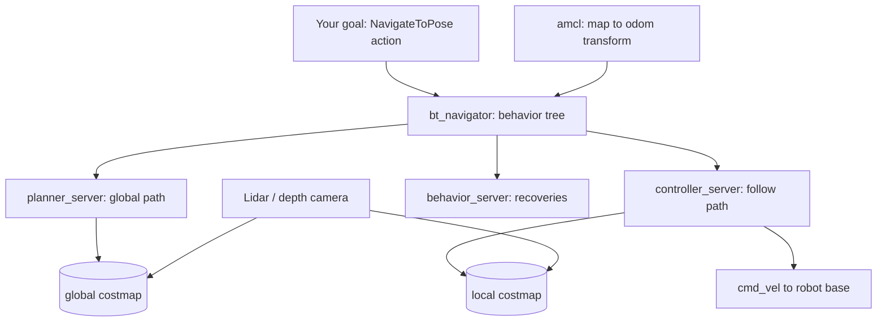

<LessonMeta level="Intermediate" time="45 min" prereqs={["ROS 2 nodes, topics and services", "ROS 2 actions and launch files", "Gazebo basics", "SLAM and localization"]} />

Your delivery robot has a map of the building and knows where it is. Someone taps "go to room 214". Between that tap and the robot rolling down the corridor, a lot has to happen: plan a route, follow it while a person steps into the way, slow down near walls, and recover if it gets stuck. **Nav2** is the open-source ROS 2 stack that does all of that, and you rarely have to write any of it yourself.

<Objectives>

- Name the main Nav2 servers and what each one does.
- Explain how costmaps represent obstacles and how inflation shapes the robot’s paths.
- Choose between common planner and controller plugins for a given robot.
- Launch Nav2 with a simulated robot and send goals from a Python script with the simple commander API.

</Objectives>

## The big picture

Nav2 is not one program. It is a set of cooperating ROS 2 nodes, most of them **lifecycle nodes** (nodes with managed start-up states) that a manager brings up in the right order. The core nodes are:

| Node | Job |
|---|---|
| `planner_server` | Computes a global path from the robot to the goal |
| `controller_server` | Follows that path locally, publishing velocity commands |
| `smoother_server` | Smooths a path after planning |
| `behavior_server` | Recovery actions such as spin, back up and wait |
| `bt_navigator` | Runs the behavior tree that decides which of the above to call, and when |
| `map_server` and `amcl` | Provide a saved map and localize the robot on it |
| `lifecycle_manager` | Starts and stops the lifecycle nodes in order |

The robot itself must provide a few things: a transform tree with `map`, `odom` and `base_link` frames, an odometry source, and a sensor that sees obstacles (a 2D lidar or depth camera). If you have done the SLAM and tf2 lessons, you already know where these come from.



## Costmaps: how Nav2 sees the world

Planners do not look at raw sensor data. They look at a **costmap**, a 2D grid where each cell holds a cost from 0 (free) up to 254 (lethal, an obstacle). Cell value 255 means unknown. Nav2 keeps two:

- The **global costmap** covers the whole map and is used for long-range planning.
- The **local costmap** is a small window that moves with the robot and is used by the controller to dodge things the map did not know about.

Each costmap is built from stacked **layers**:

- **Static layer**: the saved map.
- **Obstacle or voxel layer**: live sensor readings (lidar hits, depth points).
- **Inflation layer**: spreads a decaying cost around every obstacle.

Inflation is the clever part. It reuses the configuration-space idea from the previous lesson: a cell within the robot’s radius of an obstacle is marked as "inscribed", so the robot’s centre can never enter it. Cells farther out get a cost that falls off with distance, so the planner prefers staying in the middle of corridors without being forbidden from going near walls.

```yaml title="nav2_params.yaml (excerpt)"
local_costmap:
  local_costmap:
    ros__parameters:
      update_frequency: 5.0
      rolling_window: true
      width: 3
      height: 3
      resolution: 0.05
      robot_radius: 0.22
      plugins: ["voxel_layer", "inflation_layer"]
      inflation_layer:
        plugin: "nav2_costmap_2d::InflationLayer"
        inflation_radius: 0.7
        cost_scaling_factor: 3.0
```

<KeyIdea title="Costmaps turn the world into numbers a planner can compare">
Everything Nav2 plans or avoids goes through the costmap. If the robot clips corners, drives too close to walls or refuses to enter a doorway, look at `robot_radius` (or the footprint), `inflation_radius` and `cost_scaling_factor` first. Most "navigation bugs" are costmap settings.
</KeyIdea>

## Planners and controllers

Nav2 is **plugin-based**. Planners, controllers, costmap layers and behaviors are all plugins named in a YAML file, so you can swap algorithms without changing code.

**Planners** (global, run on demand):

- **NavFn** is a classic Dijkstra or A\* planner on the costmap. Simple and fast, good for round robots that can turn on the spot.
- **Smac Planner** is a family: 2D (grid A\*), Hybrid-A\* (respects a car-like turning radius) and State Lattice (uses a library of feasible motions). Choose Hybrid-A\* or Lattice for robots that cannot rotate in place.
- **Theta\*** produces any-angle paths with fewer jagged turns on open ground.

**Controllers** (local, run at about 20 Hz):

- **DWB** samples velocity commands and scores their short trajectories against critics (stay near the path, avoid obstacles, reach the goal).
- **Regulated Pure Pursuit** follows a lookahead point on the path and slows down near obstacles and sharp turns. Predictable and a common choice for differential-drive robots.
- **MPPI** (Model Predictive Path Integral) samples many random trajectories and picks a weighted blend. Flexible and handles tight spaces well, at higher compute cost.

The split mirrors a human driver: the planner picks the route on the map, the controller steers along it and reacts to what is right in front.

## Behavior trees

The `bt_navigator` decides what to do next with a **behavior tree** (BT), a tree of small tasks that returns success, failure or running. Nav2 uses the BehaviorTree.CPP library and ships ready-made trees as XML files. Here is the idea as an outline of a simplified tree (each line is one XML element):

```text title="simplified navigation tree (outline of the XML)"
RecoveryNode (retry up to 3 times)
├── PipelineSequence "NavigateWithReplanning"
│   ├── RateController (1 Hz)
│   │   └── ComputePathToPose   -> writes {path}
│   └── FollowPath              -> reads {path}
└── Sequence "Recovery"
    ├── ClearEntireCostmap (local)
    ├── Spin (1.57 rad)
    └── Wait (2 s)
```

Read it like a recipe: plan once a second while following the path. If something fails, run the recovery sequence (clear the local costmap, spin, wait), then try again up to three times. Because the logic lives in XML, you can change how a robot behaves, say "never spin in a crowded hallway", without rebuilding C++.

:::note
The tree above is a teaching simplification, with the XML attributes left out. The real default trees in the `nav2_bt_navigator` package are longer, with more recovery options. Open them to see how they work.
:::

## Running Nav2 with a simulated robot

Install Nav2 and its bringup package on ROS 2 Jazzy:

```bash title="terminal"
sudo apt install ros-jazzy-navigation2 ros-jazzy-nav2-bringup
```

The Nav2 bringup package includes a launch file that starts Gazebo with a TurtleBot 3 world, the Nav2 stack and RViz together. The exact environment variables and extra simulation packages have changed between releases, so follow the current "Getting Started" page at navigation.ros.org for Jazzy, then launch:

```bash title="terminal"
export TURTLEBOT3_MODEL=waffle
ros2 launch nav2_bringup tb3_simulation_launch.py headless:=False
```

In RViz, use **2D Pose Estimate** to tell the robot where it starts (this seeds localization), wait for the costmaps to appear, then use **Nav2 Goal** to click a destination. Watch the global path (the planner’s idea) and the local path (what the controller is doing).

## Sending goals from Python

Clicking in RViz is fine for a demo. Real applications send goals from code. Nav2 exposes a `NavigateToPose` action, and the `nav2_simple_commander` package wraps it in a friendly Python class, `BasicNavigator`.

```bash title="terminal"
sudo apt install ros-jazzy-nav2-simple-commander
```

```python title="go_to_pose.py"
import math

import rclpy
from geometry_msgs.msg import PoseStamped
from nav2_simple_commander.robot_navigator import BasicNavigator, TaskResult


def make_pose(navigator, x, y, yaw):
    pose = PoseStamped()
    pose.header.frame_id = "map"
    pose.header.stamp = navigator.get_clock().now().to_msg()
    pose.pose.position.x = x
    pose.pose.position.y = y
    pose.pose.orientation.z = math.sin(yaw / 2.0)
    pose.pose.orientation.w = math.cos(yaw / 2.0)
    return pose


def main():
    rclpy.init()
    navigator = BasicNavigator()

    navigator.setInitialPose(make_pose(navigator, 0.0, 0.0, 0.0))
    navigator.waitUntilNav2Active()

    goal = make_pose(navigator, 1.5, 0.5, math.pi / 2)
    navigator.goToPose(goal)

    while not navigator.isTaskComplete():
        feedback = navigator.getFeedback()
        if feedback:
            print(f"distance remaining: {feedback.distance_remaining:.2f} m")

    result = navigator.getResult()
    if result == TaskResult.SUCCEEDED:
        print("Arrived.")
    elif result == TaskResult.CANCELED:
        print("Goal was canceled.")
    else:
        print("Navigation failed.")

    navigator.lifecycleShutdown()
    rclpy.shutdown()


if __name__ == "__main__":
    main()
```

A few things worth noticing. Poses are stamped in the `map` frame, and orientation is a quaternion, so a heading angle $\psi$ becomes $z = \sin(\psi/2)$, $w = \cos(\psi/2)$. `goToPose` is non-blocking: it starts the action and returns, so you poll `isTaskComplete()` and can cancel with `navigator.cancelTask()`. The same class also offers `followWaypoints` for a list of poses and `goThroughPoses` for passing through poses along one route. Note that `lifecycleShutdown()` shuts the whole Nav2 stack down, so skip it if you want Nav2 to keep running after your script ends.

:::warning
Choose goals in free space. A goal inside an inflated obstacle will be rejected or fail repeatedly, and it looks like Nav2 is broken when the real cause is the goal.
:::

## Hands-on lab

<Steps>

1. Install Nav2, the bringup package and the simple commander, then launch the TurtleBot 3 simulation as shown above.
2. In RViz, set the initial pose, then send one goal with the **Nav2 Goal** tool. Confirm the robot arrives.
3. Enable the **Global Costmap** and **Local Costmap** displays in RViz and identify the inflated area around the walls.
4. Run `go_to_pose.py` in a second terminal (with your ROS 2 environment sourced). Adjust the coordinates to a free point in your map. Success: it prints decreasing distances and then "Arrived."
5. Copy the default parameters, increase `inflation_radius`, and relaunch with your params. Describe how the robot’s paths change.

</Steps>

## Exercises

<Exercise title="Fix the doorway" level="Beginner">

The robot refuses to drive through a 0.8 m door. Its radius is 0.30 m and the inflation radius is 0.9 m. What do you change and why?

<Solution>

With a 0.9 m inflation radius, the cost zone from each side of the door overlaps in the middle and the whole doorway is expensive. Reduce `inflation_radius` (for example to about 0.5 m) or raise `cost_scaling_factor` so costs decay faster. The robot can physically fit (0.6 m diameter in 0.8 m), but the planner thinks the door is too costly.

</Solution>
</Exercise>

<Exercise title="Pick the plugins" level="Intermediate">

You are building a car-like robot with a minimum turning radius of 1 m. Which planner and which controller families would you try first, and why?

<Solution>

A planner that respects turning radius: Smac Hybrid-A\* or the State Lattice planner. NavFn and 2D planners would produce paths with sharp turns the robot cannot follow. For the controller, Regulated Pure Pursuit or MPPI, since both can work with car-like motion, while DWB assumes a velocity-sampling model that suits differential drive better.

</Solution>
</Exercise>

<Exercise title="Patrol script" level="Intermediate">

Use `BasicNavigator` to make the robot visit three waypoints in order and print the result. Which method do you use?

<Solution>

Build a list of three `PoseStamped` messages and call `navigator.followWaypoints(waypoints)`. Then poll `isTaskComplete()` as before and check `getResult()`. Use `goThroughPoses` instead if you want a single smooth route through the poses rather than stopping at each one.

</Solution>
</Exercise>

## Check your understanding

<Quiz questions={[
  {q: "What does the inflation layer of a costmap do?", options: ["Makes the map larger", "Adds costs around obstacles so paths keep a safe distance", "Stores the saved map", "Smooths the path"], answer: 1, explain: "Inflation spreads a decaying cost from obstacles, accounting for the robot’s size and encouraging safe clearance."},
  {q: "Which Nav2 node runs the behavior tree?", options: ["planner_server", "controller_server", "bt_navigator", "map_server"], answer: 2, explain: "bt_navigator runs the tree that calls the planner, controller and recovery behaviors."},
  {q: "Which of these is a local controller plugin?", options: ["NavFn", "Smac Planner", "Regulated Pure Pursuit", "AMCL"], answer: 2, explain: "NavFn and Smac are global planners, AMCL is a localization node. Regulated Pure Pursuit follows a path locally."},
  {q: "What does navigator.goToPose(goal) do?", options: ["Blocks until the robot arrives", "Starts a NavigateToPose action and returns, so you poll isTaskComplete()", "Teleports the robot", "Only works in simulation"], answer: 1, explain: "The call is non-blocking. You poll for completion and read the result afterwards."}
]} />

<Takeaways>

- Nav2 is a set of lifecycle nodes: planner, controller, smoother, behavior server and a behavior-tree navigator.
- Costmaps (global and local, built from layers) are how Nav2 sees the world. Inflation settings shape the paths.
- Planners and controllers are plugins. Pick them to match your robot’s motion model.
- Behavior trees express "plan, follow, recover" logic in XML you can edit without recompiling.
- `BasicNavigator` lets you set the initial pose, send goals and waypoints, and read results from Python.

</Takeaways>

## Go deeper

- The Nav2 documentation at navigation.ros.org, especially Getting Started, Configuration Guide and Behavior Trees.
- The `nav2_simple_commander` examples in the Nav2 GitHub repository.
- Macenski et al., "The Marathon 2: A Navigation System" (arxiv.org/abs/2003.00368), the paper behind Nav2’s design.
- BehaviorTree.CPP documentation at behaviortree.dev.

Next: [Manipulation with MoveIt 2](./03-manipulation-with-moveit2.mdx)
