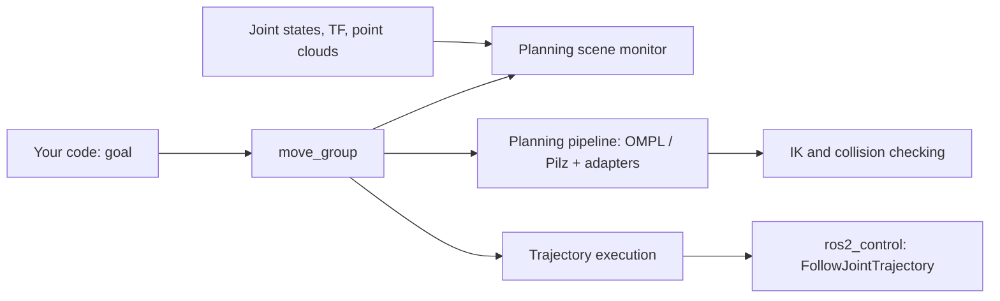

<LessonMeta level="Intermediate" time="45 min" prereqs={["Path planning algorithms", "Forward and inverse kinematics", "ROS 2 actions, parameters and launch", "TF2 and URDF"]} />

A robot arm sits next to a table with a mug on it. You want the gripper above the mug, without the elbow knocking over the lamp. Writing that planner from scratch means kinematics, collision checking, a sampling planner, time parameterization and controller hand-off. **MoveIt 2** is the ROS 2 framework that bundles all of it, and it is the standard starting point for arm manipulation.

<Objectives>

- Describe the roles of `move_group`, the planning scene and the planning pipeline.
- Add and remove collision objects so plans avoid real obstacles.
- Plan to a joint goal and a pose goal, and follow a straight-line Cartesian path.
- Choose between the MoveItPy Python API, the C++ interface and ROS messages for your project.

</Objectives>

## What MoveIt 2 is made of

MoveIt does not move motors. It computes trajectories and hands them to your ROS 2 controllers. The pieces you need to know:

- **`move_group`**: the central node. It owns the robot model, the planning scene, the planners and the kinematics solvers, and exposes them as ROS 2 actions, services and topics.
- **Robot model**: read from your robot’s URDF and a companion SRDF, which adds <Term def="Semantic Robot Description Format: names planning groups, named poses and which link pairs may safely touch">SRDF</Term> information such as the planning group `panda_arm` (which joints plan together), named poses like `ready`, and collision pairs that can be ignored.
- **Planning scene**: MoveIt’s picture of the world: the robot’s current state plus obstacles, attached objects and the occupancy map from your sensors.
- **Planning pipeline**: a chain of a planner (OMPL by default, or Pilz industrial motion planner, CHOMP, STOMP) plus *request adapters* that pre- and post-process, for instance by time-parameterizing the result.
- **Kinematics plugin**: solves inverse kinematics (KDL by default, with alternatives such as TRAC-IK and the analytical IKFast).
- **Controller interface**: sends the trajectory to a `FollowJointTrajectory` controller, normally from `ros2_control`.



<KeyIdea title="MoveIt plans against a model of the world, not the world">
Plans are only as safe as the planning scene. If a box exists on the table but not in the scene, MoveIt will happily plan straight through it. Keeping the scene in sync with reality, through collision objects you add or an occupancy map from a depth camera, is the heart of using MoveIt well.
</KeyIdea>

## Try it first

Install MoveIt 2 and a ready-made Panda arm configuration on ROS 2 Jazzy:

```bash title="terminal"
sudo apt install ros-jazzy-moveit ros-jazzy-moveit-resources-panda-moveit-config
ros2 launch moveit_resources_panda_moveit_config demo.launch.py
```

RViz opens with a **MotionPlanning** panel. Drag the orange interactive marker on the end effector to a new pose, press **Plan** to see the trajectory preview, then **Execute**. With fake controllers, the arm moves in RViz only. Try dragging the goal into the table and notice that the planner either refuses or finds a way around.

For your own arm, the **MoveIt Setup Assistant** (`ros2 launch moveit_setup_assistant setup_assistant.launch.py`) generates the config package from your URDF: planning groups, named poses, controllers and collision matrix.

## Planning from code

You have three main ways to command MoveIt, and they differ in language and level.

**MoveItPy** is the Python binding to the C++ planning stack. It runs the planning components inside your own process, so you do not need a separate `move_group` node for the plan itself. You configure it with MoveIt parameter files from a launch file. A plan to a named pose looks like this:

```python title="plan_to_named_pose.py"
import rclpy
from moveit.planning import MoveItPy


def main():
    rclpy.init()
    robot = MoveItPy(node_name="moveit_py")
    arm = robot.get_planning_component("panda_arm")

    arm.set_start_state_to_current_state()
    arm.set_goal_state(configuration_name="ready")   # named pose from the SRDF

    result = arm.plan()
    if result:
        robot.execute(result.trajectory, controllers=[])
    else:
        print("Planning failed")

    rclpy.shutdown()


if __name__ == "__main__":
    main()
```

This must be launched with the robot description, SRDF, kinematics and planning parameters passed to the node, which the MoveIt tutorials show in a launch file. A bare `python3 plan_to_named_pose.py` will not find them.

**The C++ `MoveGroupInterface`** is the long-standing, most complete interface. It talks to a running `move_group` node. It offers pose targets, joint targets, `computeCartesianPath`, scene manipulation and more, and most official tutorials use it. If you need a feature and MoveItPy lacks it, this is the fallback.

**Raw ROS interfaces** work from any language. `move_group` exposes the `MoveGroup` action (plan and execute), services such as `/compute_cartesian_path` and `/apply_planning_scene`, and the `/planning_scene` topic. Python nodes that only need to modify the scene or request a Cartesian path often use these directly.

:::info
MoveItPy has been developed alongside MoveIt 2 and its coverage is smaller than the C++ interface. Check the MoveIt documentation for your release for the up-to-date list of what is supported, rather than assuming a C++ method has a Python twin.
:::

### Pose goals versus joint goals

A **joint goal** says exactly which angles you want. It is unambiguous. A **pose goal** says where the end effector should be (position and orientation) and leaves IK to find joint values. That may fail for several reasons: the pose is out of reach, IK finds no solution that is collision-free, or the planner times out. When it fails, ask which stage failed rather than assuming the planner is broken.

## Collision objects and the planning scene

To keep the arm away from the table, tell MoveIt about it. A `moveit_msgs/CollisionObject` describes a shape (box, sphere, cylinder, mesh), its pose and the operation (add, remove, move). You can publish it as a *diff* to the planning scene:

```python title="add_table.py"
import time

import rclpy
from geometry_msgs.msg import Pose
from moveit_msgs.msg import CollisionObject, PlanningScene
from rclpy.node import Node
from shape_msgs.msg import SolidPrimitive


class SceneAdder(Node):
    def __init__(self):
        super().__init__("scene_adder")
        self.pub = self.create_publisher(PlanningScene, "/planning_scene", 10)

    def add_table(self):
        box = SolidPrimitive()
        box.type = SolidPrimitive.BOX
        box.dimensions = [0.8, 1.2, 0.04]       # x, y, z in metres

        pose = Pose()
        pose.position.x = 0.6
        pose.position.z = 0.3
        pose.orientation.w = 1.0

        obj = CollisionObject()
        obj.header.frame_id = "panda_link0"      # the robot base frame
        obj.id = "table"
        obj.primitives = [box]
        obj.primitive_poses = [pose]
        obj.operation = CollisionObject.ADD

        scene = PlanningScene()
        scene.is_diff = True                     # only the changes, not the whole scene
        scene.world.collision_objects = [obj]
        self.pub.publish(scene)


def main():
    rclpy.init()
    node = SceneAdder()
    time.sleep(1.0)          # give the publisher time to connect
    node.add_table()
    rclpy.spin_once(node, timeout_sec=0.5)
    rclpy.shutdown()


if __name__ == "__main__":
    main()
```

Run it while the Panda demo is up and the table appears in RViz. Plans now avoid it. Use `CollisionObject.REMOVE` with the same `id` to delete it.

### Attached objects

When the gripper holds a cup, the cup is part of the robot for collision purposes: it moves with the hand, and it must not hit the world. MoveIt models this with an **attached collision object**, which you attach to a link (usually the hand). You also list links the object may touch, such as the finger links, so the gripper holding it does not count as a collision. Forgetting to attach an object after a grasp is a classic reason an arm sweeps a held object through obstacles.

### Sensors in the scene

MoveIt can also build an **occupancy map** from point clouds or depth images using its octomap support. That keeps the scene honest without you describing every object. It trades convenience for noise and compute, so many teams model the key fixtures by hand and use the octomap for unknowns.

## Cartesian paths

Sometimes you want the hand to move in a straight line: lowering a gripper onto an object, wiping a table, inserting a plug. A normal planner is free to choose any joint-space route, and the hand traces a curve. **Cartesian planning** instead interpolates poses along a line (or through waypoints) and solves IK at each step.

You send MoveIt a list of waypoints, a maximum step size in metres and whether to avoid collisions. It returns a trajectory and a **fraction** between 0.0 and 1.0 telling you how much of the path was achievable before IK failed or a collision appeared. Always check it:

```python title="cartesian_service.py (the key part)"
from moveit_msgs.srv import GetCartesianPath

req = GetCartesianPath.Request()
req.group_name = "panda_arm"
req.header.frame_id = "panda_link0"
req.waypoints = waypoints          # a list of geometry_msgs/Pose
req.max_step = 0.01                # metres between interpolated poses
req.avoid_collisions = True

future = client.call_async(req)    # client for the /compute_cartesian_path service
# ... after it completes:
response = future.result()
if response.fraction < 0.99:
    print(f"Only {response.fraction:.0%} of the path is reachable")
```

The C++ `computeCartesianPath` call has the same behaviour. A fraction below 1.0 means partial success. Executing it blindly is how arms stop halfway down a pick.

If you want industrial-style linear and circular moves with predictable timing, the **Pilz industrial motion planner** provides `PTP`, `LIN` and `CIRC` motion types as a planning pipeline.

## Beyond a single motion

Real tasks are sequences: approach, grasp, lift, move, place, retreat. **MoveIt Task Constructor** lets you compose such stages and plans the whole chain consistently, so the grasp pose you pick also allows the lift. It is the usual tool for pick-and-place. You will use these ideas in the next lesson.

:::tip[Pro tip]
Start by checking everything on the planning scene in RViz. When planning fails, the reason is almost always visible there: a missing object, a start state already in collision, or a goal pose just outside the workspace.
:::

## Hands-on lab

<Steps>

1. Install MoveIt 2 and the Panda configuration, then launch `demo.launch.py` from `moveit_resources_panda_moveit_config`.
2. In the MotionPlanning panel, plan and execute to the `ready` named pose, then to a random valid goal.
3. Run `add_table.py` and confirm a box appears in RViz. Plan a goal that would pass through it and observe the planner detour or fail.
4. Use the panel’s **Scene Objects** tab to add a second obstacle by hand. Plan again.
5. Write a short script that calls `/compute_cartesian_path` with two waypoints 10 cm apart. Print the fraction. Success: a fraction of 1.0 for a reachable line and a lower value when you aim into the table.

</Steps>

## Exercises

<Exercise title="Why did it plan through my box?" level="Beginner">

You can see a box on the table through the camera, but the arm plans straight through the space. What is the most likely cause?

<Solution>

The box is not in the planning scene. MoveIt only avoids what it has been told about. Add a collision object for the box, or enable an occupancy map from the depth camera so the scene tracks it.

</Solution>
</Exercise>

<Exercise title="Reading the fraction" level="Intermediate">

A Cartesian path request returns `fraction = 0.6`. List two causes and what you would try for each.

<Solution>

(1) The path leaves the arm’s reachable workspace, or IK hits a joint limit or singularity. Try moving the object or the base, a different start configuration or a different orientation along the path. (2) A collision appears partway along the line. Check the scene in RViz, reduce the path’s length, or add an intermediate waypoint that detours. Do not execute a trajectory with a low fraction as if it were complete.

</Solution>
</Exercise>

<Exercise title="Holding a cup" level="Advanced">

After closing the gripper on a cup, your arm plans a motion that sweeps the cup into a shelf. What step did you forget, and what must you configure with it?

<Solution>

Attach the cup to the hand link as an attached collision object, so MoveIt treats it as part of the robot and checks it for collisions. List the finger and hand links as touch links so the gripper holding the cup is not considered a collision. Remove the attachment when you place it down.

</Solution>
</Exercise>

## Check your understanding

<Quiz questions={[
  {q: "What is the planning scene?", options: ["The RViz window", "MoveIt’s model of the robot state and the world, including obstacles", "A saved trajectory", "The URDF file"], answer: 1, explain: "The planning scene holds the robot state, collision objects, attached objects and any occupancy map. Planning checks collisions against it."},
  {q: "A Cartesian path request returns fraction 0.4. What does it mean?", options: ["The path is 40 cm long", "Only about 40% of the requested path could be computed", "The arm will move at 40% speed", "The plan used 40% of the time limit"], answer: 1, explain: "The fraction is how much of the path was achievable before IK or collision checking failed."},
  {q: "What is MoveItPy?", options: ["A Python re-implementation of OMPL", "A Python binding to the MoveIt C++ planning stack", "A Python-only simulator", "A replacement for ros2_control"], answer: 1, explain: "MoveItPy exposes the MoveIt planning components to Python. Its feature coverage is smaller than the C++ interface, so check your release."},
  {q: "Why attach a grasped object to the hand in the scene?", options: ["So it renders in a different colour", "So it moves with the hand and is collision-checked as part of the robot", "To speed up IK", "To lock the gripper"], answer: 1, explain: "An attached object travels with the robot. Without attaching it, MoveIt does not know the arm is carrying something."}
]} />

<Takeaways>

- MoveIt computes trajectories and passes them to ros2_control. It does not drive motors.
- `move_group` ties together the robot model, planning scene, planning pipeline, IK and execution.
- Plans are only as safe as the planning scene. Add collision objects or an occupancy map, and attach held objects.
- Cartesian paths give straight-line hand motion and return a fraction. Always check it.
- Pick the interface by need: MoveItPy for Python scripts, the C++ interface for the full feature set, or raw ROS actions and services for anything else.

</Takeaways>

## Go deeper

- The MoveIt 2 documentation and tutorials at moveit.picknik.ai.
- Coleman et al., "Reducing the Barrier to Entry of Complex Robotic Software: a MoveIt! Case Study" (arxiv.org/abs/1404.3785).
- The MoveIt Task Constructor documentation, linked from moveit.picknik.ai.
- The `ros2_control` documentation at control.ros.org for the controller side.

Next: [Grasping](./04-grasping.mdx)
