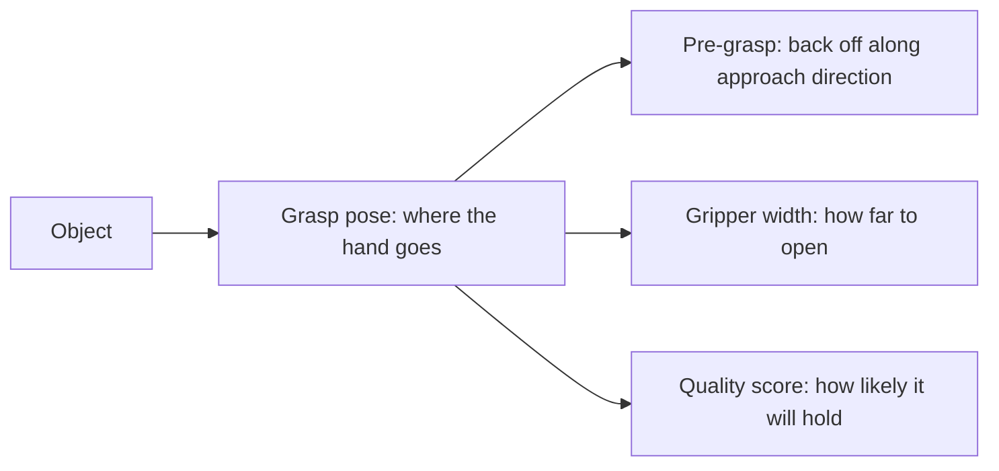
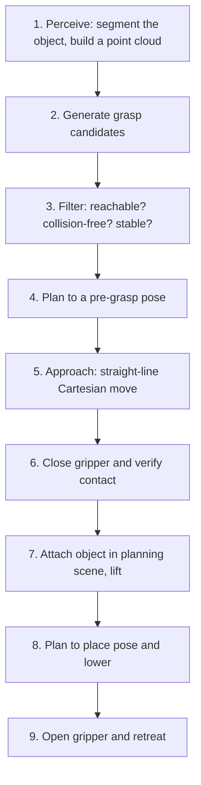

<LessonMeta level="Advanced" time="35 min" prereqs={["Manipulation with MoveIt 2", "Depth, point clouds and lidar", "Deep learning for detection and segmentation"]} />

Getting the arm to a pose is the easy half of picking something up. The hard half is the last few centimetres: where exactly should the fingers touch, how hard should they squeeze, and what happens when the object is a slippery, transparent bottle you have never seen before? Grasping is where geometry, friction, sensing and learning all collide, and it is still one of the open problems in robotics.

<Objectives>

- Describe common grasp representations, from planar four-degree-of-freedom grasps to full six-degree-of-freedom poses.
- Explain the antipodal condition and the intuition behind force closure using friction cones.
- Describe how learned grasp detectors work and where they fail.
- Lay out a complete pick-and-place pipeline and say what can go wrong at each step.

</Objectives>

## What is a grasp?

A <Term def="A hand pose and finger configuration that lets the hand hold an object securely">grasp</Term> is an answer to: where do I put the hand, how wide do I open it, and from which direction do I approach? In code, a grasp is usually a small data structure.

- **Planar (4-DoF) grasp**: for a camera looking straight down at a table. The grasp is a point $(x, y)$, a rotation angle in the image plane, and a gripper width. The gripper always approaches from above. This is simple and surprisingly effective for bin picking.
- **6-DoF grasp**: a full pose in 3D (position and orientation) plus a width. It lets the hand approach from the side or at an angle, which is needed for cluttered shelves and awkward objects.
- **Multi-finger grasps**: for a dexterous hand, a grasp also includes all the finger joint angles. You meet those in the humanoids module.

Most representations also carry a **quality score**, a number that says how likely the grasp is to succeed. Planners and learned models rank candidates by it.



## Why a grasp holds: friction and force closure

Think about pinching a pencil between two fingers. If you squeeze at the middle, it holds. If you push the fingers against the pencil at an angle, it squirts out. Physics explains why.

At each contact, the finger can push along the surface normal and also pull sideways through friction. The Coulomb friction model says the sideways force can be at most $\mu$ times the normal force:

$$
\|f_t\| \le \mu \, f_n
$$

That limit defines a **friction cone** around the contact normal, with half-angle $\alpha = \arctan(\mu)$. Any force within the cone can be applied without slipping. Beyond it, the finger slides.

For a two-finger grasp, the **antipodal condition** says: the straight line joining the two contact points must lie inside the friction cone at both contacts. When it does, the two fingers can push directly against each other, and the line of force passes through both cones, so the object does not slip.

<KeyIdea title="Antipodal means the squeeze line stays inside both friction cones">
If the line between your two fingertips tilts more than the friction angle away from either surface normal, the object will slide out. Flat, parallel faces (a box) are easy. Smooth, slippery curved objects have wide cones only when friction is high, which is why rubber fingertips help so much.
</KeyIdea>

A grasp has **force closure** when the contacts can resist any external force and torque (any "wrench") by adjusting contact forces, within the friction cones. For a planar object held with two frictional point contacts, the antipodal condition is enough for force closure. In 3D, with point contacts and friction, you need contact forces that can balance disturbances in all six directions, which can take three or more contacts, or a contact with torsional friction (a soft fingertip).

You do not have to prove this by hand for every grasp, but the intuition guides everything: contacts opposite each other, on surfaces with grip, near the object’s centre of mass so gravity does not rotate the object out of the fingers.

### A runnable antipodal checker

```python title="antipodal.py"
import math

import numpy as np


def antipodal(p1, n1, p2, n2, mu=0.5):
    """Two-finger frictional point contacts.
    p1, p2 are contact points; n1, n2 are unit surface normals pointing OUT of the object."""
    alpha = math.atan(mu)                       # half-angle of the friction cone
    line = p2 - p1
    line = line / np.linalg.norm(line)          # direction from contact 1 to contact 2
    a1 = math.acos(np.clip(np.dot(line, -n1), -1, 1))    # angle between squeeze line and inward normal 1
    a2 = math.acos(np.clip(np.dot(-line, -n2), -1, 1))   # same at contact 2
    return a1 <= alpha and a2 <= alpha


# a 4 cm wide box, fingers on opposite faces
left_p, left_n = np.array([-0.02, 0.0]), np.array([-1.0, 0.0])
right_p, right_n = np.array([0.02, 0.0]), np.array([1.0, 0.0])
print(antipodal(left_p, left_n, right_p, right_n))                # True

# the right finger is 3 cm higher, so the squeeze line tilts
right_p2 = np.array([0.02, 0.03])
print(antipodal(left_p, left_n, right_p2, right_n, mu=0.5))       # False
print(antipodal(left_p, left_n, right_p2, right_n, mu=1.0))       # True (grippier fingers)
```

Notice how raising friction from 0.5 to 1.0 rescues the second grasp. The same geometry holds or slips depending only on the contact material.

## Finding grasps

**Analytic and model-based methods** need a 3D model of the object. They sample candidate contact pairs on the surface and score them with measures like the antipodal check above or the size of the largest disturbance wrench the grasp can resist. They work well for known objects and fail when the model is wrong or missing.

**Learned grasp detection** skips the model. A neural network looks at a depth image or point cloud and directly proposes grasps with quality scores. Training data comes from simulation (where physics can test millions of grasps), from real trial and error, or from human labels.

- Dex-Net 2.0 (Mahler et al., arxiv.org/abs/1703.09312) trained a network on synthetic point clouds scored by analytic grasp quality, then ranked planar grasps at test time.
- GG-CNN (Morrison, Corke, Leitner) predicts a grasp quality, angle and width for every pixel, fast enough for closed-loop control.
- Contact-GraspNet (Sundermeyer et al., arxiv.org/abs/2103.14127) proposes 6-DoF grasps directly from a point cloud of a cluttered scene.

These methods work well on household objects with good depth data. They get into trouble with transparent or very shiny objects (depth sensors fail), heavily occluded objects and objects far from the training distribution. Plan for those failures: a grasp detector is a good source of *candidates*, not a guarantee.

:::note
Newer foundation-model approaches and large pretrained grasp models are improving fast. Check current releases rather than relying on a specific model, and always measure on your own objects.
:::

## The pick-and-place pipeline

A working pick-and-place is a chain, and every link can break.



1. **Perceive.** Detect and segment the target, then get its 3D shape or a point cloud. Calibration between camera and robot (hand-eye calibration) must be good, since a 1 cm error in the camera-to-base transform is a 1 cm miss.
2. **Generate grasps.** Use a model-based sampler or a learned detector.
3. **Filter.** Throw away candidates the arm cannot reach (IK fails), that collide with the table or neighbours, or whose approach direction is blocked. Rank the survivors by quality.
4. **Pre-grasp.** Plan a free-space motion to a pose a few centimetres back along the approach direction, with the gripper open.
5. **Approach.** Move in a straight line (Cartesian path) to the grasp pose. Slow down near the object.
6. **Close and check.** Close the gripper and confirm you are holding something: finger width at stop, motor current or a tactile sensor.
7. **Attach and lift.** Attach the object to the hand in the planning scene so planning accounts for it, then lift straight up.
8. **Place.** Plan to a pre-place pose, lower and release.
9. **Retreat.** Open and back away in a straight line so you do not knock what you just placed.

The MoveIt Task Constructor, mentioned in the previous lesson, lets you describe these stages as one task and plans them together so that, for example, a grasp chosen in step 2 is guaranteed to allow the lift in step 7.

:::warning
Always verify the grasp before moving at full speed. A failed grasp that is not detected sends the arm through a place motion with nothing in the gripper, or worse, an object loosely held.
:::

### Closed loop and failure recovery

Open-loop pipelines (look once, then move) fail when the object shifts as the fingers close. Better systems re-observe during the approach, retry with the next-best candidate after a failed grasp and track success rates. Treat grasp success as a statistic: log every attempt, and a pipeline with a 90% success rate over hundreds of trials tells you far more than a single working demo.

## Hands-on lab

<Steps>

1. Save `antipodal.py` and run it. Confirm the three outputs match the comments.
2. Add a third test: two contacts on a circle of radius 2 cm at angles 0 and 170 degrees (surface normals pointing radially outwards). Find the smallest friction coefficient for which the grasp passes the antipodal test.
3. Write the pipeline above as a Python function skeleton, with one empty function per step. For each, write one sentence on what failure looks like and how you would detect it.
4. Optional: in the MoveIt Panda demo from the previous lesson, add a box as a collision object and use the MotionPlanning panel to plan a pre-grasp pose above it and then a straight-line approach.

</Steps>

## Exercises

<Exercise title="Friction angle" level="Beginner">

A rubber fingertip on a plastic bottle has $\mu = 0.8$. What is the half-angle of the friction cone, and is a grasp whose squeeze line is 35 degrees away from the contact normal antipodal?

<Solution>

$\alpha = \arctan(0.8) \approx 38.7^\circ$. A squeeze line 35 degrees off the normal lies within the cone, so (if the same is true at the other contact) the grasp satisfies the antipodal condition. With a slippery plastic finger and $\mu = 0.3$, $\alpha \approx 16.7^\circ$ and the same grasp would slip.

</Solution>
</Exercise>

<Exercise title="Where do learned detectors break?" level="Intermediate">

Name two kinds of object that commonly cause trouble for depth-based learned grasp detectors, and one fix for each.

<Solution>

Transparent objects (glass, clear plastic) return missing or wrong depth. Fixes include using a depth-completion model, using RGB-based or multi-view methods, or placing objects in view of a sensor that handles them. Heavily cluttered or occluded objects produce incomplete point clouds. Fixes include viewing from several angles, re-sensing after each pick, or pushing items apart first.

</Solution>
</Exercise>

<Exercise title="Design the verification" level="Intermediate">

Your gripper has no tactile sensors. How can you tell whether a grasp succeeded before lifting?

<Solution>

Check the gripper width after closing: if it closed fully (or to a width much smaller than the object), you grasped nothing. Check motor current or effort: holding an object produces a stall at a width close to the object’s size. You can also lift a few centimetres and re-check width and current, which catches objects that slip during lift.

</Solution>
</Exercise>

## Check your understanding

<Quiz questions={[
  {q: "What does the antipodal condition require for a two-finger grasp?", options: ["Fingers must be the same size", "The line between the contacts lies inside the friction cone at both contacts", "The object must be symmetric", "The gripper must be open fully"], answer: 1, explain: "If the squeeze line stays within both friction cones, the contacts can press against each other without the object slipping."},
  {q: "The friction cone half-angle for friction coefficient mu is:", options: ["mu", "arctan(mu)", "arcsin(mu)", "1/mu"], answer: 1, explain: "Tangential force is at most mu times the normal force, so the cone half-angle is arctan(mu)."},
  {q: "Why use a pre-grasp pose and a straight-line approach?", options: ["It is faster", "It lets the gripper approach along a safe direction without sweeping into the object or its neighbours", "It avoids needing IK", "It improves friction"], answer: 1, explain: "Approaching from a clear direction in a straight line avoids knocking the object before the fingers close."},
  {q: "A learned grasp detector gives you a top-scoring grasp. What should the pipeline still do?", options: ["Execute it immediately", "Filter it for reachability and collisions, then verify the grasp after closing", "Retrain the model", "Skip planning"], answer: 1, explain: "Detectors propose candidates. The robot still needs IK and collision checks, and it must verify that the object is actually held."}
]} />

<Takeaways>

- A grasp is a hand pose plus gripper settings, often with a quality score. Planar 4-DoF grasps are simple and effective, 6-DoF grasps are more general.
- Friction cones explain why grasps hold. The antipodal condition means the squeeze line stays inside both cones.
- Force closure means the contacts can resist any external wrench. Intuition: opposed contacts, good friction, near the centre of mass.
- Learned detectors propose grasps from depth data without a model, and fail on transparent, shiny and occluded objects.
- Pick-and-place is a pipeline: perceive, generate, filter, pre-grasp, approach, close and verify, attach, lift, place, retreat. Measure success over many trials.

</Takeaways>

## Go deeper

- Murray, Li and Sastry, *A Mathematical Introduction to Robotic Manipulation*, the classic text on grasp analysis (free from the authors’ site).
- Mahler et al., "Dex-Net 2.0" (arxiv.org/abs/1703.09312).
- Sundermeyer et al., "Contact-GraspNet" (arxiv.org/abs/2103.14127).
- The MoveIt documentation at moveit.picknik.ai, including the MoveIt Task Constructor pick-and-place tutorial.

Next: [ML refresher for robotics](../07-robot-learning/01-ml-refresher-for-robotics.mdx)
