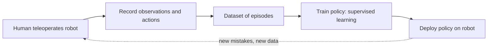

<LessonMeta level="Advanced" time="45 min" prereqs={["A machine learning refresher for robotics", "Control and PID", "Deep learning for detection and segmentation"]} />

Try writing the rules for folding a shirt or inserting a cable. Hundreds of tiny decisions depend on cloth shape and contact. Now imagine instead that you guide the robot through the task twenty times, and it learns from those examples. That is **imitation learning**, and it powers some of the most impressive manipulation demos of recent years.

<Objectives>

- Describe behavior cloning as supervised learning on demonstrations.
- Explain covariate shift and why small errors compound over time.
- Explain how DAgger gathers corrective data, and why it needs an expert on call.
- Describe, in concept, how Action Chunking with Transformers and Diffusion Policy output actions.
- Place LeRobot in a practical imitation-learning workflow.

</Objectives>

## Behavior cloning

A <Term def="A mapping from what the robot observes to what it does">policy</Term> $\pi_\theta(a \mid o)$ turns an observation $o$ (camera images, joint positions) into an action $a$ (joint targets, end-effector motion, gripper command). In **behavior cloning** (BC) you collect demonstrations from an expert, usually a human teleoperating the robot, and treat each step as a labelled example: observation in, action out. Then you train with ordinary supervised learning, exactly like the previous lesson:

$$
\theta^* = \arg\min_\theta \; \mathbb{E}_{(o, a) \sim \mathcal{D}} \left[ \, \ell\big(\pi_\theta(o), a\big) \right]
$$

where $\mathcal{D}$ is the demonstration dataset and $\ell$ is something like squared error. No rewards, no trial and error on the robot, and it can work with a few dozen demonstrations for a focused task. That simplicity is why BC is the default starting point.



## The catch: covariate shift

Here is the problem. During training, the policy sees states the expert visited. During deployment, the policy’s own tiny errors push it into states the expert never visited, where it has no training data and makes bigger errors, which push it further off. This mismatch between the training distribution of states and the deployment distribution is **covariate shift**.

Think of learning to drive from videos of an expert. The expert never drifts toward the kerb, so the videos contain no examples of how to recover from drifting toward the kerb. The first time you drift for real, you are on your own.

Formally, if the policy makes a mistake with probability $\epsilon$ per step on the expert’s states and a task lasts $T$ steps, the expected total cost can grow like $T^2 \epsilon$ rather than $T \epsilon$ (Ross, Gordon and Bagnell, 2011). Errors compound. The longer the task, the worse the problem.

<KeyIdea title="Imitation fails at the edges of the data">
A cloned policy is only trustworthy on states resembling the demonstrations. Because the policy’s own mistakes move it away from those states, you need either demonstrations that include recovery, a way to collect them, or a model that tolerates drift. Most advances in imitation learning are different answers to this one problem.
</KeyIdea>

You can see this in a small experiment. The code below uses a toy system that drifts away from zero unless pushed back. A near-perfect expert stays in a narrow band, so all demonstrations cover a tiny range. We train a network on them, let the learner drive with some execution noise, and compare how wrong it is on demo states versus the states it actually visits.

```python title="covariate_shift.py"
import numpy as np
import torch
from torch import nn

torch.manual_seed(0)
rng = np.random.default_rng(0)


def expert(pos):
    return -float(np.clip(10.0 * pos, -1.0, 1.0))    # firm push back to 0, but it saturates at 1


def rollout(policy, start, steps=40, act_noise=0.0):
    """Unstable 1D system: left alone it drifts away from 0."""
    pos, states = start, []
    for _ in range(steps):
        states.append(pos)
        a = policy(pos) + act_noise * rng.standard_normal()
        pos = pos + 0.1 * (0.8 * pos + a)
        if abs(pos) > 3:
            break
    return states


def fit(states, epochs=2000):
    X = torch.tensor(states, dtype=torch.float32).unsqueeze(1)
    Y = torch.tensor([expert(s) for s in states], dtype=torch.float32).unsqueeze(1)
    net = nn.Sequential(nn.Linear(1, 64), nn.Tanh(), nn.Linear(64, 1))
    opt = torch.optim.Adam(net.parameters(), lr=1e-2)
    for _ in range(epochs):
        loss = nn.functional.mse_loss(net(X), Y)
        opt.zero_grad()
        loss.backward()
        opt.step()
    return net


def as_policy(net):
    def policy(pos):
        with torch.no_grad():
            return net(torch.tensor([[pos]], dtype=torch.float32)).item()
    return policy


def mistake(net, states):
    """Average gap between the learner's action and what the expert would do, on these states."""
    pol = as_policy(net)
    return float(np.mean([abs(pol(s) - expert(s)) for s in states]))


# Demonstrations: the expert is nearly perfect, so it visits only a tiny band around 0.
demo = [s for _ in range(30) for s in rollout(expert, rng.uniform(-0.1, 0.1), act_noise=0.1)]
net = fit(demo)
print(f"demo states span {min(demo):+.2f} .. {max(demo):+.2f}")

# Let the learner drive and look at the states IT visits.
probe = lambda: [s for st in rng.uniform(-0.2, 0.2, 20) for s in rollout(as_policy(net), st, act_noise=0.8)]
visited = probe()
print(f"learner states span {min(visited):+.2f} .. {max(visited):+.2f}")
print(f"mistake on demo states:    {mistake(net, demo):.3f}")
print(f"mistake on learner states: {mistake(net, visited):.3f}   <- covariate shift")

# DAgger: add the learner's own states, labelled by the expert, and retrain.
data = list(demo)
for it in range(3):
    data += probe()
    net = fit(data)
    print(f"DAgger round {it + 1}: mistake on the same learner states {mistake(net, visited):.3f}")
```

Run it. You should see the learner’s states spread well beyond the demonstration band, the mistake on demo states near zero, and a clearly larger mistake on the states the learner visits. After a few DAgger rounds, the mistake on those same states falls. Exact numbers vary with your PyTorch version, but the pattern is the point.

## DAgger: asking the expert to correct you

**DAgger** (Dataset Aggregation) attacks covariate shift head on. The loop:

1. Train a policy on the current dataset.
2. Run the *learner’s* policy, and record the states it visits.
3. Ask the expert what they would have done in each of those states.
4. Add the new labelled states to the dataset and repeat.

Now the training data contains the states the learner actually gets into, with the right corrections. DAgger’s error grows roughly like $T \epsilon$ rather than $T^2 \epsilon$.

The cost is that you need the expert on call, and labelling is not always natural. Labelling states a robot arm visited, after the fact, is awkward for a human. Practical variants include **human-gated** or **interventional** collection: the robot runs on its own, a person watches and takes over when it goes wrong, and those takeover segments are added to the dataset. Another cheap fix is **noise injection** during demonstrations: perturb the robot while the expert corrects it, so the data contains recovery behaviour.

## Modern policies: predicting chunks and distributions

Two more problems appear on real robots.

**Multimodality.** Suppose the expert sometimes goes left of an obstacle and sometimes right. A network trained with squared error learns the average, which drives straight into the obstacle. Policies need to represent *several* good answers.

**Compounding error in single steps.** Predicting one action at a time at high frequency gives errors many chances to add up.

### Action chunking with transformers (ACT)

<Term def="Action Chunking with Transformers: a policy that predicts a short sequence of future actions at once">ACT</Term> was introduced with the ALOHA low-cost bimanual robot system (Zhao et al., 2023). Instead of one action per step, the policy predicts a **chunk** of the next $k$ actions from the current camera images and joint positions. The robot executes the chunk, then predicts the next. Chunking shortens the effective horizon: with $k = 100$, a 1000-step task needs only about ten decisions, so errors have fewer places to compound. ACT’s network is a transformer, trained as a conditional variational autoencoder (CVAE), which lets it capture variation between demonstrations. At run time, overlapping predictions can be combined with *temporal ensembling*, averaging the predictions for the same moment, for smoother motion.

### Diffusion Policy

**Diffusion Policy** (Chi et al., 2023) borrows the idea behind image generators. It treats action sequences like an image to be generated. Starting from random noise, a network repeatedly **denoises** the sequence, conditioned on the current observation, until it becomes a plausible action sequence. Because sampling starts from random noise, different runs can land on different valid modes (left of the obstacle or right of it), which handles multimodality naturally. It also predicts chunks and executes them in a receding-horizon fashion. The cost is more computation per decision, since denoising takes several network passes.

| Idea | Fixes | Trade-off |
|---|---|---|
| Behavior cloning | Simplicity | Compounding error, averages modes |
| DAgger | Covariate shift | Needs expert labels on learner states |
| Action chunking (ACT) | Long horizons, jerky motion | Less reactive within a chunk |
| Diffusion Policy | Multimodal behaviour | More compute per action |

:::note
Newer imitation-learning models, including large pretrained vision-language-action policies, build on these same ingredients: demonstration data, chunked action outputs, and a generative head. Later lessons cover them. Check current releases for what is state of the art.
:::

## LeRobot as a toolkit

**LeRobot** is an open-source PyTorch library from Hugging Face that packages the practical parts of this workflow. It provides a standard dataset format that you can load and share through the Hugging Face Hub, implementations of policies including ACT and Diffusion Policy, training and evaluation scripts, and support for low-cost robot hardware and simulators. The typical flow is: teleoperate and record demonstrations into a dataset, train a policy on it, evaluate it on the robot or in simulation, then iterate by recording more data where it failed.

Command names and options in LeRobot have changed between releases, so follow the README and documentation for the current version rather than copying commands from old posts.

:::tip[Pro tip]
Spend your effort on the demonstrations. Consistent, smooth, deliberate demonstrations of one way to do the task often beat twice as many sloppy, varied ones. Cover the variation you expect at deployment (object positions, lighting), and record recoveries.
:::

## Hands-on lab

<Steps>

1. Save `covariate_shift.py` and run it. Record the printed spans and mistakes.
2. Increase the demonstration noise from `act_noise=0.1` to `0.4` in the demo rollout. How do the demo span and the "mistake on learner states" change? Why?
3. Change the learner’s `act_noise` from 0.8 to 0.0. Does the covariate-shift gap shrink? What does this tell you about when the problem matters?
4. Increase the number of DAgger rounds to 6. Does the mistake keep falling, or does it plateau?
5. Success looks like this: you can explain in two sentences why the mistake is near zero on demo states but larger on learner states.

</Steps>

## Exercises

<Exercise title="Why does BC average?" level="Beginner">

Half of your demonstrations pass an obstacle on the left and half on the right. A BC policy trained with squared error drives into the obstacle. Why?

<Solution>

Squared error is minimised by the mean of the targets. At the decision point, half the actions say "steer left" and half "steer right", and the average is "go straight", which is the one choice that is never right. Use a policy that can represent several modes, such as a diffusion policy or a mixture model, or make the demonstrations consistent.

</Solution>
</Exercise>

<Exercise title="Pick the fix" level="Intermediate">

Your policy works for 10 seconds, then drifts into positions it was never shown and fails. You can collect 100 more demonstrations or run an interventional data collection. Which do you choose, and what do you record?

<Solution>

Interventional collection. Run the policy, let it fail, and have a person take over at the moment it goes wrong and complete the task. Add those takeover segments, which include the recovery behaviour the original data lacked. 100 more clean demonstrations would mostly repeat states the policy already handles.

</Solution>
</Exercise>

<Exercise title="Chunk length trade-off" level="Advanced">

You switch from predicting one action per step to chunks of 50 actions at 50 Hz. Name one benefit and one risk.

<Solution>

Benefit: fewer decisions per task, so less compounding error, and smoother motion. Risk: the robot runs open loop for up to a second within a chunk and cannot react to a sudden disturbance until the next prediction. Temporal ensembling or shorter executed chunks (predict 50, execute 10) trade some smoothness back for reactivity.

</Solution>
</Exercise>

## Check your understanding

<Quiz questions={[
  {q: "What is covariate shift in imitation learning?", options: ["The robot’s camera changes colour", "The states the policy visits at deployment differ from those in the training data", "The expert changes over time", "The loss function is wrong"], answer: 1, explain: "Small mistakes move the policy into unfamiliar states, where its errors grow."},
  {q: "What does DAgger add to the dataset in each round?", options: ["More random actions", "States visited by the learner, labelled by the expert", "Only the expert’s original demonstrations", "Simulated noise only"], answer: 1, explain: "That way the training distribution includes states the learner gets itself into, along with corrections."},
  {q: "Why predict a chunk of actions at once, as ACT does?", options: ["It uses less memory", "It shortens the effective horizon so errors compound less", "It removes the need for cameras", "It makes the expert unnecessary"], answer: 1, explain: "Fewer decision points per task means fewer chances for small errors to compound."},
  {q: "How does Diffusion Policy handle multiple valid ways to do a task?", options: ["It averages them", "It starts denoising from random noise, so different samples can land on different modes", "It ignores demonstrations", "It requires a reward function"], answer: 1, explain: "Generative sampling can represent several good behaviours instead of collapsing them to the mean."}
]} />

<Takeaways>

- Behavior cloning turns demonstrations into supervised learning: observation in, action out.
- Covariate shift makes small errors compound, so cloned policies fail in states the demos never covered.
- DAgger and interventional collection add corrective data from the learner’s own states.
- ACT predicts chunks of actions, and Diffusion Policy generates action sequences by denoising, which handles multimodal demonstrations.
- LeRobot packages datasets, policies and tooling. Data quality and coverage matter more than policy choice.

</Takeaways>

## Go deeper

- Ross, Gordon and Bagnell, "A Reduction of Imitation Learning and Structured Prediction to No-Regret Online Learning" (arxiv.org/abs/1011.0686), the DAgger paper.
- Zhao et al., "Learning Fine-Grained Bimanual Manipulation with Low-Cost Hardware" (arxiv.org/abs/2304.13705), the ACT paper.
- Chi et al., "Diffusion Policy: Visuomotor Policy Learning via Action Diffusion" (arxiv.org/abs/2303.04137).
- The LeRobot repository and documentation on huggingface.co and github.com/huggingface/lerobot.

Next: [Reinforcement learning](./03-reinforcement-learning.mdx)
