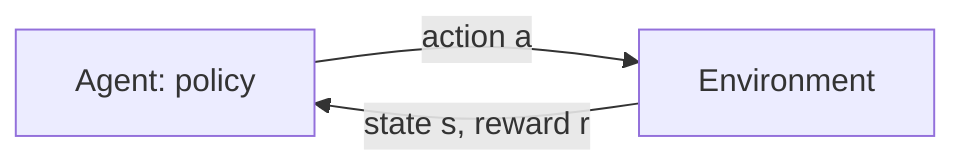

<LessonMeta level="Advanced" time="45 min" prereqs={["A machine learning refresher for robotics", "Probability for robots", "Calculus and optimization"]} />

A quadruped robot is asked to walk. Nobody can write down the correct joint torque for every instant, and no human can demonstrate the thousand-step recovery from a stumble. But it is easy to say what we want: move forward, stay upright, don’t waste energy. **Reinforcement learning** (RL) lets a robot discover its own behaviour from that kind of feedback, by trying things and seeing what scores well.

<Objectives>

- Define a Markov decision process, a policy, a return and a value function.
- Write the policy-gradient update and explain why it works.
- Run a policy-gradient agent on CartPole with Gymnasium and read its learning curve.
- Describe in plain words what PPO changes and why it is popular for robots.

</Objectives>

## The RL setup

An RL problem has an **agent** interacting with an **environment** in a loop. At each step the agent sees a **state** $s_t$, picks an **action** $a_t$, and the environment returns a **reward** $r_{t+1}$ and a new state $s_{t+1}$. This is formalised as a <Term def="Markov decision process: states, actions, transition probabilities, a reward function and a discount factor">Markov decision process</Term> (MDP).



The agent’s behaviour is its **policy** $\pi(a \mid s)$: the probability of choosing action $a$ in state $s$. The goal is a policy that maximises the expected **return**, the total reward collected over time with later rewards discounted by $\gamma \in [0, 1)$:

$$
G_t = r_{t+1} + \gamma\, r_{t+2} + \gamma^2 r_{t+3} + \dots = \sum_{k=0}^{\infty} \gamma^k \, r_{t+k+1}
$$

Discounting says "a reward now is worth more than the same reward later" and keeps the sum finite. Values around 0.99 are typical.

The *Markov* part means the state contains everything needed to predict what happens next, so the past does not matter beyond the current state. For a robot, "state" must therefore include velocities, not only positions, or the problem will not be Markov.

## Value functions

How good is it to be in a state? The **state-value function** is the expected return from state $s$ if you follow policy $\pi$:

$$
V^\pi(s) = \mathbb{E}_\pi \left[ G_t \mid s_t = s \right]
$$

The **action-value function** $Q^\pi(s, a)$ is the same, but for taking action $a$ first and then following $\pi$. Their difference is the **advantage**:

$$
A^\pi(s, a) = Q^\pi(s, a) - V^\pi(s)
$$

The advantage tells you whether an action was better or worse than the policy’s average behaviour in that state. It will be the star of the policy-gradient method below.

Values obey a self-consistency rule, the **Bellman equation**: the value of a state is the expected immediate reward plus the discounted value of the next state.

$$
V^\pi(s) = \mathbb{E}_{a \sim \pi,\; s' \sim P} \left[ r + \gamma\, V^\pi(s') \right]
$$

Value-based methods such as Q-learning and DQN use this recursion to learn values and act greedily on them. They work well for discrete actions. Robots usually have continuous actions (motor torques), where **policy-gradient** methods are the common choice.

## Policy gradients

Instead of learning values and deriving a policy, we can parameterise the policy directly, $\pi_\theta(a \mid s)$, with a neural network, and improve $\theta$ by gradient ascent on the expected return $J(\theta)$. The **policy gradient theorem** gives a surprisingly simple estimate:

$$
\nabla_\theta J(\theta) = \mathbb{E}_{\pi_\theta} \left[ \sum_t \nabla_\theta \log \pi_\theta(a_t \mid s_t) \; G_t \right]
$$

Read it as: *make the actions you took more likely, in proportion to how much return followed them.* Good outcomes push up the probability of the actions that led to them, bad outcomes push them down. This is the **REINFORCE** algorithm.

<KeyIdea title="RL is trial, error and credit assignment">
The policy gradient reinforces whatever the agent just did, weighted by how well things went afterwards. The hard part is credit assignment: with long episodes and sparse reward it is unclear which of thousands of actions deserves the credit. Baselines, value functions and well-designed rewards all exist to make this signal less noisy.
</KeyIdea>

Raw returns are noisy: if every return is positive, REINFORCE pushes up every action a little. Subtracting a **baseline** (such as the average return or a learned $V(s)$) leaves the expected gradient unchanged but cuts the variance a lot. Using $G_t - V(s_t)$, an estimate of the advantage, gives an **actor-critic** method: the policy is the *actor* and the learned value function is the *critic*.

## A runnable example: CartPole

CartPole is the "hello world" of RL: a cart with a hinged pole, where the agent pushes left or right and earns +1 for every step the pole stays up. The maximum episode length in `CartPole-v1` is 500 steps. Install the dependencies:

```bash title="terminal"
pip install gymnasium torch
```

<Tabs>
<TabItem value="pg" label="REINFORCE (from scratch)">

```python title="cartpole_reinforce.py"
import gymnasium as gym
import torch
from torch import nn

torch.manual_seed(0)
env = gym.make("CartPole-v1")

policy = nn.Sequential(nn.Linear(4, 64), nn.Tanh(), nn.Linear(64, 2))   # logits for [left, right]
opt = torch.optim.Adam(policy.parameters(), lr=1e-2)
gamma = 0.99


def run_episode():
    obs, _ = env.reset()
    log_probs, rewards = [], []
    done = False
    while not done:
        logits = policy(torch.as_tensor(obs, dtype=torch.float32))
        dist = torch.distributions.Categorical(logits=logits)
        action = dist.sample()
        obs, reward, terminated, truncated, _ = env.step(action.item())
        log_probs.append(dist.log_prob(action))
        rewards.append(reward)
        done = terminated or truncated
    return log_probs, rewards


def discounted_returns(rewards):
    returns, g = [], 0.0
    for r in reversed(rewards):
        g = r + gamma * g
        returns.append(g)
    returns.reverse()
    return torch.tensor(returns)


for episode in range(1, 301):
    log_probs, rewards = run_episode()
    returns = discounted_returns(rewards)
    returns = (returns - returns.mean()) / (returns.std() + 1e-8)      # baseline and scaling
    loss = -(torch.stack(log_probs) * returns).sum()                   # gradient ascent on expected return
    opt.zero_grad()
    loss.backward()
    opt.step()
    if episode % 50 == 0:
        print(f"episode {episode:3d}  length {len(rewards):3d}")
```

</TabItem>
<TabItem value="sb3" label="PPO with stable-baselines3">

```bash title="terminal"
pip install stable-baselines3
```

```python title="cartpole_ppo.py"
from stable_baselines3 import PPO

model = PPO("MlpPolicy", "CartPole-v1", verbose=1)
model.learn(total_timesteps=50_000)

env = model.get_env()
obs = env.reset()
for _ in range(500):
    action, _ = model.predict(obs, deterministic=True)
    obs, reward, done, info = env.step(action)
    if done[0]:
        obs = env.reset()
```

</TabItem>
</Tabs>

Look at how the from-scratch version maps onto the maths. `dist.log_prob(action)` is $\log \pi_\theta(a_t \mid s_t)$. `returns` is $G_t$. Normalising the returns subtracts a baseline and scales them. The loss is the negative of the policy-gradient objective, since optimisers minimise.

Run the first script and watch the episode lengths. The first few are short (the pole falls in 10–40 steps) and later ones climb towards 500. Learning is noisy and may swing between good and bad episodes. That is normal for REINFORCE, and it is why more stable algorithms exist. Because the agent samples actions, different seeds give different curves.

:::tip[Pro tip]
Always plot a learning curve over several random seeds before believing an RL result. A single lucky run can look like success. Also check what the reward actually encourages: RL optimises exactly what you wrote, not what you meant.
:::

## PPO: the practical workhorse

REINFORCE has a weakness: one big update can wreck the policy, and the data it just collected is useless for the next update because the policy has changed. **Proximal Policy Optimization** (PPO, Schulman et al., 2017) stays popular for robotics because it makes updates more cautious and reuses data a little.

The intuition: collect a batch of experience with the current policy. Then take several gradient steps on that batch, but **clip** how far the new policy’s action probabilities may move from the old ones. With the probability ratio $\rho_t(\theta) = \pi_\theta(a_t \mid s_t) \,/\, \pi_{\theta_{old}}(a_t \mid s_t)$ and advantage estimate $\hat{A}_t$, the objective is

$$
L(\theta) = \mathbb{E}_t \left[ \min\!\big( \rho_t \hat{A}_t, \;\; \mathrm{clip}(\rho_t,\, 1-\varepsilon,\, 1+\varepsilon)\, \hat{A}_t \big) \right]
$$

If an action had positive advantage, the objective rewards making it more likely, but only up to a ratio of $1+\varepsilon$ (often 0.2). Beyond that, the clip removes the incentive. This acts like a guard rail: improve, but do not take a step so large that things collapse. PPO also uses a learned value function for advantages (typically Generalized Advantage Estimation) and runs many environments in parallel.

PPO is on-policy: data is used for a few epochs and then thrown away, so it needs a lot of experience. That is fine in simulation, where you can generate millions of steps, and painful on a real robot. The next lesson is about exactly that.

:::warning
Reward design is where many RL projects go wrong. Agents exploit loopholes: a robot rewarded for forward speed may learn to fall forward and slide. When training behaves strangely, inspect the behaviour in a video, not only the reward number.
:::

## Hands-on lab

<Steps>

1. Install Gymnasium and PyTorch. Run `cartpole_reinforce.py` and note when episode length first reaches 500.
2. Remove the return normalisation line and rerun. What happens to learning speed and stability?
3. Change `gamma` to 0.5. CartPole needs the agent to care about the future. Does it still learn?
4. Run `cartpole_ppo.py` with stable-baselines3 and compare the sample efficiency and stability to your own implementation.
5. Success looks like this: a plot or printed log showing episode length climbing to the 500-step cap, and a sentence on how it differed across two seeds.

</Steps>

## Exercises

<Exercise title="Compute a return" level="Beginner">

An episode gives rewards 1, 1, 1, 0 and ends, with $\gamma = 0.9$. What is $G_0$?

<Solution>

$G_0 = 1 + 0.9 \times 1 + 0.9^2 \times 1 + 0.9^3 \times 0 = 1 + 0.9 + 0.81 + 0 = 2.71$.

</Solution>
</Exercise>

<Exercise title="Why a baseline?" level="Intermediate">

In a task where every reward is positive, why does vanilla REINFORCE learn slowly, and what does subtracting the mean return change?

<Solution>

With all-positive returns, every sampled action’s probability is pushed up, only by different amounts, so the useful signal (which actions were better) is buried in noise and the gradient estimates have high variance. Subtracting a baseline centres the returns, so above-average actions are pushed up and below-average ones are pushed down. The expected gradient is unchanged, but the variance is much lower.

</Solution>
</Exercise>

<Exercise title="Spot the reward bug" level="Intermediate">

A robot arm should place a block in a bin. You reward "negative distance between block and bin" at every step. The agent learns to push the block off the table and into the bin’s direction without placing it. What went wrong, and how might you fix it?

<Solution>

The reward only measures distance, so any motion that shrinks distance scores well, even if the block ends in a useless place. Add terms for the real goal (a large bonus for the block being inside the bin and at rest), penalise the block leaving the workspace, and shape reward in stages (reach, grasp, lift, place). Then watch rollouts to check that behaviour matches intent.

</Solution>
</Exercise>

## Check your understanding

<Quiz questions={[
  {q: "What does the discount factor gamma do?", options: ["Sets the learning rate", "Weights later rewards less than immediate ones", "Chooses the action", "Normalises observations"], answer: 1, explain: "Return is a sum of rewards scaled by gamma to the power of the time offset, so distant rewards count for less."},
  {q: "What does the policy gradient do, in words?", options: ["Makes actions more likely in proportion to the return that followed", "Minimises prediction error", "Copies an expert", "Chooses the highest-value action"], answer: 0, explain: "It increases the log-probability of taken actions, weighted by how good the outcome was."},
  {q: "Why subtract a baseline in policy gradients?", options: ["To make the policy deterministic", "To reduce variance without changing the expected gradient", "To increase the discount", "To skip backpropagation"], answer: 1, explain: "A baseline such as the mean return or V(s) cuts noise while keeping the gradient unbiased."},
  {q: "What does PPO’s clipping do?", options: ["Limits how much the policy can change in one update", "Clips the reward to zero", "Limits episode length", "Removes the need for a value function"], answer: 0, explain: "Clipping the probability ratio removes incentive for large policy changes, stabilising training."}
]} />

<Takeaways>

- RL is an agent-environment loop. An MDP defines states, actions, transitions, rewards and a discount.
- The return is discounted total reward. Value functions $V$ and $Q$ predict it, and the advantage compares an action to the average.
- Policy gradients nudge the policy to make good actions more likely. Baselines and critics cut the variance.
- PPO clips policy updates to keep training stable and is a common choice for robot learning in simulation.
- Rewards define the behaviour you get, so test them by watching rollouts, and judge results across several seeds.

</Takeaways>

## Go deeper

- Sutton and Barto, *Reinforcement Learning: An Introduction* (incompleteideas.net/book), the standard free textbook.
- The Gymnasium documentation at gymnasium.farama.org.
- Schulman et al., "Proximal Policy Optimization Algorithms" (arxiv.org/abs/1707.06347).
- The Stable-Baselines3 documentation at stable-baselines3.readthedocs.io.

Next: [RL in simulation with Isaac Lab](./04-rl-in-simulation-isaac-lab.mdx)
