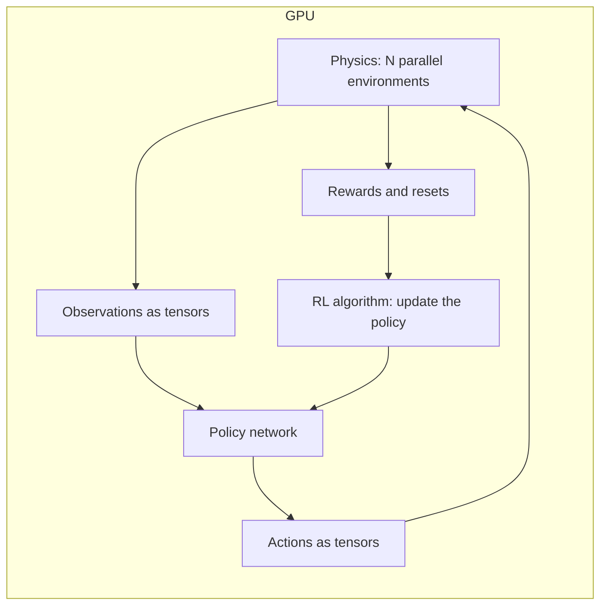

<LessonMeta level="Advanced" time="35 min" prereqs={["Reinforcement learning", "Isaac Sim essentials", "The sim-to-real gap"]} />

Reinforcement learning needs millions of attempts. A real robot makes a few thousand falls before something breaks, and each fall costs time and money. A simulator can run thousands of robots at once, faster than real time, and a fall is free. This lesson shows how modern robot-learning pipelines use that advantage, using NVIDIA Isaac Lab as the worked example.

<Objectives>

- Explain why massively parallel GPU simulation changed robot reinforcement learning.
- Describe the main building blocks of an Isaac Lab task: observations, actions, rewards, terminations, events and curricula.
- Design a reward function with several terms and recognise common reward-design traps.
- Choose domain randomization parameters and a curriculum for a task.

</Objectives>

:::info
Isaac Sim and Isaac Lab change quickly. This lesson teaches the concepts and the structure of a task, not version-specific commands. Check the current Isaac Lab documentation at isaac-sim.github.io/IsaacLab for installation steps and the exact API of your release.
:::

## Why parallel simulation matters

Classical RL on a robot ran one simulation on the CPU and shuttled data between the simulator and the neural network. That became the bottleneck: the GPU that trains the network sat idle waiting for the CPU that simulates the physics.

The breakthrough was to run **thousands of copies of the environment at once, inside one GPU simulation**, and keep all the data (states, observations, rewards) on the GPU as tensors. The policy network also runs on the GPU. Nothing crosses to the CPU each step. Work that once took days of wall-clock time can finish in a much shorter time. A well-known demonstration of this idea is "Learning to Walk in Minutes Using Massively Parallel Deep Reinforcement Learning" (Rudin et al., 2021), which trained legged-robot walking in minutes on a single GPU.

<KeyIdea title="Parallelism turns RL from rare luck into routine engineering">
With thousands of robots training together, each learning step sees a huge, varied batch of experience. You can afford to try many reward designs, many random seeds and many randomizations in a day. The limiting factor shifts from compute to the quality of your task design: rewards, randomization and terminations.
</KeyIdea>

**Isaac Lab** is NVIDIA’s open-source framework for robot learning on top of Isaac Sim. It grew out of earlier NVIDIA robot-learning projects and provides ready-made robots, sensors, tasks and integrations with common RL libraries. You write a task description, point an RL library at it, and training runs across thousands of environments in parallel.



## Anatomy of a task

Isaac Lab describes a task as a set of configuration pieces. In its **manager-based** style, each piece has a manager that you configure with terms. (There is also a more hands-on **direct** style where you write the step logic yourself as tensor code.) The usual pieces are:

| Piece | Question it answers | Example |
|---|---|---|
| Scene | What exists? | Robot, ground plane, objects, sensors |
| Observations | What does the policy see? | Joint positions and velocities, base orientation, last action, commanded velocity |
| Actions | What does the policy control? | Target joint positions for a PD controller |
| Rewards | What counts as good? | Track velocity, stay upright, save energy |
| Terminations | When does an episode end? | Robot falls, time runs out |
| Events | What changes at reset or during the episode? | Randomize friction, mass; apply random pushes |
| Curriculum | How does difficulty grow? | Harder terrain as the robot succeeds |
| Commands | What goal is the policy given? | Desired forward velocity |

Everything is vectorised: each term is a function that takes tensors with one row per environment and returns tensors with one row per environment. You do not write a loop over robots.

### Observations and actions

The policy should see what a **real** robot can sense, plus nothing it cannot. If you feed the policy the exact simulator contact forces and the robot has no such sensor, the policy will fail in the real world. Add realistic **sensor noise** to observations during training.

Actions are usually **target joint positions** that a low-level PD controller tracks, rather than raw torques. That makes learning easier and behaviour smoother, and it matches how many real robots are driven.

A popular trick is **asymmetric actor-critic**: the critic (used only in training) is allowed to see privileged simulator information, such as exact terrain height or friction, while the actor (the deployed policy) sees only what the real robot can sense. This speeds up learning without breaking deployment.

## Reward design

Rewards are a **sum of weighted terms**. For legged locomotion, a typical recipe is one or two terms that define the goal (track a commanded velocity) plus several small penalty terms that shape *how* the robot achieves it (smooth, efficient, upright).

Here is a vectorised reward function in plain PyTorch. It is not Isaac Lab code, but it has the same shape as the terms you would write: tensors with a leading dimension for the number of environments.

```python title="locomotion_reward.py"
import torch


def locomotion_reward(base_lin_vel, cmd_vel, joint_torques, action, last_action, up_z, fell):
    """Every tensor has a leading dimension of num_envs, so thousands of robots are scored in one call."""
    vel_err = torch.sum((cmd_vel - base_lin_vel[:, :2]) ** 2, dim=1)
    track = torch.exp(-vel_err / 0.25)                       # 1.0 when perfect, decays smoothly with error
    torque_penalty = torch.sum(joint_torques ** 2, dim=1)    # discourage wasting energy
    jerk_penalty = torch.sum((action - last_action) ** 2, dim=1)   # discourage twitchy actions
    return (
        1.0 * track
        - 1e-4 * torque_penalty
        - 0.01 * jerk_penalty
        + 0.2 * up_z                                         # stay upright (1.0 = perfectly upright)
        - 5.0 * fell.float()                                 # big penalty for falling over
    )


n = 4096
r = locomotion_reward(
    base_lin_vel=torch.randn(n, 3) * 0.3,
    cmd_vel=torch.full((n, 2), 0.5),
    joint_torques=torch.randn(n, 12),
    action=torch.randn(n, 12),
    last_action=torch.randn(n, 12),
    up_z=torch.rand(n),
    fell=torch.rand(n) < 0.02,
)
print(r.shape, round(r.mean().item(), 3))
```

Run it: you get one reward per environment, from a single call that handles 4096 robots. The weights matter. The `exp` shaping gives a smooth, bounded reward that is largest at zero error, which tends to behave better than a raw negative error. Small penalties on torque and action change keep motions gentle, but if you make them too large the robot learns that standing still is the safest option.

### Common traps

- **Reward hacking.** The agent finds a loophole. A robot paid for speed may fall forward. Watch rollouts, not only reward curves.
- **Conflicting terms.** Rewarding both "move fast" and "use very little energy" with similar weights gives an agent that does neither well. Tune one term at a time.
- **Sparse reward.** A reward that only appears on complete success (such as "block in bin") gives almost no signal early on. Add shaping terms (distance to block, grasp contact, lift height) but check they do not create a new loophole.
- **Over-shaping.** Many hand-tuned terms can lock the robot into your idea of the solution rather than a better one.
- **No termination signals.** Without early termination for falling, simulators waste time on robots that are already lying on the floor.

:::tip[Pro tip]
Add reward terms one at a time and log each term’s contribution separately. When training goes wrong, a per-term plot tells you which term dominates.
:::

## Domain randomization

A policy trained in one perfect simulation will overfit to its quirks. **Domain randomization** deliberately varies the simulation across environments (and across resets), so the policy has to work in all of them. The real world then looks like just another variation.

Things worth randomizing for a legged or manipulation robot:

- **Physics:** ground friction, restitution, link masses and centres of mass, payload mass.
- **Actuators:** motor strength, PD gains, joint friction and damping, and **latency** between command and effect.
- **Sensing:** observation noise, bias, dropped or delayed frames, camera pose and lighting for vision policies.
- **Disturbances:** random pushes, force impulses, uneven terrain.

Choose ranges that bracket your best estimate of reality, wide enough to cover errors in your model but not so wide that the task becomes impossible. Randomizing everything massively can produce a cautious, slow policy that works everywhere and excels nowhere. Measure real parameters where you can (weigh the robot, measure latency) and centre your ranges there.

## Curriculum

Throwing the hardest version of a task at a beginner policy can leave it with no reward signal at all. A **curriculum** starts easy and raises the difficulty as the policy improves.

For a walking robot, terrain is a natural curriculum: start every robot on flat ground. When a robot successfully traverses its terrain, move it to a harder patch (slopes, steps, rough ground). If it fails badly, move it back to an easier one. Command ranges can grow similarly, from slow forward walking to faster, turning and sideways motion. Because thousands of robots train at once, different robots can be at different difficulty levels simultaneously.

Curricula can be hand-designed or automatic. The key is a measurable **progress signal** (distance walked, success rate) that triggers promotion.

## From training to a real robot

A trained policy is a small neural network. Export it, run it at the control rate on the robot’s computer, and check the following before trusting it:

- Observation order and scaling match training exactly.
- The action is applied the same way (same PD gains, same joint limits, same control rate).
- You have a safe stop and conservative limits for the first run.

Expect a gap anyway. Compare simulation and hardware logs for the same command, find where they diverge, then adjust the randomization ranges, add the missing effect to the simulator, or both. This loop is covered in depth in the simulation module’s sim-to-real lesson.

## Hands-on lab

<Steps>

1. Save `locomotion_reward.py` and run it. Confirm the output shape is `(4096,)`.
2. Add a term that penalises joint velocities above a threshold. Plot how the mean reward changes for random inputs.
3. Write down a plan for a new task, "a robot arm slides a block to a target spot on a table". List: the observations (what a real robot can sense), the action space, four reward terms with signs and rough weights, two termination conditions.
4. For the same task, list five parameters you would randomize with a sensible range for each, and a one-line curriculum plan.
5. Optional, if you have an NVIDIA GPU: follow the current Isaac Lab installation guide and run one of its built-in training tasks. Success: reward curves climb across training and a playback shows the policy moving.

</Steps>

## Exercises

<Exercise title="Why GPU tensors?" level="Beginner">

Why does keeping observations and rewards on the GPU, instead of copying them to the CPU each step, speed up training so much?

<Solution>

The transfer between CPU and GPU, and the Python loop over environments, would dominate the time. Keeping states, observations, rewards and the policy on the GPU means every step is a batch tensor operation across thousands of environments with no round trips.

</Solution>
</Exercise>

<Exercise title="Diagnose the lazy robot" level="Intermediate">

Your walking policy learns to stand still. Name two likely reward-design causes and a fix for each.

<Solution>

(1) Penalty terms (torque, action rate) outweigh the velocity-tracking reward, so staying still is the best score. Reduce penalty weights or increase the tracking term. (2) The tracking reward is too sparse or too sharply peaked, so early policies get no gradient towards moving. Use a smoother shaping such as an exponential of the error, or start with a curriculum of easy commands.

</Solution>
</Exercise>

<Exercise title="Randomization budget" level="Advanced">

You randomize friction from 0.05 to 3.0, mass by plus or minus 80 percent and add 200 ms latency. The policy trains but moves timidly even on good ground. What is a likely cause, and how do you investigate?

<Solution>

The ranges are probably much wider than reality, so the policy optimises for the worst case in the set and becomes conservative. Narrow the ranges to plausible values (measure the real mass, friction on your floor and latency), then test which individual randomization hurts performance by turning them on one at a time.

</Solution>
</Exercise>

## Check your understanding

<Quiz questions={[
  {q: "What made modern robot RL much faster?", options: ["Smaller neural networks", "Thousands of simulated robots running in parallel on the GPU with data kept as GPU tensors", "Removing rewards", "Training on real robots only"], answer: 1, explain: "Parallel GPU simulation gives huge batches of experience without CPU-GPU transfers."},
  {q: "Why use an asymmetric actor-critic?", options: ["The critic may use privileged simulator information the real robot cannot sense, while the actor sees only deployable inputs", "To halve the network size", "To remove rewards", "To disable randomization"], answer: 0, explain: "Privileged information helps the critic learn faster, but the deployed actor only needs real-world observations."},
  {q: "What is the purpose of domain randomization?", options: ["Making the simulator faster", "Forcing the policy to work across many variations so the real world looks like one more variation", "Adding more reward terms", "Reducing GPU memory"], answer: 1, explain: "Randomizing physics, sensing and disturbances produces policies that tolerate model errors."},
  {q: "What does a terrain curriculum do?", options: ["Starts easy and promotes robots to harder terrain as they succeed", "Gives all robots the hardest terrain first", "Randomizes the reward", "Stops training early"], answer: 0, explain: "It keeps the difficulty matched to the policy’s ability so there is always a learning signal."}
]} />

<Takeaways>

- Running thousands of environments in parallel on the GPU, with all data as tensors, makes robot RL fast enough to iterate on.
- An Isaac Lab task is built from a scene, observations, actions, rewards, terminations, events and a curriculum, all vectorised across environments.
- Rewards are weighted sums. Add terms one at a time, log each, and watch rollouts for hacking.
- Domain randomization makes policies robust, but ranges should bracket reality rather than ignore it.
- Curricula keep difficulty matched to progress. Always compare real-robot behaviour to simulation and iterate.

</Takeaways>

## Go deeper

- The Isaac Lab documentation at isaac-sim.github.io/IsaacLab, and the NVIDIA developer pages at docs.nvidia.com for Isaac Sim.
- Rudin et al., "Learning to Walk in Minutes Using Massively Parallel Deep Reinforcement Learning" (arxiv.org/abs/2109.11978).
- Tobin et al., "Domain Randomization for Transferring Deep Neural Networks from Simulation to the Real World" (arxiv.org/abs/1703.06907).
- Peng et al., "Sim-to-Real Transfer of Robotic Control with Dynamics Randomization" (arxiv.org/abs/1710.06537).

Next: [Datasets and scaling](./05-datasets-and-scaling.mdx)
