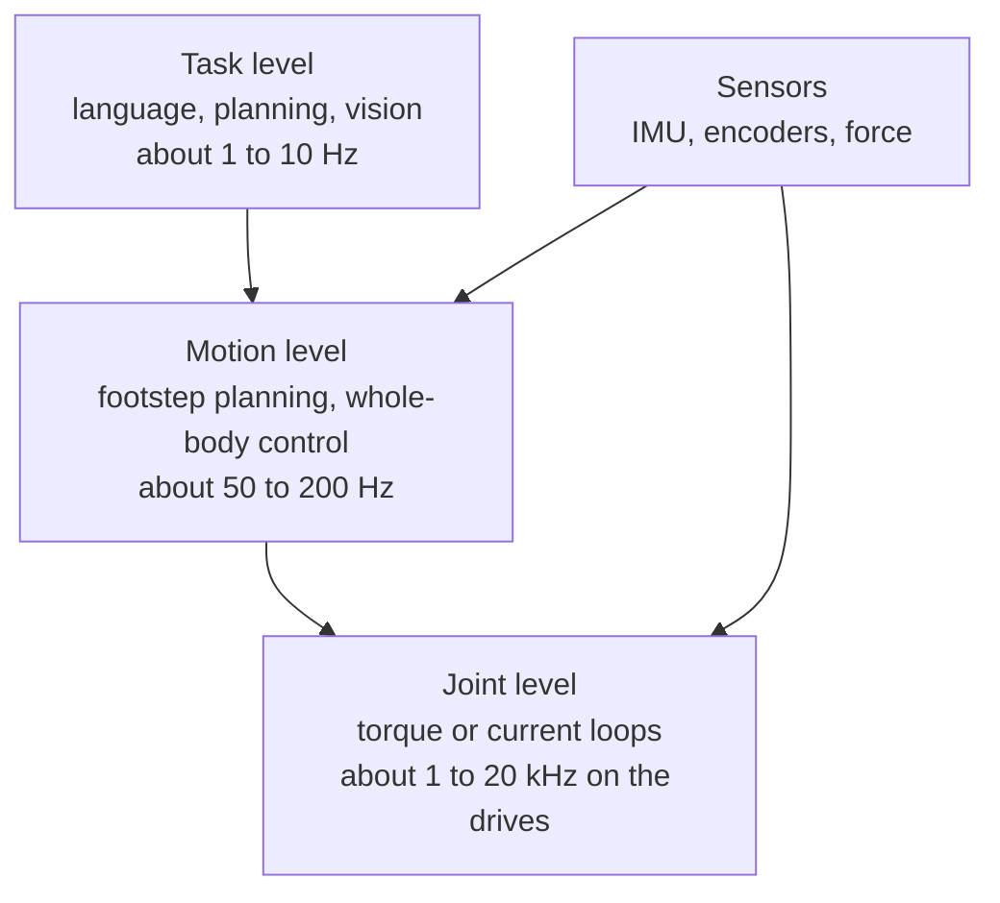

<LessonMeta level="Intermediate" time="30 min" prereqs={["Anatomy of a robot", "Frames and rigid transforms", "Python basics"]} />

Picture a humanoid carrying a box up a flight of stairs. Its knee has to deliver a burst of torque on every step, its ankle has to feel the floor within a few milliseconds, its hip must not shake itself apart, and the whole machine must carry its own battery and computer. Every one of those requirements is a design choice made months earlier, when someone picked an actuator, a sensor or a processor. This lesson is a tour of those choices.

<Objectives>

- Count the degrees of freedom of a humanoid and explain where they go.
- Compare quasi-direct-drive, series elastic and hydraulic actuators.
- Use gear ratio to compute output torque and reflected inertia.
- List the sensors and compute layers a humanoid needs, and what each one is for.
- Argue honestly for and against the human form.

</Objectives>

## The body: degrees of freedom

A <Term def="A single independent way a body can move. A hinge joint adds one; a ball joint adds three.">degree of freedom</Term> (DoF) is one independent way the robot can move. A hinge (like your elbow) gives one. A ball-and-socket joint (like your shoulder) gives three. Most humanoids build a ball joint from three hinge axes that meet at a point.

A typical humanoid layout looks like this:

| Part | Typical DoF | Why |
|---|---|---|
| Each leg | 6 | 3 at the hip, 1 at the knee, 2 at the ankle: enough to place a foot anywhere in space with any orientation |
| Each arm | 6 or 7 | 3 at the shoulder, 1 at the elbow, 2 or 3 at the wrist; a 7th lets the elbow swing while the hand stays put |
| Waist or torso | 0 to 3 | Extends reach and helps balance |
| Neck and head | 1 to 3 | Points the cameras |
| Each hand | 1 to 20 or more | From a simple two-finger gripper to a dexterous hand |

Add it up and an ordinary full-size humanoid has somewhere between 25 and 50 actuated joints, plus the hands. The exact number depends on the design, so treat the table as a rule of thumb, not a spec for any particular robot.

There is one more number that matters. A humanoid is a <Term def="A robot whose base is not bolted to the world. Its body can translate and rotate freely, which adds 6 unactuated degrees of freedom.">floating-base</Term> system: nothing fixes the pelvis to the world, so the robot has 6 extra DoF (position and orientation of the body) that no motor controls directly. The robot can only change them by pushing on the ground through its feet. That single fact is why balance (the next lesson) is hard.

```python title="joint_budget.py"
from dataclasses import dataclass

@dataclass
class Joint:
    name: str
    dof: int
    peak_torque_nm: float  # round, made-up numbers for practice; not any real robot

leg = [Joint("hip", 3, 150.0), Joint("knee", 1, 200.0), Joint("ankle", 2, 80.0)]
arm = [Joint("shoulder", 3, 60.0), Joint("elbow", 1, 40.0), Joint("wrist", 3, 15.0)]
neck = [Joint("neck", 2, 10.0)]
waist = [Joint("waist", 1, 120.0)]

def dof(chain):
    return sum(j.dof for j in chain)

body = {"left leg": leg, "right leg": leg, "left arm": arm,
        "right arm": arm, "neck": neck, "waist": waist}

total = 0
for name, chain in body.items():
    print(f"{name:10s} {dof(chain)} DoF")
    total += dof(chain)

print("actuated body DoF (no hands):", total)
print("floating-base DoF (unactuated):", 6)
print("configuration size:", total + 6)
```

Run it and you get 6 per leg, 7 per arm, 2 for the neck, 1 for the waist: 29 actuated DoF without hands, 35 numbers in the full configuration. Notice that the legs hold the biggest torques. They carry the whole weight and must catch it on every step.

## Actuators: where the muscle comes from

An <Term def="The motor, gearbox and drive electronics that together move one joint.">actuator</Term> is more than a motor. The gearbox decides how the motor feels to the rest of the robot. Three families dominate.

### Geared electric motors

A small, fast motor is cheap and light but weak. A gearbox with ratio $N$ trades speed for torque:

$$
\tau_{\text{out}} = \eta \, N \, \tau_{\text{motor}}, \qquad J_{\text{reflected}} = N^2 J_{\text{rotor}}
$$

Here $\eta$ is efficiency (always below 1) and $J_{\text{rotor}}$ is the rotor’s inertia. The second equation is the surprise. Torque grows with $N$, but the inertia the joint *feels* grows with $N^2$. A high gear ratio makes the joint strong, slow to accelerate, and hard to move by hand. Friction in the gearbox also gets multiplied, so you cannot feel the outside world through the motor current.

```python title="actuator_tradeoff.py"
def joint_from_motor(tau_motor, j_rotor, n, efficiency=0.9):
    """Return (output torque in Nm, reflected inertia in kg m^2)."""
    return tau_motor * n * efficiency, j_rotor * n ** 2

print(" N   output torque   reflected inertia")
for n in (6, 9, 30, 100):
    tau, j = joint_from_motor(tau_motor=1.5, j_rotor=2.0e-4, n=n)
    print(f"{n:3d}   {tau:8.1f} Nm   {j:12.4f} kg m^2")
```

Going from $N=9$ to $N=100$ multiplies torque by about 11 but reflected inertia by about 123. That is the heart of the next design choice.

### Quasi-direct-drive (QDD)

<Term def="An actuator with a large, torque-dense motor and a low gear ratio, typically around 6 to 10, so that it stays backdrivable.">Quasi-direct-drive</Term> actuators use a large-diameter, high-torque motor and a small gear ratio. Because $N$ is low, the joint is <Term def="Able to be moved from the output side. A backdrivable joint gives way when something pushes on it.">backdrivable</Term>: a push on the leg turns the motor, and the motor current tells you how hard you were pushed. That gives free <Term def="Estimating the force a joint exerts or feels from motor current alone, with no force sensor.">proprioceptive force sensing</Term> and makes impacts (a foot hitting the floor) much gentler on the gearbox. The price is a bigger, heavier, hotter motor for the same torque. This design became popular in legged robots over the last decade.

### Series elastic actuators (SEA)

A <Term def="An actuator with a spring placed between the motor and the load. Measuring the spring’s stretch measures the force.">series elastic actuator</Term> puts a deliberate spring between the gearbox and the link. Measure how far the spring stretches and you know the torque, with a cheap encoder and excellent accuracy. The spring also absorbs shocks and can store energy between steps. The cost is bandwidth: the spring limits how fast the force can change, and the control loop has to handle one more resonance.

### Hydraulic and electric

Hydraulic actuators push fluid through cylinders. They have very high power density and can deliver huge forces from a small package, which is why some pioneering humanoids used them for jumping and flips. They also need a pump, hoses, a reservoir and careful sealing, run hot and noisy, and can leak. Electric actuators are quieter, cleaner, more efficient and simpler to control, and as motors and batteries have improved, most new humanoids have moved to electric. A well-known hydraulic research humanoid was later followed by an electric version from the same maker.

:::note[Linear actuators]
Legs also use linear actuators (such as roller-screw designs) that push a knee or ankle through a short linkage. They give high force in a compact line and are common at the knee and ankle of larger robots.
:::

<KeyIdea title="Gear ratio is a trade, not a free lunch">

More gearing buys torque and costs speed, backdrivability and force sensing. Legged robots that must absorb impacts and react to pushes usually want low gear ratios (QDD) or a spring (SEA). Slow, strong, precise joints can afford more gearing.

</KeyIdea>

## Sensors: how the robot knows itself

The word *proprioception* means sensing your own body. A humanoid needs it in layers:

- **Joint encoders** measure every joint angle, usually at the motor and often again at the output. Velocity comes from differencing.
- **An IMU** (inertial measurement unit: gyroscope plus accelerometer) sits in the pelvis or torso and reports body orientation and angular velocity. It is the most important balance sensor.
- **Force/torque sensors** in the ankles (and sometimes wrists) measure the ground reaction. They tell the controller where the pressure is under the foot, which is exactly the quantity the next lesson needs.
- **Cameras, depth sensors and LiDAR** in the head see the world: stairs, doors, objects.
- **Tactile sensors** in the fingertips feel contact; see [Hands and dexterity](./05-hands-and-dexterity.mdx).

State estimation fuses these into one estimate of where the body is and how fast it is moving. That uses the filters from [State estimation and Kalman filters](../05-perception/04-state-estimation-and-kalman-filters.mdx).

## Compute: three speeds

Think in layers, each running at its own rate:



The joint-level loops live in the motor drives and talk over a real-time bus such as EtherCAT or CAN. A control computer runs the motion layer with hard real-time deadlines. A separate, more powerful computer (usually with a GPU or AI accelerator) runs perception and learned models, because those can take tens of milliseconds and must never block the balance loop. Keeping the layers apart is how a robot can think slowly and still not fall over.

## Why the human form?

Humanoid robots are not the best shape for every job. A wheeled base with two arms is cheaper, more stable and often fine. The argument for two legs and two arms is practical:

- The world is built for humans: stairs, door handles, shelves, tools, vehicles. A humanoid fits without changing the building.
- Human demonstrations transfer: a person can teleoperate the robot, and video of people doing tasks maps naturally onto a body of the same shape.
- One general body, many tasks, which makes large data collection and large models worthwhile.

The arguments against are just as real. Two legs are unstable, expensive, energy-hungry and slow to commercialise. Every joint is a possible failure. Be skeptical of claims that a humanoid is always the right answer; pick the body that fits the task.

:::warning[Don’t trust spec sheets blindly]
Payload, runtime and speed figures for commercial humanoids change quickly and are often best-case numbers. Treat any figure you read as marketing until you find the test conditions.
:::

## Hands-on lab

<Steps>

1. Save `joint_budget.py` and run it. Confirm you get 29 actuated DoF and a configuration of size 35.
2. Add a `hand` chain of your choice (for example 6 DoF) to each arm and re-run. How does the count change?
3. Save `actuator_tradeoff.py`, run it, then change `j_rotor` to double. Which column changes, and by how much?
4. Add a column for the time to reach a target angular acceleration, assuming a load inertia of 0.5 kg m^2 plus the reflected inertia. Which gear ratio is best now?
5. You are done when you can explain, in two sentences, why a 100:1 joint is poor at absorbing a footstrike.

</Steps>

## Exercises

<Exercise title="Count the joints" level="Beginner">

A humanoid has 6-DoF legs, 7-DoF arms, a 3-DoF waist and a 2-DoF neck. How many actuated DoF does it have, and how large is its full configuration vector?

<Solution>

Legs: 2 × 6 = 12. Arms: 2 × 7 = 14. Waist 3, neck 2. Total actuated: 12 + 14 + 3 + 2 = 31. Add 6 for the floating base: the configuration has 37 values.

</Solution>

</Exercise>

<Exercise title="Pick a gear ratio" level="Intermediate">

A motor gives 2 N·m and has rotor inertia $3\times10^{-4}$ kg m². With efficiency 0.9, compute output torque and reflected inertia for $N = 8$ and $N = 50$. Which would you choose for a hip that must react to pushes, and why?

<Solution>

For $N=8$: torque $= 0.9 \times 8 \times 2 = 14.4$ N·m; reflected inertia $= 3\times10^{-4} \times 64 = 0.0192$ kg m². For $N=50$: torque $= 90$ N·m; inertia $= 3\times10^{-4} \times 2500 = 0.75$ kg m². The hip that reacts to pushes should favour $N=8$ (backdrivable, low reflected inertia, can sense force through current), provided the motor can be made strong enough. $N=50$ gives more torque but the joint is stiff and slow to respond.

</Solution>

</Exercise>

<Exercise title="Layers of compute" level="Intermediate">

Why should a large vision model not run in the same loop as the balance controller?

<Solution>

Balance needs a deadline met every cycle, within a few milliseconds. A large model has variable, much longer latency and could occasionally miss its deadline, leaving the robot without a command while it is unstable. Running perception on a separate computer or process, and handing the controller its latest result asynchronously, keeps balance safe.

</Solution>

</Exercise>

## Check your understanding

<Quiz questions={[
  {q: "What makes a humanoid a floating-base system?", options: ["It has no legs", "Its body is not fixed to the world, so 6 body degrees of freedom are not directly actuated", "It floats in water", "It uses a spring in every joint"], answer: 1, explain: "Nothing bolts the pelvis to the ground, so the robot controls its body pose only indirectly, by pushing on the ground through the feet."},
  {q: "If you double the gear ratio of a joint, what happens to reflected inertia?", options: ["It doubles", "It halves", "It grows by four times", "It stays the same"], answer: 2, explain: "Reflected inertia scales with the square of the gear ratio."},
  {q: "Why do many legged robots prefer low-gear-ratio actuators?", options: ["They are cheaper in every case", "They are backdrivable, absorb impacts better and allow force sensing from motor current", "They never overheat", "They run without batteries"], answer: 1, explain: "Backdrivability gives compliance and proprioceptive force sensing, which help with impacts and pushes."},
  {q: "Which sensor is the most important for balance?", options: ["An IMU in the pelvis or torso", "A microphone", "A thermometer", "A GPS receiver"], answer: 0, explain: "The IMU reports body orientation and angular velocity, which the balance controller needs at high rate."}
]} />

<Takeaways>

- A typical humanoid has roughly 25 to 50 actuated joints plus 6 unactuated floating-base DoF.
- Gear ratio trades torque against speed and backdrivability; reflected inertia grows with the square of the ratio.
- QDD actuators favour impact tolerance and force sensing; SEAs measure force with a spring; hydraulics offer power density at the cost of complexity.
- Sensing comes in layers: encoders, IMU, foot force, vision, touch.
- Compute is layered by rate, so slow AI never blocks fast balance.
- The human form is a practical bet about environments and data, not a law of nature.

</Takeaways>

## Go deeper

- [MuJoCo documentation](https://mujoco.readthedocs.io/) for simulating articulated bodies, including humanoids.
- [Pinocchio rigid-body dynamics library](https://stack-of-tasks.github.io/pinocchio/) for kinematics and dynamics of floating-base robots.
- [Isaac Lab documentation](https://isaac-sim.github.io/IsaacLab/): check the current release for humanoid assets and tasks.

Next: [Balance and the ZMP](./02-balance-and-zmp.mdx)
