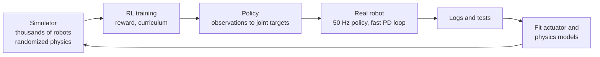

<LessonMeta level="Advanced" time="40 min" prereqs={["Balance and the ZMP", "Reinforcement learning basics", "Python basics"]} />

A humanoid has been standing nicely for ten minutes. Now you say "walk to the door" and everything gets harder: the feet leave the ground one at a time, the robot is falling forward on purpose and catching itself, the floor might be uneven, and a person might step in the way. Walking is not one skill. It is a rhythm, a model, and a lot of small corrections. This lesson shows the two big families of walking controllers and what each one needs.

<Objectives>

- Describe the phases of the human gait cycle and map them onto a robot.
- Explain how model predictive control (MPC) generates footsteps and a CoM path from the pendulum model.
- Describe how a reinforcement-learned walking policy is built: observations, actions, rewards, randomization.
- Compare the two approaches and name the sim-to-real steps each one needs.
- Write a gait clock and a simple walking reward in Python.

</Objectives>

## The gait cycle

Walking repeats the same pattern. Follow one foot:

- **Stance:** the foot is on the ground and carries weight. In ordinary human walking it lasts roughly 60 percent of the cycle.
- **Swing:** the foot is in the air, moving forward to its next landing spot, roughly the other 40 percent.
- **Double support:** both feet are down. It happens twice per cycle, once at each handover, and usually accounts for around 20 percent of the total time.

When the robot speeds up, double support shrinks. At a run it disappears and a *flight phase* appears, where neither foot touches the ground. For most humanoid walking you can assume stance on one foot, double support, stance on the other, and repeat.

Two other terms are useful. A <Term def="One full left-right sequence of steps; the time it takes for one foot to go from landing to the next landing.">stride</Term> is two steps; the <Term def="The fraction of the gait cycle a foot spends on the ground.">duty factor</Term> is the share of each cycle the foot is in stance.

```python title="gait_clock.py"
def gait_phase(t, period=0.8, duty=0.6):
    """Return (phase, left_in_stance, right_in_stance). The right foot runs half a cycle behind."""
    phase = (t / period) % 1.0
    left = phase < duty
    right = ((phase + 0.5) % 1.0) < duty
    return phase, left, right

def label(left, right):
    if left and right:
        return "double support"
    if left:
        return "left stance, right swing"
    if right:
        return "right stance, left swing"
    return "flight"

for i in range(0, 17):
    t = i * 0.05
    phase, left, right = gait_phase(t)
    print(f"t={t:4.2f}  phase={phase:4.2f}  {label(left, right)}")

samples = 1000
double = sum(1 for k in range(samples)
             if all(gait_phase(0.8 * k / samples)[1:]))
print("double support share of the cycle:", double / samples)
```

Running it prints a repeating sequence of left stance, double support, right stance, double support, and finally reports 0.2 for the double-support share. That clock is more than a toy. Many walking controllers, learned or planned, are driven by exactly this kind of phase signal.

## Walking with a model: capture point and MPC

In [Balance and the ZMP](./02-balance-and-zmp.mdx) you saw that the capture point tells you where to step. Walking is that idea repeated: at every step, place the foot so that the pendulum keeps moving in the direction you want, rather than stopping.

Instead of stopping at the capture point, the robot picks a footstep so that the capture point lands where it wants *next time*. With $\dot{\xi} = \omega(\xi - p)$, a foot placed behind $\xi$ lets $\xi$ run forward, and the robot speeds up; a foot placed ahead of it slows it down. How far behind or ahead you place it, together with the step timing, sets how quickly the robot speeds up or slows down.

Doing this by hand works for a clean flat floor. Planning many steps ahead, with limits on step length, foot rotation and contact timing, is a job for optimization.

### MPC

<Term def="Model predictive control: at every control cycle, solve an optimization over a short future horizon using a model, apply only the first control, then repeat.">Model predictive control</Term> (MPC) does this. At each cycle the controller:

1. Takes the current estimated state (CoM position and velocity, foot positions).
2. Predicts the next $N$ steps (or the next second or so) with a model, usually the LIPM or a richer centroidal model.
3. Chooses the ZMP positions or foot placements $p_k$ that make the CoM follow the desired velocity while respecting limits.
4. Applies only the first command, then re-solves at the next cycle with fresh sensor data.

A discretized LIPM gives the prediction: $s_{k+1} = A s_k + B p_k$ with $s = (x, \dot{x})$. Stacking $N$ steps turns the problem into a quadratic program:

$$
\min_{p_0,\dots,p_{N-1}} \;\sum_{k=1}^{N} \left\| \dot{x}_k - \dot{x}^{\text{ref}} \right\|^2 + \alpha \sum_{k=0}^{N-1} \left\| p_k - p^{\text{ref}}_k \right\|^2
\quad \text{s.t. } p^{\min}_k \le p_k \le p^{\max}_k
$$

The bounds are the support polygon (ZMP stays in the foot) and the reachable foot positions. A QP solver finds the answer in a millisecond or less, so the whole thing runs at 100 Hz or faster. An earlier classic, *preview control* of the ZMP, tracks a planned future ZMP reference with a feedback law, and is the ancestor of this approach.

The planned CoM and foot trajectories are then handed to a whole-body controller (next lesson), which turns them into joint torques.

<KeyIdea title="MPC trades computation for foresight">

A model-based walker looks ahead. That makes it excellent at planned, constrained motion: stepping onto stones, turning in place, stopping exactly. It is limited by its model. A single point mass cannot capture swinging arms or a heavy payload, so richer models and good state estimation matter.

</KeyIdea>

## Walking with a policy: reinforcement learning

The other approach throws away the hand-written model. A neural network observes the robot and outputs actions, and training on millions of simulated steps teaches it to walk. You met the basics in [Reinforcement learning](../07-robot-learning/03-reinforcement-learning.mdx) and the training setup in [RL in simulation with Isaac Lab](../07-robot-learning/04-rl-in-simulation-isaac-lab.mdx). For walking, the standard recipe looks like this:

**Observations** (what the policy sees): body angular velocity and orientation from the IMU (often as the gravity vector expressed in the body frame), joint positions and velocities, the previous action, a velocity command from the user, and often the gait phase from the clock above.

**Actions:** target joint angles. A fast PD controller on the drive turns them into torque. The policy runs at around 50 Hz while the PD loop runs far faster.

**Reward:** a weighted sum that says what good walking is:

- reward matching the commanded forward and turning speed,
- reward the feet for being on the ground when the gait clock says stance,
- penalize torque (energy), jerky action changes, and feet that slide on the floor,
- end the episode and penalize if the robot falls.

```python title="walking_reward.py"
import math

def tracking(err, sigma):
    """1.0 when the error is zero, decaying smoothly as it grows."""
    return math.exp(-(err * err) / sigma)

def walking_reward(cmd, state, action, last_action, torques, contacts, contact_target):
    r = 1.0 * tracking(cmd["vx"] - state["vx"], 0.25)
    r += 0.5 * tracking(cmd["yaw"] - state["yaw"], 0.25)
    match = sum(1 for c, t in zip(contacts, contact_target) if c == t)
    r += 0.3 * match / len(contacts)
    r -= 2e-4 * sum(tq * tq for tq in torques)
    r -= 0.05 * sum((a - b) ** 2 for a, b in zip(action, last_action))
    if state["fell"]:
        r -= 1.0
    return r

cmd = {"vx": 0.5, "yaw": 0.0}
good = walking_reward(cmd, {"vx": 0.48, "yaw": 0.02, "fell": False},
                      [0.1, 0.2], [0.1, 0.19], [20.0, 25.0, 18.0],
                      [True, False], [True, False])
bad = walking_reward(cmd, {"vx": 0.05, "yaw": 0.4, "fell": True},
                     [0.9, -0.8], [0.0, 0.0], [90.0, 95.0, 80.0],
                     [False, True], [True, False])
print("good step reward:", round(good, 3))
print("bad step reward: ", round(bad, 3))
```

Run it and the good step scores about 1.5 while the bad step is strongly negative. Real training uses a dozen or more reward terms, and tuning their weights is a large part of the craft.

Training runs thousands of simulated robots in parallel on a GPU, so a policy can accumulate years of walking experience in hours. A <Term def="Gradually making the training environment harder, for example by increasing slope or roughness as the policy improves.">terrain curriculum</Term> starts on flat ground and moves on to slopes, stairs and rough surfaces as the policy improves.

## Sim-to-real

A policy that walks in simulation will often fall on hardware, because simulation is never exact. The tools are the ones from [The sim-to-real gap](../04-simulation/05-sim-to-real-gap.mdx):

- **Domain randomization:** each training episode changes friction, link masses, motor strength, sensor noise, delays and random shoves. The policy learns to cope with a whole family of robots, one of which resembles the real one.
- **Actuator modelling:** fit a model of the real motor and drive (including torque limits, friction and latency) and use it in the simulator. This closes a surprisingly large part of the gap.
- **Asymmetric actor-critic:** the critic gets privileged information (true friction, terrain height) that the real robot does not have, which speeds up learning while the actor only uses sensors the robot actually has.
- **Safe deployment:** start with the robot hanging from a gantry, clip the actions, set torque and joint limits on the drives, and keep an emergency stop in reach.



## MPC or RL?

| | MPC and model-based | RL policy |
|---|---|---|
| Needs | Good model, state estimator, solver | Simulator, reward, compute |
| Strength | Constraints, precision, explainable, works the first time on flat ground | Rough terrain, recovery, natural motion, handles unmodelled effects |
| Weakness | Fails when the model is wrong; hard to tune for new tasks | Reward tuning, sim-to-real work, hard to guarantee behavior |
| Debugging | Inspect the plan and the constraints | Inspect rewards and randomization |

In practice they mix. A common pattern is an RL policy for robust low-level walking, with a model-based planner choosing footsteps or velocity commands above it, or an MPC that uses a learned value function. Which one wins depends on the task, the terrain, and how much simulation you can afford. Check the current literature for the latest results; this area changes quickly.

:::warning[Falls are real]
A full-size humanoid that falls can damage itself and hurt people. Always test new walking controllers in simulation first, then on a gantry or with a safety line, and never inside the reach of an untrained bystander.
:::

## Hands-on lab

<Steps>

1. Save `gait_clock.py` and run it. Confirm you see two double-support intervals per cycle and that the share is 0.2.
2. Change `duty` to 0.5. What does the double-support share become? Try 0.45. What does the robot do now?
3. Save `walking_reward.py` and run it. Make a third scenario, a robot walking at the right speed but sliding its feet, and add a foot-slip penalty term.
4. Experiment: change the weight of the action-rate penalty from 0.05 to 1.0. Which behaviour does it discourage, and what might the downside be on a real robot?
5. You are done when you can explain how each reward term maps to a visible walking behaviour.

</Steps>

## Exercises

<Exercise title="Double support" level="Beginner">

A gait has period 1.0 s and duty factor 0.55. What fraction of the cycle is double support, and how long is each double-support interval?

<Solution>

With two feet half a cycle apart, each foot spends $0.55 - 0.5 = 0.05$ of the cycle overlapping at each handover. There are two handovers, so double support is $2 \times 0.05 = 0.10$ of the cycle, or 0.1 s per cycle, and each interval lasts 0.05 s.

</Solution>

</Exercise>

<Exercise title="Where to step" level="Intermediate">

A robot walks with CoM velocity 0.6 m/s and a LIPM with $\omega = 3.4\ \text{s}^{-1}$. Its capture point is how far ahead of the CoM? If it places the foot exactly there, what happens?

<Solution>

The offset is $\dot{x}/\omega = 0.6/3.4 \approx 0.18$ m. Placing the foot at the capture point makes $\dot{\xi} = 0$, so the robot comes to rest over the foot. To keep walking, it must place the foot somewhat behind the capture point, so the capture point keeps moving forward.

</Solution>

</Exercise>

<Exercise title="Design a reward" level="Advanced">

Your RL walker moves quickly but its feet shuffle on the ground and it vibrates. Name two reward terms you could add or change, and say why.

<Solution>

Add a foot-air-time reward (paid when a foot spends a reasonable time in the air per step), which discourages shuffling. Increase the penalty on action rate or joint acceleration, which discourages vibration. You could also add a penalty on foot velocity while in contact. Check each change in simulation first to confirm it does not make the robot stand still instead.

</Solution>

</Exercise>

## Check your understanding

<Quiz questions={[
  {q: "In normal walking, what is double support?", options: ["Both feet in the air", "Both feet on the ground, at each handover between steps", "Using both arms for balance", "Two controllers running at once"], answer: 1, explain: "Double support is the short phase where both feet are on the ground while weight transfers from one leg to the other."},
  {q: "What does MPC do at each control cycle?", options: ["Plays back a fixed trajectory", "Solves an optimization over a short future horizon, applies the first command, then repeats", "Trains a neural network from scratch", "Only measures the state"], answer: 1, explain: "MPC re-plans every cycle using fresh state and applies only the first part of the plan."},
  {q: "Why use domain randomization when training a walking policy?", options: ["To make training slower", "So the policy copes with a range of physics and is more likely to work on the real robot", "To avoid using a simulator", "To reduce the number of joints"], answer: 1, explain: "Randomizing friction, mass, delay and noise forces the policy to be robust, narrowing the sim-to-real gap."},
  {q: "What is an asymmetric actor-critic?", options: ["A critic with privileged simulator information, and an actor that uses only real sensors", "A critic that is bigger than the actor", "An actor trained on one leg only", "A policy with two reward functions"], answer: 0, explain: "The critic is only used in training, so it can see information the real robot lacks, which speeds learning."}
]} />

<Takeaways>

- Walking alternates stance and swing; double support is the short overlap when both feet are down.
- Model-based walkers step relative to the capture point; MPC solves for ZMP or footstep sequences with a QP, many times per second.
- RL walkers map observations to joint targets, trained with a shaped reward on thousands of simulated robots.
- Sim-to-real work (randomization, actuator models, careful deployment) is what makes learned walking reach hardware.
- MPC excels at constraints and precision; RL excels at robustness and rough terrain; real systems often combine them.
- Test on a gantry first.

</Takeaways>

## Go deeper

- [Learning to Walk in Minutes Using Massively Parallel Deep Reinforcement Learning](https://arxiv.org/abs/2109.11978), a widely used recipe for GPU-parallel legged training.
- [Learning agile and dynamic motor skills for legged robots](https://arxiv.org/abs/1901.08652), an early demonstration of sim-to-real legged RL with actuator modelling.
- [Isaac Lab documentation](https://isaac-sim.github.io/IsaacLab/): check the current release for locomotion tasks and humanoid examples.

Next: [Whole-body control](./04-whole-body-control.mdx)
