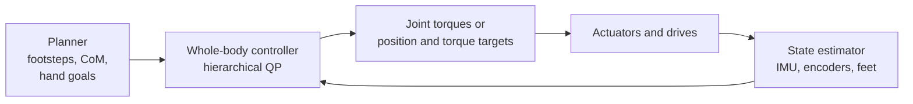

<LessonMeta level="Advanced" time="40 min" prereqs={["Forward and inverse kinematics", "Dynamics essentials", "Locomotion"]} />

Your humanoid has to pick a box off a shelf. The hands need to reach it. The feet must stay planted without slipping. The body must not fall over as the arms move forward. The elbows must stay clear of the torso, and no joint may exceed its limit. Each of those is a goal, and they all compete for the same few dozen joints. A *whole-body controller* is the piece of software that settles the argument, hundreds of times a second.

<Objectives>

- Write a task in task space and compute a joint motion that achieves it.
- Use null-space projection to run a lower-priority task without disturbing a higher one.
- Explain how a hierarchical quadratic program (HQP) organizes tasks and constraints.
- Describe the floating-base dynamics and contact constraints inside a whole-body controller.
- Explain why loco-manipulation is harder than walking or reaching alone.

</Objectives>

## Tasks in task space

A <Term def="A desired behavior written as a quantity the robot should control, such as a hand pose, the center-of-mass position or a foot height.">task</Term> is something you want, expressed in the space where it makes sense. A hand task lives in 3D space, not in joint angles. You already know the link between the two spaces, the Jacobian $J$ from [Forward and inverse kinematics](../02-robot-fundamentals/03-forward-and-inverse-kinematics.mdx):

$$
\dot{x} = J(q)\,\dot{q}
$$

To move the hand with velocity $\dot{x}^{\text{des}}$, invert the relation using the pseudo-inverse $J^{+}$:

$$
\dot{q} = J^{+}\,\dot{x}^{\text{des}}, \qquad \dot{x}^{\text{des}} = K\,(x^{\text{target}} - x)
$$

When there are more joints than task dimensions the robot is <Term def="Having more degrees of freedom than the task needs, so many joint motions achieve the same task.">redundant</Term>, and infinitely many joint motions give the same hand motion. The pseudo-inverse picks the smallest one. The extra freedom is not wasted. It is exactly the room we use for secondary goals.

## Priorities and the null space

The set of joint motions that do not move the hand at all is called the <Term def="The set of joint velocities that produce zero task velocity. Moving inside it changes the robot’s posture without disturbing the task.">null space</Term> of $J$. The projector onto it is

$$
N = I - J^{+} J
$$

Any motion of the form $N z$ leaves the first task untouched. So a second, less important task can use it. With task 1 (hand) and task 2 (stay near a comfortable posture), the prioritized solution is:

$$
\dot{q} = J_1^{+}\dot{x}_1 + N_1\, (J_2 N_1)^{+}\left(\dot{x}_2 - J_2 J_1^{+}\dot{x}_1\right)
$$

You do not need to memorize it. Read it as: do task 1 as well as possible; then do as much of task 2 as you can inside what task 1 does not care about.

```python title="prioritized_ik.py"
import numpy as np

LINKS = np.array([0.40, 0.30, 0.20])  # link lengths in metres

def fk(q):
    """End-effector (x, y) of a planar 3-link arm."""
    a = np.cumsum(q)
    return np.array([np.sum(LINKS * np.cos(a)), np.sum(LINKS * np.sin(a))])

def jacobian(q):
    a = np.cumsum(q)
    J = np.zeros((2, 3))
    for i in range(3):
        J[0, i] = -np.sum(LINKS[i:] * np.sin(a[i:]))
        J[1, i] = np.sum(LINKS[i:] * np.cos(a[i:]))
    return J

def pinv(A, damping=1e-6):
    """Damped pseudo-inverse: safe near singularities."""
    return A.T @ np.linalg.inv(A @ A.T + damping * np.eye(A.shape[0]))

def prioritized_step(q, target, q_rest, gain=0.5):
    """Task 1 (strict priority): hand position. Task 2: stay near q_rest."""
    J1 = jacobian(q)
    e1 = gain * (target - fk(q))
    J1p = pinv(J1)
    N1 = np.eye(3) - J1p @ J1            # motions that do not disturb task 1
    J2 = np.eye(3)
    e2 = gain * (q_rest - q)
    dq1 = J1p @ e1
    dq2 = pinv(J2 @ N1) @ (e2 - J2 @ dq1)
    return dq1 + N1 @ dq2

q = np.array([0.3, 0.4, 0.3])
q_rest = np.array([0.5, 0.5, 0.5])
target = np.array([0.55, 0.35])

for it in range(200):
    q = q + prioritized_step(q, target, q_rest)

print("with posture task: hand error", np.linalg.norm(target - fk(q)).round(5),
      " posture error", np.linalg.norm(q_rest - q).round(3))

# compare: task 1 only (no posture task in the null space)
q3 = np.array([0.3, 0.4, 0.3])
for it in range(200):
    q3 = q3 + pinv(jacobian(q3)) @ (0.5 * (target - fk(q3)))
print("task 1 only:       hand error", np.linalg.norm(target - fk(q3)).round(5),
      " posture error", np.linalg.norm(q_rest - q3).round(3))
```

Both runs put the hand on the target. The first run finishes slightly closer to the rest posture, because it used the leftover freedom. With a three-joint arm and a two-dimensional task, there is only one direction of freedom to spare, so the gain is modest. A humanoid has dozens of spare directions.

<KeyIdea title="Priorities are strict, not weighted">

In a prioritized controller, a lower task can never hurt a higher one. That is different from adding up weighted costs, where a big enough weight on the posture could pull the hand off target. Strict priority is how you tell the robot "never drop the balance task, even if the hand has to give up."

</KeyIdea>

## From kinematics to dynamics

A walking humanoid cannot be controlled with velocities alone. It must manage forces on the ground. Whole-body controllers use the full dynamics of a floating-base robot:

$$
M(q)\,\dot{v} + h(q, v) = S^{\top}\tau + J_c^{\top} f
$$

Here $v$ is the generalized velocity (including the 6 floating-base entries), $M$ is the mass matrix, $h$ gathers gravity, Coriolis and centrifugal terms, $\tau$ are joint torques, and $f$ are the contact forces at the feet or hands. The matrix $S$ selects the actuated joints: the first 6 rows have no motors, which is the floating-base problem from [Humanoid anatomy](./01-humanoid-anatomy.mdx). The body only moves because the contact forces $f$ push on it.

Contact adds more rules:

- A foot that is planted does not move: $J_c \dot{v} + \dot{J}_c v = 0$.
- The ground can only push, never pull: the normal force $f_z \ge 0$.
- The foot must not slip: the sideways force stays inside the <Term def="The set of contact forces that friction can supply without sliding, shaped like a cone around the contact normal.">friction cone</Term>, $\sqrt{f_x^2 + f_y^2} \le \mu f_z$. Controllers replace the cone with a pyramid of linear inequalities so it fits in a QP.
- Joint torques and angles stay within their limits.

## The hierarchical QP

Now put it all together. The unknowns are the accelerations $\dot{v}$, torques $\tau$ and contact forces $f$. Stack them as $u$. Every task becomes a linear equation in $u$. A task on a point with Jacobian $J_i$ says $J_i \dot{v} + \dot{J}_i v = \ddot{x}_i^{\text{des}}$, with the desired acceleration from a spring-damper law:

$$
\ddot{x}_i^{\text{des}} = \ddot{x}^{\text{ref}}_i + K_d(\dot{x}^{\text{ref}}_i - \dot{x}_i) + K_p(x^{\text{ref}}_i - x_i)
$$

Physical laws (the dynamics, the contact, friction and limits) are <Term def="A requirement that must be satisfied exactly, as opposed to a task, which is only satisfied as well as possible.">hard constraints</Term>. Tasks are soft: satisfied as well as possible. There are two common ways to combine the tasks.

**Weighted QP.** One optimization with all tasks summed and a weight $w_i$ on each:

$$
\min_{u}\; \sum_i w_i\,\| A_i u - b_i \|^2 \quad \text{s.t. } C u \le d,\; Eu = e
$$

This is simple and fast but priorities are only "soft"; with the wrong weights tasks interfere.

**Hierarchical QP (HQP).** Solve the tasks in order of priority, one QP per level. At level $k$:

$$
\min_{u,\,w_k}\; \| w_k \|^2 \quad \text{s.t. } A_k u - b_k = w_k,\; A_i u - b_i = w_i^{*}\;(i < k),\; Cu \le d
$$

Here $w_k$ is the residual (error) of task $k$. The constraint $A_i u - b_i = w_i^{*}$ says that earlier tasks keep exactly the error they already achieved. So level $k$ can only use freedom that the higher levels left behind: the same idea as the null-space formula, now with inequalities added.

A typical priority list from top to bottom: physics and contact constraints; balance (momentum or CoM); foot placement and swing-foot trajectory; hand tasks; torso orientation; posture; minimize torque. If the robot is pushed hard, the hand tasks quietly degrade while balance stays satisfied.



In practice you rarely write this solver yourself. Libraries such as Pinocchio provide the dynamics terms, and open-source task-space controllers (the `tsid` library, for example) and QP solvers handle the rest. The skill to learn is shaping tasks, priorities and constraints, not coding the solver.

## Loco-manipulation

*Loco-manipulation* is moving and manipulating at the same time: walking while carrying a box, pushing a cart, opening a door with a hand while stepping through. It is hard because the arms and legs are coupled through the floating base. Swinging an arm shifts the center of mass and creates angular momentum. A heavy payload moves the CoM forward and changes how much force the feet must supply. A door push comes back as a force on the body.

Three approaches are common:

- **Treat the arms as a disturbance.** The leg controller keeps balance, estimates the extra forces from the arms and compensates. Simple, and robust for light loads.
- **Optimize jointly.** Plan the CoM, momentum and arm motion together (whole-body MPC, centroidal momentum control). More capable, more compute and more model accuracy needed.
- **Learn it.** Train a whole-body RL policy that receives upper-body commands (from a planner or from human teleoperation) and learns to keep balance while following them. This is an active research direction, and results change fast, so check the current literature.

Many real systems use a hybrid: a learned or model-based lower body for balance, and a task-space controller for the arms, connected by a shared state estimate.

:::tip[Pro tip]
When a whole-body controller misbehaves, print the active constraints. Nine times out of ten the QP is infeasible or a friction cone is saturated, and that tells you which task to relax.
:::

## Hands-on lab

<Steps>

1. Save `prioritized_ik.py` and run it. Both lines should show a hand error near zero.
2. Move `target` to `np.array([0.8, 0.2])`. Is it reachable? What do you see if you ask for `[1.2, 0.0]` (beyond the arm length of 0.9 m)?
3. Change `q_rest` to `[1.0, 1.0, 1.0]`. Does the hand still reach the target? Does the posture error grow?
4. Swap the priorities: make posture task 1 and the hand task 2. What happens to the hand error?
5. Done when you can say which task is allowed to fail, and why.

</Steps>

## Exercises

<Exercise title="Spot the null space" level="Intermediate">

A 7-joint arm controls only the 3D position of the hand. How many dimensions does its null space have, and what is the physical meaning of moving in it?

<Solution>

There are 7 joint velocities and 3 task constraints, so the null space has $7 - 3 = 4$ dimensions (assuming a non-singular configuration). Moving in it changes the arm’s posture (for example swinging the elbow) while the hand stays exactly where it is.

</Solution>

</Exercise>

<Exercise title="Weights versus priorities" level="Advanced">

A weighted QP has a balance task with weight 100 and a hand task with weight 1. Describe a situation where the hand task still ends up disturbing balance, and how strict priorities fix it.

<Solution>

If the hand is asked to move very far or very fast, its error term can become large enough that $1 \times \text{error}^2$ exceeds the (small) balance error that results from shifting the weight. The optimizer then trades a little balance for hand accuracy. With strict priorities, the hand task is only solved in what is left after balance is satisfied as well as possible, so it cannot degrade balance at all.

</Solution>

</Exercise>

<Exercise title="Feasibility" level="Intermediate">

A foot is on ice with friction coefficient $\mu = 0.1$ and carries a normal force of 300 N. What is the largest sideways force the foot can resist?

<Solution>

$f_t \le \mu f_z = 0.1 \times 300 = 30$ N. Any whole-body plan that asks for more horizontal force at that foot is infeasible, and the QP will either fail or move the demand to the other foot.

</Solution>

</Exercise>

## Check your understanding

<Quiz questions={[
  {q: "What is the null space of a task Jacobian?", options: ["Joint motions that do not change the task, so they can be used for lower-priority goals", "The motions that break the robot", "The empty list of tasks", "The set of unreachable points"], answer: 0, explain: "Moves in the null space leave the task velocity unchanged, so a secondary task can use them."},
  {q: "What does it mean that priorities in a hierarchical QP are strict?", options: ["All tasks are weighted equally", "A lower-priority task may not worsen the result of a higher-priority one", "Only one task runs", "Priorities change randomly"], answer: 1, explain: "Each level is solved while keeping the error of the higher levels fixed."},
  {q: "Why is S in the floating-base dynamics equation needed?", options: ["The first six degrees of freedom of the body have no motors, so torque only enters through the actuated joints", "It scales the gravity", "It selects the camera", "It removes friction"], answer: 0, explain: "S picks out the actuated joints; the floating base can only be pushed by contact forces."},
  {q: "Why is loco-manipulation harder than walking alone?", options: ["Arms are heavy", "The arms and legs are coupled through the body, so arm motion and loads disturb balance", "Walking is not allowed with hands", "There is no model"], answer: 1, explain: "Arm motion and carried loads change the center of mass and momentum, which the balance controller must handle."}
]} />

<Takeaways>

- A task is a goal in the space where it makes sense; the Jacobian maps it to joint motion.
- Redundancy gives a null space where lower-priority tasks can work without disturbing higher ones.
- A floating-base controller must respect dynamics, contact, friction cones and limits.
- A hierarchical QP solves tasks level by level and keeps earlier results fixed, giving strict priorities.
- Loco-manipulation couples arms and legs through the body; approaches range from disturbance rejection to joint optimization to learned policies.
- Debug by checking which constraints are active.

</Takeaways>

## Go deeper

- [Pinocchio documentation](https://stack-of-tasks.github.io/pinocchio/) for the dynamics terms (mass matrix, Jacobians) used above.
- [Drake documentation](https://drake.mit.edu/) for optimization-based control examples.
- [Isaac Lab documentation](https://isaac-sim.github.io/IsaacLab/): check the current release for whole-body and humanoid environments.

Next: [Hands and dexterity](./05-hands-and-dexterity.mdx)
