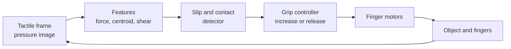
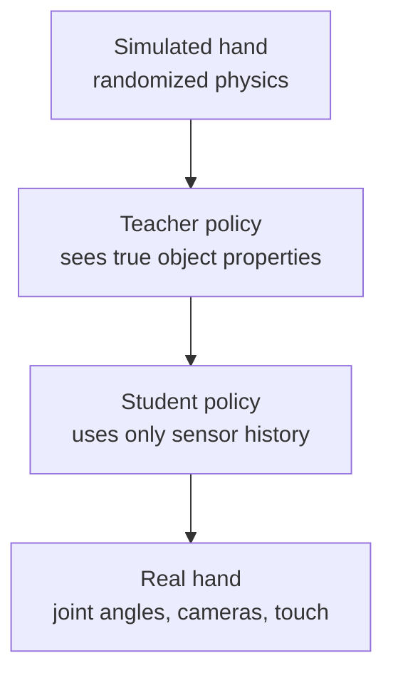

<LessonMeta level="Advanced" time="35 min" prereqs={["Grasping", "Reinforcement learning basics", "Python basics"]} />

A humanoid can walk to the table, reach out, and then drop the cup. The arm was fine; the hand was the problem. A hand has to be gentle with an egg, firm with a hammer, and quick enough to catch a pen that starts to slip. For most robots, the hand is still the weakest part of the body, and the biggest opportunity.

<Objectives>

- Compare parallel grippers, underactuated hands and fully actuated dexterous hands.
- Explain how resistive, capacitive, magnetic and optical tactile sensors work.
- Write a simple slip detector and a grip-force reflex.
- Describe how RL produced in-hand manipulation, and why sim-to-real is hard for touch.

</Objectives>

## Hand designs

A human hand has roughly twenty degrees of freedom, driven by muscles mostly in the forearm and connected by tendons. Copying all of that is expensive, so robot hands sit on a spectrum.

| Design | Idea | Strengths | Weaknesses |
|---|---|---|---|
| Parallel-jaw gripper | Two fingers that close on each other | Cheap, robust, easy to control; fine for boxes and bins | Cannot re-orient objects, little shape adaptation |
| Underactuated adaptive hand | Fewer motors than joints; linkages or tendons let the fingers wrap around the object | Conforms to shape without sensing, simple control | Limited fine control, hard to do in-hand motion |
| Fully actuated dexterous hand | Roughly one actuator per joint, an opposable thumb | Can re-orient and manipulate tools | Many actuators and wires, expensive, fragile, hard to control |
| Soft or compliant hand | Flexible fingers, pneumatic or elastic bodies | Safe, gentle, tolerant of error | Imprecise, hard to model, limited force |

An <Term def="A mechanism with fewer actuators than joints, so some joints move passively, driven by contact and springs.">underactuated</Term> finger is a clever trick: one motor pulls a tendon, and springs and geometry make the finger wrap around whatever is in the way. Many commercial arms ship with simple grippers for this reason: they work.

The opposable thumb matters most. A hand without a thumb that can oppose the other fingers cannot make a precision pinch or a stable power grasp, which is why dexterous hands spend a large share of their design effort on the thumb.

Where the motors live is another design choice. Motors in the palm and fingers give compact, quick hands with limited torque. Motors in the forearm pulling tendons down to the fingers give strength and low finger weight, at the price of tendon friction, stretch and maintenance. Humanoid designs often mix both.

:::note
Choosing the hand is choosing the task. A warehouse humanoid that moves totes needs two sturdy pads. A humanoid that assembles electronics needs fine fingers. Do not buy dexterity you cannot control.
:::

## Tactile sensing

Vision tells you what the object looks like. It cannot tell you how hard you are squeezing, whether the object is slipping, or where the contact is once your own fingers hide it from the camera. That is the job of touch.

Common <Term def="A sensor that measures contact: where, how hard, and sometimes the direction of sliding.">tactile sensor</Term> technologies:

- **Resistive and capacitive arrays.** A grid of small pads (taxels), each changing resistance or capacitance as it is pressed. Thin, cheap and easy to put on fingertips, but with limited range and drift over time.
- **Piezoelectric sensors.** They produce a voltage when force *changes*, so they are excellent at detecting the vibration of a starting slip, and poor at measuring steady force.
- **Magnetic sensors.** A small magnet embedded in soft rubber moves when the rubber is pressed or sheared, and Hall-effect chips measure the field. Compact and robust, with force in more than one direction.
- **Optical, vision-based sensors.** A small camera looks at the back of a soft gel pad. The gel deforms around the contact, and the camera sees the shape, even fine texture. Sensors in this family (GelSight is the best-known name) give very high-resolution contact images, and can estimate shear from the movement of dots printed on the gel. They are bulkier and need processing, but are rich.

What you can estimate: whether there is contact, where, how hard, how the force is directed, whether the object is sliding, and sometimes the object’s shape and texture.

<KeyIdea title="Touch closes the loop where vision cannot">

During a grasp, your hand blocks the camera. Tactile sensing keeps working exactly then. It lets a robot react in milliseconds to slip or to a load change, a loop that is much faster than anything vision can close.

</KeyIdea>

## A slip reflex

When an object begins to slip, the contact patch on a sensor moves, even though the total force stays about the same. A very simple detector watches for that. In the demo below, a synthetic 8 by 8 sensor holds an object that starts to slide because the grip is too small. Each time slip is detected, the controller squeezes 30 percent harder, up to a safe limit.

```python title="tactile_slip.py"
import numpy as np

def make_frame(cx, cy, force, size=8, width=1.5):
    """Synthetic 8x8 taxel pressure image: a Gaussian blob centred at (cx, cy)."""
    ys, xs = np.indices((size, size))
    blob = np.exp(-((xs - cx) ** 2 + (ys - cy) ** 2) / (2 * width ** 2))
    return force * blob / blob.sum()

def centroid(frame):
    total = frame.sum()
    ys, xs = np.indices(frame.shape)
    return np.array([(xs * frame).sum() / total, (ys * frame).sum() / total])

def slipping(prev, curr, max_shift=0.25, force_tol=0.35):
    """Slip if the contact patch moves although the total force barely changed."""
    shift = np.linalg.norm(centroid(curr) - centroid(prev))
    steady = abs(curr.sum() - prev.sum()) <= force_tol * prev.sum()
    return bool(shift > max_shift and steady)

grip, grip_max = 2.0, 10.0   # commanded grip force in newtons
needed = 5.0                 # grip the object really needs so it does not slide
cx = 3.5                     # where the contact patch sits, in taxel units
prev = make_frame(cx, 3.5, grip)

for t in range(12):
    if grip < needed:
        cx += 0.4            # too little grip: the object slides and drags the patch
    curr = make_frame(cx, 3.5, grip)
    slip = slipping(prev, curr)
    if slip:
        grip = min(grip * 1.3, grip_max)   # squeeze a little harder
    print(f"t={t:2d}  grip={grip:5.2f} N  patch x={cx:4.1f}  slip={slip}")
    prev = curr
```

Run it. Slip is detected four times in a row, the grip climbs from 2 N to about 5.7 N, which is above what the object needs, and then the sliding stops and the reflex goes quiet. Real hands do the same with higher-rate signals and more careful filters, and they also release the grip again once the load is safe so they do not crush what they hold.



## In-hand manipulation

*In-hand manipulation* means moving an object around inside the hand without putting it down: rotating a pen, turning a cube to show a different face, switching a screwdriver from a lifting grip to a turning grip. It is hard because fingers must make and break contact in just the right order, while keeping the object from falling. Writing the contact model and planner by hand is difficult, and small errors in friction cause a drop.

Reinforcement learning changed this. In a well-known project, OpenAI trained a policy entirely in simulation to reorient a block with an anthropomorphic research hand, then ran it on the real hand, and later solved a Rubik’s cube with the same hand. The ingredients are worth remembering because they appear again and again:

1. **A simulator with many parallel copies.** The policy practices for the equivalent of years of hand time.
2. **A reward for progress toward a goal orientation,** with a penalty for dropping.
3. **Heavy domain randomization.** Friction, object size and mass, finger gains, delays and sensor noise all change from episode to episode. A later version increased the randomization automatically as the policy got better.
4. **Observations from sensors the real robot has.** Joint angles, plus the object pose estimated by cameras (or in newer work, by touch).
5. **Privileged information for the critic,** and sometimes a teacher-student setup: a teacher policy that knows the true friction and mass is distilled into a student that must infer them from its recent history.



The remaining gap is touch. Vision-based tactile sensors give rich data but are costly to simulate faithfully, so many learned policies still run blind to contact, or use simple force estimates. Teleoperation with a glove or a camera-tracked hand, combined with [imitation learning](../07-robot-learning/02-imitation-learning.mdx), is a practical alternative for collecting dexterous data, and is a very active area. The field moves quickly; check the current literature for the latest hand hardware and learned skills.

:::warning[Safety near fingers]
Dexterous hands are fast and strong for their size. Use current and torque limits on every finger during development, and never test with a hand near your own.
:::

## Hands-on lab

<Steps>

1. Save `tactile_slip.py` and run it. Confirm slip is detected for the first few steps and then stops.
2. Lower `max_shift` to 0.1 and raise it to 0.6. How does the number of detected slips and the final grip change? What does that tell you about sensitivity versus false alarms?
3. Add a release rule: once there has been no slip for 5 steps, reduce `grip` by 5 percent each step, but never below the last value that stopped the slip.
4. Add random noise (for example `np.random.normal(0, 0.01, frame.shape)`) to each frame. Does the detector still work? What would you add to cope?
5. Done when you can describe the trade-off between reacting quickly and reacting to noise.

</Steps>

## Exercises

<Exercise title="Pick a hand" level="Beginner">

A robot must move boxes and plastic totes between conveyor belts all day. Which hand design would you choose, and why?

<Solution>

A parallel-jaw gripper or a simple suction/pad gripper. The objects are regular, force and speed matter more than dexterity, and a simple hand is cheap, robust and easy to control. A dexterous hand adds cost and failure modes for no benefit here.

</Solution>

</Exercise>

<Exercise title="Why a slip is visible" level="Intermediate">

Explain why a slip shows up as a moving contact patch with roughly constant total force, and why a sensor that only measures total force would miss it.

<Solution>

When an object slides, the fingertip keeps pressing about as hard (the normal force is about unchanged), but the point of contact moves across the pad. A sensor that reports only a single total force sees no change, so it cannot tell sliding from holding. An array or camera that sees where the pressure is can see the patch move.

</Solution>

</Exercise>

<Exercise title="Design the randomization" level="Advanced">

You are training an in-hand cube-rotation policy in simulation. List four physical parameters you would randomize and what failure each one prevents on the real hand.

<Solution>

Friction coefficient between finger and object: prevents a policy that works only on a perfectly grippy surface. Object mass and size: prevents overfitting to one cube. Joint controller gains or motor strength: covers differences between simulated and real actuators. Observation noise and delay: covers imperfect sensing, so the policy does not depend on exact, instant measurements. (Other good answers: gravity direction offsets, finger link masses, camera pose error.)

</Solution>

</Exercise>

## Check your understanding

<Quiz questions={[
  {q: "What is an underactuated hand?", options: ["A hand with no motors", "A hand with fewer actuators than joints, using passive mechanics to adapt to the object", "A hand that is broken", "A hand with extra actuators for redundancy"], answer: 1, explain: "Underactuated hands use linkages, tendons and springs so the fingers wrap around objects with few motors."},
  {q: "Why can tactile sensing help when vision cannot?", options: ["It works in the dark only", "The robot’s own hand blocks the camera during a grasp, but touch still works and is fast", "It is cheaper than a camera", "It needs no processing"], answer: 1, explain: "During a grasp the hand occludes the object, while touch measures contact directly at high rate."},
  {q: "In optical tactile sensors of the GelSight type, what does the camera look at?", options: ["The outside world", "The back of a soft gel that deforms around the contact", "The robot’s face", "A laser grid on the floor"], answer: 1, explain: "A camera inside the sensor sees how the gel deforms, giving a detailed picture of the contact."},
  {q: "Why is domain randomization central to learned in-hand manipulation?", options: ["It makes the simulator faster", "It prepares the policy for the differences between simulated and real friction, mass, delays and noise", "It removes the need for a reward", "It lets the hand work without joints"], answer: 1, explain: "The real hand differs from the simulation in many small ways. Randomizing those parameters makes the policy robust to them."}
]} />

<Takeaways>

- Hand designs trade simplicity and robustness against dexterity: parallel grippers, underactuated, fully actuated and soft hands.
- The opposable thumb is the key to precision grasps.
- Touch works where vision cannot, and enables fast reflexes like slip response.
- Sensor technologies include resistive and capacitive arrays, piezoelectric, magnetic and optical gel sensors.
- RL learns in-hand manipulation in simulation using massive parallelism, domain randomization and privileged teacher information.
- Simulating touch faithfully is still an open problem, so check the current literature for progress.

</Takeaways>

## Go deeper

- [Learning Dexterous In-Hand Manipulation](https://arxiv.org/abs/1808.00177), the OpenAI paper on block reorientation with RL and domain randomization.
- [Solving Rubik’s Cube with a Robot Hand](https://arxiv.org/abs/1910.07113), which adds automatic domain randomization.
- [Isaac Lab documentation](https://isaac-sim.github.io/IsaacLab/): check the current release for dexterous manipulation environments.

Next: [LLMs as robot planners](../09-foundation-models/01-llms-as-robot-planners.mdx)
