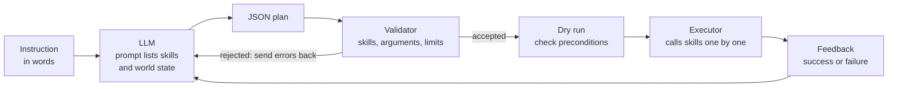

<LessonMeta level="Intermediate" time="40 min" prereqs={["Python basics", "Actions, parameters and launch files", "Forward and inverse kinematics"]} />

You tell a kitchen robot, "I spilled my drink, can you help?" There is no button for that sentence. A person would reason: find something to wipe with, go to it, pick it up, bring it over. A large language model (LLM) has read enough text to make that kind of plan. The hard part is the other half: making sure the plan only uses things the robot can actually do, in the order the world allows. This lesson shows how to use an LLM for the thinking and keep the robot in charge of the doing.

<Objectives>

- Explain why an LLM should choose among robot skills rather than write motor commands.
- Describe SayCan-style grounding: language likelihood times affordance.
- Write a JSON plan format, validate it, and execute it on a mocked skill library.
- Compare function calling with code-as-policies, and name the risks of each.
- Build a retry loop that feeds errors back to the model.

</Objectives>

## What an LLM is good at, and not

A <Term def="A neural network trained on huge amounts of text to predict the next token. Given a prompt, it can continue, summarize, translate and reason in words.">large language model</Term> is a very good guesser about everyday tasks. It knows that sponges wipe spills, that mugs go in sinks, and that you must open a door before walking through it. It has never been told that your gripper opens to 8 cm, that the table is 40 cm too far away, or that your arm shakes when it moves fast.

So we give the model the *what* and keep the *how* fixed:

- The LLM decides **which skills to call, with which arguments, in what order**. This is <Term def="Breaking a big goal into an ordered list of smaller steps the robot already knows how to do.">task decomposition</Term>.
- Each <Term def="A tested, bounded robot behavior with a name and arguments, such as pick(object) or go_to(place).">skill</Term> is hand-written or separately learned and tested, with its own controller, limits and safety checks.

<KeyIdea title="The LLM picks skills; it does not drive motors">

Never let a language model output raw joint commands or velocities. Its text is not checked by physics, and one wrong number can break something. Give it a menu of vetted skills, and treat everything it says as a suggestion that your code must validate.

</KeyIdea>



## Grounding with SayCan

An LLM can propose a step that is sensible in words but impossible right now: "pick up the sponge" when the sponge is across the room. The SayCan approach (Google, 2022) fixes this by multiplying two numbers for every skill the robot has:

$$
\text{score}(s) = p_{\text{LM}}(s \mid \text{instruction, history}) \times p_{\text{can}}(s \mid \text{state})
$$

The first term, from the language model, says how useful the skill sounds. The second, the <Term def="Whether and how well an action can be done in the current situation. In SayCan it comes from a learned value function.">affordance</Term>, says how likely the skill is to succeed from where the robot is now. The robot picks the highest product, runs that skill, updates the state and repeats.

```python title="saycan_scoring.py"
# SayCan idea: score each skill by (what the language model likes) x (what is possible now).
llm_score = {            # stand-in for the language model's usefulness score
    "go to sink": 0.25,
    "go to table": 0.05,
    "pick sponge": 0.55,
    "pick apple": 0.10,
    "done": 0.05,
}

def affordance(skill, state):
    """Estimated chance the skill succeeds from this state (a value function in real systems)."""
    near_sponge = state["at"] == "sink"
    table = {
        "go to sink": 0.05 if state["at"] == "sink" else 0.95,
        "go to table": 0.95,
        "pick sponge": 0.90 if near_sponge else 0.02,
        "pick apple": 0.90 if state["at"] == "counter" else 0.02,
        "done": 0.50,
    }
    return table[skill]

def choose(state):
    scored = {s: llm_score[s] * affordance(s, state) for s in llm_score}
    for skill, score in sorted(scored.items(), key=lambda kv: -kv[1]):
        print(f"   {skill:12s} {llm_score[skill]:.2f} x {affordance(skill, state):.2f} = {score:.3f}")
    return max(scored, key=scored.get)

for state in ({"at": "start"}, {"at": "sink"}):
    print("robot at", state["at"])
    print(" -> chosen:", choose(state))
```

At the start, the model loves "pick sponge" (0.55), but its affordance is only 0.02, so the product is tiny and "go to sink" wins. Once the robot stands at the sink, the same skill scores 0.495 and is chosen. The language model supplies common sense, the affordance supplies reality. In the original system the affordances came from learned value functions; in your own robot they can come from simple checks (is the object reachable? is the hand free?) or from a perception model.

Follow-up work added closed-loop feedback, for example describing the scene or reporting success after each step so the model can react (see the Go deeper links).

## Plans as JSON, with tool calling

The practical way to connect an LLM to skills is <Term def="Giving the model a list of named functions with typed arguments, so that it replies with a structured call instead of free text.">function calling</Term> (also called tool use). You describe each skill with a name, a description and an argument schema; the model answers with a structured call. Most model providers support this, and the schema looks like this:

```json title="skill_schema.json"
{
  "name": "pick",
  "description": "Pick up an object at the robot's current location with the right hand.",
  "parameters": {
    "type": "object",
    "properties": {
      "obj": {"type": "string", "enum": ["red_mug", "sponge", "apple"]}
    },
    "required": ["obj"]
  }
}
```

The `enum` is your friend: the model can only name objects and places that exist. Even so, models sometimes return malformed JSON, invent a skill, or pick a valid argument that makes no sense in the current state. So you must validate in three layers: the JSON parses, the names and arguments match the schema, and the plan makes sense in the current world (preconditions). The program below does all three. It needs no API key: `fake_llm` stands in for a real model, and its first answer is wrong on purpose so you can see the retry loop.

```python title="plan_and_execute.py"
import copy
import json

FENCE = "`" * 3
PLACES = ["start", "table", "sink", "counter", "shelf"]
WORLD = {
    "at": "start",
    "holding": None,
    "objects": {"red_mug": "table", "sponge": "sink", "apple": "counter"},
}

# ---- Mocked skills. Each edits the world it is given and returns (ok, message). ----
def go_to(world, place):
    world["at"] = place
    return True, f"moved to {place}"

def pick(world, obj):
    if world["holding"] is not None:
        return False, "the hand is not empty"
    if world["objects"][obj] != world["at"]:
        return False, f"{obj} is not at {world['at']}"
    world["holding"] = obj
    world["objects"][obj] = "hand"
    return True, f"picked {obj}"

def put_down(world, obj, where):
    if world["holding"] != obj:
        return False, f"not holding {obj}"
    if world["at"] != where:
        return False, f"robot is at {world['at']}, not {where}"
    world["holding"] = None
    world["objects"][obj] = where
    return True, f"placed {obj} on {where}"

# Skill library: name -> function and the allowed values of each argument.
SKILLS = {
    "go_to": {"fn": go_to, "args": {"place": PLACES}},
    "pick": {"fn": pick, "args": {"obj": list(WORLD["objects"])}},
    "place": {"fn": put_down, "args": {"obj": list(WORLD["objects"]), "where": PLACES}},
}

def fake_llm(instruction, feedback=None):
    """Stands in for a real model. Its first answer is wrong on purpose."""
    if feedback is None:
        return json.dumps([{"skill": "teleport", "args": {"place": "sink"}}])
    steps = [
        {"skill": "go_to", "args": {"place": "table"}},
        {"skill": "pick", "args": {"obj": "red_mug"}},
        {"skill": "go_to", "args": {"place": "sink"}},
        {"skill": "place", "args": {"obj": "red_mug", "where": "sink"}},
    ]
    return FENCE + "json\n" + json.dumps(steps) + "\n" + FENCE   # models love code fences

def strip_fence(text):
    text = text.strip()
    if text.startswith(FENCE):
        text = text.split("\n", 1)[1].rsplit(FENCE, 1)[0]
    return text

def validate(plan):
    """Return a list of problems; an empty list means the plan is well formed."""
    if not isinstance(plan, list) or not plan:
        return ["the plan must be a non-empty list"]
    errors = []
    for i, step in enumerate(plan):
        name = step.get("skill") if isinstance(step, dict) else None
        if name not in SKILLS:
            errors.append(f"step {i}: unknown skill {name!r}")
            continue
        spec = SKILLS[name]["args"]
        args = step.get("args", {})
        if set(args) != set(spec):
            errors.append(f"step {i}: {name} needs arguments {sorted(spec)}")
            continue
        for key, allowed in spec.items():
            if args[key] not in allowed:
                errors.append(f"step {i}: {key}={args[key]!r} is not one of {allowed}")
    return errors

def run_plan(plan, world):
    """Dry-run on a copy first; only touch the real world if every step works."""
    trial = copy.deepcopy(world)
    for i, step in enumerate(plan):
        ok, msg = SKILLS[step["skill"]]["fn"](trial, **step["args"])
        if not ok:
            return False, f"dry run failed at step {i}: {msg}"
    log = []
    for step in plan:
        log.append(SKILLS[step["skill"]]["fn"](world, **step["args"])[1])
    return True, log

def plan_and_execute(instruction, world, max_tries=3):
    feedback = None
    for attempt in range(1, max_tries + 1):
        raw = fake_llm(instruction, feedback)
        try:
            plan = json.loads(strip_fence(raw))
        except json.JSONDecodeError as err:
            feedback = f"invalid JSON: {err}"
        else:
            errors = validate(plan)
            if errors:
                feedback = "; ".join(errors)
            else:
                ok, result = run_plan(plan, world)
                if ok:
                    return result
                feedback = result
        print(f"attempt {attempt} rejected: {feedback}")
    return None

log = plan_and_execute("Put the red mug in the sink.", WORLD)
print("executed:", log)
print("world now:", WORLD)
```

Run it. The first answer names a skill called `teleport`, which does not exist, so `validate` rejects it and the error text goes back to the model as feedback. The second answer, wrapped in a code fence as chat models often do, is stripped, parsed, validated and dry-run on a copy of the world, and only then executed. When you swap `fake_llm` for a real model call, nothing else needs to change: that is the point of the layers. The `go_to` skill is deliberately simple. In a real system it would send a Nav2 goal, as you will see in [the voice-to-action lesson](./04-voice-to-action-pipeline.mdx).

## Code as policies

An alternative to a fixed JSON schema is to let the model write a short Python program that calls your perception and control functions. This is called *code as policies*. The model can use loops, conditions and arithmetic: "for each cup on the table, if it is red, put it in the bin" becomes a loop. It generalizes well because code is a very expressive plan language.

The risks are larger too. The generated code is untrusted input. Run it in a restricted environment: expose only a small set of functions, forbid imports and file access, cap the run time and number of calls, and check the abstract syntax tree before you run it. Prefer JSON for simple sequences, and code only where you really need loops.

:::warning[Never run model output directly]
Executing text from a model with full Python rights is an arbitrary-code hole. Use a sandbox, an allow-list of names and a timeout, and still keep the robot’s safety layer (limits, e-stop) below it.
:::

## Hands-on lab

<Steps>

1. Save `plan_and_execute.py` and run it. Confirm the first attempt is rejected and the second succeeds.
2. Add a fourth skill, `open_gripper()`, with no arguments. Add it to `SKILLS` and update `validate` if needed. Make `fake_llm` call it.
3. Change the second answer of `fake_llm` to leave out the `go_to table` step. What error do you get, and at which layer is it caught?
4. Add a rule to `validate`: reject plans longer than 8 steps. Why is a step budget useful?
5. Done when a plan with a bad skill, a bad argument and a missing precondition are each rejected with a clear message.

</Steps>

## Exercises

<Exercise title="Why a product?" level="Beginner">

In the SayCan score, why multiply the language score and the affordance instead of adding them?

<Solution>

A product is near zero if either factor is near zero. A skill the model loves but the robot cannot do now (affordance close to 0) scores low, and a skill that is easy but pointless (language score close to 0) also scores low. A sum could let one large number hide a zero in the other.

</Solution>

</Exercise>

<Exercise title="Spot the missing layer" level="Intermediate">

A model returns `[{"skill": "pick", "args": {"obj": "apple"}}]` when the robot is at the table and the apple is on the counter. Which validation layer catches it, and what should the feedback to the model say?

<Solution>

The schema layer passes it (valid skill, valid argument). The precondition (dry-run) layer catches it: the apple is not at the robot’s location. The feedback might read "pick failed: apple is not at table; the apple is at counter", which helps the model add a `go_to counter` step.

</Solution>

</Exercise>

<Exercise title="Code or JSON?" level="Intermediate">

For each task choose JSON plans or code-as-policies and justify: (a) "put the mug in the sink", (b) "sort all the blocks on the table by colour into three bins".

<Solution>

(a) JSON: a short fixed sequence of known skills, easy to validate. (b) Code: the number of blocks is not known in advance, so a loop and a condition on colour are needed; a code plan expresses this compactly. If you choose code, run it in a sandbox with an allow-list of functions.

</Solution>

</Exercise>

## Check your understanding

<Quiz questions={[
  {q: "What should an LLM output when used as a robot planner?", options: ["Raw joint torques", "A sequence of calls to vetted skills with validated arguments", "Camera images", "Battery commands"], answer: 1, explain: "The LLM chooses among tested skills. The skills handle control and safety."},
  {q: "In SayCan, what does the affordance term represent?", options: ["How well the sentence is written", "How likely the skill is to succeed in the current state", "The model’s size", "The cost of the API call"], answer: 1, explain: "Affordance grounds the plan in what the robot can actually do right now."},
  {q: "Why validate a plan even if the model usually gets it right?", options: ["Models can return malformed JSON, invent skills or break preconditions", "Validation makes the model faster", "JSON cannot be parsed otherwise", "It is only needed for code output"], answer: 0, explain: "Language models are not guaranteed to follow your schema or the state of the world, so check every plan."},
  {q: "What is the main extra risk of code as policies?", options: ["It uses more words", "Generated code is untrusted and must be sandboxed", "It cannot use loops", "It needs no perception"], answer: 1, explain: "Running model-written code is dangerous without an allow-list, a timeout and a sandbox."}
]} />

<Takeaways>

- Use the LLM for decomposition and common sense, and keep control and safety in tested skills.
- SayCan multiplies the language score by an affordance so plans stay physically possible.
- Describe skills with names, descriptions and typed arguments (function calling); enums restrict the model to real objects and places.
- Validate in layers: parse, schema, preconditions; dry-run before acting.
- Feed errors back to the model for a bounded number of retries.
- Code as policies is powerful and risky; sandbox it.

</Takeaways>

## Go deeper

- [Do As I Can, Not As I Say (SayCan)](https://arxiv.org/abs/2204.01691), the original grounding paper.
- [Code as Policies](https://arxiv.org/abs/2209.07753), language model programs for embodied control.
- [Inner Monologue](https://arxiv.org/abs/2207.05608), closing the loop with feedback from the scene and from success detectors.

Next: [Vision-language grounding](./02-vision-language-grounding.mdx)
