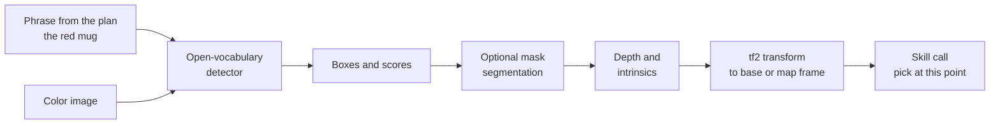

<LessonMeta level="Intermediate" time="40 min" prereqs={["Cameras and image processing", "Depth, point clouds and LiDAR", "LLMs as robot planners"]} />

The planner says "pick up the red mug". The robot’s camera sees a table with a red mug, a red bowl, a blue mug and a pile of papers. Which of those pixels is *the red mug*? Linking a word to a place in the world is called <Term def="Connecting a phrase in language to the specific object, region or location it refers to in the robot’s sensor data.">grounding</Term>, and until recently it needed a detector trained for every object name. Vision-language models let a robot ground words it has never been trained on.

<Objectives>

- Explain how CLIP-style models place images and text in one embedding space.
- Use cosine similarity to match a phrase to image crops.
- Describe open-vocabulary detection and where it fits in a robot pipeline.
- Turn a detected box and a depth image into a 3D point in the robot’s base frame.
- Use a vision-language model for scene questions, and know when not to trust it.

</Objectives>

## Words and pictures in one space

Early object detectors had a fixed list of classes: 80 labels, say. Ask for "teapot" when it is not on the list and the detector is stuck.

CLIP (Contrastive Language-Image Pre-training, from OpenAI in 2021) changed the recipe. It trains two networks together: an image encoder $f$ and a text encoder $g$. Each turns its input into a vector, and both vectors are <Term def="Scaled to length 1, so that the dot product of two vectors equals the cosine of the angle between them.">normalized</Term> to length 1. Training uses hundreds of millions of image-caption pairs from the web, and one rule: **the right caption for an image should be closer to it than all the wrong captions.**

For a batch of $N$ pairs, the similarity of image $i$ and text $j$ is $s_{ij} = f(I_i)\cdot g(T_j)/\tau$, where $\tau$ is a temperature. The loss pushes the diagonal (true pairs) up with a softmax cross-entropy, in both directions:

$$
\mathcal{L} = -\frac{1}{2N}\sum_{i=1}^{N}\left[\log\frac{e^{s_{ii}}}{\sum_j e^{s_{ij}}} + \log\frac{e^{s_{ii}}}{\sum_j e^{s_{ji}}}\right]
$$

After training, a photo of a red mug and the sentence "a red mug" land close together in the shared space, even if "red mug" was never a class label. You get **zero-shot** matching: write any phrase, compare it with an image, and read off the score.

<KeyIdea title="One space, any phrase">

The embedding space is the bridge. Once images and text live in the same space, finding "the thing the words describe" is just a nearest-neighbour search with a dot product.

</KeyIdea>

### A toy you can run

The real encoders are large neural networks. This toy keeps the geometry and drops the networks: four concept axes, hand-made image vectors for three crops, and a text encoder that sets the axes it recognizes.

```python title="clip_toy.py"
import numpy as np

# A toy "embedding space" with four concept axes: red, blue, round, flat.
CONCEPTS = ["red", "blue", "round", "flat"]

def embed_text(phrase):
    """Toy text encoder: one-hot features for the concepts that appear in the words."""
    v = np.array([1.0 if c in phrase.split() else 0.0 for c in CONCEPTS])
    v += 0.05  # tiny constant so no vector is exactly zero
    return v / np.linalg.norm(v)

# Toy image encoder outputs for three crops from a detector (pretend a network produced these).
crops = {
    "crop_a": np.array([0.9, 0.0, 0.8, 0.1]),   # red, round (a mug)
    "crop_b": np.array([0.0, 0.9, 0.7, 0.1]),   # blue, round (a bowl)
    "crop_c": np.array([0.1, 0.1, 0.1, 0.9]),   # flat (a tray)
}
image_emb = np.stack([v / np.linalg.norm(v) for v in crops.values()])

def softmax(x):
    e = np.exp(x - x.max())
    return e / e.sum()

query = "red round"
t = embed_text(query)
scale = 20.0                       # plays the role of 1 / temperature
logits = scale * image_emb @ t     # cosine similarity because everything is normalised
probs = softmax(logits)
print(f'query: "{query}"')
for name, p in zip(crops, probs):
    print(f"  {name}: {p:.3f}")
print("best match:", list(crops)[int(np.argmax(probs))])

# The contrastive training loss on a batch of N matching (image, text) pairs.
def clip_loss(img, txt, scale=20.0):
    logits = scale * img @ txt.T                       # N x N similarity matrix
    def xent(l):                                       # cross-entropy, correct pair on the diagonal
        l = l - l.max(axis=1, keepdims=True)
        logp = l - np.log(np.exp(l).sum(axis=1, keepdims=True))
        return -np.mean(np.diag(logp))
    return 0.5 * (xent(logits) + xent(logits.T))

texts = np.stack([embed_text(p) for p in ["red round", "blue round", "flat"]])
print("loss with matching pairs:  ", round(clip_loss(image_emb, texts), 3))
print("loss with shuffled pairs:  ", round(clip_loss(image_emb, texts[[1, 2, 0]]), 3))
```

Run it. The phrase "red round" gives crop A a probability near 1, and the loss is near zero when pairs match but large when they are shuffled. That large loss is the training signal. With the real model, the same pattern works on photos. You need the `transformers`, `torch` and `pillow` packages, an image file called `crop.jpg`, and the weights download on first run:

```python title="clip_zero_shot.py"
import torch
from PIL import Image
from transformers import CLIPModel, CLIPProcessor

name = "openai/clip-vit-base-patch32"
model = CLIPModel.from_pretrained(name)
processor = CLIPProcessor.from_pretrained(name)

image = Image.open("crop.jpg")
labels = ["a red mug", "a blue bowl", "a sponge", "a pile of papers"]
inputs = processor(text=labels, images=image, return_tensors="pt", padding=True)
with torch.no_grad():
    out = model(**inputs)
probs = out.logits_per_image.softmax(dim=1)[0]
for label, p in zip(labels, probs):
    print(f"{label:18s} {p.item():.3f}")
```

CLIP scores a *whole image* against text. It does not say *where* the object is. For that you need a detector.

## Open-vocabulary detection

An <Term def="An object detector that takes any text phrase as input and returns boxes for objects matching it, instead of using a fixed list of classes.">open-vocabulary detector</Term> takes an image and a list of phrases and returns a box and a score for each match. Models in this family (OWL-ViT and Grounding DINO are well-known examples) combine a vision transformer with CLIP-like text embeddings. A segmentation model such as the Segment Anything Model (SAM) can then turn a box into a pixel-accurate mask.

With the Hugging Face `transformers` pipeline, detection takes a few lines (again, weights download on first run, and `scene.jpg` is your own image):

```python title="open_vocab_detect.py"
from PIL import Image
from transformers import pipeline

detector = pipeline("zero-shot-object-detection", model="google/owlvit-base-patch32")
image = Image.open("scene.jpg")
results = detector(image, candidate_labels=["a red mug", "a sponge"])
for r in results:
    b = r["box"]
    print(f'{r["label"]:12s} score={r["score"]:.2f} box=({b["xmin"]}, {b["ymin"]}, {b["xmax"]}, {b["ymax"]})')
```

Model names and APIs change, so check the current release of the library for the recommended detector.

## From a box to a 3D point

A box lives in pixels. A robot needs a point in space. With a depth image (or a depth camera registered to the color image), the conversion is geometry you already know from [Depth, point clouds and LiDAR](../05-perception/02-depth-point-clouds-and-lidar.mdx). For a pixel $(u, v)$ with depth $Z$ and camera intrinsics $f_x, f_y, c_x, c_y$:

$$
X = \frac{(u - c_x)\,Z}{f_x}, \qquad Y = \frac{(v - c_y)\,Z}{f_y}
$$

That gives a point in the camera frame. A transform from the camera to the robot base (published in ROS 2 by `tf2`, see [tf2 and URDF](../03-ros2/04-tf2-and-urdf.mdx)) moves it to the frame the planner uses.

```python title="ground_3d.py"
import numpy as np

# Camera intrinsics (pixels) for a 640 x 480 image.
FX = FY = 600.0
CX, CY = 320.0, 240.0

# Pose of the camera in the robot base frame (base: x forward, y left, z up;
# camera optical frame: x right, y down, z forward).
R_BASE_CAM = np.array([[0.0, 0.0, 1.0],
                       [-1.0, 0.0, 0.0],
                       [0.0, -1.0, 0.0]])
T_BASE_CAM = np.array([0.10, 0.0, 0.90])   # camera 10 cm ahead of and 0.9 m above the base origin

def deproject(u, v, z):
    """Pixel (u, v) with depth z in metres -> 3D point in the camera frame."""
    return np.array([(u - CX) * z / FX, (v - CY) * z / FY, z])

def box_to_base_point(box, depth):
    """box = (u0, v0, u1, v1). Use the median depth of the middle of the box."""
    u0, v0, u1, v1 = box
    uc, vc = (u0 + u1) / 2, (v0 + v1) / 2
    w, h = (u1 - u0) / 4, (v1 - v0) / 4          # the central half of the box
    patch = depth[int(vc - h):int(vc + h), int(uc - w):int(uc + w)]
    valid = patch[np.isfinite(patch) & (patch > 0.1)]
    if valid.size == 0:
        raise ValueError("no valid depth inside the box")
    p_cam = deproject(uc, vc, float(np.median(valid)))
    return R_BASE_CAM @ p_cam + T_BASE_CAM

# Synthetic depth image: a table 1.1 m away, a mug 0.8 m away, some missing readings.
depth = np.full((480, 640), 1.1)
depth[230:290, 370:430] = 0.8
depth[250:255, 390:395] = 0.0                    # holes (invalid pixels) happen with real sensors

box = (370, 230, 430, 290)                       # a detector says the red mug is here
print("mug in base frame (m):", box_to_base_point(box, depth).round(3))
```

The result is about `[0.9, -0.107, 0.873]`: 0.9 m in front of the base, 11 cm to the right, at a height a mug would sit on a table. Using the *median* of the middle of the box makes the answer robust to holes in the depth and to background pixels near the box edge. A real grasp also needs an orientation, which the [grasping lesson](../06-motion/04-grasping.mdx) covers.



## Asking questions about a scene

A <Term def="A model that takes an image and text and replies in text, so you can ask questions about the picture.">vision-language model</Term> (VLM) is a language model with eyes: give it a picture and a question, get text back. Useful robot jobs include:

- **Scene description for the planner:** "List the objects on the table."
- **Success checking:** "Is the red mug in the sink? Answer yes or no."
- **Disambiguation:** "There are two mugs. Which one is closer to the sponge?"
- **Explaining failures:** "Why did the grasp fail?" using the last camera frame.

VLMs are powerful and wrong in particular ways. They can invent objects, miscount, confuse left and right, and answer fluently when they cannot see. Good habits:

1. Ask for short, structured answers (yes or no, a JSON list) and validate them.
2. Verify with a second source: confirm a "yes, the mug is in the sink" with a detector or depth check before acting on it.
3. Use the VLM to *propose*, and geometry (depth, masks, collision checks) to *confirm*.
4. Log images and answers so that you can audit mistakes later.

:::warning[Confident does not mean correct]
A VLM will happily describe a scene it cannot resolve. For anything safety-relevant (is a person in the way? is the stove on?), do not rely on a language answer alone.
:::

## Hands-on lab

<Steps>

1. Run `clip_toy.py`. Change the query to "blue round" and then "flat". Check each gives the right crop.
2. Add a new crop vector for a "red flat" object and a query "red". Which crops now score highly, and why is the result ambiguous?
3. Run `ground_3d.py`. Move the box to `(100, 230, 160, 290)` and update the depth image to put the mug there. Does the y value become positive or negative? Why?
4. Make the depth image return 0 everywhere in the box. Confirm that the function raises an error, and decide what the robot should do then (look again, move the camera, ask for help).
5. Optional: with the real CLIP block, try prompts like "a red mug" and "a photo of a red mug" on your own image. Do the scores change?

</Steps>

## Exercises

<Exercise title="Cosine similarity" level="Beginner">

Two normalized vectors have a dot product of 0.95. Are they similar or different, and what is the angle?

<Solution>

Very similar. For normalized vectors the dot product is the cosine of the angle, and $\arccos(0.95) \approx 18^\circ$, so they point in almost the same direction.

</Solution>

</Exercise>

<Exercise title="Reading a depth hole" level="Intermediate">

A detector gives a box on a shiny metal kettle, and the depth sensor returns invalid values on the shiny part. What can you do to still get a 3D point?

<Solution>

Take the median over only the valid pixels in a larger part of the box, including the edges where the depth is valid. Or use the depth of the surface just beneath or beside the object and add the object’s expected size, or move the camera and try again, or fuse several frames. If there are still no valid readings, report failure instead of guessing.

</Solution>

</Exercise>

<Exercise title="Verify before acting" level="Intermediate">

A VLM says "the stove is off". Why might you still check another way before leaving the robot unattended, and what could you use?

<Solution>

VLMs can be confidently wrong, especially on small details like a faint flame or a dial position. Add an independent check: a thermal camera or temperature sensor, a smart-plug status, or a dedicated classifier trained on stove images. For safety, require agreement or ask a human.

</Solution>

</Exercise>

## Check your understanding

<Quiz questions={[
  {q: "What does CLIP train an image encoder and a text encoder to do?", options: ["Detect boxes", "Place matching images and captions close together in a shared embedding space", "Generate captions", "Compress images"], answer: 1, explain: "The contrastive loss pulls true image-text pairs together and pushes wrong pairs apart."},
  {q: "Why is open-vocabulary detection useful for robots?", options: ["It needs no camera", "You can search for any phrase without training a new detector for that class", "It is always perfect", "It returns 3D poses directly"], answer: 1, explain: "The text is an input, so new object names need no retraining."},
  {q: "Which formula gives the camera-frame X from a pixel and depth?", options: ["X = (u minus cx) times Z divided by fx", "X = u times Z", "X = fx divided by Z", "X = depth only"], answer: 0, explain: "Pinhole geometry: X = (u - cx) Z / fx."},
  {q: "What is a good way to use a VLM answer in a safety-relevant decision?", options: ["Trust it fully", "Confirm it with an independent source such as geometry or another sensor", "Ask the same question twice", "Ignore the image"], answer: 1, explain: "VLMs can be confidently wrong. Use them to propose, and verify with independent evidence."}
]} />

<Takeaways>

- CLIP-style models share one embedding space for images and text, so any phrase can be matched to an image by cosine similarity.
- Open-vocabulary detectors add boxes; segmentation models add masks.
- Depth plus intrinsics turns a box into a 3D point; tf2 moves it into the planner’s frame.
- Use the median of valid depth in the middle of the box for robustness.
- VLMs answer questions about scenes but can hallucinate, so validate and cross-check.
- Models and library APIs change fast; check the current release before you build.

</Takeaways>

## Go deeper

- [Learning Transferable Visual Models From Natural Language Supervision](https://arxiv.org/abs/2103.00020), the CLIP paper.
- [Simple Open-Vocabulary Object Detection with Vision Transformers](https://arxiv.org/abs/2205.06230), the OWL-ViT paper.
- [Grounding DINO](https://arxiv.org/abs/2303.05499) and [Segment Anything](https://arxiv.org/abs/2304.02643) for text-prompted boxes and masks.

Next: [Vision-language-action models](./03-vision-language-action-models.mdx)
