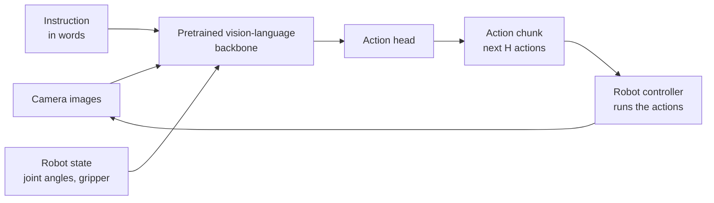

<LessonMeta level="Advanced" time="40 min" prereqs={["Imitation learning", "Vision-language grounding", "Python basics"]} />

So far we built a pipeline: a language model plans, a vision model finds the objects, and hand-written skills act. That works, but every skill is its own engineering project, and "fold the towel" or "wipe the table in a spiral" may not be in the library. Another idea is to learn the whole mapping at once: look at the camera, read the instruction, output the next motion. Models that do this are called vision-language-action (VLA) models. This lesson explains how they work at the level that stays true even as specific models change.

<Objectives>

- Describe the structure of a VLA: backbone, action head, action chunks.
- Explain tokenized actions and how they differ from continuous regression.
- Explain why diffusion and flow-matching heads handle multi-modal demonstrations well.
- Outline how to collect data and fine-tune a VLA on your own robot.
- Say what a VLA cannot guarantee, and where it fits with planners and safety layers.

</Objectives>

## What a VLA is

A <Term def="Vision-language-action model: a neural network that takes camera images, a text instruction and often the robot’s own state, and outputs robot actions.">VLA model</Term> starts from a pretrained vision-language model (the kind from the last lesson). That backbone already understands pictures and words, from training on internet-scale data. We then add the ability to output *actions* and train on robot demonstrations: sequences of (camera images, instruction, robot state, action) recorded by a human teleoperating the robot.



Why start from a vision-language model instead of from scratch? Web-scale pretraining gives the model knowledge no robot dataset contains: what a "toy dinosaur" is, that "the thing you drink from" means the mug. Some VLAs have been shown to follow instructions and handle objects that never appeared in their robot data, because the backbone recognized them.

The main design question is the **action head**: how the model produces actions. There are three common answers.

## Head 1: actions as tokens

A language model produces tokens. So make actions into tokens. Take each action dimension (say, change in x, y, z, rotation, gripper), divide its range into bins (for example 256), and let the model output one token per dimension, like words. The idea was used in the RT-2 model from Google DeepMind, which showed that one network can output both text and robot actions after being trained on web data and robot data together, and open models such as OpenVLA follow the same recipe.

```python title="action_tokens.py"
import numpy as np

# Action = [dx, dy, dz, droll, dpitch, dyaw, gripper]: small end-effector motions plus gripper opening.
LOW = np.array([-0.05, -0.05, -0.05, -0.3, -0.3, -0.3, 0.0])
HIGH = np.array([0.05, 0.05, 0.05, 0.3, 0.3, 0.3, 1.0])
N_BINS = 256

def tokenize(action):
    """Continuous action -> one integer token (0..255) per dimension."""
    unit = np.clip((np.asarray(action) - LOW) / (HIGH - LOW), 0.0, 1.0)
    return np.minimum((unit * N_BINS).astype(int), N_BINS - 1)

def detokenize(tokens):
    """Tokens -> the centre of each bin."""
    return LOW + (np.asarray(tokens) + 0.5) / N_BINS * (HIGH - LOW)

action = np.array([0.012, -0.031, 0.004, 0.10, 0.0, -0.2, 1.0])
tokens = tokenize(action)
back = detokenize(tokens)
print("tokens :", tokens.tolist())
print("as text:", " ".join(f"<a{t}>" for t in tokens))
print("round-trip error:", np.abs(back - action).round(5).tolist())
print("worst possible error per dimension:", ((HIGH - LOW) / N_BINS / 2).round(5).tolist())

# Chunking: the model predicts H future actions at once; we run only the first K, then predict again.
H, K = 8, 4
rng = np.random.default_rng(0)
def fake_policy(step):
    """Stand-in for a model call: returns an H x 7 chunk starting at this step."""
    base = np.array([0.01, 0.0, 0.0, 0.0, 0.0, 0.0, 1.0])
    return base + 0.001 * rng.standard_normal((H, 7))

executed = []
for step in range(0, 16, K):
    chunk = fake_policy(step)
    executed.extend(chunk[:K])
print("model calls for 16 control steps:", 16 // K, "(instead of 16)")
```

The round-trip error never exceeds half a bin width, so 256 bins is fine for small motions. Tokenizing lets you reuse the whole language-model machinery (next-token prediction, big pretrained weights). The costs are that predicting several actions means several tokens one after another (slow), and that each dimension is treated separately.

## Head 2: direct regression

The simplest head is a small neural network that outputs the action numbers directly and is trained to match demonstrations with a squared-error loss. It is fast and easy. But there is a catch, and it is why more complex heads exist. Human demonstrations are **multi-modal**: to go around an obstacle, one person goes left and another goes right. A regression model trained with squared error predicts the *average*, which drives straight into the obstacle.

## Head 3: diffusion and flow matching

A generative head models the whole distribution of actions, then samples one. In a <Term def="A generative method that starts from random noise and removes it step by step, guided by the observations, to produce an action.">diffusion</Term> head, noise is gradually removed from a random action until a realistic one remains. **Flow matching** is a close relative with a simpler training rule: draw a noise sample $x_0$ and a real action $a$, pick a random time $t \in [0,1]$, form the point on the straight line between them, and train a network $v_\theta$ to predict the direction of that line:

$$
x_t = (1 - t)\,x_0 + t\,a, \qquad \mathcal{L}(\theta) = \mathbb{E}\,\big\| v_\theta(x_t, t, \text{obs}) - (a - x_0) \big\|^2
$$

To generate an action, start from noise at $t = 0$ and follow the learned velocity field to $t = 1$, with a few small Euler steps:

$$
x_{t + \Delta t} = x_t + \Delta t \; v_\theta(x_t, t, \text{obs})
$$

Because the sample starts from random noise, different runs can land on different valid modes, so the model can go left *or* right but not into the middle. A handful of steps (often around ten) is enough, which keeps it quick.

```python title="flow_matching_toy.py"
import numpy as np

rng = np.random.default_rng(0)
expert = np.array([0.02, -0.01, 0.0, 0.1, 0.0, 0.0, 1.0])   # pretend demonstration action

def training_pair(a1):
    """One flow-matching training example: a point on the straight path from noise to the action."""
    x0 = rng.standard_normal(a1.shape)       # noise
    t = rng.uniform()                        # random time in [0, 1]
    xt = (1.0 - t) * x0 + t * a1             # noisy action at time t
    target_v = a1 - x0                       # the velocity the network must predict
    return xt, t, target_v

def sample(velocity_fn, obs, dim=7, steps=10):
    """Generate an action by integrating the learned velocity field from noise (Euler method)."""
    x = rng.standard_normal(dim)
    for k in range(steps):
        t = k / steps
        x = x + (1.0 / steps) * velocity_fn(x, t, obs)
    return x

def good_net(x, t, obs):
    """Pretend trained network: the exact velocity toward the expert action."""
    return (expert - x) / max(1.0 - t, 1e-3)

def bad_net(x, t, obs):
    return np.zeros_like(x)                  # predicts "do not move"

for name, net in [("good_net", good_net), ("bad_net", bad_net)]:
    errs = []
    for _ in range(2000):
        xt, t, v = training_pair(expert)
        errs.append(np.mean((net(xt, t, None) - v) ** 2))
    print(f"{name}: flow-matching loss = {np.mean(errs):.4f}")

a = sample(good_net, obs=None)
print("sampled action:", a.round(3).tolist())
print("expert action :", expert.tolist())
```

The "networks" here are stand-ins, since training a real one is beyond a short lab. What the code shows is the part that is the same in real systems: how a training example is built, what the loss compares, and how sampling integrates from noise to an action. A good network scores a loss near zero; a network that predicts "no motion" scores far higher. This family of heads appears in the π0 line of models from Physical Intelligence (a pretrained vision-language backbone plus a separate flow-matching "action expert") and in diffusion-based policies; NVIDIA’s GR00T-style humanoid models describe a related two-part design with a slower reasoning module and a faster diffusion-based action module. Architectures and release details change often, so **check the current release** of any model before you build on it.

<KeyIdea title="Three ways to say what to do next">

Tokens treat actions as words (simple, reuses language models, slower). Regression outputs one number per dimension (fast, but averages different strategies). Diffusion and flow heads sample from the full distribution of actions (handle multiple valid strategies, and are good at smooth, precise motion).

</KeyIdea>

## Action chunks

Most modern VLAs predict a short **chunk** of future actions, perhaps a second of motion, rather than a single step. The ending of `action_tokens.py` shows the idea: with $H = 8$ and $K = 4$, the robot runs half of each chunk, then asks the model again, so it calls the model a quarter as often as it moves.

Chunking has three benefits: smoother motion (the model commits to a short trajectory), tolerance to slow inference (the robot is still moving while the next chunk is computed), and less *compounding error*, the drift that builds up when single-step errors feed back into the next prediction. The cost is lower reactivity during a chunk. A common refinement, *temporal ensembling*, runs the model every step and averages the overlapping predictions for the current moment, weighting recent ones more.

## Collecting data and fine-tuning

You rarely train a VLA from scratch. You start from a released checkpoint and adapt it to your robot and tasks. A typical plan:

1. **Fix your action space.** Choose what the model outputs: end-effector deltas, absolute poses or joint targets. Match what the checkpoint was trained on, or plan to re-train the head. Decide the control rate.
2. **Collect demonstrations.** Teleoperate your robot to do each task many times (tens to hundreds of demonstrations is a common range for narrow tasks, but check the model’s guidance). Vary object positions, lighting and clutter so the model does not memorize one setup. Record camera images, robot state, action and the instruction.
3. **Clean and normalize.** Remove failed or idle episodes, align timestamps, compute per-dimension statistics (mean and spread) for normalization, and keep the camera setup the same as at deployment.
4. **Fine-tune.** Full fine-tuning needs a large GPU; parameter-efficient methods such as LoRA (small trainable adapters on top of frozen weights) cut memory a lot. Hold out episodes for validation.
5. **Evaluate on the robot,** not just in loss curves. A low training loss does not guarantee a working policy. The [evaluation lesson](./05-evaluation-and-safety.mdx) shows how to measure it honestly.
6. **Iterate on data.** Failures usually point to missing situations in the data, so collect more demonstrations of those.

For a single narrow task with limited data, a smaller policy trained from scratch (such as an ACT-style or diffusion policy) can match or beat a large VLA and runs on modest hardware. Reach for a VLA when you need language instructions, many tasks, or generalization to new objects.

Public cross-robot datasets (the Open X-Embodiment collection is the best-known) let a model see many robots, and are what many released VLAs start from. Whether such pretraining helps *your* robot is an empirical question; check the model’s documentation and test it.

## What a VLA does not give you

- **No guarantees.** It is a learned function and can fail in surprising ways on unfamiliar input. Wrap it in a safety layer: joint, speed and force limits, workspace bounds, and an emergency stop. See [Evaluation and safety](./05-evaluation-and-safety.mdx).
- **Compute and latency.** Large models need a strong GPU. Many systems run the model on a nearby server or onboard computer and stream actions to a fast low-level controller.
- **Limited reasoning over long tasks.** For long multi-step jobs, use an LLM planner (lesson 1) to break the job into short instructions, and let the VLA execute each one.
- **Fast change.** Names, sizes, licences and benchmark numbers shift every few months. Read the current model card and repository before you commit.

:::tip[Pro tip]
Always log the observations, instruction and action chunks your policy sees and outputs. When a failure happens, the log is how you find out whether the model, the data or the camera was at fault.
:::

## Hands-on lab

<Steps>

1. Run `action_tokens.py`. Confirm the round-trip error is below the "worst possible" row for every dimension.
2. Change `N_BINS` to 16. What happens to the error? Would 16 bins be enough for a gripper that is only open or closed? For a 5 cm motion range?
3. Run `flow_matching_toy.py`. Change `steps` in `sample` from 10 to 2 and then to 1. How does the output change with `good_net`? Why does the exact velocity field make even 1 step work here, but real networks usually need more?
4. Write a `noisy_net` that adds Gaussian noise (standard deviation 0.5) to the output of `good_net` and check how far the sampled action is from `expert` at 10 steps.
5. Done when you can explain to a friend, without equations, how a flow head makes an action.

</Steps>

## Exercises

<Exercise title="Token resolution" level="Beginner">

An action dimension ranges from -0.05 to 0.05 m, divided into 256 bins. What is the bin width, and what is the largest rounding error?

<Solution>

The range is 0.1 m, so the bin width is $0.1/256 \approx 0.00039$ m (0.39 mm). If you decode to the bin centre, the largest error is half a bin, about 0.2 mm.

</Solution>

</Exercise>

<Exercise title="Why not regression?" level="Intermediate">

A demonstration set has half the demos going around an obstacle on the left and half on the right. What does a regression head trained with squared error do, and why does a flow head do better?

<Solution>

Squared error is minimized by the mean of the demonstrations, which is a path straight through the obstacle. A flow head models the distribution of actions and samples from it, so each rollout picks one valid mode (left or right) and avoids the obstacle.

</Solution>

</Exercise>

<Exercise title="Plan your data" level="Intermediate">

You want to fine-tune a VLA to "put the cup in the dish rack" on your own arm. List four things you would vary while collecting demonstrations, and one thing you would keep the same as at deployment.

<Solution>

Vary: cup position and orientation, which cup (colour and shape), the rack position, lighting, and background clutter. Keep the same: the camera positions and settings (and the action space and control rate), since the model learns from those exact viewpoints and signals.

</Solution>

</Exercise>

## Check your understanding

<Quiz questions={[
  {q: "What is the basic input and output of a VLA model?", options: ["Text in, text out only", "Images, an instruction and robot state in; robot actions out", "Only joint angles in; images out", "Audio in; audio out"], answer: 1, explain: "A VLA maps camera images, an instruction and state to actions, usually as a short chunk."},
  {q: "What is a tokenized action?", options: ["An action encoded as a password", "A continuous action divided into bins so each value becomes a discrete token the language model can output", "A text description of a plan", "An action with no units"], answer: 1, explain: "Each action dimension is discretized into bins, and the model outputs one token per dimension."},
  {q: "Why do diffusion and flow heads suit multi-modal demonstrations?", options: ["They always output the average", "They sample from the distribution of actions, so each rollout can choose one valid strategy", "They need no data", "They are slower to train than anything else"], answer: 1, explain: "Sampling from noise lets the model represent several valid ways of doing the task instead of averaging them."},
  {q: "What does action chunking give you?", options: ["Smoother motion and fewer model calls, at the cost of some reactivity", "Faster GPUs", "A guaranteed safe robot", "Language understanding"], answer: 0, explain: "Predicting several steps at once smooths motion, hides inference latency and reduces compounding error."}
]} />

<Takeaways>

- A VLA is a pretrained vision-language backbone plus an action head, trained on robot demonstrations.
- Action heads come in three flavours: tokens, direct regression and diffusion or flow generation.
- Flow matching trains a network to predict the direction from noise to a real action, and samples by following that field.
- Action chunks give smoother motion and tolerate slow inference.
- Fine-tune on your own data: fix the action space, vary the scenes, normalize, evaluate on the robot, iterate on the data.
- VLAs come with no guarantees: add safety layers, and check the current release for specifics.

</Takeaways>

## Go deeper

- [RT-2: Vision-Language-Action Models Transfer Web Knowledge to Robotic Control](https://arxiv.org/abs/2307.15818)
- [OpenVLA: An Open-Source Vision-Language-Action Model](https://arxiv.org/abs/2406.09246)
- [π0: A Vision-Language-Action Flow Model for General Robot Control](https://arxiv.org/abs/2410.24164)
- [Flow Matching for Generative Modeling](https://arxiv.org/abs/2210.02747), and [GR00T N1](https://arxiv.org/abs/2503.14734) for a humanoid-oriented model.

Next: [Voice-to-action pipeline](./04-voice-to-action-pipeline.mdx)
