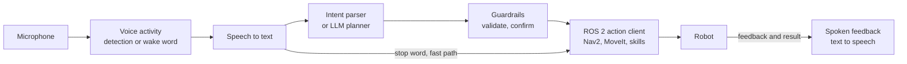

<LessonMeta level="Advanced" time="45 min" prereqs={["ROS 2 actions", "Navigation with Nav2", "LLMs as robot planners"]} />

A person in a hospital corridor says, "Robot, take this to room twelve." Behind that sentence is a chain of systems: a microphone, a speech recogniser, something that works out what was meant, a planner, a navigation stack, and a voice that says "On my way." Every link can fail, and the person is watching. This lesson builds the whole chain, with an architecture you can reuse for any spoken command.

<Objectives>

- Draw the architecture of a voice-to-action pipeline and name what each stage does.
- Transcribe audio with an open speech-to-text model.
- Write an intent parser that handles safety words, confirmation and unknown commands.
- Send a Nav2 goal from a ROS 2 node, report feedback, and cancel it on "stop".
- Reason about latency, errors and privacy.

</Objectives>

## The architecture



Read it left to right as five jobs:

1. **Hear.** Capture audio, and decide when a command starts and ends. *Voice activity detection* finds the speech; a *wake word* (or a push-to-talk button) decides whether it was meant for the robot.
2. **Transcribe.** <Term def="Automatic speech recognition: turning audio of spoken words into written text.">Speech-to-text</Term> (STT) turns audio into a string.
3. **Understand.** Turn the string into an <Term def="The goal behind a sentence, such as go to a place or stop, with its parameters, in a fixed machine-readable form.">intent</Term> with parameters. This can be a handful of rules for a small command set, or an LLM planner as in [LLMs as robot planners](./01-llms-as-robot-planners.mdx) for open-ended requests.
4. **Check and act.** Validate the intent against what the robot is allowed to do, ask for confirmation if it is risky or unclear, then send it to a ROS 2 action server.
5. **Report.** Say or show what was understood, how it is going, and how it ended.

Note the shortcut arrow: the stop word bypasses the planner and goes straight to the action layer. A stop command must never wait for an LLM.

<KeyIdea title="Every stage can be wrong, so every stage must say so">

Speech recognition mishears, parsers misread, planners hallucinate, and robots fail. A good pipeline passes along its confidence, rejects what it does not understand, and tells the person exactly what it will do before it does it.

</KeyIdea>

## Hearing and transcribing

Whisper is an open speech recognition model released by OpenAI, and several fast reimplementations exist. The following script uses `faster-whisper` (install it with `pip install faster-whisper`; the model downloads on first use, and `command.wav` is a short recording of your own):

```python title="transcribe.py"
from faster_whisper import WhisperModel

model = WhisperModel("small", device="cpu", compute_type="int8")
segments, info = model.transcribe("command.wav", language="en")
text = " ".join(seg.text.strip() for seg in segments)
print(f"[{info.language}] {text}")
```

On a laptop CPU the small model typically needs a second or so for a short clip; a GPU is faster. Measure it on your hardware, because it varies a lot.

Practical advice:

- **Use push-to-talk or a wake word** at first. Continuous listening in a noisy room produces a stream of false commands.
- **Record at 16 kHz, mono.** That is what the models expect.
- **A microphone array helps.** Robot motors are noisy, and a cheap single microphone on the robot body hears mostly motors.
- **Bias with a vocabulary.** If you only support a few place names, check them against the transcript and treat near-misses ("kitchen" and "chicken") as unknown rather than guessing.

## Understanding: a small, safe parser

For a fixed set of commands, rules are better than an LLM: they are fast, predictable and testable. The parser below handles safety words first, finds the verb and place, and returns `unknown` for everything else.

```python title="intent_parser.py"
import re

PLACES = {
    "kitchen": ["kitchen", "cooking area"],
    "door": ["door", "entrance", "front door"],
    "charger": ["charger", "charging station", "dock"],
    "desk": ["desk", "workstation"],
}
STOP_WORDS = ("stop", "halt", "freeze", "emergency")

def normalize(text):
    text = text.lower().strip()
    text = re.sub(r"[^a-z0-9 ]+", " ", text)          # drop punctuation
    text = re.sub(r"^(hey robot|ok robot|robot)\s+", "", text)   # drop the wake phrase
    return re.sub(r"\s+", " ", text)

def parse_intent(raw):
    """Map a transcript to a small, fixed set of intents. Anything else is 'unknown'."""
    text = normalize(raw)
    words = text.split()
    if any(w in STOP_WORDS for w in words):            # safety words win over everything
        return {"intent": "stop", "confirm": False}
    if re.search(r"\b(go|come|drive|navigate|walk|head)\b", text) or text.startswith("take me"):
        for place, names in PLACES.items():
            if any(re.search(rf"\b{re.escape(n)}\b", text) for n in names):
                return {"intent": "go_to", "place": place, "confirm": False}
        return {"intent": "unknown", "reason": "no known place in the request"}
    if re.search(r"\b(status|battery|how are you)\b", text):
        return {"intent": "report_status", "confirm": False}
    return {"intent": "unknown", "reason": "not a supported command"}

if __name__ == "__main__":
    tests = [
        "Hey robot, go to the kitchen.",
        "please drive to the charging station",
        "Take me to the front door",
        "STOP!",
        "go to the moon",
        "what is your battery level",
        "make me a sandwich",
    ]
    for t in tests:
        print(f"{t!r:42} -> {parse_intent(t)}")
```

Run it. The first three sentences give `go_to` intents with the right place; `STOP!` gives `stop`; "go to the moon" and "make me a sandwich" are `unknown`. Saying "I did not understand" is a correct result. A guess is not.

For open-ended speech, replace `parse_intent` with an LLM call that returns a JSON plan, and keep the same checks afterwards (schema, allow-list, confirmation), as in lesson 1. Keep the stop-word check *outside* the model.

## Acting: a ROS 2 node

Now connect the intent to a robot. This node listens on a `speech/text` topic (your STT process publishes it), parses the text, and sends a `NavigateToPose` goal to Nav2, as you learned in [Navigation with Nav2](../06-motion/02-navigation-with-nav2.mdx). It speaks feedback on `speech/say` for a text-to-speech node, and cancels the goal when it hears "stop". It assumes `intent_parser.py` sits next to it in the same package, and that the map has named places.

```python title="voice_commander.py"
import math

import rclpy
from action_msgs.msg import GoalStatus
from geometry_msgs.msg import PoseStamped
from nav2_msgs.action import NavigateToPose
from rclpy.action import ActionClient
from rclpy.node import Node
from std_msgs.msg import String

from intent_parser import parse_intent

# Named places in the map frame: x (m), y (m), yaw (rad). Fill in from your own map.
PLACES = {
    "kitchen": (3.0, 1.5, 0.0),
    "door": (0.5, -2.0, 1.57),
    "charger": (-1.0, 0.0, 3.14),
    "desk": (2.0, -1.0, 0.0),
}


class VoiceCommander(Node):
    def __init__(self):
        super().__init__("voice_commander")
        self.nav = ActionClient(self, NavigateToPose, "navigate_to_pose")
        self.say_pub = self.create_publisher(String, "speech/say", 10)
        self.create_subscription(String, "speech/text", self.on_text, 10)
        self.goal_handle = None

    def say(self, text):
        msg = String()
        msg.data = text
        self.say_pub.publish(msg)
        self.get_logger().info(f"say: {text}")

    def on_text(self, msg):
        intent = parse_intent(msg.data)
        self.get_logger().info(f'heard "{msg.data}" -> {intent}')
        if intent["intent"] == "stop":
            self.stop()
        elif intent["intent"] == "go_to":
            self.go_to(intent["place"])
        else:
            self.say("Sorry, I did not understand that.")

    def go_to(self, place):
        if not self.nav.wait_for_server(timeout_sec=2.0):
            self.say("Navigation is not available right now.")
            return
        x, y, yaw = PLACES[place]
        goal = NavigateToPose.Goal()
        goal.pose = PoseStamped()
        goal.pose.header.frame_id = "map"
        goal.pose.header.stamp = self.get_clock().now().to_msg()
        goal.pose.pose.position.x = x
        goal.pose.pose.position.y = y
        goal.pose.pose.orientation.z = math.sin(yaw / 2.0)
        goal.pose.pose.orientation.w = math.cos(yaw / 2.0)
        self.say(f"Going to the {place}.")
        future = self.nav.send_goal_async(goal, feedback_callback=self.on_feedback)
        future.add_done_callback(self.on_goal_response)

    def on_goal_response(self, future):
        handle = future.result()
        if not handle.accepted:
            self.say("I could not plan a path there.")
            return
        self.goal_handle = handle
        handle.get_result_async().add_done_callback(self.on_result)

    def on_feedback(self, feedback_msg):
        remaining = feedback_msg.feedback.distance_remaining
        self.get_logger().info(f"{remaining:.1f} m to go")

    def on_result(self, future):
        status = future.result().status
        self.goal_handle = None
        if status == GoalStatus.STATUS_SUCCEEDED:
            self.say("I have arrived.")
        elif status == GoalStatus.STATUS_CANCELED:
            self.say("Stopped.")
        else:
            self.say("I could not get there.")

    def stop(self):
        if self.goal_handle is not None:
            self.goal_handle.cancel_goal_async()
        else:
            self.say("I am not moving.")


def main():
    rclpy.init()
    node = VoiceCommander()
    try:
        rclpy.spin(node)
    finally:
        node.destroy_node()
        rclpy.shutdown()


if __name__ == "__main__":
    main()
```

To test without a microphone, run Nav2 in simulation (see [Simulated sensors and ros_gz](../04-simulation/03-simulated-sensors-and-ros-gz.mdx) for a robot to drive), start the node, and publish a fake transcript from a terminal:

```bash title="terminal"
ros2 topic pub --once /speech/text std_msgs/msg/String "{data: 'go to the kitchen'}"
ros2 topic pub --once /speech/text std_msgs/msg/String "{data: 'stop'}"
```

Watch the robot start moving, and then stop. The feedback callback prints the remaining distance as it goes. Once this works with typed text, connect the real speech chain by publishing the STT output on the same topic. That way each stage can be tested on its own.

:::note
Feedback matters even without a speaker: show the recognised text and the chosen action on a screen. People trust a robot more when they can see what it understood.
:::

## Latency, errors and privacy

**Latency.** The delay from the end of speech to the first motion is the sum of end-of-speech detection, transcription, understanding, validation and the action server’s start-up. Each stage can take from tens of milliseconds to a couple of seconds, and the sum is what people feel. Measure each stage and log it. If an LLM is in the loop, consider a fast rule-based path for common commands.

**Errors.** Plan for each one:

- *Mis-transcription:* repeat back what was understood before doing anything irreversible ("Go to the kitchen. Is that right?").
- *Ambiguity:* ask a question instead of guessing ("Which mug, the red one or the blue one?").
- *Silence or noise:* time out and ask again, rather than acting on a partial command.
- *Unknown commands:* say so, and suggest what the robot can do.

**Privacy.** A robot with a microphone in a home or workplace hears private conversations. Prefer on-device transcription, record only after a wake word or button, tell people when it is listening (a light helps), and do not store audio you do not need.

:::warning[Stop must always work]
Test the stop word and a physical emergency stop with the robot at full speed, in noise, and with the network disconnected. Voice is a convenience layer; it is never the only way to stop a robot.
:::

## Hands-on lab

<Steps>

1. Save `intent_parser.py` and run it. Confirm all seven test sentences behave as described.
2. Add three more sentences of your own, including one that is ambiguous and one with a mis-transcription ("go to the chicken"). Decide what the parser should do and make it do that.
3. Add a new intent, `"bring_me"`, with a confirm flag set to true. Make the node ask "Do you want me to bring the item?" and wait for a "yes" or "no" on the next transcript.
4. If you have ROS 2 Jazzy and Nav2 with a simulated robot, save `voice_commander.py` in a package, run it, and use the two `ros2 topic pub` commands to drive and stop the robot.
5. Done when typed "go to the kitchen" moves the robot, "stop" cancels the goal, and nonsense is politely refused.

</Steps>

## Exercises

<Exercise title="Where does stop go?" level="Beginner">

Why does the architecture send the stop word directly to the action layer instead of through the LLM planner?

<Solution>

An LLM call can take a second or more, may fail, or may misinterpret. Stopping is time-critical and must be reliable, so it is handled by a simple, fast, tested path that does not depend on a model.

</Solution>

</Exercise>

<Exercise title="Add a confirmation" level="Intermediate">

Describe how you would add a confirmation step before the robot goes to a place marked "restricted". Which part of the code changes, and what state do you need?

<Solution>

In `on_text`, when the intent is `go_to` and the place is restricted, store the pending intent in an attribute (such as `self.pending`) and say "Go to the lab? Say yes to confirm." On the next transcript, if it is "yes" within a few seconds, run `go_to`; on "no" or timeout, discard it. The state you need is the pending intent and a timestamp.

</Solution>

</Exercise>

<Exercise title="Budget the delay" level="Intermediate">

Suppose end-of-speech detection takes 0.4 s, STT 0.8 s, parsing 0.01 s and starting the action 0.2 s. What is the time from the end of speech to motion? Name two ways to reduce it.

<Solution>

$0.4 + 0.8 + 0.01 + 0.2 \approx 1.4$ s. Reduce it by using a smaller or GPU-accelerated STT model, streaming transcription that starts before speech ends, a shorter end-of-speech silence threshold, or a spoken acknowledgement ("OK") right away so the delay feels shorter.

</Solution>

</Exercise>

## Check your understanding

<Quiz questions={[
  {q: "What is the first job of the intent parser in this lesson?", options: ["Find the place name", "Check for safety words such as stop", "Pick a voice for the robot", "Download the map"], answer: 1, explain: "Safety words are checked first so that they always win over any other interpretation."},
  {q: "In the ROS 2 node, how does the node stop the robot?", options: ["It kills the Nav2 process", "It cancels the active goal through the action client", "It disables the microphone", "It resets the map"], answer: 1, explain: "The node keeps the goal handle and calls cancel_goal_async on it."},
  {q: "Why repeat back what was understood?", options: ["It sounds polite only", "Mis-transcription is common, and a confirmation lets the user catch it before the robot acts", "It makes the model faster", "It saves battery"], answer: 1, explain: "Echoing the interpretation lets people catch mistakes before they have physical consequences."},
  {q: "Which is a good privacy practice for a robot with a microphone?", options: ["Record everything and upload it", "Use a wake word or push-to-talk, transcribe on the device where possible, and indicate when listening", "Never tell anyone it is listening", "Store all audio forever"], answer: 1, explain: "Limit what you capture, keep it local where possible, and make listening visible."}
]} />

<Takeaways>

- The pipeline is: hear, transcribe, understand, check and act, report.
- Whisper-family models give good open speech-to-text; measure latency on your hardware.
- Rules suit small command sets; use an LLM for open-ended requests, with the same validation after it.
- Safety words bypass the planner and go straight to the action layer.
- A ROS 2 node can turn an intent into a Nav2 action goal, forward feedback, and cancel on command.
- Confirm risky or unclear commands, handle errors out loud, and protect people’s privacy.

</Takeaways>

## Go deeper

- [Robust Speech Recognition via Large-Scale Weak Supervision](https://arxiv.org/abs/2212.04356), the Whisper paper.
- [ROS 2 actions: writing an action client](https://docs.ros.org/en/jazzy/Tutorials/Intermediate/Writing-an-Action-Server-Client/Py.html) in the Jazzy documentation.
- [Nav2 documentation](https://navigation.ros.org/) for the `NavigateToPose` action and named waypoints.

Next: [Evaluation and safety](./05-evaluation-and-safety.mdx)
