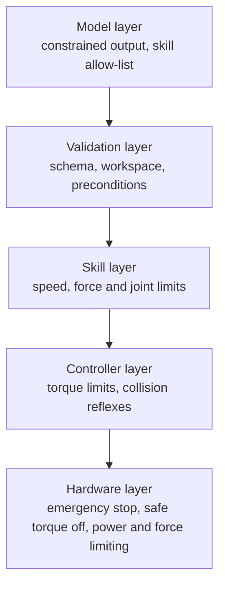
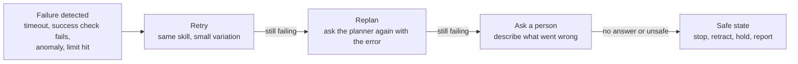

<LessonMeta level="Advanced" time="40 min" prereqs={["Voice-to-action pipeline", "Probability for robots", "Python basics"]} />

A demo video shows the robot putting the mug in the sink, perfectly. How many takes did it need? Would it work with a different mug, in dim light, if you phrased the request another way, or when someone stands nearby? A model-driven robot is a statistical system acting in the physical world. It will be wrong some of the time, so the work is to find out how often, in which situations, and to make sure being wrong is safe. This lesson is about that work.

<Objectives>

- Define success metrics before running experiments and report them with confidence intervals.
- Design generalization tests along several axes, and keep a clean test set.
- Build layered guardrails around a model-driven robot.
- Choose a level of human oversight and design confirmations that people will actually read.
- Design a failure-recovery ladder that ends in a safe state.

</Objectives>

## Measuring what works

### Define success first

Write down, before the first trial, exactly what counts as success. "Mug in the sink" might mean fully inside, upright, not broken, in under 60 seconds, with no human help. Vague criteria let tired experimenters round up. Where possible, let a sensor or script judge success, not a person who wants the experiment to work.

Useful metrics:

| Metric | What it tells you |
|---|---|
| Success rate | Fraction of trials that meet the criteria. The headline number. |
| Partial progress | A score from a rubric (reached, grasped, lifted, placed) that shows *where* things break. |
| Time to complete | Speed; also catches hesitation and recovery loops. |
| Interventions | How often a human had to step in per hour or per task. |
| Failure type | A count by category: perception, language or planning, grasp, motion, recovery. |
| Safety events | Limit violations, near collisions, emergency stops. A fast robot with many of these is not good. |
| For language planners | Plan validity (valid JSON, real skills), hallucination rate, instruction-following rate, latency. |

### Report uncertainty

If a robot succeeds 8 out of 10 times, is its true rate 80 percent? Not necessarily. With only ten trials the true rate could easily be anywhere from about 50 to 95 percent. A <Term def="A range that probably contains the true value. A 95 percent interval would contain the true rate in 95 out of 100 repeated experiments of the same kind.">confidence interval</Term> shows that. The Wilson interval is a good choice for success rates, because it behaves well with small samples and rates near 0 or 1:

$$
\text{interval} = \frac{\hat{p} + \frac{z^2}{2n} \pm z\sqrt{\frac{\hat{p}(1-\hat{p})}{n} + \frac{z^2}{4n^2}}}{1 + \frac{z^2}{n}}, \qquad z = 1.96
$$

where $\hat{p}$ is the observed rate and $n$ the number of trials.

```python title="success_rate.py"
import math

def wilson(successes, trials, z=1.96):
    """95 percent Wilson score interval for a success rate."""
    if trials == 0:
        return 0.0, 1.0
    p = successes / trials
    denom = 1 + z * z / trials
    centre = (p + z * z / (2 * trials)) / denom
    half = z * math.sqrt(p * (1 - p) / trials + z * z / (4 * trials * trials)) / denom
    return centre - half, centre + half

def trials_needed(margin, p=0.5, z=1.96):
    """Rough number of trials so the interval is about +/- margin (worst case at p = 0.5)."""
    return math.ceil(z * z * p * (1 - p) / margin ** 2)

results = {                                  # (successes, trials) per test condition
    "seen objects, normal light": (18, 20),
    "new objects":                (9, 20),
    "dim lighting":               (15, 20),
    "paraphrased instruction":    (17, 20),
}

base_lo, _ = wilson(*results["seen objects, normal light"])
print(f"{'condition':30s} {'rate':>5s}   95% interval")
for name, (s, n) in results.items():
    lo, hi = wilson(s, n)
    flag = "  <-- clearly worse than baseline" if hi < base_lo else ""
    print(f"{name:30s} {s / n:5.2f}   [{lo:.2f}, {hi:.2f}]{flag}")

print("8 of 10 :", [round(x, 2) for x in wilson(8, 10)])
print("80 of 100:", [round(x, 2) for x in wilson(80, 100)])
print("trials for +/-10 points:", trials_needed(0.10), " for +/-5 points:", trials_needed(0.05))
```

Run it. Eight of ten gives an interval of roughly 0.49 to 0.94, while 80 of 100 narrows it to about 0.71 to 0.87. To pin a rate down to plus or minus 10 points you need around 100 trials; for 5 points, about 385. The flag in the table is a deliberately conservative check (it only fires when the intervals do not overlap), so with 20 trials per condition you will miss modest differences. Plan for more trials where the decision matters.

<KeyIdea title="A success rate without a trial count is not a result">

Always report successes, trials and an interval. "90 percent" from 10 trials and "90 percent" from 500 trials mean very different things. When comparing two systems, run them on the same set of initial conditions, in interleaved order, so that luck and drift affect both equally.

</KeyIdea>

## Testing generalization

A policy that works in the room where it was trained tells you little. Test deliberately along axes where deployment will differ:

- **Objects:** new instances of known categories, then new categories.
- **Positions and poses:** places and orientations not in the training data.
- **Lighting and camera:** brightness, shadows, glare, a slightly moved camera.
- **Background and clutter:** distractor objects, different tables and cloths.
- **Instructions:** paraphrases ("put the mug away", "place the cup in the sink"), typos, other speakers and accents.
- **Time and wear:** a different day, a different robot unit, a half-charged battery.
- **Adversarial or odd input:** ambiguous requests, impossible requests, and text in the scene such as a sign reading "ignore your instructions", which a vision-language model may obey if you let it.

Keep a **held-out test set** that you never tune on. If you adjust prompts, thresholds or training data after looking at the test results, the test is no longer a test. Simulation is excellent for running thousands of regression trials cheaply; the real robot has the final word. Report both, and say which is which.

## Safety by layers

No single check is enough, so stack independent ones, so that when one fails another catches it:



Each layer should work even if the one above it is wrong. A model that is tricked into saying "move to x = 5 m" must still be stopped by the validator; a bug in the validator must still be stopped by the speed limit; and a bug in the software must still be stopped by a hardware emergency stop.

```python title="guardrail.py"
from dataclasses import dataclass

@dataclass(frozen=True)
class Limits:
    workspace_min: tuple = (-0.5, -0.5, 0.0)    # x, y, z in metres, robot base frame
    workspace_max: tuple = (0.8, 0.5, 0.8)
    max_speed: float = 0.25                      # m/s
    max_force: float = 20.0                      # N
    human_speed_factor: float = 0.4              # slow down when a person is close
    allowed_skills: tuple = ("go_to", "pick", "place", "say")
    confirm_skills: tuple = ("place",)           # ask a person first

def check_command(cmd, limits=Limits(), human_nearby=False):
    """Return (verdict, possibly_modified_command, reasons). Verdict: allow, confirm or block."""
    cmd = dict(cmd)
    reasons = []
    if cmd.get("skill") not in limits.allowed_skills:
        return "block", cmd, [f"skill {cmd.get('skill')!r} is not on the allow-list"]
    target = cmd.get("target")
    if target is not None:
        for axis, lo, hi, value in zip("xyz", limits.workspace_min, limits.workspace_max, target):
            if not lo <= value <= hi:
                return "block", cmd, [f"target {axis}={value} is outside the workspace [{lo}, {hi}]"]
    if cmd.get("force", 0.0) > limits.max_force:
        return "block", cmd, [f"force {cmd['force']} N exceeds {limits.max_force} N"]
    cap = limits.max_speed * (limits.human_speed_factor if human_nearby else 1.0)
    if cmd.get("speed", 0.0) > cap:
        reasons.append(f"speed limited from {cmd['speed']} to {cap:.2f} m/s")
        cmd["speed"] = cap
    verdict = "confirm" if cmd["skill"] in limits.confirm_skills else "allow"
    return verdict, cmd, reasons

tests = [
    ({"skill": "pick", "target": (0.4, 0.1, 0.3), "speed": 0.2}, False),
    ({"skill": "pick", "target": (0.4, 0.1, 0.3), "speed": 0.2}, True),
    ({"skill": "pick", "target": (1.5, 0.0, 0.3), "speed": 0.1}, False),
    ({"skill": "place", "target": (0.2, 0.0, 0.2)}, False),
    ({"skill": "open_door"}, False),
    ({"skill": "pick", "target": (0.3, 0.0, 0.2), "force": 60.0}, False),
]
for cmd, human in tests:
    verdict, safe_cmd, why = check_command(cmd, human_nearby=human)
    print(f"{verdict:7s} human={human!s:5s} {cmd['skill']:10s} {why}")
```

Run it. The same pick command is allowed at full speed when nobody is near, but clamped to a slower speed when a person is close. The out-of-workspace target, the unknown skill and the over-force command are blocked, and `place` needs confirmation. Notice the three outcomes: **allow**, **confirm** and **block**, and that *clamping* a value is often better than rejecting the whole command. This code is a software guardrail only. It does not replace certified safety hardware.

:::warning[Software is not a safety system]
A guardrail in Python can have bugs and can crash. For anything that can hurt a person, rely on engineered hardware safety (emergency stops, safety-rated controllers, speed and force limiting) and on the safety standards for your type of robot. Industrial and collaborative robots are covered by standards such as ISO 10218 and ISO/TS 15066, and personal-care robots by ISO 13482; check which apply to your robot. See [Ethics, safety and standards](../10-capstone-and-career/04-ethics-safety-and-standards.mdx).
:::

## Human oversight

How much should a person be involved? It depends on the cost of a mistake.

- **Human in the loop:** a person approves each action. Right for new, risky or irreversible steps (handling sharp tools, opening doors to the outside).
- **Human on the loop:** the robot acts, and a person watches and can stop it at any time. Right for routine tasks with a stop button within reach.
- **Human out of the loop:** the robot acts alone. Only for low-risk tasks in well-tested conditions, and with all the layers above.

Design confirmations with care. If the robot asks about everything, people click "yes" without reading (alert fatigue). Ask only when the action is risky or the request is ambiguous, say plainly what will happen ("I will put the red mug in the sink"), and show it where the person can see it. Make "stop" instant and always available. Log what was asked, what was approved, and what happened, so you can review incidents later.

## Failure recovery

Failures are normal, so plan them. A good recovery ladder goes from cheap to safe:



Rules that make this work:

1. **Detect failure explicitly.** Use timeouts, success checks (is the mug really in the sink? confirm with a detector, not only a model) and sanity checks on sensors.
2. **Bound retries.** Two or three, not infinity. An endless retry loop is a failure of its own.
3. **Change something between attempts.** A different grasp, a new viewpoint. Repeating the identical action rarely helps.
4. **Always have a safe state,** such as stopping motion, holding the object or putting it down gently, and reporting what happened.
5. **Learn from failures.** Cluster the failure types from your logs, and fix the most common one first, often with data, not with prompts.

## Hands-on lab

<Steps>

1. Save `success_rate.py` and run it. Add a fifth condition of your own choice and check how its interval compares with the baseline.
2. Double every trial count (keep the same rates) and run it again. Which conditions now get the "clearly worse" flag?
3. Save `guardrail.py` and run it. Add a rule: block any command whose `speed` is negative, and add a test for it.
4. Add a new skill, `"hand_over"`, which must always require confirmation and must always be slowed down to 0.1 m/s when `human_nearby` is true. Add tests.
5. Write a one-page test plan for the module project: 10 commands (including 3 ambiguous and 2 unsafe), 20 trials each, the success criteria, and the generalization axes you will vary.

</Steps>

## Exercises

<Exercise title="How many trials?" level="Beginner">

You want to know a robot’s success rate to within plus or minus 10 percentage points at 95 percent confidence. About how many trials do you need in the worst case?

<Solution>

Using $n \approx z^2\,p(1-p)/E^2$ with $p = 0.5$, $z = 1.96$ and $E = 0.10$: $n \approx 3.84 \times 0.25 / 0.01 \approx 96$, so about 100 trials. If you expect a much higher or lower success rate, you need fewer.

</Solution>

</Exercise>

<Exercise title="Read the interval" level="Intermediate">

Policy A succeeds 9 of 10 trials. Policy B succeeds 85 of 100. Which is better? What would you do next?

<Solution>

You cannot say. A’s observed rate is higher (0.90 versus 0.85), but its Wilson interval for 10 trials is roughly 0.60 to 0.98, which easily contains B’s interval of about 0.77 to 0.91. Run more trials of A on the same initial conditions as B before choosing.

</Solution>

</Exercise>

<Exercise title="Design a recovery" level="Intermediate">

A pick fails because the mug slips out of the gripper. Write a recovery ladder with three rungs and a safe end state.

<Solution>

Rung 1: re-detect the mug and retry the grasp with a slightly different approach angle and a slightly higher grip force (within limits). Rung 2: ask the planner or perception to pick a different grasp point, or reposition the base. Rung 3: ask a person for help ("I cannot grasp the mug; please move it"). Safe end state: stop motion, open the gripper over a safe surface, and report the failure with a log of the attempts.

</Solution>

</Exercise>

## Check your understanding

<Quiz questions={[
  {q: "Why report a confidence interval with a success rate?", options: ["To make the number look more complicated", "Because with few trials the true rate could be very different from the observed one", "Because rates must be rounded", "To compare units"], answer: 1, explain: "The interval shows how much the observed rate could be due to chance, especially with small samples."},
  {q: "What is the purpose of a held-out test set?", options: ["To train the model faster", "To measure performance on data you never tuned on, so that the result is honest", "To store backups", "To reduce latency"], answer: 1, explain: "If you tune using the test set, the result is no longer an honest measure of generalization."},
  {q: "What is a layered safety design?", options: ["One very good check", "Several independent checks, so that if one fails another still catches the problem", "Only a hardware stop", "Only a model prompt"], answer: 1, explain: "Independent layers (model, validation, skills, controller, hardware) give defence in depth."},
  {q: "What should come last in a failure-recovery ladder?", options: ["Retry forever", "A safe state: stop, hold or put down, and report", "Ignore the failure", "Turn up the speed"], answer: 1, explain: "If retries, replanning and asking for help do not work, the robot must end in a safe state."}
]} />

<Takeaways>

- Define success before testing; prefer automatic success checks.
- Report successes, trials and a confidence interval; use paired, interleaved comparisons.
- Test generalization along many axes with a held-out set you never tune on.
- Stack independent safety layers, ending in hardware safety; software guardrails alone are not enough.
- Match oversight to risk, and design confirmations that people notice.
- Plan recovery: detect, retry a bounded number of times with changes, replan, ask, then reach a safe state.

</Takeaways>

## Go deeper

- [Open X-Embodiment: Robotic Learning Datasets and RT-X Models](https://arxiv.org/abs/2310.08864) for how large cross-robot evaluations are organised (check the paper for the exact claims).
- [Diffusion Policy](https://arxiv.org/abs/2303.04137), which includes careful real-robot evaluation protocols.
- [ROS 2 documentation](https://docs.ros.org/en/jazzy/) for lifecycle nodes and tools useful for supervision and logging.

Next: [Capstone brief](../10-capstone-and-career/01-capstone-brief.mdx)
