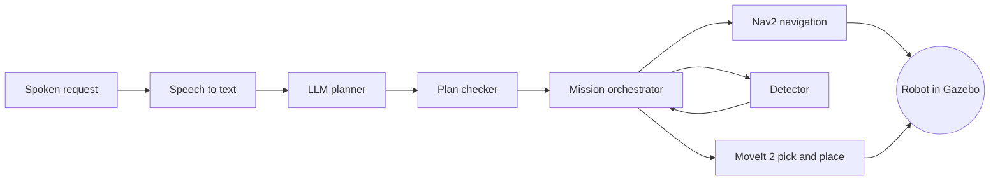

<LessonMeta level="Advanced" time="40 min" prereqs={["Modules 03 to 09 (or the lessons you plan to lean on)", "A working ROS 2 Jazzy and Gazebo Harmonic setup"]} />

You are standing in a simulated apartment. You say, "Bring the red cup to the table." A mobile robot hears you, works out what you mean, drives to the counter, spots the red cup among three other objects, grasps it, carries it across the room and sets it down on the table. Nobody touches a keyboard.

That one sentence touches nearly everything you have learned: speech, language models, navigation, perception, manipulation and the glue that holds them together. This lesson is the contract for building it.

<Objectives>

- Describe the capstone system end to end and name the subsystem that owns each step.
- Turn the requirements into a milestone plan you can actually finish.
- Predict how your project will be graded, using the rubric, and design your evidence to match.
- Choose a stretch goal that fits your time and ambition.

</Objectives>

## What you are building

The capstone is **a voice-commanded robot assistant in simulation**. The robot is a <Term def="A robot with a wheeled or tracked base that can drive around, plus one or more arms that can grasp and move objects.">mobile manipulator</Term>: a base that drives plus an arm with a gripper. It lives in Gazebo Harmonic, talks to ROS 2 Jazzy through `ros_gz`, and must complete spoken fetch-and-carry requests with no human help after the command.

Here is the whole loop at a glance.



Every box maps to a lesson you have already read. The planner comes from [LLMs as robot planners](../09-foundation-models/01-llms-as-robot-planners.mdx), the full chain from [Voice to action](../09-foundation-models/04-voice-to-action-pipeline.mdx), navigation from [Navigation with Nav2](../06-motion/02-navigation-with-nav2.mdx), and manipulation from [Manipulation with MoveIt 2](../06-motion/03-manipulation-with-moveit2.mdx).

<KeyIdea title="Integration is the hard part">
Each subsystem on its own is a solved exercise from an earlier module. The capstone is difficult because they must work together: timing, frames, failure handling and shared state. A robot that does four things 90 percent of the time finishes the whole task only about two thirds of the time. Plan for the seams.
</KeyIdea>

## The world and the robot

You choose your robot model, but it must meet these minimums.

- A differential-drive or omnidirectional base with odometry.
- A 2D lidar (or a depth camera usable for navigation) for localization and obstacle avoidance.
- An arm with at least 5 degrees of freedom and a parallel-jaw gripper.
- An RGB-D camera that can see the workspace in front of the arm.
- A way to receive audio. In simulation this can be your computer microphone, or recorded `.wav` files played into the pipeline.

The world is an apartment-style environment you build in Gazebo: at least two rooms, a counter, a table, and four to six household objects. The objects include a red cup, a blue cup and a green box, plus one or two distractors. Object positions on the counter are randomized for each trial. Fixed positions are not allowed, because they let you skip perception.

## Requirements

Requirements are numbered so your write-up and the grading can refer to them.

| ID | Requirement | Must or should |
|---|---|---|
| R1 | Accept a spoken English request and convert it to text | Must |
| R2 | Use an LLM to produce a structured plan from the text | Must |
| R3 | Validate every plan against an allowlist of actions and known places before any motion | Must |
| R4 | Navigate between rooms with Nav2, avoiding a moving or unexpected obstacle | Must |
| R5 | Detect and localize the target object from camera data, not from ground truth | Must |
| R6 | Pick the object and place it on a named surface with MoveIt 2 | Must |
| R7 | Report progress and failures back to the user in text (speech output is a stretch goal) | Must |
| R8 | Recover from at least two failure types without human help (for example a failed grasp or a blocked path) | Must |
| R9 | Provide a one-command bring-up and a one-command evaluation run | Must |
| R10 | Stop motion within one second when a stop command is published | Should |

R3 and R10 are not decoration. A language model can emit a confident, wrong plan, and your robot has to survive that. You will meet this idea again in [Evaluation and safety](../09-foundation-models/05-evaluation-and-safety.mdx) and in [Ethics, safety and standards](./04-ethics-safety-and-standards.mdx).

:::warning[Ground truth is a cheat]
Gazebo can tell you exactly where every object is. Using that for R5 will make the demo easy and the grade low. Use it only to score your trials, never to drive the robot.
:::

## Milestones

Eight weeks is a comfortable pace if you work a few evenings each week. Cut it shorter if you are already strong in some areas, but keep the order, because later milestones depend on earlier ones.

| Milestone | Week | Done means |
|---|---|---|
| M1: Robot and world | 1 | The robot spawns, drives with teleop, and publishes sensors into ROS 2 |
| M2: Navigation | 2 to 3 | The robot reaches named places in the map reliably, 9 of 10 times |
| M3: Perception | 3 to 4 | The detector returns the target object pose in the map frame with a measured error |
| M4: Manipulation | 4 to 5 | The arm picks and places a known object at a known spot, scripted |
| M5: Language and voice | 6 | Spoken text becomes a validated plan, tested on 20 phrasings |
| M6: Integration | 7 | The full request works end to end, with recovery behaviors |
| M7: Evaluation and demo | 8 | Trial results, a demo video and a written report |

The detailed week-by-week instructions, package layout and node graph are in the [Capstone build guide](./02-capstone-build-guide.mdx).

## How you will be graded

Your work is scored out of 100. Whether you are submitting to an instructor, a study group or just yourself, grade honestly against this table.

| Criterion | Weight | Full marks look like |
|---|---|---|
| Functionality | 30 | The end-to-end request succeeds on most trials with randomized object placement |
| Evaluation and robustness | 20 | At least 20 logged trials, a success rate, a failure breakdown by stage, and fixes driven by that breakdown |
| Architecture and code quality | 15 | Clear packages, typed interfaces, launch files, parameters in YAML, a few real tests |
| Safety and failure handling | 15 | Plan validation, stop command, timeouts, and recovery behaviors you can demonstrate |
| Documentation and reproducibility | 10 | A stranger can clone, build and run in under 30 minutes using your README |
| Demo and write-up | 10 | A clear 3-minute video and a short report with honest limitations |

<KeyIdea title="Measure, then fix">
The strongest submissions are not the ones that work first time. They are the ones that log every trial, find that, say, 60 percent of failures happen at the grasp, and then improve the grasp. A failure breakdown table is worth more than a polished video.
</KeyIdea>

### Measuring a trial

A trial is one spoken request, from the moment the command is accepted to the moment the robot reports done or gives up. Success means the correct object rests on the correct surface, within 10 cm of the target spot, and nothing was knocked over. Record each trial as one line of JSON.

```yaml title="eval/scenario.yaml"
name: bring_red_cup_to_table
trials: 20
randomize:
  red_cup_on_counter: {x_range: [-0.3, 0.3], y_range: [-0.2, 0.2]}
  distractors: [blue_cup, green_box]
command: "Bring the red cup to the table."
success:
  object: red_cup
  surface: table
  max_distance_m: 0.10
timeout_s: 240
```

Your evaluation script then turns the log into the numbers the rubric asks for.

```python title="eval/summarize.py"
import json
import statistics
import sys
from collections import Counter
from pathlib import Path


def load(path):
    lines = Path(path).read_text(encoding="utf-8").splitlines()
    return [json.loads(line) for line in lines if line.strip()]


def summarize(trials):
    wins = [t for t in trials if t["success"]]
    print(f"trials: {len(trials)}")
    print(f"success rate: {len(wins) / len(trials):.0%}")
    if wins:
        median = statistics.median(t["duration_s"] for t in wins)
        print(f"median time of successful trials: {median:.0f} s")
    failures = Counter(t["failure_stage"] for t in trials if not t["success"])
    for stage, count in failures.most_common():
        print(f"  failed at {stage}: {count}")


if __name__ == "__main__":
    summarize(load(sys.argv[1]))
```

Each line in `trials.jsonl` looks like `{"success": false, "duration_s": 212.4, "failure_stage": "grasp"}`. For successful trials, set `failure_stage` to `null`.

## Stretch goals

Do the required work first. Then pick one stretch goal, not three. Depth beats breadth.

- **Speech out.** Add text-to-speech so the robot says what it is doing and asks a clarifying question when the request is ambiguous ("I see two cups. Which one?").
- **Multi-step requests.** "Put the blue cup on the counter, then bring me the green box." Your plan validator needs to handle ordering and shared state.
- **Humanoid variant.** Swap the wheeled base for a humanoid in simulation and have it walk or be carried between rooms by a locomotion policy. Pair this with [Locomotion](../08-humanoids/03-locomotion.mdx) and [Whole-body control](../08-humanoids/04-whole-body-control.mdx). Expect this to take several extra weeks.
- **Learned grasping or a VLA.** Replace the scripted grasp with a learned policy, as in [Vision-language-action models](../09-foundation-models/03-vision-language-action-models.mdx), and compare success rates against your classical baseline.
- **Real hardware.** Run a reduced version on a physical robot, following [Deploying on hardware](./03-deploying-on-hardware.mdx). A low-cost wheeled base with a small arm is enough.

## Hands-on lab

Set up the project skeleton and the evaluation harness before you write any robot code. It is the cheapest way to make the rest of the project measurable.

<Steps>

1. Create a repository named `proprio-capstone` with a `README.md` that states the project goal, the requirements table (R1 to R10) and your milestone dates.
2. Copy `scenario.yaml` and `summarize.py` from this lesson into an `eval/` folder. Change the command and objects to match your own world.
3. Write a tiny `eval/fake_trials.jsonl` with ten invented trials (a mix of successes and failures at different stages) and run `python eval/summarize.py eval/fake_trials.jsonl`. You should see a success rate and a failure breakdown.
4. In your README, add a one-paragraph risk list: the three things most likely to go wrong and your plan for each.
5. Commit with a message such as "Add capstone skeleton and eval harness", and tag it `m0`.

</Steps>

You know it worked when the summary script prints sensible numbers from your fake data and someone else could read your README and tell what "done" means.

Stuck? Ask **Rivet**, the course assistant, bottom-right.

## Exercises

<Exercise title="Compose the probability" level="Intermediate">
Suppose your system has four stages with independent success rates: speech 0.95, planning 0.95, navigation 0.9 and manipulation 0.8. What is the expected end-to-end success rate, and which stage should you improve first if you can raise only one stage by 0.05?

<Solution>
Multiply the stages: 0.95 × 0.95 × 0.9 × 0.8 = 0.65, about 65 percent. Raising manipulation from 0.8 to 0.85 gives 0.69. Raising navigation from 0.9 to 0.95 gives 0.69 too, while raising speech or planning to 1.0 would give about 0.68. In practice, improve the stage with the lowest rate that is cheapest to fix, and always confirm with measured failure data, since the independence assumption is rarely true.
</Solution>
</Exercise>

<Exercise title="Write an ambiguity rule" level="Beginner">
The user says, "Bring me the cup." There are two cups in the scene. Write the behavior your robot should show, in two or three sentences, and say which requirement it relates to.

<Solution>
The robot should not guess. It should report that it sees two cups (red and blue) and ask which one to fetch, then wait for a reply or time out safely. This relates to R3 (validating the plan before motion, since the plan is underspecified) and R7 (reporting back to the user). A stretch goal would speak the question aloud.
</Solution>
</Exercise>

<Exercise title="Pick your stretch goal" level="Advanced">
Choose one stretch goal and write a half-page plan: what you will build, how you will measure it against the baseline, and what you will cut if you fall behind.

<Solution>
A good answer names a measurable outcome ("learned grasp reaches at least the scripted grasp success rate over 20 trials"), a comparison against the required baseline, a date, and an explicit fallback ("if the learned policy is not working by week 7, report what I tried and ship the scripted grasp"). Plans that name a fallback are more likely to finish.
</Solution>
</Exercise>

## Check your understanding

<Quiz questions={[
  {
    q: "Why is using Gazebo ground truth for object locations not allowed for driving the robot?",
    options: [
      "It runs too slowly in simulation",
      "It skips perception, which the capstone is meant to exercise",
      "ROS 2 does not publish ground truth",
      "It breaks the Nav2 costmap"
    ],
    answer: 1,
    explain: "Ground truth makes the task artificially easy and bypasses requirement R5. Use it only to score trials."
  },
  {
    q: "Which requirement protects the robot from a confident but wrong LLM plan?",
    options: [
      "R1, speech to text",
      "R3, validating every plan against an allowlist before motion",
      "R6, pick and place with MoveIt 2",
      "R9, one-command bring-up"
    ],
    answer: 1,
    explain: "Plan validation rejects unknown actions and places before anything moves, so a hallucinated step never reaches the hardware."
  },
  {
    q: "What does the grading rubric reward most directly for improving a project over time?",
    options: [
      "A longer demo video",
      "More packages in the repository",
      "Logged trials with a failure breakdown that drives fixes",
      "Using the newest language model"
    ],
    answer: 2,
    explain: "Evaluation and robustness carries 20 points, and a failure breakdown shows you found and fixed real problems."
  },
  {
    q: "Why does a chain of four 90 percent subsystems finish the whole task only about two thirds of the time?",
    options: [
      "Success probabilities multiply across stages",
      "ROS 2 adds latency at each hop",
      "Language models are unreliable",
      "Gazebo randomizes failures"
    ],
    answer: 0,
    explain: "0.9 to the fourth power is about 0.66, so reliability compounds downward as stages are chained."
  }
]} />

<Takeaways>

- The capstone is a voice-commanded mobile manipulator in Gazebo Harmonic that hears, plans, navigates, perceives and picks and places.
- Requirements R1 to R10 define done; R3 (plan validation) and R10 (stop command) are the safety backbone.
- Integration, not any single subsystem, is where most of the difficulty lives.
- You are graded on measured evidence: logged trials, failure breakdowns, reproducibility and an honest write-up.
- Never drive the robot with simulator ground truth; use it only to score trials.
- Choose one stretch goal and plan a fallback before you start.

</Takeaways>

## Go deeper

- [Gazebo documentation](https://gazebosim.org/docs) for worlds, models and the `ros_gz` bridge.
- [Nav2 documentation](https://navigation.ros.org) for the navigation stack you will configure.
- [MoveIt 2 documentation](https://moveit.picknik.ai) for planning and pick-and-place tutorials.
- [ROS 2 Jazzy documentation](https://docs.ros.org/en/jazzy/) for everything underneath.

Next: [Capstone build guide](./02-capstone-build-guide.mdx)
