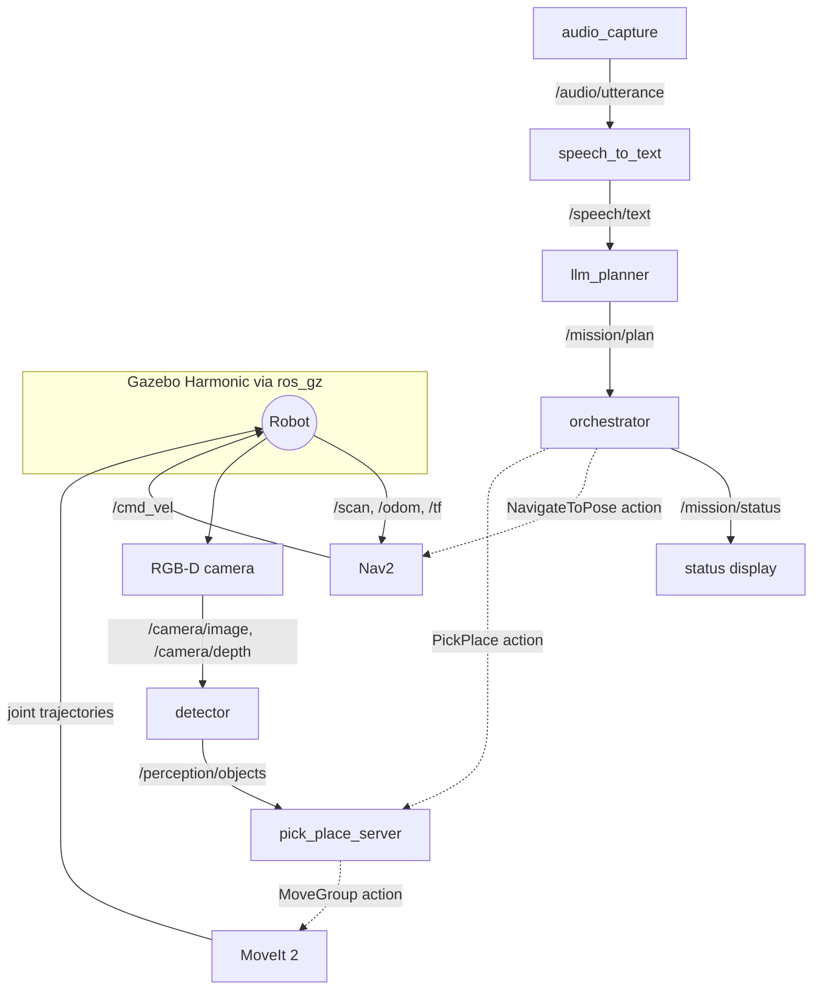

<LessonMeta level="Expert" time="45 min" prereqs={["Capstone brief", "ROS 2 actions, launch files and tf2", "Nav2 and MoveIt 2 basics"]} />

Week three of the build. The robot drives beautifully on its own, the arm picks beautifully on its own, and when you wire them together the arm waves at an empty counter because the camera frame was never connected to the map. Every capstone hits a moment like this. The fix is rarely clever; it is a clear structure that makes the problem easy to find.

This guide gives you that structure: how to lay out your packages, how the nodes talk, what to build each week and how to test and debug it.

<Objectives>

- Lay out a ROS 2 workspace for a multi-subsystem robot with clean package boundaries.
- Define the topics and actions that connect the subsystems, including one custom action.
- Build the system in the right order, testing each layer before the next.
- Apply a debugging checklist to find which layer a failure lives in.

</Objectives>

## Package layout

Split the project by responsibility, not by language. Each package has one job and a short list of dependencies. This keeps builds fast and lets you test each piece alone.

```text title="proprio_ws/src/"
proprio_interfaces/     custom msg and action definitions (CMake package)
proprio_description/    URDF/xacro, meshes, ros2_control tags
proprio_sim/            Gazebo worlds, ros_gz bridge config, spawn launch
proprio_navigation/     Nav2 params, maps, localization launch
proprio_perception/     detector node, pose estimation, camera config
proprio_manipulation/   MoveIt 2 config, pick_place action server
proprio_voice/          audio capture, speech-to-text node
proprio_planner/        LLM client, prompt, plan validator
proprio_mission/        orchestrator (state machine over actions)
proprio_bringup/        top-level launch files and parameter YAML
proprio_eval/           trial runner, scoring, scenario files
```

Keep every tunable value (frame names, object names, timeouts, model names) in YAML under `proprio_bringup/config/`. Never hard-code them in nodes. This is the habit from [Actions, parameters and launch files](../03-ros2/03-actions-parameters-launch.mdx).

## The node graph

Here is how the nodes talk at runtime. Solid arrows are topics; the orchestrator calls actions on Nav2 and on your pick-and-place server.



### Interfaces

Agree on interfaces first. If the contracts are stable, you can build and test the pieces in any order.

| Interface | Type | Direction | Purpose |
|---|---|---|---|
| `/audio/utterance` | `audio_common_msgs` or a file path in `std_msgs/String` | mic to ASR | One recorded utterance (your choice, document it) |
| `/speech/text` | `std_msgs/String` | ASR to planner | Transcript of the request |
| `/mission/plan` | `std_msgs/String` (JSON list) | planner to orchestrator | A validated list of steps |
| `/mission/status` | `std_msgs/String` | orchestrator to user | Progress and failures |
| `navigate_to_pose` | `nav2_msgs/action/NavigateToPose` | orchestrator to Nav2 | Drive to a named place |
| `pick_place` | `proprio_interfaces/action/PickPlace` | orchestrator to manipulation | Pick or place |
| `/perception/objects` | `vision_msgs/Detection3DArray` | detector to manipulation | Detected objects with map-frame poses |
| `/emergency_stop` | `std_msgs/Bool` | anyone to all movers | Latched stop request |

Only one interface is custom. Define it once in `proprio_interfaces`.

```text title="proprio_interfaces/action/PickPlace.action"
# mode is "pick" or "place"
string mode
# object to pick, or surface to place on
string name
---
bool success
string message
---
string phase
```

The plan itself is a short JSON list with an **allowlist** of three actions.

```json title="example plan"
[
  {"action": "navigate_to", "target": "counter"},
  {"action": "pick", "object": "red_cup"},
  {"action": "navigate_to", "target": "table"},
  {"action": "place", "target": "table"}
]
```

<KeyIdea title="The orchestrator is a small, boring state machine">
Resist putting intelligence in the glue. The LLM decides what to do; the orchestrator only runs validated steps one at a time, checks each result and aborts cleanly on failure. A short, deterministic orchestrator is easy to test and easy to trust.
</KeyIdea>

## The orchestrator

This node validates the plan, then executes steps in order. Notice that it rejects bad plans before anything moves.

```python title="proprio_mission/orchestrator.py"
import json
import math

import rclpy
from action_msgs.msg import GoalStatus
from geometry_msgs.msg import PoseStamped
from nav2_msgs.action import NavigateToPose
from proprio_interfaces.action import PickPlace
from rclpy.action import ActionClient
from rclpy.node import Node
from std_msgs.msg import String

# (x, y, yaw) in the map frame; load these from YAML in your real project
PLACES = {"table": (2.0, 0.5, 0.0), "counter": (-1.0, 2.0, 1.57)}
ALLOWED = {"navigate_to": "target", "pick": "object", "place": "target"}


def validate(plan):
    if not isinstance(plan, list) or not plan:
        raise ValueError("plan must be a non-empty list")
    for step in plan:
        if not isinstance(step, dict) or step.get("action") not in ALLOWED:
            raise ValueError(f"unknown step: {step!r}")
        field = ALLOWED[step["action"]]
        if set(step) != {"action", field}:
            raise ValueError(f"bad fields for {step['action']}: {sorted(step)}")
        if field == "target" and step["target"] not in PLACES:
            raise ValueError(f"unknown place: {step['target']!r}")
    return plan


def pose_for(name, stamp):
    x, y, yaw = PLACES[name]
    pose = PoseStamped()
    pose.header.frame_id = "map"
    pose.header.stamp = stamp
    pose.pose.position.x = x
    pose.pose.position.y = y
    pose.pose.orientation.z = math.sin(yaw / 2)
    pose.pose.orientation.w = math.cos(yaw / 2)
    return pose


class Orchestrator(Node):
    def __init__(self):
        super().__init__("orchestrator")
        self.nav = ActionClient(self, NavigateToPose, "navigate_to_pose")
        self.manip = ActionClient(self, PickPlace, "pick_place")
        self.status_pub = self.create_publisher(String, "/mission/status", 10)
        self.create_subscription(String, "/mission/plan", self.on_plan, 10)
        self.steps = []
        self.busy = False

    def say(self, text):
        self.get_logger().info(text)
        self.status_pub.publish(String(data=text))

    def on_plan(self, msg):
        if self.busy:
            self.say("busy: plan ignored")
            return
        try:
            self.steps = validate(json.loads(msg.data))
        except ValueError as err:
            self.say(f"rejected plan: {err}")
            return
        self.busy = True
        self.next_step()

    def next_step(self):
        if not self.steps:
            self.busy = False
            self.say("done")
            return
        step = self.steps.pop(0)
        self.say(f"step: {step}")
        if step["action"] == "navigate_to":
            goal = NavigateToPose.Goal()
            goal.pose = pose_for(step["target"], self.get_clock().now().to_msg())
            self.send(self.nav, goal)
        elif step["action"] == "pick":
            self.send(self.manip, PickPlace.Goal(mode="pick", name=step["object"]))
        else:
            self.send(self.manip, PickPlace.Goal(mode="place", name=step["target"]))

    def send(self, client, goal):
        if not client.server_is_ready():
            self.abort("action server not available")
            return
        client.send_goal_async(goal).add_done_callback(self.on_accepted)

    def on_accepted(self, future):
        handle = future.result()
        if not handle.accepted:
            self.abort("goal rejected")
            return
        handle.get_result_async().add_done_callback(self.on_result)

    def on_result(self, future):
        wrapped = future.result()
        ok = wrapped.status == GoalStatus.STATUS_SUCCEEDED
        if ok and hasattr(wrapped.result, "success"):
            ok = wrapped.result.success
        if ok:
            self.next_step()
        else:
            self.abort(f"step failed (status {wrapped.status})")

    def abort(self, why):
        self.steps.clear()
        self.busy = False
        self.say(f"aborted: {why}")


def main():
    rclpy.init()
    rclpy.spin(Orchestrator())


if __name__ == "__main__":
    main()
```

For recovery (requirement R8), extend `on_result`: when a `pick` fails once, re-run the detector and retry; when navigation fails, call Nav2’s clear-costmap service and retry. Keep the retry count small and logged.

## Week by week

**Week 1: robot and world.** Build the world and the robot description. Bridge the sensors with `ros_gz`. Drive with keyboard teleop and confirm `/tf`, `/scan`, `/odom` and camera topics appear. Lesson links: [Gazebo worlds and robots](../04-simulation/02-gazebo-worlds-and-robots.mdx), [Simulated sensors and ros_gz](../04-simulation/03-simulated-sensors-and-ros-gz.mdx), [TF2 and URDF](../03-ros2/04-tf2-and-urdf.mdx).

**Weeks 2 to 3: navigation.** Build a map with SLAM, then localize and navigate with Nav2. Define the named places. Test 10 runs between each pair. See [Navigation with Nav2](../06-motion/02-navigation-with-nav2.mdx) and [SLAM and localization](../05-perception/05-slam-and-localization.mdx).

**Weeks 3 to 4: perception.** Detect the objects, back-project the detection with the depth image, and transform the result into the map frame with tf2. Measure position error against ground truth, using ground truth only for scoring. See [Deep learning for detection and segmentation](../05-perception/03-deep-learning-detection-segmentation.mdx) and [Depth, point clouds and lidar](../05-perception/02-depth-point-clouds-and-lidar.mdx).

**Weeks 4 to 5: manipulation.** Configure MoveIt 2 for your arm, add the table and counter as collision objects, and write the `pick_place` server: approach, grasp, lift, carry pose, place, retreat. See [Manipulation with MoveIt 2](../06-motion/03-manipulation-with-moveit2.mdx) and [Grasping](../06-motion/04-grasping.mdx).

**Week 6: language and voice.** Build speech-to-text, the LLM planner with a system prompt that lists only the allowed actions and places, and test 20 different phrasings. See [LLMs as robot planners](../09-foundation-models/01-llms-as-robot-planners.mdx) and [Voice to action](../09-foundation-models/04-voice-to-action-pipeline.mdx).

**Week 7: integration.** Run the orchestrator with the real subsystems. Add the stop topic, timeouts and the two recovery behaviors.

**Week 8: evaluation and demo.** Run 20 or more trials, fix the biggest failure stage, record the demo and write the report.

## Test plan

Test at three levels, and run the cheaper tests more often.

| Level | What it checks | Example |
|---|---|---|
| Unit | Pure functions with no ROS | `validate()` accepts the example plan and rejects an unknown place, a missing field and an empty list |
| Subsystem | One package with the others faked | Publish a fake plan and confirm the orchestrator calls the right action servers in order |
| System | The whole chain in simulation | The 20-trial evaluation from the brief |

A unit test for the validator takes five minutes and catches the most dangerous class of bug:

```python title="proprio_mission/test/test_validate.py"
import pytest

from proprio_mission.orchestrator import validate


def test_accepts_good_plan():
    plan = [{"action": "navigate_to", "target": "table"}]
    assert validate(plan) == plan


@pytest.mark.parametrize("bad", [
    [],
    [{"action": "fly", "target": "table"}],
    [{"action": "navigate_to", "target": "moon"}],
    [{"action": "pick"}],
])
def test_rejects_bad_plans(bad):
    with pytest.raises(ValueError):
        validate(bad)
```

## Debugging checklists

When something fails, work down the stack. Do not guess.

**Nothing moves.**
1. Is the simulation running and unpaused? Check `ros2 topic hz /clock`.
2. Is the bridge up? `ros2 topic list` should show your sensor topics.
3. Did the orchestrator accept the plan? Read `/mission/status`.
4. Is the action server visible? `ros2 action list`.

**Robot drives to the wrong place.**
1. Is the map frame correct? View in RViz with the fixed frame set to `map`.
2. Is localization converged? Check the particle cloud or pose covariance.
3. Do named places match the map you are actually using?

**Arm misses the object.**
1. Print the detected pose in the camera frame, then in the map frame. Does it match what you see?
2. Check the TF tree with `ros2 run tf2_tools view_frames`. A missing or stale camera frame is the usual culprit.
3. Check clock use: all nodes must use simulated time (`use_sim_time: true`).

**LLM plan is rejected or odd.**
1. Print the raw model output and the prompt. Is the allowlist in the prompt?
2. Lower the temperature and ask for JSON only.
3. Add the failing phrasing to your 20-phrase test set.

:::tip[Pro tip]
Record a bag of every failed trial with `ros2 bag record -a` in a short window. A failure you can replay is a failure you can fix. More on this in [Packages, debugging and bags](../03-ros2/05-packages-debugging-and-bags.mdx).
:::

## Hands-on lab

Build the spine of the system first, using fakes for the hard parts.

<Steps>

1. Create `proprio_interfaces` with `PickPlace.action` and build it with `colcon build --packages-select proprio_interfaces`.
2. Add `proprio_mission/orchestrator.py` and the `test_validate.py` unit test. Run `pytest` and make all tests pass.
3. Write a fake `pick_place` action server that sleeps one second and returns `success=True`. Launch Nav2 in simulation, or a fake `navigate_to_pose` server if Nav2 is not ready yet.
4. Publish a plan: `ros2 topic pub --once /mission/plan std_msgs/msg/String "{data: '[{\"action\": \"navigate_to\", \"target\": \"table\"}]'}"`.
5. Watch `ros2 topic echo /mission/status`. You should see the step, then `done`. Publish a bad plan with an unknown place and confirm you see `rejected plan`.

</Steps>

You know it worked when good plans run to `done`, bad plans are rejected with a reason, and no robot ever moved for a bad plan.

## Exercises

<Exercise title="Add a stop" level="Intermediate">
Add a subscription to `/emergency_stop` (`std_msgs/Bool`) in the orchestrator. When it receives `True`, it should clear remaining steps, cancel the active goal and publish `aborted: stop requested`. What do you need to store to cancel the active goal?

<Solution>
Store the goal handle from `on_accepted` (for example `self.active = handle`). On stop, call `self.active.cancel_goal_async()` if it exists, then call `self.abort("stop requested")`. Also keep a flag so a stale result callback does not start the next step after the stop.
</Solution>
</Exercise>

<Exercise title="Find the layer" level="Intermediate">
The arm reaches 15 cm to the left of the cup on every trial, always by roughly the same amount. Which layer most likely has the bug, and how would you confirm it?

<Solution>
A consistent offset points to a calibration or frame problem, not noise: likely the camera extrinsics in the URDF or the transform from camera to map. Confirm by placing the object at a known pose, printing the detected pose in the map frame and comparing it with ground truth. Random errors would instead suggest the detector or depth noise.
</Solution>
</Exercise>

## Check your understanding

<Quiz questions={[
  {
    q: "Why does the orchestrator validate the plan before executing any step?",
    options: [
      "To make the JSON smaller",
      "So a wrong or hallucinated plan is rejected before anything moves",
      "Because Nav2 requires it",
      "To speed up the LLM"
    ],
    answer: 1,
    explain: "Validation against an allowlist keeps unknown actions and places from ever reaching the robot."
  },
  {
    q: "Which is the best first test for the plan validator?",
    options: [
      "A full 20-trial simulation",
      "A unit test with good and bad plans, no ROS needed",
      "A hardware test",
      "A demo video"
    ],
    answer: 1,
    explain: "Pure functions can be unit tested in seconds, which makes it cheap to catch the most dangerous bugs."
  },
  {
    q: "The arm is always 15 cm off in the same direction. The most likely cause is:",
    options: [
      "Random sensor noise",
      "A calibration or frame transform error",
      "A slow LLM",
      "Too many trials"
    ],
    answer: 1,
    explain: "Systematic offsets come from calibration or frame errors; noise would scatter the misses."
  },
  {
    q: "Where should values like frame names and timeouts live?",
    options: [
      "Hard-coded in each node",
      "In YAML parameter files loaded at launch",
      "In the LLM prompt",
      "In the URDF only"
    ],
    answer: 1,
    explain: "Parameters in YAML are easy to change, review and reuse without rebuilding nodes."
  }
]} />

<Takeaways>

- Split the workspace by responsibility, and put every tunable value in YAML.
- Fix the interfaces first; only one custom action, `PickPlace`, is needed.
- The orchestrator is a short, deterministic state machine over validated steps.
- Build in order: world, navigation, perception, manipulation, language, integration, evaluation.
- Test at three levels: unit, subsystem with fakes, and full system trials.
- Debug top-down through the layers and use bags to replay failures.

</Takeaways>

## Go deeper

- [ROS 2 Jazzy: writing an action server and client](https://docs.ros.org/en/jazzy/Tutorials/Intermediate/Writing-an-Action-Server-Client/Py.html)
- [Nav2: NavigateToPose and the BT navigator](https://navigation.ros.org)
- [MoveIt 2 pick and place tutorial](https://moveit.picknik.ai)
- [Gazebo and ROS integration with ros_gz](https://gazebosim.org/docs)

Next: [Deploying on hardware](./03-deploying-on-hardware.mdx)
