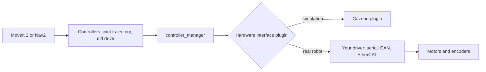

<LessonMeta level="Expert" time="45 min" prereqs={["Capstone build guide", "ros2_control basics", "Sim-to-real gap"]} />

In simulation, a bug costs you a restart. On a real robot, the same bug can cost a motor, a table lamp or a finger. The robot you built drives straight in Gazebo; on the floor it drifts left, because one wheel is a fraction of a millimetre smaller than the other. The code is the same. The world is not.

This lesson is the checklist for crossing that gap carefully: what hardware runs your software, how to keep the timing honest, how to talk to motors, how to stop safely and how to test without hurting anything.

<Objectives>

- Choose and set up embedded compute for a robot, and explain the trade-offs.
- Explain what real-time means for a robot and which parts of the stack need it.
- Use ros2_control to run the same controllers in simulation and on hardware.
- Add layered safety stops, calibrate sensors and log every run.
- Plan a staged field test that reveals problems at low risk.

</Objectives>

## Why hardware is different

Everything you have built assumed things that real hardware does not give you for free.

- **Time is messy.** In simulation, the clock is yours. On hardware, sensors arrive late, jitter and drop.
- **Physics is not exact.** Friction, backlash, battery sag and wheel slip all exist.
- **Failure is physical.** A crash is not a restart; it is a repair.
- **Resources are limited.** Your laptop GPU is not on the robot. Power, heat and weight are budgets.

The <Term def="The difference in behavior between a simulated robot and the real one, caused by modelling errors, sensor noise, delays and unmodelled physics.">sim-to-real gap</Term> from [The sim-to-real gap](../04-simulation/05-sim-to-real-gap.mdx) is not a research curiosity here; it is the thing you manage every day.

<KeyIdea title="Keep one software stack for both worlds">
Design so that moving from sim to hardware means swapping the lowest layer (the hardware interface) and some YAML, not rewriting your nodes. Same topics, same controllers, same launch structure. Every difference you leave in is a new bug.
</KeyIdea>

## Embedded compute

A robot carries its own computer. Many teams choose a single-board computer with an integrated GPU, such as the NVIDIA Jetson class of boards, because running neural networks for detection and speech on the robot saves network latency and works without Wi-Fi. Other options are small x86 mini PCs, or a split design where a microcontroller handles motors and sensors in tight loops while a bigger computer handles perception and planning.

Things to weigh:

- **Compute and memory.** Can the board run your detector at the frame rate you need? Optimized inference engines (for example TensorRT on NVIDIA hardware) often make the difference between 5 and 30 frames per second.
- **Power and heat.** Boards have power modes. A board that runs fine on the bench can throttle inside a closed chassis. Measure temperature during a long run.
- **Operating system match.** The reference stack in this course is Ubuntu 24.04 with ROS 2 Jazzy. Vendor images may ship a different Ubuntu release. Check what your board supports; if it differs, run ROS 2 in a container so the software environment matches what you tested.
- **Storage and I/O.** Logging at full rate needs fast storage. Check the ports for cameras, lidar and CAN or serial buses.

A common split is: microcontroller for motor loops at 1 kHz or more, onboard computer for ROS 2 nodes, and an optional operator laptop for visualization over the network.

## Real-time, in plain words

A <Term def="A system where the correctness of a result depends on delivering it before a deadline, not only on its value.">real-time</Term> system is not one that is fast. It is one that is predictable: a control loop meant to run every 5 ms must run every 5 ms, every time. A late motor command is a wrong motor command.

Standard Linux is a general-purpose scheduler and can delay your process for many milliseconds at an unlucky moment. For a slow mobile base at 20 to 50 Hz that is usually acceptable. For fast arm control or balancing a legged robot, it is not.

Practical advice, from cheapest to hardest:

1. **Put the hard real-time loop on a microcontroller** or the motor drive itself. Let the onboard computer send setpoints at a modest rate.
2. **Use a real-time kernel** (a PREEMPT_RT kernel) on the computer if it must close fast loops itself.
3. **Keep the control loop clean.** No memory allocation, no logging to disk, no blocking calls inside the loop. Pre-allocate and lock memory, and give the control thread a real-time scheduling priority.
4. **Keep clocks in sync** across computers with a network time service such as chrony, or your timestamps and `tf` lookups will fail in strange ways.
5. **Choose DDS settings and QoS deliberately.** Sensor streams usually want best-effort, shallow queues; commands and maps want reliable delivery.

Measure instead of hoping. Log the actual period of your control loop and plot the worst case, not the average.

## ros2_control: the same controllers everywhere

<Term def="A ROS 2 framework that separates controllers (what to compute) from hardware interfaces (how to talk to a specific device).">ros2_control</Term> is built for exactly this goal. A controller, such as a joint trajectory controller, reads joint states and writes commands through named interfaces. A <Term def="A plugin that reads sensor values from a device and writes commands to it, exposing them to controllers as named state and command interfaces.">hardware interface</Term> plugin turns those names into real bus traffic. In simulation, a Gazebo plugin plays that role instead.



You describe the hardware in the URDF with a `ros2_control` tag. The only thing that changes between sim and real is the plugin name and its parameters.

```xml title="kinemata_description/urdf/arm.ros2_control.xacro"
<ros2_control name="ArmSystem" type="system">
  <hardware>
    <!-- simulation: -->
    <plugin>gz_ros2_control/GazeboSimSystem</plugin>
    <!-- real robot: replace with your own plugin and add its parameters
    <plugin>kinemata_hardware/ArmSystemHardware</plugin>
    <param name="serial_port">/dev/ttyUSB0</param>
    -->
  </hardware>
  <joint name="shoulder_joint">
    <command_interface name="position"/>
    <state_interface name="position"/>
    <state_interface name="velocity"/>
  </joint>
</ros2_control>
```

The controller configuration is plain YAML and is identical in both worlds.

```yaml title="kinemata_bringup/config/controllers.yaml"
controller_manager:
  ros__parameters:
    update_rate: 100

    joint_state_broadcaster:
      type: joint_state_broadcaster/JointStateBroadcaster

    arm_controller:
      type: joint_trajectory_controller/JointTrajectoryController

arm_controller:
  ros__parameters:
    joints:
      - shoulder_joint
    command_interfaces:
      - position
    state_interfaces:
      - position
      - velocity
```

Writing a real hardware interface means implementing a C++ class derived from the ros2_control system interface. At minimum it declares its joints, exports state and command interfaces, and implements `read` (device to interface) and `write` (interface to device), plus lifecycle steps such as configure and activate. The exact method signatures change between ROS 2 releases, so follow the ros2_control documentation for Jazzy and start from its example hardware interfaces. Keep `read` and `write` fast and non-blocking.

:::note
Start with the bus driver as a standalone library you can test with a script. Wrap it in the hardware interface only when it already works. Debugging a driver and a plugin at once is twice as hard.
:::

## Safety stops, in layers

Never rely on a single mechanism to stop a robot. Stack independent layers, so a failure in one still leaves another.

1. **Hardware emergency stop.** A physical button that cuts motor power through a circuit, not through software. This is your last line of defense and must work when the computer is frozen.
2. **Drive-level limits.** Current, torque, speed and position limits configured in the motor drives themselves.
3. **Watchdogs.** If commands stop arriving, the robot stops. A dead-man timer is simple and very effective.
4. **Software limits and state machine.** Speed caps near people, joint limits, workspace boundaries, and a state machine that refuses motion when in a fault state.
5. **Operator procedure.** Spotter within reach of the e-stop, clear test area, written checklist.

Here is a command watchdog you can put between any planner and the base. It forwards velocity commands only while they are fresh and publishes zero velocity otherwise.

```python title="kinemata_bringup/cmd_vel_watchdog.py"
import rclpy
from geometry_msgs.msg import Twist
from rclpy.node import Node


class CmdVelWatchdog(Node):
    def __init__(self):
        super().__init__("cmd_vel_watchdog")
        self.declare_parameter("timeout_s", 0.5)
        self.timeout = self.get_parameter("timeout_s").value
        self.last_cmd = Twist()
        self.last_time = self.get_clock().now()
        self.create_subscription(Twist, "cmd_vel_raw", self.on_cmd, 10)
        self.pub = self.create_publisher(Twist, "cmd_vel", 10)
        self.create_timer(0.05, self.tick)  # 20 Hz

    def on_cmd(self, msg):
        self.last_cmd = msg
        self.last_time = self.get_clock().now()

    def tick(self):
        age = (self.get_clock().now() - self.last_time).nanoseconds * 1e-9
        self.pub.publish(self.last_cmd if age < self.timeout else Twist())


def main():
    rclpy.init()
    rclpy.spin(CmdVelWatchdog())


if __name__ == "__main__":
    main()
```

Check which velocity message type your base controller expects in your ROS 2 version and match it. The idea is the same either way.

:::warning[A software stop is not an emergency stop]
A ROS topic that says "stop" depends on the computer, the network, the middleware and your code all working. Treat it as a convenience layer. The hardware e-stop must not depend on any of them.
:::

## Calibration

Simulation gave you perfect numbers. Reality needs measurement.

- **Camera intrinsics.** Focal length, optical center, distortion. Use a checkerboard and the ROS camera calibration tools.
- **Camera extrinsics and hand-eye calibration.** Where the camera sits relative to the robot base or the gripper. A few millimetres of error here becomes centimetres at the gripper. The "arm misses by a constant offset" symptom from the previous lesson usually lives here.
- **Joint zero offsets.** The angle your encoder reads when the arm is at its model-defined zero. Mark a physical reference pose and verify it.
- **Wheel odometry.** Measure the true wheel radius and track width by driving a marked distance and a full rotation, then correct the parameters.
- **IMU bias.** Record a few seconds at rest to estimate gyroscope bias.

Store calibration values in version-controlled YAML, with the date and the method. A calibration you cannot reproduce is a calibration you cannot trust.

## Logging and field testing

Log every run. Record sensors, transforms, commands, states and your own mission status.

```bash title="terminal"
ros2 bag record -s mcap -o run_$(date +%F_%H%M) \
  /tf /tf_static /odom /scan /joint_states /cmd_vel /mission/status
```

Check the storage plugins available on your install, and watch disk usage, since camera images are large. Add the software version (`git rev-parse HEAD`) and the parameter files to your run folder so any run can be reproduced.

Test in stages, and do not skip rungs.

1. **Bench, wheels or arm unloaded.** Motors respond in the right direction and the e-stop cuts power.
2. **Tethered or wheels lifted.** Full stack running, robot cannot move away.
3. **Low speed, open space.** Speed capped to a fraction of normal, a spotter holding the e-stop.
4. **Realistic environment, no people.** Run the capstone scenario.
5. **Realistic environment, supervised.** Only after the previous stages pass repeatedly.

After every stage, review the logs. Anything surprising is a reason to stay at the current stage.

Stuck? Ask **Rivet**, the course assistant, bottom-right.

## Hands-on lab

You will add a watchdog to your simulated robot and prove it works, which is the same process you would follow on hardware.

<Steps>

1. Save `cmd_vel_watchdog.py` from this lesson into a package, add it as an entry point, and build.
2. Remap your teleop or Nav2 output to `cmd_vel_raw`, and run the watchdog so `cmd_vel` drives the simulated base.
3. Drive the robot with a teleop node, then stop the teleop process with Ctrl+C while the robot is moving.
4. Confirm with `ros2 topic echo /cmd_vel` that zero velocity appears within about half a second, and that the robot stops in Gazebo.
5. Start `ros2 bag record -s mcap /tf /odom /cmd_vel_raw /cmd_vel`, repeat the test, and replay the bag with `ros2 bag play` to check the timing.

</Steps>

You know it worked when the robot stops by itself after the command stream ends, and the bag shows the zero command arriving on time.

## Exercises

<Exercise title="Layer the stops" level="Beginner">
List the five safety layers for your capstone robot, and for each say what failure it protects against that the others do not.

<Solution>
Hardware e-stop: protects against frozen software or network loss. Drive limits: protect against a bad command that exceeds current or speed. Watchdog: protects against a crashed or disconnected planner. Software limits: protect against planned motion into a forbidden zone. Operator procedure: protects against conditions nobody modelled, such as a person walking in. Each layer covers a case where the layers below it may fail.
</Solution>
</Exercise>

<Exercise title="Budget the loop" level="Advanced">
Your arm controller needs a 200 Hz loop. What is the period, and why would logging to disk inside the loop be a problem?

<Solution>
The period is 1 / 200 = 5 ms. Disk writes can block for many milliseconds at unpredictable times, which would cause deadline misses and jerky or unsafe motion. Move logging to a separate low-priority thread or process, and pass data through a lock-free buffer or use ros2 bag outside the loop.
</Solution>
</Exercise>

<Exercise title="Plan a staged test" level="Intermediate">
Write a five-line test plan for the first time your robot carries a cup, one line per stage in the ladder, with a pass condition for each.

<Solution>
Example: (1) Bench: gripper opens and closes without a cup, e-stop cuts power. (2) Tethered: arm completes the pick motion with a cup in a fixture, no base motion. (3) Low speed: base drives 2 m with the cup held, at one quarter speed. (4) Full scenario, no people: 10 trials, no drops. (5) Supervised: demo with a spotter, only if stage 4 had zero safety events.
</Solution>
</Exercise>

## Check your understanding

<Quiz questions={[
  {
    q: "What does ros2_control let you keep identical between simulation and a real robot?",
    options: [
      "The physics",
      "The controllers and their YAML configuration",
      "The sensor noise",
      "The battery"
    ],
    answer: 1,
    explain: "Controllers talk to named interfaces; only the hardware plugin changes between Gazebo and your real driver."
  },
  {
    q: "Which stop is the last line of defense and must not depend on software?",
    options: [
      "A watchdog timer node",
      "A speed limit in the planner",
      "A hardware emergency stop that cuts motor power",
      "A ROS topic called /stop"
    ],
    answer: 2,
    explain: "Only a circuit-level stop still works when the computer, network or software has failed."
  },
  {
    q: "What does real-time mean for a control loop?",
    options: [
      "It runs as fast as possible",
      "It meets its deadline predictably every cycle",
      "It uses a GPU",
      "It runs on a cloud server"
    ],
    answer: 1,
    explain: "Real-time is about predictable timing; a late command can be as wrong as a bad one."
  },
  {
    q: "A robot always reaches 15 cm off target on hardware but not in simulation. What should you check first?",
    options: [
      "Calibration, especially camera extrinsics and joint offsets",
      "The color of the object",
      "The length of the demo video",
      "The Wi-Fi password"
    ],
    answer: 0,
    explain: "A constant offset suggests a systematic calibration error rather than noise."
  }
]} />

<Takeaways>

- Design so that only the hardware interface and some YAML change between sim and real.
- Pick embedded compute by inference speed, power, heat and operating system fit, and use containers when versions differ.
- Real-time means predictable timing; keep tight loops on microcontrollers or a real-time kernel and measure the worst case.
- ros2_control keeps controllers identical while hardware plugins vary.
- Stack independent safety layers, with a hardware e-stop at the bottom.
- Calibrate, log every run, and test in stages from bench to supervised field trial.

</Takeaways>

## Go deeper

- [ros2_control documentation for Jazzy](https://control.ros.org/jazzy/index.html)
- [ROS 2 Jazzy documentation](https://docs.ros.org/en/jazzy/)
- [Gazebo and ros2_control integration](https://gazebosim.org/docs)
- [NVIDIA developer documentation for embedded platforms](https://docs.nvidia.com)

Next: [Ethics, safety and standards](./04-ethics-safety-and-standards.mdx)
