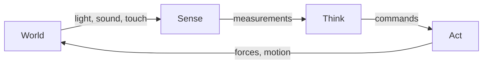
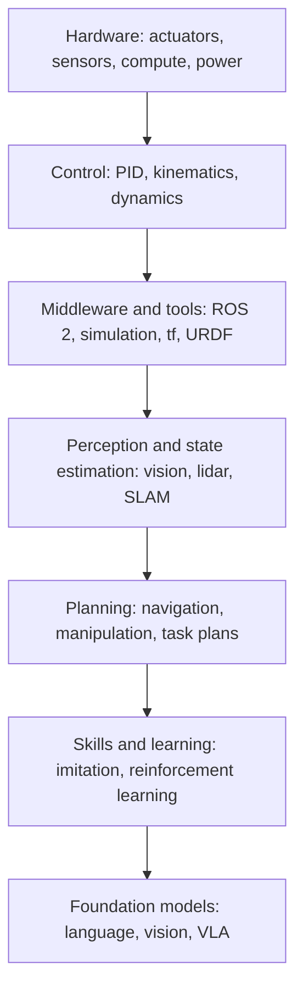

<LessonMeta level="Beginner" time="30 min" prereqs={["How this course works"]} />

ایک روبوٹ ویکیوم کرسی کی ٹانگ سے ٹکراتا ہے، پیچھے ہٹتا ہے، مڑتا ہے، اور دوبارہ کوشش کرتا ہے۔ ایک گودام کا بازو ایک ایسا ڈبہ اٹھاتا ہے جو اس نے پہلے کبھی نہیں دیکھا۔ ایک ہیومنائیڈ فرش پر پڑی کیبل کے اوپر سے قدم رکھتا ہے۔ یہ بظاہر بہت مختلف مشینیں لگتی ہیں، لیکن اندرونی طور پر یہ سب ایک ہی لوپ میں ایک ہی کام کر رہی ہیں۔ ایک بار جب آپ اس لوپ اور اس کے ارد گرد کی تہوں کو سمجھ لیتے ہیں، تو روبوٹکس کا ہر موضوع جو آپ بعد میں پڑھیں گے، اپنی صحیح جگہ پر فٹ ہو جاتا ہے۔

<Objectives>

- Physical AI اور مجسم ذہانت (embodied intelligence) کی اپنے الفاظ میں تعریف کریں۔
- sense، think، act لوپ کی وضاحت کریں اور ہر مرحلے کی ایک مثال دیں۔
- Physical AI اسٹیک کی تہوں کے نام بتائیں اور وضاحت کریں کہ ہر ایک کیا کرتی ہے۔
- وضاحت کریں کہ ہیومنائیڈ روبوٹس کہاں فٹ ہوتے ہیں اور وہ مشکل کیوں ہیں۔
- Kinemata کے ہر ماڈیول کو اسٹیک کی ایک تہہ کے ساتھ جوڑیں۔

</Objectives>

## Physical AI کیا ہے؟

زیادہ تر AI جو آپ نے استعمال کی ہے وہ سکرین پر رہتی ہے۔ ایک چیٹ باٹ ٹیکسٹ لیتا ہے اور ٹیکسٹ واپس کرتا ہے۔ ایک امیج ماڈل ایک پرامپٹ لیتا ہے اور ایک تصویر دیتا ہے۔ اگر یہ کوئی غلطی کرتا ہے، تو آپ غلطی پڑھتے ہیں اور دوبارہ کوشش کرتے ہیں۔

<Term def="Physical AI وہ مصنوعی ذہانت ہے جو کسی جسم (جیسے روبوٹ، گاڑی یا ڈرون) کے ذریعے حقیقی دنیا میں دیکھتی، سمجھتی اور عمل کرتی ہے۔">Physical AI</Term> جسم کے ساتھ AI ہے۔ یہ کیمروں، مائیکروفونز اور لمس کے ذریعے دنیا کو محسوس کرتی ہے، فیصلہ کرتی ہے کہ کیا کرنا ہے، اور موٹروں کے ذریعے عمل کرتی ہے۔ اس شعبے کو <Term def="مجسم ذہانت (Embodied intelligence) یہ خیال ہے کہ ذہانت کسی ماحول میں محسوس کرنے اور عمل کرنے والے جسم کے ہونے سے تشکیل پاتی ہے۔">embodied intelligence</Term> (مجسم ذہانت) بھی کہا جاتا ہے، کیونکہ جسم ذہانت کے کام کرنے کا ایک حصہ ہے، کوئی اضافی چیز نہیں۔

جسم مسئلے کے بارے میں ہر چیز بدل دیتا ہے:

- **دنیا جواب میں زور لگاتی ہے۔** کشش ثقل (gravity)، رگڑ (friction) اور ٹکراؤ اختیاری نہیں ہیں۔ ایک غلط حرکت کسی چیز کو توڑ سکتی ہے۔
- **احساس (Sensing) شور سے بھرا اور نامکمل ہوتا ہے۔** ایک کیمرہ کسی شے کا صرف ایک رخ دیکھتا ہے، lidar شیشے کو چھوڑ دیتا ہے، اور گیلی سطح پر پہیہ پھسل جاتا ہے۔
- **وقت مشکل ہے۔** ایک توازن برقرار رکھنے والے روبوٹ کے پاس ردعمل دینے کے لیے صرف چند ملی سیکنڈ ہوتے ہیں۔ جبکہ ایک چیٹ باٹ سیکنڈوں تک سوچ سکتا ہے۔
- **غلطیوں کی حقیقی قیمت ہوتی ہے۔** آپ گرنے والی پلیٹ پر undo کا بٹن نہیں دبا سکتے۔

یہ پابندیاں ہی وجہ ہیں کہ روبوٹکس کو دہائیاں لگ گئیں، اور اسی لیے مضبوط سکھائے گئے ماڈلز (learned models) کی حالیہ آمد اتنی پرجوش ہے۔ وہ مشکل مسائل جنہیں کبھی ہاتھ سے کوڈ (hand-code) کیا جاتا تھا، جیسے اشیاء کو پہچاننا یا "میرے لیے سرخ کپ لاؤ" کو سمجھنا، اب اتنے اچھے طریقے سے حل ہو چکے ہیں کہ انہیں حقیقی روبوٹس پر آزمایا جا سکے۔

## sense, think, act لوپ

ہر روبوٹ ایک ہی لوپ، بار بار، ایک سیکنڈ میں کئی بار چلاتا ہے۔

**Sense** دنیا کو اعداد و شمار میں بدلتا ہے: کیمرے کے پکسلز، lidar کے فاصلے، جوڑوں کے زاویے، موٹر کے کرنٹ، اور انرشیل سینسر کی ریڈنگ۔

**Think** اعداد و شمار کو فیصلے میں بدلتا ہے۔ اس میں اسٹیٹ کا تخمینہ (state estimation: میں کہاں ہوں، میرے ارد گرد کیا ہے)، منصوبہ بندی (planning: کون سا راستہ یا مراحل کا سلسلہ) اور کنٹرول (control: اس لمحے کتنا ٹارک چاہیے) شامل ہیں۔

**Act** فیصلے کو حرکت میں بدلتا ہے: موٹرز، گرپرز، پہیے۔

اس کے بعد دنیا بدل جاتی ہے، جزوی طور پر اس عمل کی وجہ سے، اور لوپ دوبارہ شروع ہوتا ہے۔ وہی فیڈ بیک (feedback) روبوٹکس کی بنیادی خصوصیت ہے۔ ایک روبوٹ اندھا دھند منصوبے پر عمل نہیں کرتا؛ وہ مسلسل حقیقت کو چیک کرتا ہے اور اصلاح کرتا ہے۔

<KeyIdea title="روبوٹ جسم کے ساتھ ایک فیڈ بیک لوپ ہے">
اگر آپ اس کورس سے ایک تصویر یاد رکھتے ہیں، تو اسے sense, think, act بنائیں۔ جب بھی کوئی موضوع الجھا ہوا لگے، پوچھیں: یہ لوپ کا کون سا حصہ ہے؟ کیمرہ ڈرائیور sensing ہے۔ پاتھ پلانر thinking ہے۔ موٹر کنٹرولر acting ہے۔ لوپ ایک ہی رہتا ہے چاہے روبوٹ ایک کھلونے والی گاڑی ہو یا ہیومنائیڈ۔
</KeyIdea>

### لوپس کے اندر لوپس

لوپ ایک ہی رفتار سے نہیں چلتا۔ ایک حقیقی روبوٹ کئی لوپس کو ایک دوسرے کے اندر طے کرتا ہے، اندر سے تیز اور باہر سے سست۔

| لوپ | عام رفتار | سوال جس کا یہ جواب دیتا ہے |
|---|---|---|
| Motor control | 1,000 Hz یا اس سے زیادہ | اس وقت اس موٹر کو کتنا کرنٹ دیا جائے؟ |
| Balance and joint control | 100 سے 1,000 Hz | کیا جسم سیدھا کھڑا ہے؟ |
| Perception | 10 سے 60 Hz | کیمرہ کیا دیکھ رہا ہے؟ |
| Motion planning | 1 سے 10 Hz | کون سا راستہ رکاوٹ سے بچاتا ہے؟ |
| Task and language planning | 0.1 سے 1 Hz | درخواست کو پورا کرنے کے لیے مجھے آگے کیا کرنا چاہیے؟ |

تیز لوپس کا سادہ اور قابل اعتماد ہونا ضروری ہے۔ سست لوپس مفصل اور لچکدار ہو سکتے ہیں۔ روبوٹ ڈیزائن کا ایک بڑا حصہ یہ فیصلہ کرنا ہے کہ کون سا مسئلہ کس لوپ سے تعلق رکھتا ہے۔

## Physical AI اسٹیک

روبوٹ کو تہوں (layers) کے طور پر سوچیں، ہر ایک نیچے والی تہہ پر بنی ہے۔

اسے نیچے سے پڑھیں۔

1. **Hardware.** موٹرز اور گیئر باکس، سینسرز، بیٹریاں، اور کمپیوٹر۔ اوپر موجود ہر چیز کو اس بات کا احترام کرنا ہوگا کہ ہارڈویئر جسمانی طور پر کیا کر سکتا ہے۔
2. **Control.** وہ سافٹ ویئر جو جوڑوں اور پہیوں کو آپ کی ہدایت کے مطابق چلاتا ہے، روبوٹ کی جیومیٹری (kinematics) اور اس کی فورسز (dynamics) کے ماڈلز، نیز PID جیسے فیڈ بیک کنٹرولرز کا استعمال کرتے ہوئے۔
3. **Middleware and tools.** وہ بنیادی نظام جو بہت سے پروگراموں کو ڈیٹا شیئر کرنے دیتا ہے: میسجز کے لیے **ROS 2**، کوآرڈینیٹ فریمز کے لیے **tf2**، روبوٹ کی وضاحت کے لیے **URDF**، اور محفوظ ٹیسٹنگ کے لیے **Gazebo** جیسے سمیلیٹرز۔
4. **Perception and state estimation.** خام سینسر ڈیٹا کو ایک قابل استعمال تصویر میں بدلنا: اشیاء کہاں ہیں، روبوٹ کہاں ہے، اور اسے اس پر کتنا یقین ہے۔
5. **Planning.** یہ فیصلہ کرنا کہ کیسے حرکت کرنی ہے: ٹکراؤ سے پاک راستہ تلاش کرنا، **Nav2** کے ساتھ کسی کمرے تک ڈرائیو کرنا، **MoveIt 2** کے ساتھ پہنچنا اور پکڑنا۔
6. **Skills and learning.** وہ رویے جو ہاتھ سے لکھنے کے بجائے سکھائے جاتے ہیں، مظاہروں سے (imitation learning) یا تجربے اور غلطی سے (reinforcement learning)۔
7. **Foundation models.** بڑے پہلے سے تربیت یافتہ ماڈلز جو زبان اور تصاویر کو سمجھتے ہیں اور انہیں اعمال سے جوڑ سکتے ہیں۔ یہ سب سے نئی تہہ ہے، اور سب سے تیز رفتاری سے آگے بڑھ رہی ہے۔

یہ تہیں ایک دوسرے سے بات کرتی ہیں۔ ایک فاؤنڈیشن ماڈل کہہ سکتا ہے "مگ اٹھاؤ"، ایک پلانر بازو کا راستہ تیار کرتا ہے، ایک کنٹرولر اس پر عمل کرتا ہے، اور سینسر رپورٹ کرتے ہیں کہ آیا یہ کام کر گیا۔

:::note[تہیں سخت اور غیر لچکدار نہیں ہیں]
جدید تحقیق ان حدود کو دھندلا دیتی ہے۔ ایک vision-language-action ماڈل کیمرے کے پکسلز اور ایک جملے سے براہ راست موٹر کمانڈز پر جا سکتا ہے، جس میں کئی تہیں بائی پاس ہو جاتی ہیں۔ آپ کو پھر بھی تہوں کو سمجھنے کی ضرورت ہے، کیونکہ اس طرح آپ اسے ڈیبگ کرتے ہیں اور یہ فیصلہ کرتے ہیں کہ آیا یہ محفوظ ہے یا نہیں۔
:::

## ہیومنائیڈز کہاں فٹ ہوتے ہیں

ایک <Term def="ہیومنائیڈ روبوٹ کا جسم تقریباً انسان جیسا ہوتا ہے: ایک دھڑ، دو بازو، دو ٹانگیں اور ایک سر۔">humanoid</Term> کسی مختلف قسم کی ذہانت کا نام نہیں ہے۔ یہ ایک ایسا روبوٹ ہے جو سخت حالات میں اسٹیک کی ہر تہہ کو ایک ساتھ استعمال کرتا ہے۔

آخر اسے بنایا ہی کیوں جائے؟ ہماری دنیا، سیڑھیوں سے لے کر دروازے کے ہینڈلز اور اوزاروں تک، انسانی جسم کے لیے ڈیزائن کی گئی ہے۔ ایک ہیومنائیڈ اصولاً ماحول کو دوبارہ بنائے بغیر اس میں کام کر سکتا ہے۔ مقصد یہ ہے کہ ایک عام جسم اور ایک عام دماغ مل کر بہت سے کام کر سکتے ہیں۔

یہ مشکل کیوں ہے؟

- **توازن (Balance)۔** ایک ہیومنائیڈ ایک لمبی، تنگ شے ہے جو دو چھوٹے پاؤں پر کھڑی ہے۔ یہ فطری طور پر غیر مستحکم ہے، اور اسے خود کو مسلسل درست کرتے رہنا چاہیے۔
- **بہت سے جوڑ (Many joints)۔** درجنوں جوڑ جنہیں ایک ساتھ حرکت کرنا ہوتی ہے: پورے جسم کا کنٹرول (whole-body control) ایک بڑا ہم آہنگی کا مسئلہ ہے۔
- **رابطہ (Contact)۔** چلنا اور پکڑنا ٹکراؤ اور رگڑ سے مل کر بنتے ہیں، جن کا ماڈل بنانا مشکل ہوتا ہے۔
- **ہاتھ (Hands)۔** انسان جیسی مہارت کے لیے بہت سے چھوٹے، مضبوط، اور حساس ایکچویٹرز کی ضرورت ہوتی ہے۔
- **حفاظت (Safety)۔** گرتا ہوا ہیومنائیڈ بھاری ہوتا ہے اور کسی کو زخمی کر سکتا ہے۔

اسی لیے Maude 08 کورس میں دیر سے آتا ہے۔ توازن، کنٹرول، پرسیپشن اور لرننگ سب اس میں شامل ہوتے ہیں، اور سب سے مشکل روبوٹ کو آزمانے سے پہلے آپ کو ان پر عبور حاصل ہونا چاہیے۔

## 11 ماڈیولز اسٹیک پر کیسے نقش ہوتے ہیں

| ماڈیول | تہہ (تہیں) جو یہ کور کرتا ہے |
|---|---|
| 00 · Start here | آپ کا ورک اسٹیشن اور یہ نقشہ |
| 01 · Foundations | ریاضی، کوڈ اور اوزار جو ہر تہہ استعمال کرتی ہے |
| 02 · Robot fundamentals | ہارڈویئر کی سمجھ، کنٹرول |
| 03 · ROS 2 | مڈل ویئر اور اوزار |
| 04 · Simulation | مڈل ویئر اور اوزار، ہر تہہ کی ٹیسٹنگ |
| 05 · Perception | پرسیپشن اور اسٹیٹ کا تخمینہ |
| 06 · Motion | منصوبہ بندی (Planning) |
| 07 · Robot learning | مہارتیں اور سکھانا (Skills and learning) |
| 08 · Humanoids | تمام تہیں، سب سے مشکل جسم پر لاگو |
| 09 · Foundation models | فاؤنڈ
