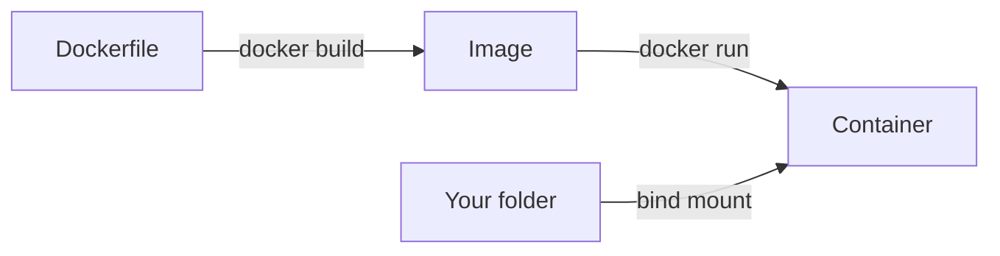

<LessonMeta level="Beginner" time="35 min" prereqs={["Workstation setup"]} />

آپ کے روبوٹ کے کمپیوٹر میں کوئی ماؤس، کوئی ڈیسک ٹاپ اور اکثر کوئی اسکرین نہیں ہوتی۔ آپ ٹرمینل کے ذریعے نیٹ ورک پر اس تک پہنچتے ہیں۔ جب کل کام کرنے والا کوڈ آج کام کرنا بند کر دیتا ہے، تو آپ کو بالکل ٹھیک معلوم ہونا چاہیے کہ کیا بدلا ہے۔ اور جب کوئی ساتھی کہتا ہے "یہ میری مشین پر چلتا ہے"، تو آپ کو اسے اپنی مشین پر چلانے کا ایک طریقہ درکار ہوتا ہے۔ شیل، Git اور Docker وہ طریقے ہیں جن سے پیشہ ورانہ روبوٹکس ٹیمیں ان تینوں مسائل کو حل کرتی ہیں، اور یہ اب آپ کے وقت کے ایک گھنٹے کے مستحق ہیں۔

<Objectives>

- فائل سسٹم میں نیویگیٹ کریں اور پائپ (pipes) اور ری ڈائریکشن (redirection) کے ساتھ کمانڈز کو ملا کر استعمال کریں۔
- ماحولیاتی متغیرات (environment variables) کو پڑھیں اور مرتب کریں، اور فائل کی اجازتوں (file permissions) کو سمجھیں۔
- بغیر کسی خطرے کے کام محفوظ کرنے، برانچ بنانے، مرج کرنے اور غلطیوں کو واپس لینے کے لیے Git کا استعمال کریں۔
- امیجز (images)، کنٹینرز (containers) اور والیومز (volumes) کی وضاحت کریں، اور ایک ROS 2 Jazzy کنٹینر چلائیں۔
- ایک چھوٹا شیل اسکرپٹ (shell script) لکھیں جو سیٹ اپ کا ایک قدم خودکار بناتا ہے۔

</Objectives>

## دس منٹ میں شیل

<Term def="شیل ایک ایسا پروگرام ہے جو آپ کے ٹائپ کردہ کمانڈز کو پڑھتا ہے اور انہیں چلاتا ہے؛ Ubuntu پر ڈیفالٹ bash ہے۔">شیل</Term> کمپیوٹر کے لیے ایک ٹیکسٹ انٹرفیس ہے۔ ایک کمانڈ پروگرام کا نام ہوتا ہے جس کے بعد آپشنز اور آرگومنٹس ہوتے ہیں۔ یہ وہ کمانڈز ہیں جنہیں آپ روزانہ استعمال کریں گے۔

| Command | What it does |
|---|---|
| `pwd` | موجودہ ڈائریکٹری کا پرنٹ لیں |
| `ls -la` | تفصیلات کے ساتھ پوشیدہ فائلوں سمیت تمام فائلوں کی فہرست بنائیں |
| `cd path` | ڈائریکٹری تبدیل کریں (`cd ..` اوپر جاتا ہے، `cd ~` ہوم ڈائریکٹری میں جاتا ہے) |
| `mkdir -p a/b` | ایک ڈائریکٹری اور تمام پیرنٹ ڈائریکٹریز بنائیں |
| `cp a b` / `mv a b` | کاپی کریں / منتقل کریں یا نام تبدیل کریں |
| `rm file` / `rm -r dir` | حذف کریں (کوئی ریسائیکل بن نہیں ہے: محتاط رہیں) |
| `cat file` / `less file` | فائل دکھائیں / صفحہ بہ صفحہ دیکھیں |
| `grep -rn "text" .` | فائلوں میں متن تلاش کریں، ریکرسیو انداز میں |
| `find . -name "*.py"` | نام کے ذریعے فائلیں تلاش کریں |
| `man ls` or `ls --help` | رہنما ہدایت نامہ (manual) پڑھیں |

دو خصوصیات شیل کو طاقتور بناتی ہیں۔ ایک **پائپ** (`|`) ایک کمانڈ کے آؤٹ پٹ کو دوسرے کی ان پٹ بناتا ہے، اور **ری ڈائریکشن** (`>`, `>>`) آؤٹ پٹ کو فائل میں بھیجتا ہے۔

```bash title="terminal"
# Count how many Python files are in this project
find . -name "*.py" | wc -l

# Find every line mentioning "lidar", save the results
grep -rn "lidar" . > lidar_mentions.txt

# Append a timestamped note to a log
echo "$(date) calibrated camera" >> notes.log
```

اوپر والا تیر کا بٹن دبانے سے پچھلے کمانڈز یاد آتے ہیں، Tab ناموں کو مکمل کرتا ہے، اور Ctrl+C چلتے ہوئے پروگرام کو روکتا ہے۔ ان تینوں کو سیکھیں اور آپ دگنی رفتار سے کام کریں گے۔

:::tip[کبھی بھی ایسا کمانڈ کاپی نہ کریں جسے آپ نہیں سمجھتے]
انٹرنیٹ سے کوئی کمانڈ پیسٹ کرنے سے پہلے، خاص طور پر `sudo`، `rm` یا `curl ... | bash` والا، اسے پڑھیں۔ اگر آپ وضاحت نہیں کر سکتے کہ یہ کیا کرتا ہے، تو Rivet سے پوچھیں یا `man` کے ساتھ تلاش کریں۔ روٹ (root) کے طور پر چلائی گئی ایک غلط کمانڈ آپ کے سسٹم کو خراب کر سکتی ہے۔
:::

## ماحولیاتی متغیرات، PATH اور اجازتیں

ایک <Term def="ایک ماحولیاتی متغیر (environment variable) ایک نامزد قیمت ہے، جیسے PATH یا ROS_DISTRO، جسے شیل اپنے شروع کردہ ہر پروگرام تک پہنچاتا ہے۔">ماحولیاتی متغیر</Term> ایک نامزد سیٹنگ ہے۔ آپ نے پہلے `ROS_DISTRO` دیکھا تھا۔ دو اہم متغیرات:

- `PATH` ان فولڈرز کی فہرست ہے جنہیں شیل تلاش کرتا ہے جب آپ کوئی کمانڈ ٹائپ کرتے ہیں۔ اسی لیے `source /opt/ros/jazzy/setup.bash` سے `ros2` کام کرتا ہے: یہ `PATH` میں فولڈرز شامل کرتا ہے۔
- `ROS_DOMAIN_ID` روبوٹ نیٹ ورکس کو الگ کرتا ہے۔

```bash title="terminal"
echo $PATH                    # show it
export MY_ROBOT=kinemata1      # set it for this shell and its children
printenv MY_ROBOT             # kinemata1
```

`export` کے ساتھ سیٹ کیا گیا متغیر ٹرمینل بند کرنے پر غائب ہو جاتا ہے۔ اسے برقرار رکھنے کے لیے، وہ لائن `~/.bashrc` میں شامل کریں، جو ہر نئے ٹرمینل کے لیے چلتی ہے۔

**اجازتیں (Permissions)** یہ طے کرتی ہیں کہ کون فائل کو پڑھ، لکھ یا چلا سکتا ہے۔ `ls -l` کے ساتھ ان کی فہرست دیکھیں۔ `-rwxr-xr-x` جیسی لائن کا مطلب ہے کہ مالکان پڑھ، لکھ اور چلا سکتے ہیں، اور دیگر پڑھ اور چلا سکتے ہیں۔ اسکرپٹ کو چلانے کے قابل بنانے کے لیے:

```bash title="terminal"
chmod +x setup.sh
./setup.sh
```

`sudo` (ایڈمنسٹریٹر کے طور پر چلائیں) صرف تبھی استعمال کریں جب کسی کمانڈ کو واقعی اس کی ضرورت ہو، جیسے `apt install`۔ `sudo` کے ساتھ اپنا کوڈ چلانے سے root کی ملکیت والی فائلیں بن جاتی ہیں جو بعد میں الجھن کا باعث بنتی ہیں۔

### پروسیس اور پیکجز

`ps aux | grep python` چلتے ہوئے پروگراموں کی فہرست بناتا ہے۔ `top` لائیو استعمال دکھاتا ہے، اور `kill PID` نمبر کے ذریعے پروسیس کو روکتا ہے۔ سافٹ ویئر انسٹال کرنے کے لیے، `sudo apt install name` پیکج حاصل کرتا ہے، اور `apt search word` اسے تلاش کرتا ہے۔ آپ نے پچھلے سبق میں یہ کیا تھا۔

## Git: آپ کے کوڈ کے لیے ایک ٹائم مشین

<Term def="Git ایک ورژن کنٹرول سسٹم ہے: یہ آپ کے پروجیکٹ کے اسنیپ شاٹس ریکارڈ کرتا ہے تاکہ آپ دیکھ سکیں کہ کیا بدلا ہے، پہلے والی حالت میں واپس جا سکیں، اور متوازی طور پر کئی ورژنز پر کام کر سکیں۔">Git</Term> آپ کے پروجیکٹ کے اسنیپ شاٹس کو ریکارڈ کرتا ہے، جنہیں **commits** کہا جاتا ہے۔ ہر کمٹ کے ساتھ ایک پیغام ہوتا ہے جس میں بتایا جاتا ہے کہ آپ نے تبدیلی کیوں کی۔ کچھ بھی ضائع نہیں ہوتا: آپ ہمیشہ واپس جا سکتے ہیں۔

<KeyIdea title="کمٹ چھوٹے کریں، بار بار کریں، اور وجہ بتائیں">
ایک کمٹ ایک سیو پوائنٹ (save point) ہے جس پر آپ واپس جا سکتے ہیں۔ ہر کام کرنے والے قدم کے بعد ایک کمٹ بنائیں، ایک ایسے پیغام کے ساتھ جو بتائے کہ کیا اور کیوں بدلا، جیسے "معکوس تبدیلی (inverse transform) شامل کی اور ٹیسٹ کیا"۔ جب ایک تبدیلی کے بعد روبوٹ خراب ہوتا ہے، تو ایک صاف ہسٹری آپ کو گھنٹوں کے بجائے منٹوں میں غلط کمٹ تلاش کرنے دیتی ہے۔
</KeyIdea>

بنیادی لوپ میں چار کمانڈز ہیں:

```bash title="terminal"
git init                       # start tracking this folder (once)
git status                     # what has changed?
git add transforms.py          # stage a file for the next commit
git commit -m "Add transform helpers"   # save the snapshot
git log --oneline              # show the history
```

`git add` کے ساتھ اسٹیجنگ کرنے سے آپ کو یہ منتخب کرنے کی اجازت ملتی ہے کہ ہر کمٹ میں کیا جاتا ہے۔ `git diff` وہ تبدیلیاں دکھاتا ہے جو آپ نے ابھی تک اسٹیج نہیں کی ہیں۔

### برانچز (Branches)

ایک **برانچ** کام کی ایک الگ لائن ہے۔ آپ اپنے کام کرنے والے کوڈ کو خطرے میں ڈالے بغیر کسی خیال کو آزمانے کے لیے برانچز کا استعمال کرتے ہیں۔

```bash title="terminal"
git switch -c try-kalman-filter     # create and move to a new branch
# ...edit, add, commit...
git switch main                     # go back
git merge try-kalman-filter         # bring the work in
git branch -d try-kalman-filter     # tidy up
```

اگر دو برانچز انہی لائنوں کو تبدیل کرتی ہیں، تو Git رک جاتا ہے اور آپ سے **تنازعہ (conflict)** حل کرنے کو کہتا ہے: یہ فائل میں دونوں ورژنز کی نشاندہی کرتا ہے، آپ اپنی مرضی کے مطابق ترمیم کرتے ہیں، پھر `git add` اور `git commit` کرتے ہیں۔

### چیزیں کالعدم کرنا (Undoing)

غلطیاں ہوتی ہیں۔ باہر نکلنے کے محفوظ طریقے یہ ہیں:

| Situation | Command |
|---|---|
| ایک فائل میں تبدیلیاں مسترد کریں | `git restore file.py` |
| فائل کو ان اسٹیج (unstage) کریں | `git restore --staged file.py` |
| کمٹ منسوخ کریں لیکن نیا کمٹ ہسٹری میں رکھیں | `git revert <commit>` |
| پرانا ورژن دیکھیں | `git show <commit>:file.py` |

ہسٹری کو دوبارہ لکھنے والی کمانڈز کے ساتھ محتاط رہیں، جیسے `git reset --hard` اور `git push --force`۔ وہ کام کو تباہ کر سکتی ہیں۔

### ریموٹ اور کیا کمٹ نہیں کرنا چاہیے

ایک **ریموٹ** جیسے GitHub سرور پر آپ کی ریپوزٹری کی ایک کاپی ہے۔ ایک بار `git remote add origin URL` استعمال کریں، پھر `git push` اور `git pull` کریں۔ ایک `.gitignore` فائل بنائیں جس میں ان چیزوں کی فہرست ہو جنہیں Git کو نظر انداز کرنا چاہیے:

```text title=".gitignore"
__pycache__/
*.pyc
.venv/
build/
install/
log/
*.bag
.env
```

پاس ورڈز یا API کیز جیسے راز کبھی بھی کمٹ نہ کریں، اور بڑی جنریٹ شدہ فائلز (ROS 2 `build/`, `install/`, `log/`, اور ریکارڈ شدہ ڈیٹا) کو ریپوزٹری سے باہر رکھیں۔

## Docker: ہر جگہ ایک جیسا ماحول

ایک روبوٹکس پروجیکٹ آپریٹنگ سسٹم، ROS 2، لائبریریوں اور ان کے صحیح ورژنز پر انحصار کرتا ہے۔ <Term def="Docker ایک ایپلی کیشن کو اس کی آپریٹنگ سسٹم فائلوں اور انحصاروں (dependencies) کے ساتھ ایک امیج میں بنڈل کرتا ہے، جو ایک الگ تھلگ کنٹینر کے طور پر چلتا ہے۔">Docker</Term> آپ کو اس تمام کو بنڈل کرنے دیتا ہے، تاکہ آپ کے کنٹینر میں چلنے والا پروجیکٹ آپ کے ساتھی کے کنٹینر، سرور، یا روبوٹ پر بھی چلے۔

جاننے کے لیے تین الفاظ:

- ایک **امیج (image)** ایک منجمد ہدایت نامہ ہے: فائلیں اور انہیں چلانے کے لیے سیٹنگز۔
- ایک **کنٹینر (container)** کسی امیج کا چلتا ہوا واقعہ (running instance) ہے۔ آپ آزادانہ طور پر کنٹینرز شروع اور ختم کر سکتے ہیں۔
- ایک **والیوم (volume)** یا بائنڈ ماؤنٹ آپ کے کمپیوٹر اور کنٹینر کے درمیان ایک فولڈر کا اشتراک کرتا ہے، تاکہ کنٹینر ختم ہونے کے بعد بھی کام محفوظ رہے۔



Ubuntu کے لیے docs.docker.com پر سرکاری گائیڈ پر عمل کرتے ہوئے Docker انسٹال کریں (وہاں موجود موجودہ ہدایات پر عمل کریں)، پھر ایک آفیشل ROS 2 Jazzy امیج آزمائیں:

```bash title="terminal"
docker run --rm -it ros:jazzy
# inside the container:
ros2 --help
exit
```

`--rm` نکلنے پر کنٹینر کو حذف کر دیتا ہے، اور `-it` آپ کو ایک تفاعلی (interactive) ٹرمینل دیتا ہے۔ اپنے پروجیکٹ فولڈر کا اشتراک کرنے کے لیے:

```bash title="terminal"
docker run --rm -it -v "$PWD":/work -w /work ros:jazzy bash
```

یہاں `-v` موجودہ فولڈر کو `/work` پر ماؤنٹ کرتا ہے اور `-w` آپ کو اس میں شروع کرتا ہے۔ آپ وہاں جو فائلیں بناتے ہیں وہ آپ کے کمپیوٹر پر رہتی ہیں۔

اپنی امیج بنانے کے لیے، ایک `Dockerfile` لکھیں:

```dockerfile title="Dockerfile"
FROM ros:jazzy
RUN apt-get update && apt-get install -y python3-numpy && rm -rf /var/lib/apt/lists/*
WORKDIR /work
CMD ["bash"]
```

اسے بنائیں اور چلائیں:

```bash title="terminal"
docker build -t kinemata-dev .
docker run --rm -it -v "$PWD":/work kinemata-dev
```

:::note[کنٹینرز اور گرافکس]
کنٹینر سے Gazebo یا RViz چلانے کے لیے اضافی ڈسپلے سیٹنگز کی ضرورت ہوتی ہے۔ ہم سمیلیشن ماڈیول میں اس کی طرف لوٹیں گے۔ فی الحال، کنٹینرز کمانڈ لائن ورک اور قابلِ دوبارہ تخلیق بلڈز کے لیے ہیں۔
:::

## ایک چھوٹا اسکرپٹ جو سب کو جوڑتا ہے

ایک <Term def="شیل اسکرپٹ کمانڈز کی ایک ٹیکسٹ فائل ہے جسے شیل ترتیب سے چلاتا ہے، تاکہ ملٹی اسٹیپ کام ایک کمانڈ بن جائے۔">شیل اسکرپٹ</Term> ایک روٹین کو ایک کمانڈ میں بدل دیتا ہے۔ یہ اسکرپٹ روبوٹکس ورک اسٹیشن کے لیے ایک تیز سیلف ہیلتھ رپورٹ پرنٹ کرتا ہے:

```bash title="check_env.sh"
#!/usr/bin/env bash
set -e   # stop at the first error

echo "OS:       $(lsb_release -ds)"
echo "Python:   $(python3 --version)"
echo "Git:      $(git --version)"

if command -v ros2 >/dev/null 2>&1; then
  echo "ROS 2:    ${ROS_DISTRO:-not sourced}"
else
  echo "ROS 2:    not found (did you source setup.bash?)"
fi

if command -v docker >/dev/null 2>&1; then
  echo "Docker:   $(docker --version)"
else
  echo "Docker:   not installed"
fi
```

`chmod +x check_env.sh` کے ساتھ اسے قابلِ عمل بنائیں اور `./check_env.sh` چلائیں۔ پہلی لائن، **shebang**، بتاتی ہے کہ کون سا پروگرام فائل چلاتا ہے۔ `set -e` اسکرپٹ کو پہلے ناکام قدم پر روک دیتا ہے، جو غلطیوں کو خاموشی سے جمع ہونے سے روکتا ہے۔

## عملی لیب (Hands-on lab)

آپ اسکرپٹ کے ساتھ ایک ورژن شدہ ورک اسپیس بنائیں گے اور ایک ROS 2 کنٹینر چلائیں گے۔

<Steps>

1. `kinemata-workspace` میں، اوپر والے اسکرپٹ کے ساتھ `tools/check_env.sh` بنائیں، اسے قابلِ عمل بنائیں، اور اسے چلائیں۔ جو بھی چیزیں غائب بتائی گئی ہیں انہیں ٹھیک کریں۔
2. اوپر دیے گئے اندراجات کے ساتھ ایک `.gitignore` بنائیں اور اسے کمٹ کریں۔
3. `git switch -c add-tools` کے ساتھ ایک برانچ بنائیں، اس برانچ پر اسکرپٹ کو کمٹ کریں، پھر `git switch main` اور `git merge add-tools` کے ساتھ اسے `main` میں مرج کریں۔
4. `git log --oneline` چلائیں اور تصدیق کریں کہ آپ کو اس ماڈیول سے کم از کم تین کمٹ نظر آ رہے ہیں۔
5. Docker انسٹال کریں (سرکاری گائیڈ پر عمل کرتے ہوئے)، پھر `docker run --rm -it ros:jazzy` چلائیں۔ اندر، `ros2 --help` اور پھر `exit` چلائیں۔
6. اپنے فولڈر کے ساتھ کنٹینر کو ماؤنٹ کرکے چلائیں، `/work` کے اندر `from_container.txt` نامی فائل بنائیں، باہر نکلیں، اور `ls` کے ساتھ تصدیق کریں کہ فائل آپ کے ہوسٹ پر موجود ہے۔
7. جائزہ: `git log --oneline` چند واضح کمٹ میسجز دکھاتا ہے، `check_env.sh` آپ کے ورژنز رپورٹ کرتا ہے، اور `from_container.txt` آپ کے فولڈر میں موجود ہے۔

</Steps>

## مشقیں

<Exercise title="پائپ کا استعمال" level="Beginner">
ایک ایسی کمانڈ لکھیں جو موجودہ ڈائریکٹری ٹری میں پانچ سب سے بڑی فائلیں دکھائے۔

<Solution>
```bash
find . -type f -printf "%s %p\n" | sort -nr | head -5
```
`find` ہر فائل کو اس کے سائز کے ساتھ پرنٹ کرتا ہے، `sort -nr` سب سے بڑے کو پہلے رکھتے ہوئے عددی ترتیب دیتا ہے، اور `head -5` پانچ لائنیں رکھتا ہے۔ ہر حصہ ایک کام کرتا ہے اور پائپ انہیں جوڑتا ہے۔
</Solution>
</Exercise>

<Exercise title="حذف شدہ فائل کی بحالی" level="Intermediate">
آپ نے `notes.md` کمٹ کی، پھر غلطی سے `rm notes.md` چلا دیا۔ آپ انٹرنیٹ پر تلاش کیے بغیر اسے واپس کیسے حاصل کریں گے؟

<Solution>
`git restore notes.md` چلائیں۔ Git آخری کمٹ سے فائل کو کاپی واپس کرتا ہے۔ اگر حذف کرنا پہلے ہی کمٹ ہو چکا تھا، تو `git log --oneline -- notes.md` کے ساتھ کمٹ تلاش کریں اور اس سے پچھلے والے سے `git restore --source=<commit>~1 notes.md` کے ساتھ بحال کریں۔ یہی وجہ ہے کہ آپ بار بار کمٹ کرتے ہیں۔
</Solution>
</Exercise>

<Exercise title="بائنڈ ماؤنٹ کیوں؟" level="Intermediate">
آپ `docker run --rm -it ros:jazzy` چلاتے ہیں، اندر کوڈ لکھتے ہیں، اور باہر نکلتے ہیں۔ آپ کا کوڈ غائب ہو گیا ہے۔ وضاحت کریں کہ ایسا کیوں ہوا اور اس کا حل دیں۔

<Solution>
`--rm` فلیگ کنٹینر کو حذف کر دیتا ہے، اور کنٹینر کے اپنے فائل سسٹم کے اندر لکھی گئی فائلیں اس کے ساتھ ہی ختم ہو جاتی ہیں۔ اپنے کمپیوٹر سے `-v "$PWD":/work` کے ساتھ ایک فولڈر ماؤنٹ کریں، اور `/work` کے اندر لکھیں۔ وہ فائلیں آپ کے ہوسٹ پر رہیں گی اور کنٹینر ہٹانے کے بعد بھی محفوظ رہیں گی۔
</Solution>
</Exercise>

## اپنی سمجھ کی جانچ کریں

<Quiz questions={[
  {q: "find . -name \"*.py\" | wc -l میں پائپ (pipe) کیا کرتا ہے؟", options: ["آؤٹ پٹ کو فائل میں محفوظ کرتا ہے", "find کے آؤٹ پٹ کو wc کی ان پٹ بناتا ہے", "مختلف مشینوں پر ایک ہی وقت میں دو کمانڈز چلاتا ہے", "فائلوں کو حذف کرتا ہے"], answer: 1, explain: "پائپ ایک پروگرام کے آؤٹ پٹ کو اگلے پروگرام کی ان پٹ سے جوڑتا ہے، تاکہ wc ان لائنوں کو گن سکے جو find نے پیش کی ہیں۔"},
  {q: "ROS setup اسکرپٹ کو سورس کرنے سے ros2 کیوں دستیاب ہوتا ہے؟", options: ["یہ ROS انسٹال کرتا ہے", "یہ PATH میں ROS فولڈرز شامل کرتا ہے اور موجودہ شیل میں دیگر متغیرات سیٹ کرتا ہے", "یہ ایک ROS نوڈ شروع کرتا ہے", "یہ فائل کی اجازتیں تبدیل کرتا ہے"], answer: 1, explain: "سورسنگ موجودہ شیل کے لیے PATH جیسے ماحولیاتی متغیرات سیٹ کرتی ہے، تاکہ شیل ROS پروگرام تلاش کر سکے۔"},
  {q: "چھوٹے اور بار بار کمٹ کرنے کی اہم وجہ کیا ہے؟", options: ["Git کو اس کی ضرورت ہے", "ہر کمٹ ایک سیو پوائنٹ ہے، تاکہ آپ کسی خراب تبدیلی کو تیزی سے تلاش کر کے منسوخ کر سکیں", "یہ فائلوں کو چھوٹا بناتا ہے", "یہ آپ کی تبدیلیوں کو چھپاتا ہے"], answer: 1, explain: "واضح پیغامات کے ساتھ چھوٹے کمٹ ایک درست ہسٹری دیتے ہیں، جس سے کسی مسئلے کو تلاش کرنا اور واپس لینا تیز ہو جاتا ہے۔"},
  {q: "Docker امیج اور کنٹینر میں کیا فرق ہے؟", options: ["وہ ایک ہی چیز ہیں", "ایک امیج ایک منجمد ہدایت نامہ ہے اور کنٹینر اس کا چلتا ہوا واقعہ ہے", "ایک کنٹینر ایک ہدایت نامہ ہے اور ایک امیج چل رہی ہے", "ایک امیج آپ کے ہوسٹ پر ایک فولڈر ہے"], answer: 1, explain: "آپ ایک بار ایک امیج بناتے ہیں اور اس سے کئی قابلِ تلف (disposable) کنٹینرز شروع کر سکتے ہیں۔"}
]} />

<Takeaways>

- شیل پائپس اور ری ڈائریکشن کے ساتھ چھوٹی کمانڈز کو جوڑتا ہے، اور PATH یہ طے کرتا ہے کہ وہ کون سے پروگرام تلاش کر سکتا ہے۔
- sudo کا استعمال احتیاط سے کریں، اور وہ کمانڈز پیسٹ نہ کریں جن کی آپ وضاحت نہیں کر سکتے۔
- Git کمٹس سیو پوائنٹس ہیں: کمٹ چھوٹے کریں، وجہ لکھیں، اور محفوظ طریقے سے تجربات کرنے کے لیے برانچز کا استعمال کریں۔
- رازوں اور جنریٹ شدہ فائلوں جیسے بلڈ فولڈرز کو .gitignore کے ساتھ Git سے باہر رکھیں۔
- Docker ایک ماحول کو ایک امیج میں بنڈل کرتا ہے جو قابلِ تلف کنٹینرز کے طور پر چلتا ہے۔
- اپنے پروجیکٹ فولڈر کو بائنڈ ماؤنٹ کریں تاکہ آپ کا کام کنٹینر کے بعد بھی محفوظ رہے۔

</Takeaways>

## مزید گہرائی میں جائیں

- [Pro Git، کتاب](https://git-scm.com/book/en/v2): مفت اور مکمل، جس کے پہلے تین ابواب اس کورس کے لیے کافی ہیں۔
- [Linux کمانڈ لائن (linuxcommand.org)](https://linuxcommand.org/tlcl.php): شیل پر ایک مفت ابتدائی کتاب۔
- [Docker شروع کریں](https://docs.docker.com/get-started/): امیجز اور کنٹینرز کا سرکاری گائیڈ۔
- [Docker Hub پر سرکاری ROS امیجز](https://hub.docker.com/_/ros): اس سبق میں استعمال ہونے والی `ros:jazzy` امیج کا صفحہ۔

آگے: [روبوٹ کی اناٹومی (Anatomy of a robot)](../02-robot-fundamentals/01-anatomy-of-a-robot.mdx)
