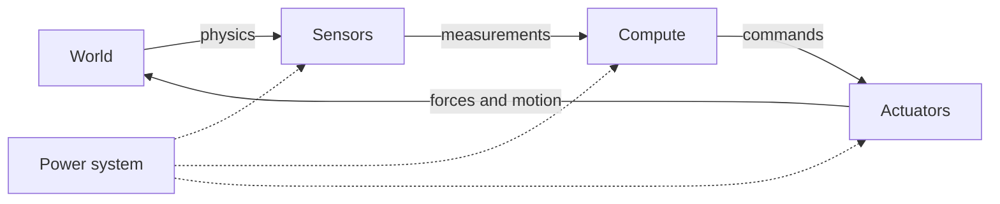

<LessonMeta level="Beginner" time="30 min" prereqs={["Python basics", "High-school physics"]} />

راہداری میں چلتے ہوئے ایک چھوٹے ڈلیوری روبوٹ کا تصور کریں۔ اچانک ایک شخص دروازے سے باہر آتا ہے۔ ایک سیکنڈ کے چھوٹے سے حصے میں روبوٹ کو انہیں دیکھنا، بریک لگانے کا فیصلہ کرنا، اور اپنے کمپیوٹر کو بند کیے بغیر پہیوں کی پاور کاٹنی ہوتی ہے۔ اس ایک ہموار رکاوٹ کے پیچھے پرزوں کی ایک پوری زنجیر کام کر رہی ہوتی ہے: کوئی چیز جو محسوس کرتی ہے، کوئی چیز جو سوچتی ہے، کوئی چیز جو حرکت کرتی ہے، اور کوئی چیز جو ان سب کو طاقت فراہم کرتی ہے۔ یہ سبق آپ کو اس زنجیر کا نقشہ فراہم کرتا ہے، تاکہ بعد کے ہر سبق کو جوڑنے کے لیے ایک بنیاد مل سکے۔

<Objectives>

- روبوٹ کے چار ذیلی نظاموں (sensing، compute، actuation، power) کے نام بتائیں اور وضاحت کریں کہ ہر ایک کیا کام کرتا ہے۔
- Proprioceptive اور exteroceptive سینسرز کے درمیان فرق واضح کریں اور ہر ایک کی دو مثالیں دیں۔
- Sense-think-act لوپ میں سگنل کا راستہ ٹریس کریں اور بتائیں کہ تاخیر (delay) اور شور (noise) کہاں داخل ہوتے ہیں۔
- ایک چھوٹے موبائل روبوٹ کے لیے ایک تخمینی پاور بجٹ اور ڈیٹا ریٹ بجٹ کا حساب لگائیں۔

</Objectives>

## روبوٹ ایک لوپ ہے، صرف ایک مشین نہیں

دھات کو الگ کر دیں تو روبوٹ ایک ہی خیال کا تکرار ہے: **محسوس کرنا، سوچنا، عمل کرنا (sense, think, act)**۔ یہ دنیا کی پیمائش کرتا ہے، فیصلہ کرتا ہے کہ کیا کرنا ہے، دنیا پر زور لگاتا ہے، اور پھر دوبارہ پیمائش کرتا ہے تاکہ دیکھے کہ کیا ہوا۔ دنیا بدلتی رہتی ہے، اس لیے یہ لوپ کبھی نہیں رکتا۔

چار فزیکل ذیلی نظام اس لوپ کو حقیقی بناتے ہیں:

1. **Sensors** فزیکل دنیا کو نمبرز (numbers) میں بدلتے ہیں۔
2. **Compute** نمبرز کو فیصلوں میں بدلتا ہے۔
3. **Actuators** فیصلوں کو قوت (forces) میں بدلتے ہیں۔
4. **Power** باقی تینوں کو زندہ رکھتی ہے۔

روبوٹکس میں ہر چیز، لائن کی پیروی کرنے والے کھلونے سے لے کر ایک انسان نما (humanoid) روبوٹ تک، اس سوال کا ایک مختلف جواب ہے: "کون سے پرزے، اور انہیں آپس میں کیسے جوڑا گیا ہے؟"

<KeyIdea title="لوپ ہی روبوٹ ہے">
روبوٹ کی تعریف اس کے جسم سے نہیں ہوتی۔ اس کی تعریف ایک بند لوپ (closed loop) سے ہوتی ہے: پیمائش کریں، فیصلہ کریں، عمل کریں، تکرار کریں۔ سست یا نویزی (noisy) لوپ والا بہترین جسم بھی خراب رفتار دکھاتا ہے۔ جبکہ ایک تیز، صاف ستھرے لوپ والا معمولی جسم بھی جاگوئی اثر دکھا سکتا ہے۔
</KeyIdea>

## Sensors: روبوٹ چیزوں کو کیسے جانتا ہے

ایک <Term def="ایک ایسا آلہ جو فزیکل مقدار جیسے روشنی، حرکت یا قوت کو الیکٹریکل سگنل میں تبدیل کرتا ہے">sensor</Term> آپ کو کبھی بھی "حتمی سچائی" نہیں دیتا۔ یہ آپ کو ایک ایسا نمبر دیتا ہے جو سچائی سے متعلق ہوتا ہے، ب
