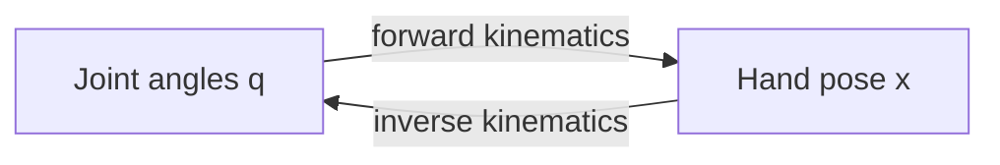

<LessonMeta level="Intermediate" time="45 min" prereqs={["Frames and rigid transforms", "NumPy", "Basic calculus (derivatives)"]} />

آپ ایک روبوٹک بازو (robot arm) سے کہتے ہیں "گریپر کو کپ پر رکھو"۔ بازو خلا میں جگہ یا پوزیشنوں کو نہیں سمجھتا؛ اس کے موٹر صرف جوڑوں کے زاویوں (joint angles) کو سمجھتے ہیں۔ جوڑوں کے زاویوں کے فارمولے کو ہاتھ کی پوزیشن میں بدلنا آسان ہے۔ لیکن ہاتھ کی مطلوبہ پوزیشن کو جوڑوں کے زاویوں میں بدلنا اصل کام ہے، اور اسے Inverse Kinematics (معکوس کائنیومیٹکس) کہا جاتا ہے۔ ہر pick-and-place، انسانی نما روبوٹ (humanoid) کا ہر قدم اور ہر اینیمیٹڈ کردار اسی پر انحصار کرتا ہے۔

<Objectives>

- Forward kinematics، Jacobian اور inverse kinematics کی تعریف کریں اور بتائیں کہ ان کا آپس میں کیا تعلق ہے۔
- 2-link planar arm کے لیے forward kinematics کا حساب لگائیں اور 6-DOF بازوؤں کے لیے DH اور product-of-exponentials کے پیچھے موجود تصور کو بیان کریں۔
- 2-link بازو کے تحلیلی (analytic) inverse kinematics کا حساب لگائیں اور کوڈ لکھیں، بشمول اس کے دو حل۔
- Jacobian بنائیں اور NumPy میں عددی طور پر (numerically) IK حل کرنے کے لیے damped least squares کا استعمال کریں۔
- Singularities کو پہچانیں اور وضاحت کریں کہ ان کے قریب damping کیوں مدد کرتی ہے۔

</Objectives>

## کائنیومیٹکس: فورسز کے بغیر حرکت

<Term def="the study of motion by geometry alone, ignoring the forces and masses that cause it">Kinematics</Term> (کائنیومیٹکس) صرف یہ پوچھتا ہے کہ "ہر چیز کہاں ہے؟"، یہ کبھی نہیں پوچھتا کہ "کس فورس کی ضرورت ہے؟"۔ دو سوالات اس شعبے کی وضاحت کرتے ہیں:

- **Forward kinematics (FK):** جوڑوں کی قیمتیں $q$ دیے جانے پر، end effector (ہاتھ یا ٹول) کہاں ہے؟ اس کا ہمیشہ صرف ایک ہی جواب ہوتا ہے۔
- **Inverse kinematics (IK):** ہاتھ کی مطلوبہ حالت (pose) دیے جانے پر، جوڑوں کی کون سی قیمتیں $q$ اسے حاصل کرتی ہیں؟ اس کے صفر، ایک، متعدد یا لاپتہ (غیر محدود) جوابات ہو سکتے ہیں۔

ایک <Term def="the number of independent motions a mechanism can make; for a serial arm it usually equals the number of joints">degree of freedom (DOF)</Term> حرکت کرنے کا ایک آزاد طریقہ ہے۔ ایک پلینر 2-link بازو میں 2 DOF ہوتے ہیں۔ ایک عام صنعتی بازو میں 6 ہوتے ہیں، جو 3D میں ہاتھ کو کسی بھی پوزیشن اور سمت میں رکھنے کے لیے کم از کم ضروری ہیں۔

## 2-link بازو کی Forward kinematics

لمبائی $l_1$ اور $l_2$ کے دو سخت لنک (rigid links) ایک پلین میں گھومتے ہیں۔ جوڑ 1 (Joint 1) لنک 1 کو $x$-محور سے $q_1$ گھماتا ہے۔ جوڑ 2 (Joint 2) لنک 2 کو لنک 1 کے لحاظ سے $q_2$ گھماتا ہے۔ ہاتھ کی پوزیشن دونوں لنک ویکٹرز کا مجموعہ ہے:

$$x = l_1\cos q_1 + l_2\cos(q_1+q_2), \qquad y = l_1\sin q_1 + l_2\sin(q_1+q_2)$$

یہ forward kinematics ہے۔ توجہ دیں کہ لنک 2 کا مطلق زاویہ (absolute angle) $q_1 + q_2$ ہے: پ
