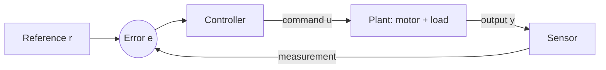

<LessonMeta level="Intermediate" time="45 min" prereqs={["Dynamics essentials", "Python and NumPy", "Basic calculus"]} />

آپ ایک روبوٹ آرم کو 1 ریڈین (radian) پر منتقل ہونے کا حکم دیتے ہیں۔ یہ اوور شوٹ (overshoot) کر کے 1.2 پر چلا جاتا ہے، واپس 0.9 پر جھولتا ہے، اور سیٹل ہونے سے پہلے چند سیکنڈ کے لیے لڑکھڑاتا ہے۔ یا اس سے بھی برا، کشش ثقل (gravity) کے مسلسل بوجھ کی وجہ سے یہ کبھی 1 تک پہنچ ہی نہیں پاتا۔ موٹرز بالکل ٹھیک ہیں؛ بس کمانڈز کا انتخاب غلط ہے۔ کنٹرول فی سیکنڈ کئی بار کمانڈز منتخب کرنے کا فن ہے تاکہ روبوٹ وہی کرے جو آپ نے پوچھا ہے، نہ کہ اس کے قریب ترین کچھ اور۔

<Objectives>

- اوپن لوپ (open-loop) بمقابلہ کلوزڈ لوپ (closed-loop / feedback) کنٹرول کی وضاحت کریں اور یہ کہ حقیقی دنیا میں فیڈ بیک کیوں جیتتا ہے۔
- ایک PID کنٹرولر لکھیں اور سیمیولیٹڈ DC موٹر پر اس کا ٹیسٹ کریں۔
- وضاحت کریں کہ P، I اور D میں سے ہر ایک کیا کام کرتا ہے، قدم بہ قدم ان کی ٹیوننگ کریں، اور کسی رسپانس سے اوور شوٹ، سیٹلنگ ٹائم (settling time) اور سٹیڈی اسٹیٹ ایرر (steady-state error) پڑھیں۔
- اینٹی وائنڈ اپ (anti-windup) اور فلٹر شدہ ڈیریویٹو (filtered derivative) شامل کریں، اور بتائیں کہ ہر ایک کیوں اہم ہے۔
- تصوراتی سطح پر کیسکیڈڈ کنٹرول (cascaded control) اور امپیڈینس کنٹرول (impedance control) کی وضاحت کریں۔

</Objectives>

## اوپن لوپ بمقابلہ کلوزڈ لوپ

ایک **اوپن لوپ** کنٹرولر کمانڈ بھیجتا ہے اور امید رکھتا ہے۔ "موٹر کو 6 V پر 2 سیکنڈ کے لیے چلائیں" اوپن لوپ ہے۔ یہ صرف اس وقت کام کرتا ہے جب دنیا بالکل ویسی ہی ہو جیسا آپ نے فرض کیا تھا: کوئی اضافی بوجھ نہیں، رگڑ (friction) میں کوئی تبدیلی نہیں، اور بیٹری مکمل چارج ہے۔ حقیقی روبوٹ ان مفروضوں کو مسلسل توڑتے ہیں۔

ایک **کلوزڈ لوپ** یا <Term def="ایسا کنٹرول جو نتیجے کی پیمائش کرتا ہے اور اگلے کمانڈ کو ایڈجسٹ کرنے کے لیے ہدف اور پیمائش کے درمیان ایرر کو استعمال کرتا ہے">فیڈ بیک کنٹرول</Term> سسٹم یہ ماپتا ہے کہ اصل میں کیا ہوا اور اس کی تصحیح کرتا ہے۔ ایرر (error) ہے:

$$e(t) = r(t) - y(t)$$

جہاں $r$ ریفرنس (ہدف) ہے اور $y$ ماپی گئی آؤٹ پٹ ہے۔ کنٹرولر $e$ کو کمانڈ $u$ میں بدل دیتا ہے۔

فیڈ بیک کا ایک بڑا تحفہ ہے: یہ سسٹم
