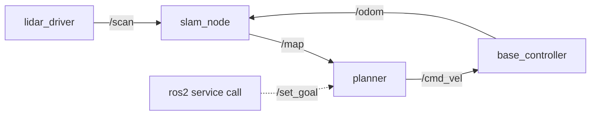
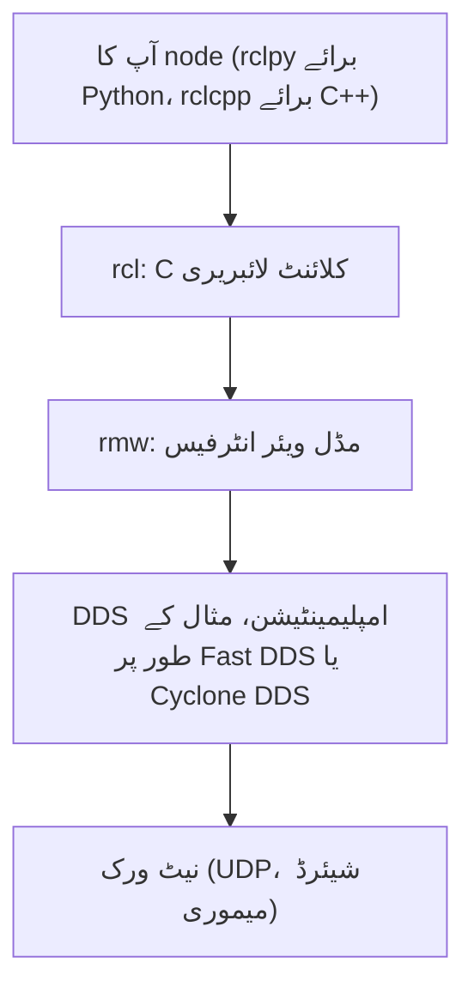

<LessonMeta level="انٹرمیڈیٹ" time="40 منٹ" prereqs={["پائتھون کی بنیادی باتیں", "لینکس ٹرمینل", "روبوٹ کے بنیادی اصولوں کا ماڈیول"]} />

آپ کے روبوٹ میں ایک LiDAR ڈرائیور، ایک میپ بلڈر، ایک پلانر اور ایک موٹر کنٹرولر ہے۔ اگر یہ تمام ایک بڑے پروگرام کے طور پر لکھے جائیں، تو LiDAR کوڈ میں کریش کا مطلب ہوگا کہ پہیے بھی کام کرنا چھوڑ دیں گے، اور کوئی دوسرا آپ کے پلانر کو دوبارہ استعمال نہیں کر سکے گا۔ اگر انہیں الگ الگ پروگراموں میں تقسیم کر دیا جائے جو ایک دوسرے سے بات چیت کرتے ہیں، تو ہر حصے کا الگ سے معائنہ (test)، دوبارہ آغاز (restart) اور تبدیلی (swap) ممکن ہو جاتی ہے۔ ROS 2 وہ لچکدار فریم ورک (plumbing) ہے جو ان پروگراموں کو ایک دوسرے کو ڈھونڈنے اور ڈیٹا کا بااعتماد تبادلہ کرنے کی اجازت دیتا ہے، چاہے Wi-Fi کا کنکشن خراب ہی کیوں نہ ہو۔

یہ سبق یہ سمجھاتا ہے کہ یہ فریم ورک کس طرح کام کرتا ہے، تاکہ اگلے اسباق میں جو کوڈ آپ لکھیں وہ کبھی بھی پراسرار معلوم نہ ہو۔ ہم اس سبق میں **ROS 2 Jazzy Jalisco** اور Ubuntu 24.04 کا استعمال کریں گے۔

<Objectives>

- ROS 2 گراف کو بیان کریں: nodes، topics، services، actions اور parameters۔
- وضاحت کریں کہ DDS کیا ہے، nodes ایک دوسرے کو کیسے دریافت (discover) کرتے ہیں، اور ROS_DOMAIN_ID کیا کام کرتا ہے۔
- ایک QoS پروفائل (reliability، durability، history) منتخب کریں اور پیش گوئی کریں کہ آیا publisher اور subscriber آپس میں کنیکٹ ہوں گے یا نہیں۔
- Executors اور callback groups کی وضاحت کریں، اور یہ کہ ایک node کو multi-threaded executor کی ضرورت کب ہوتی ہے۔

</Objectives>

## ROS 2 کوئی آپریٹنگ سسٹم نہیں ہے

<Term def="Robot Operating System: ایک اوپن سورس لائبریریوں، ٹولز اور اصولوں کا سیٹ جو روبوٹ سافٹ ویئر کو بہت سے باہمی تعاون کرنے والے پروگراموں کے طور پر بنانے کے لیے استعمال ہوتا ہے">ROS</Term> ایک مڈل ویئر (middleware) فریم ورک ہے: ایسی لائبریریاں، ٹولز اور اصول جو لینکس (Linux) کے اوپر چلتے ہیں۔ اس کا بنیادی خیال **کمپیوٹیشن گراف (computation graph)** ہے: چھوٹے پروگراموں کا ایک نیٹ ورک، جن میں سے ہر ایک ایک مخصوص کام کرتا ہے، جو نامزد چینلز کے ذریعے ایک دوسرے سے جڑے ہوتے ہیں۔



بنیادی اجزاء (Building blocks):

- **Node**: ایک عمل (process یا اس کا حصہ) جس کی ایک واحد ذمہ داری ہوتی ہے، جیسے `lidar_driver`۔
- **Topic**: ایک نامزد، ٹائپ شدہ (typed) ڈیٹا سٹریم۔ Publishers اس پر لکھتے ہیں، subscribers اس سے پڑھتے ہیں، اور دونوں میں سے کسی کو ایک دوسرے کا پتہ نہیں ہوتا۔ یہ مینی ٹو مینی (Many-to-many) رابطہ ہے۔
- **Service**: درخواست اور جواب (request and response)، جیسے عمل کے درمیان کوئی فنکشن کال (function call)۔ تیز ترین سوالات کے لیے بہترین: "odometry کو ری سیٹ کریں"۔
- **Action**: فیڈ بیک اور منسوخی کے ساتھ طویل عرصے تک چلنے والا ہدف (goal): "کچن کی طرف نیویگیٹ کریں"۔
- **Parameter**: ایک node کی ملکیت میں نامزد ترتیب (setting)، جسے رن ٹائم پر پڑھا اور تبدیل کیا جا سکتا ہے۔

ہر ٹاپک کا ایک **میسج ٹائپ (message type)** ہوتا ہے، جیسے `sensor_msgs/msg/LaserScan`۔ ٹائپس کو سادہ ٹیکسٹ فائلوں میں بیان کیا جاتا ہے، اور ROS ان سے ہر زبان کے لیے کوڈ تیار کرتا ہے۔ آپ عام طور پر تیار شدہ معیاری میسجز (`geometry_msgs`، `sensor_msgs`، `std_msgs`) کا استعمال اپنے ذاتی میسجز بنانے سے کہیں زیادہ کریں گے۔

<KeyIdea title="تعلق کا ختم ہونا (Decoupling) ہی اصل مقصد ہے">
ایک publisher کبھی کسی subscriber کو براہ راست کال نہیں کرتا۔ وہ صرف ایک نام پر پبلش کرتا ہے۔ یہی وجہ ہے کہ آپ ڈیٹا استعمال کرنے والے کوڈ کو بدلے بغیر اصلی LiDAR کو ریکارڈنگ یا سمیلیٹر کے ساتھ بدل سکتے ہیں۔
</KeyIdea>

## آپ کے کوڈ کے نیچے موجود تہہ (Layers)

جب آپ Python میں `publisher.publish(msg)` کو کال کرتے ہیں، تو میسج متعدد تہوں (layers) سے گزرتا ہے:



- **rclpy / rclcpp** آپ کو آپ کی زبان میں ایک آسان API فراہم کرتے ہیں۔
- **rcl** ایک عام C کور (core) ہے، تاکہ دونوں زبانیں ایک جیسا رویہ اپنائیں۔
- **rmw** (ROS middleware interface) ایک باریک اڈاپٹر (adapter) ہے۔ یہی ROS 2 کو آپ کے کوڈ کو تبدیل کیے بغیر DDS وینڈرز بدلنے کی اجازت دیتا ہے۔
- **DDS** ساتھیوں (peers) کو تلاش کرنے اور بائٹس کو منتقل کرنے کا اصل کام کرتا ہے۔

## آسان الفاظ میں DDS

<Term def="Data Distribution Service: پبلش-سبسکرائب کمیونیکیشن کے لیے ایک انڈسٹری اسٹینڈرڈ، جس میں بلٹ ان ڈسکوری اور کوالٹی آف سروس کنٹرولز شامل ہیں">DDS</Term> ایک ایسا معیاری فریم ورک ہے جو ہوائی جہاز اور دفاع جیسے انتہائی حساس سسٹمز کے لیے بنایا گیا تھا۔ یہ ROS 2 کو تین ایسی چیزیں فراہم کرتا ہے جو ROS 1 میں موجود نہیں تھیں: **کوئی مرکزی ماسٹر (central master) نہیں**، **خودکار دریافت (discovery)** اور **حسب ضرورت قابل اعتماد کمیونیکیشن (configurable reliability)**۔

**دریافت (Discovery)۔** یہاں فون بک رکھنے والا کوئی مرکزی ماسٹر پروسیس نہیں ہے۔ جب کوئی node شروع ہوتا ہے، تو وہ نیٹ ورک پر اپنے وجود کا اعلان کرتا ہے (ڈیفالٹ طور پر ملٹی کاسٹ کا استعمال کرتے ہوئے)۔ دوسرے nodes اسے سنتے ہیں، ٹاپکس اور ٹائپس کا موازنہ کرتے ہیں، اور براہ راست کنیکٹ ہو جاتے ہیں۔ اگر ایک node بند ہو جائے تو کسی دوسری چیز کو ری اسٹارٹ کرنے کی ضرورت نہیں ہوتی۔ اس کا نقصان نیٹ ورک پر کچھ ایکسٹرا ٹریفک ہے، یہی وجہ ہے کہ بڑے سسٹمز میں ڈسکوری کو ٹیون (tune) کیا جاتا ہے۔

**ڈومینز (Domains)۔** Nodes صرف اسی <Term def="0 سے 101 تک کا ایک عدد جو DDS ٹریفک کو تقسیم کرتا ہے تاکہ ایک ہی نیٹ ورک پر روبوٹس کے الگ الگ گروپس ایک دوسرے کو نہ سنیں">ڈومین</Term> میں موجود ساتھیوں کو تلاش کرتے ہیں جو ماحولیاتی متغیر (environment variable) `ROS_DOMAIN_ID` کے ذریعہ سیٹ کی جاتی ہے۔ اگر دس طلباء کلاس روم کا نیٹ ورک شیئر کر رہے ہیں، تو ہر ایک کو اپنا ID دیں ورنہ ان کے روبوٹ ایک دوسرے کے nodes کو چلانے لگیں گے:

```bash
export ROS_DOMAIN_ID=7
```

Jazzy میں آپ `export ROS_AUTOMATIC_DISCOVERY_RANGE=LOCALHOST` کے ساتھ ڈسکوری کو صرف لوکل مشین تک محدود کر سکتے ہیں، جو لیپ ٹاپ پر سمیلیشنز چلاتے وقت کافی کارآمد ہوتا ہے۔

**DDS کا انتخاب۔** Jazzy ڈیفالٹ کے طور پر eProsima Fast DDS (`rmw_fastrtps_cpp`) کے ساتھ آتا ہے۔ Eclipse Cyclone DDS (`rmw_cyclonedds_cpp`) ایک مقبول متبادل ہے۔ پیکیج انسٹال کرنے کے بعد ماحولیاتی متغیر (environment variable) سے سوئچ کریں:

```bash
sudo apt install ros-jazzy-rmw-cyclonedds-cpp
export RMW_IMPLEMENTATION=rmw_cyclonedds_cpp
```

ایک روبوٹ پر موجود تمام nodes کو ایک ہی RMW کا استعمال کرنا چاہیے۔ مختلف وینڈرز کو ملانا بنیادی ٹاپکس کے لیے کام کر سکتا ہے لیکن غیر متوقع مسائل پیدا کر سکتا ہے، اس لیے اس پر بھروسہ کرنے سے پہلے ٹیسٹ کر لیں۔

## کوالٹی آف سروس (QoS)

مختلف ڈیٹا مختلف قسم کے سلوک کا مستحق ہوتا ہے۔ 10 Hz پر لیزر اسکین کا کوئی فائدہ نہیں اگر وہ تاخیر سے پہنچے، اس لیے پرانے اسکین کو چھوڑ دینا ٹھیک ہے۔ ایک میپ، جو صرف ایک بار پبلش ہوتا ہے، ہر تاخیر سے آنے والے کے پاس لازمی پہنچنا چاہیے۔ QoS آپ کو ان ضروریات کو بیان کرنے کی اجازت دیتا ہے۔ بنیادی کنٹرولز:

| سیٹنگ | آپشنز | مطلب |
|---|---|---|
| Reliability | `RELIABLE`, `BEST_EFFORT` | ضائع شدہ میسجز کو دوبارہ بھیجیں، یا بھیج کر بھول جائیں |
| Durability | `VOLATILE`, `TRANSIENT_LOCAL` | بھیجنے کے بعد بھول جائیں، یا دیر سے آنے والے subscribers کے لیے آخری میسجز رکھیں |
| History | `KEEP_LAST` (depth کے ساتھ), `KEEP_ALL` | قطار (queue) میں کتنے میسجز رکھنے ہیں |
| Deadline, Lifespan, Liveliness | وقت کی مدت (durations) | اگر ڈیٹا میں تاخیر ہو تو خبردار کریں، اگر پرانا ہو تو ضائع کریں، بند شدہ publishers کی نشاندہی کریں |

پری سیٹس (Presets) زیادہ تر ضروریات کو پورا کرتے ہیں۔ `rclpy.qos` میں: ڈیفالٹ (reliable, volatile, keep last 10)؛ تیز رفتار سینسرز کے لیے `qos_profile_sensor_data` (best effort, volatile, small queue)؛ اور نقشوں اور جامد ترتیبات جیسی چیزوں کے لیے ایک لیچڈ (latched) سٹائل پروفائل (reliable کے ساتھ transient local)۔

### مطابقت (Compatibility): کیا وہ کنیکٹ ہوں گے؟

ایک subscriber صرف تبھی میسجز حاصل کرتا ہے جب اس کی درخواست publisher کی فراہم کردہ پیشکش سے زیادہ سخت نہ ہو۔ وہ قواعد جو آپ کو یاد رکھنے چاہئیں:

| Publisher پیش کرتا ہے | Subscriber درخواست کرتا ہے | کیا کنیکٹ ہوں گے؟ |
|---|---|---|
| `RELIABLE` | `RELIABLE` | جی ہاں |
| `RELIABLE` | `BEST_EFFORT` | جی ہاں |
| `BEST_EFFORT` | `BEST_EFFORT` | جی ہاں |
| `BEST_EFFORT` | `RELIABLE` | **جی نہیں** |
| `TRANSIENT_LOCAL` | `VOLATILE` | جی ہاں |
| `VOLATILE` | `TRANSIENT_LOCAL` | **جی نہیں** |

:::warning
ROS 2 میں مبتدیوں کا سب سے بڑا مسئلہ: "میرا subscriber کچھ حاصل نہیں کر رہا"۔ اکثر کیمرہ یا LiDAR ڈرائیور `BEST_EFFORT` پبلش کرتا ہے، جبکہ آپ کا subscriber ڈیفالٹ `RELIABLE` استعمال کر رہا ہوتا ہے۔ دونوں خاموشی سے ایک دوسرے سے کنیکٹ ہونے سے انکار کر دیتے ہیں۔ `ros2 topic info /topic --verbose` سے چیک کریں اور QoS کو میچ کریں۔
:::

یہاں دو چھوٹے اسکرپٹس ہیں جو عملی طور پر durability دکھاتے ہیں۔ `source /opt/ros/jazzy/setup.bash` کے بعد انہیں عام پائتھون کے طور پر چلائیں۔

```python title="latched_pub.py"
import rclpy
from rclpy.node import Node
from rclpy.executors import ExternalShutdownException
from rclpy.qos import QoSProfile, DurabilityPolicy, ReliabilityPolicy
from std_msgs.msg import String


class MapAnnouncer(Node):
    """Publishes once. A late subscriber still receives it (TRANSIENT_LOCAL)."""

    def __init__(self):
        super().__init__("map_announcer")
        qos = QoSProfile(
            depth=1,
            reliability=ReliabilityPolicy.RELIABLE,
            durability=DurabilityPolicy.TRANSIENT_LOCAL,
        )
        self.pub = self.create_publisher(String, "map_info", qos)
        msg = String()
        msg.data = "map v1: 4000 cells"
        self.pub.publish(msg)
        self.get_logger().info("published map info once")


def main():
    rclpy.init()
    node = MapAnnouncer()
    try:
        rclpy.spin(node)
    except (KeyboardInterrupt, ExternalShutdownException):
        pass
    finally:
        node.destroy_node()
        rclpy.try_shutdown()


if __name__ == "__main__":
    main()
```

```python title="late_sub.py"
import sys

import rclpy
from rclpy.node import Node
from rclpy.executors import ExternalShutdownException
from rclpy.qos import QoSProfile, DurabilityPolicy, ReliabilityPolicy
from std_msgs.msg import String


class LateListener(Node):
    def __init__(self, durability):
        super().__init__("late_listener")
        qos = QoSProfile(
            depth=1,
            reliability=ReliabilityPolicy.RELIABLE,
            durability=durability,
        )
        self.create_subscription(String, "map_info", self.on_msg, qos)
        self.get_logger().info(f"subscribed with {durability.name}")

    def on_msg(self, msg):
        self.get_logger().info(f"got: {msg.data}")


def main():
    mode = sys.argv[1] if len(sys.argv) > 1 else "transient"
    durability = DurabilityPolicy.TRANSIENT_LOCAL if mode == "transient" else DurabilityPolicy.VOLATILE
    rclpy.init()
    node = LateListener(durability)
    try:
        rclpy.spin(node)
    except (KeyboardInterrupt, ExternalShutdownException):
        pass
    finally:
        node.destroy_node()
        rclpy.try_shutdown()


if __name__ == "__main__":
    main()
```

پہلے `latched_pub.py` شروع کریں، کچھ سیکنڈ انتظار کریں، پھر `python3 late_sub.py transient` چلائیں۔ یہ وہ میسج حاصل کرتا ہے جو اس سے "مس" ہو گیا تھا۔ `python3 late_sub.py volatile` چلائیں اور اسے کچھ بھی سنائی نہیں دے گا، کیونکہ publisher کا آخری میسج صرف انہی subscribers کو فراہم کیا جاتا ہے جو اس کی درخواست کرتے ہیں۔

## Executors اور callback groups

ایک node کے کال بیکس (timers, subscriptions, services) خود سے نہیں چلتے۔ ایک <Term def="rclpy کا وہ حصہ جو ایونٹس کا انتظار کرتا ہے اور ان سے ملتے جلتے کال بیکس کو ایک یا متعدد تھریڈز پر چلاتا ہے">executor</Term> ایونٹس کا انتظار کرتا ہے اور انہیں کال کرتا ہے۔

- **`SingleThreadedExecutor`** (جو `rclpy.spin` استعمال کرتا ہے) ایک وقت میں ایک کال بیک چلاتا ہے۔ سادہ اور قابل پیش گوئی۔ خرابی: ایک سست کال بیک باقی تمام چیزوں کو بلاک کر دیتا ہے، بشمول دیگر ٹائمرز اور انکمنگ میسجز۔
- **`MultiThreadedExecutor`** تھریڈز کے پول پر کال بیکس چلاتا ہے، اس لیے ایک سست کال بیک اب باقی سسٹمز کو بلاک نہیں کرتا۔

صرف تھریڈز کا ہونا کافی نہیں ہے۔ **Callback groups** executor کو بتاتے ہیں کہ کون سے کال بیکس ایک ہی وقت میں چل سکتے ہیں:

- `MutuallyExclusiveCallbackGroup` (ڈیفالٹ): اس گروپ میں موجود کال بیکس کبھی بھی متوازی (parallel) نہیں چلتے۔
- `ReentrantCallbackGroup`: اس گروپ میں موجود تمام کال بیکس متوازی چل سکتے ہیں۔

مختلف گروپس میں موجود کال بیکس ایک multi-threaded executor پر متوازی طور پر چل سکتے ہیں۔ اس کا کلاسک استعمال کسی کال بیک کے اندر سے سروس کو کال کرنا ہے: جواب کے لیے دوسرے کال بیک کے چلنے کی ضرورت ہوتی ہے، اور ایک گروپ اور ایک تھریڈ کے ساتھ آپ کو ڈیڈ لاک (deadlock) ملتا ہے۔

```python title="two_speeds.py"
import time

import rclpy
from rclpy.node import Node
from rclpy.callback_groups import MutuallyExclusiveCallbackGroup
from rclpy.executors import MultiThreadedExecutor, ExternalShutdownException


class TwoSpeeds(Node):
    def __init__(self):
        super().__init__("two_speeds")
        # Separate groups, so the slow job cannot block the fast loop.
        self.fast_group = MutuallyExclusiveCallbackGroup()
        self.slow_group = MutuallyExclusiveCallbackGroup()
        self.create_timer(0.1, self.fast_tick, callback_group=self.fast_group)
        self.create_timer(1.0, self.slow_job, callback_group=self.slow_group)
        self.count = 0

    def fast_tick(self):
        self.count += 1
        if self.count % 5 == 0:
            self.get_logger().info(f"fast loop alive (tick {self.count})")

    def slow_job(self):
        self.get_logger().info("slow job started (0.5 s of work)")
        time.sleep(0.5)  # stands in for a heavy computation
        self.get_logger().info("slow job finished")


def main():
    rclpy.init()
    node = TwoSpeeds()
    executor = MultiThreadedExecutor(num_threads=2)
    executor.add_node(node)
    try:
        executor.spin()
    except (KeyboardInterrupt, ExternalShutdownException):
        pass
    finally:
        node.destroy_node()
        rclpy.try_shutdown()


if __name__ == "__main__":
    main()
```

اسے بالکل اسی طرح لکھ کر چلائیں، پھر executor کو `SingleThreadedExecutor` سے بدلیں اور دیکھیں کہ کس طرح ہر سست کام پر تیز رفتار ٹک آدھے سیکنڈ کے لیے رک جاتے ہیں۔ یہ رکاوٹ بالکل وہی چیز ہے جو ایک حقیقی کنٹرولر کو ناہموار (stutter) بنا دے گی۔

:::tip[پرو ٹپ]
پائتھون کے Global Interpreter Lock (GIL) کا مطلب ہے کہ ایک multi-threaded rclpy executor بھاری حساب کتاب کی نسبت انتظار (sleeps, I/O) کے کاموں میں کہیں زیادہ مدد کرتا ہے۔ سنجیدہ کمپیوٹیشن کے لیے، اسے اس کے اپنے node میں، C++ میں، یا ایسے NumPy کوڈ میں رکھیں جو GIL کو جاری (release) کرتا ہو۔
:::

## عملی لیب

آپ خود سے ڈسکوری، ڈومینز اور QoS کی مطابقت کا مشاہدہ کریں گے۔

<Steps>

1. دو ٹرمینلز کھولیں اور دونوں میں `source /opt/ros/jazzy/setup.bash` چلائیں۔ پہلے میں `ros2 run demo_nodes_cpp talker` اور دوسرے میں `ros2 run demo_nodes_py listener` چلائیں۔ آپ کو ایک دوسرے سے ملتی جلتی لائنیں نظر آنی چاہئیں۔
2. تیسرے ٹرمینل میں `ros2 node list`، `ros2 topic list -t`، اور `ros2 topic info /chatter --verbose` چلائیں۔ دونوں اینڈ پوائنٹس کی QoS ویلیوز تلاش کریں۔
3. Listener کو روکیں، اس کے ٹرمینل میں `export ROS_DOMAIN_ID=5` سیٹ کریں اور اسے دوبارہ شروع کریں۔ اب وہ talker کو نہیں سن سکتا۔ ID کو واپس پہلے جیسا سیٹ کریں اور وہ دوبارہ کنیکٹ ہو جائے گا۔
4. `latched_pub.py` اور `late_sub.py` کو محفوظ کریں۔ Publisher کو چلائیں، انتظار کریں، پھر subscriber کو ایک بار `transient` کے ساتھ اور ایک بار `volatile` کے ساتھ چلائیں۔ مختلف نتائج کی تصدیق کریں۔
5. `late_sub.py` کو ایڈٹ کریں تاکہ وہ `BEST_EFFORT` reliability کی درخواست کرے۔ کیا وہ اب بھی reliable publisher سے کنیکٹ ہوتا ہے؟ اب publisher کو best effort اور subscriber کو reliable بنائیں۔ رپورٹ شدہ غیر مطابقت دیکھنے کے لیے `ros2 topic info /map_info -v` چیک کریں۔

</Steps>

آپ کو معلوم ہوگا کہ یہ کام کر گیا جب آپ کوڈ چلانے سے پہلے ہی QoS ٹیبلز کو دیکھ کر یہ پیش گوئی کر سکیں کہ کون سے جوڑے آپس میں کنیکٹ ہوں گے۔

## مشقیں

<Exercise title="کیا یہ کنیکٹ ہوگا؟" level="Beginner">
ایک کیمرہ ڈرائیور `BEST_EFFORT`, `VOLATILE`, depth 5 پر پبلش کرتا ہے۔ آپ کا node ڈیفالٹ QoS (reliable, volatile, depth 10) کے ساتھ سبسکرائب کرتا ہے۔ کیا اسے تصاویر موصول ہوں گی؟ اس کا حل کیا ہے؟

<Solution>
نہیں۔ ایک reliable subscriber کبھی best-effort publisher کے ساتھ کنیکٹ نہیں ہو سکتا۔ حل: `qos_profile_sensor_data` (best effort) یا کسی بھی ایسے پروفائل کے ساتھ سبسکرائب کریں جو `BEST_EFFORT` کی درخواست کرتا ہو۔
</Solution>
</Exercise>

<Exercise title="ڈیڈ لاک کی تلاش" level="Intermediate">
ڈیفالٹ کال بیک گروپ والا ایک node، جو `rclpy.spin` پر چل رہا ہے، ایک ٹائمر کال بیک کے اندر سے `client.call(req)` کے ساتھ ہم وقت ساز (synchronously) سروس کو کال کرتا ہے۔ یہ کیوں معطل (hang) ہو سکتا ہے، اور آپ اسے کیسے ٹھیک کریں گے؟

<Solution>
جواب ایک ایونٹ کے طور پر آتا ہے جسے ایک کال بیک کے ذریعہ پروسیس کیا جانا چاہیے۔ سنگل تھریڈڈ executor کے ساتھ ٹائمر کال بیک واحد تھریڈ پر قبضہ کیے ہوئے ہے، اس لیے رسپانس کال بیک کبھی نہیں چل سکتا، اور `call` ہمیشہ کے لیے انتظار کرتا رہتا ہے۔ حل: `client.call_async(req)` کا استعمال کریں اور فیوچر (future) کو سنبھالیں (یا done کال بیک شامل کریں)، یا ایک `MultiThreadedExecutor` چلائیں اور کلائنٹ کو ٹائمر سے الگ کال بیک گروپ میں رکھیں۔
</Solution>
</Exercise>

<Exercise title="QoS ڈیزائن کریں" level="Intermediate">
تین ٹاپکس کے لیے QoS منتخب کریں: 30 Hz کیمرہ سٹریم، روبوٹ کا جامد نقشہ (static map)، اور ایمرجنسی اسٹاپ کمانڈ۔

<Solution>
کیمرہ: `BEST_EFFORT`, `VOLATILE`, `KEEP_LAST` depth 1 سے 5 (نئے فریمز اہمیت رکھتے ہیں، پرانے نہیں)۔ نقشہ: `RELIABLE`, `TRANSIENT_LOCAL`, depth 1 (دیر سے آنے والے سبسکرائبرز کو بھی یہ لازمی ملنا چاہیے)۔ ایمرجنسی اسٹاپ: `RELIABLE`, `VOLATILE`, depth 1 سے 10، اختیاری طور پر deadline یا liveliness پالیسی کے ساتھ تاکہ خاموش publisher کا پتہ لگایا جا سکے۔ یہاں لکیری تاخیر (latency) کے مقابلے میں بااعتمادی زیادہ اہم ہے، اور ایک ہارڈر ویئر اسٹاپ کو اس کی بیک اپ پر ہونا چاہیے۔
</Solution>
</Exercise>

## اپنی سمجھ کی جانچ کریں

<Quiz questions={[
  {q: "DDS ROS 2 کو کیا فراہم کرتا ہے جو مرکزی ماسٹر پروسیس کی ضرورت کو ختم کرتا ہے؟", options: ["ایک کلاؤڈ سرور", "Nodes کے درمیان غیر مرکزی خودکار دریافت (Decentralised discovery)", "ایک گرافیکل انٹرفیس", "ایک تیز تر پائتھون انٹرپریٹر"], answer: 1, explain: "DDS nodes خود کا اعلان کرتے ہیں اور ایک دوسرے کو براہ راست تلاش کرتے ہیں، اس لیے کوئی ایک ایسا پروسیس نہیں ہوتا جس کے کریش ہونے سے پورا گراف بند ہو جائے۔"},
  {q: "ایک publisher BEST_EFFORT پیش کرتا ہے اور ایک subscriber RELIABLE کی درخواست کرتا ہے۔ کیا ہوتا ہے؟", options: ["میسجز بااعتماد طریقے سے موصول ہوتے ہیں", "میسجز best effort کے تحت موصول ہوتے ہیں", "وہ کنیکٹ نہیں ہوتے، اور کوئی میسج موصول نہیں ہوتا", "Publisher کریش ہو جاتا ہے"], answer: 2, explain: "ایک subscriber publisher کی پیشکش سے زیادہ کی درخواست نہیں کر سکتا۔ اینڈ پوائنٹس غیر مطابقت پذیر ہیں اور ROS ایک QoS انکمپیٹیبلٹی ایونٹ کی رپورٹ کرتا ہے۔"},
  {q: "TRANSIENT_LOCAL durability کس کام کے لیے مفید ہے؟", options: ["ڈیٹا تیزی سے بھیجنے کے لیے", "دیر سے شامل ہونے والے subscribers کو آخری پبلش شدہ میسجز حاصل کرنے کی اجازت دینے کے لیے", "میسجز کو انکرپٹ کرنے کے لیے", "CPU کا استعمال کم کرنے کے لیے"], answer: 1, explain: "Publisher اپنے حالیہ میسجز کو محفوظ رکھتا ہے اور بعد میں شامل ہونے والے subscribers کو فراہم کرتا ہے۔ یہ نقشوں اور جامد ڈیٹا کے لیے معمول کا انتخاب ہے۔"},
  {q: "MultiThreadedExecutor کے ساتھ callback groups کیوں استعمال کیے جاتے ہیں؟", options: ["DDS وینڈر کا انتخاب کرنے کے لیے", "یہ تعین کرنے کے لیے کہ کون سے کال بیکس متوازی (parallel) چل سکتے ہیں", "میسجز کے سائز کو چھوٹا کرنے کے لیے", "ڈومین ID کو تبدیل کرنے کے لیے"], answer: 1, explain: "صرف تھریڈز متوازی عمل کی اجازت نہیں دیتے: ایک ہی باہمی استثنائی (mutually exclusive) گروپ کے کال بیکس اب بھی باری باری چلتے ہیں۔ گروپس بتاتے ہیں کہ کون سی چیزیں ایک ساتھ چل سکتی ہیں۔"}
]} />

<Takeaways>

- ROS 2 چھوٹے پروگراموں (nodes) کا ایک گراف ہے جو topics، services، actions اور parameters کے ذریعے بات چیت کرتے ہیں۔
- آپ کا کوڈ rcl اور rmw پر مبنی ہے، جو DDS امپلیمینٹیشن پر چلتے ہیں؛ Jazzy میں ڈیفالٹ Fast DDS ہے۔
- DDS ماسٹر کے بغیر ساتھیوں کو تلاش کرتا ہے؛ ROS_DOMAIN_ID ایک نیٹ ورک پر گروپس کو الگ کرتا ہے۔
- QoS کاوشوں، بااعتمادی، پائیداری اور ہسٹری کو کنٹرول کرتا ہے؛ ایک subscriber publisher کی پیشکش سے زیادہ کا مطالبہ نہیں کر سکتا۔
- ڈیفالٹ executor ایک وقت میں ایک کال بیک چلاتا ہے؛ سست کام کو تیز لوپس کو بلاک کرنے سے روکنے کے لیے ملٹی تھریڈنگ اور کال بیک گروپس کا استعمال کریں۔
- جب میسجز موصول نہ ہوں، تو سب سے پہلے QoS کی مطابقت کو چیک کریں۔

</Takeaways>

پھنس گئے ہیں؟ کورس کے اسسٹنٹ **Rivet** سے نیچے دائیں جانب پوچھیں۔

## مزید گہرائی میں جائیں

- [ROS 2 Jazzy Documentation](https://docs.ros.org/en/jazzy/): ٹیوٹوریلز، تصورات اور API کے حوالہ جات کا سرکاری گھر۔
- [About Quality of Service settings (Jazzy)](https://docs.ros.org/en/jazzy/Concepts/Intermediate/About-Quality-of-Service-Settings.html): تمام QoS کی فہرست اور مطابقت کے ٹیبلز۔
- [Executors (Jazzy)](https://docs.ros.org/en/jazzy/Concepts/Intermediate/About-Executors.html): Executors کس طرح کال بیکس کا وقت متعین (schedule) کرتے ہیں۔

اگلا سبق: [Nodes, topics and services](./02-nodes-topics-services.mdx)
