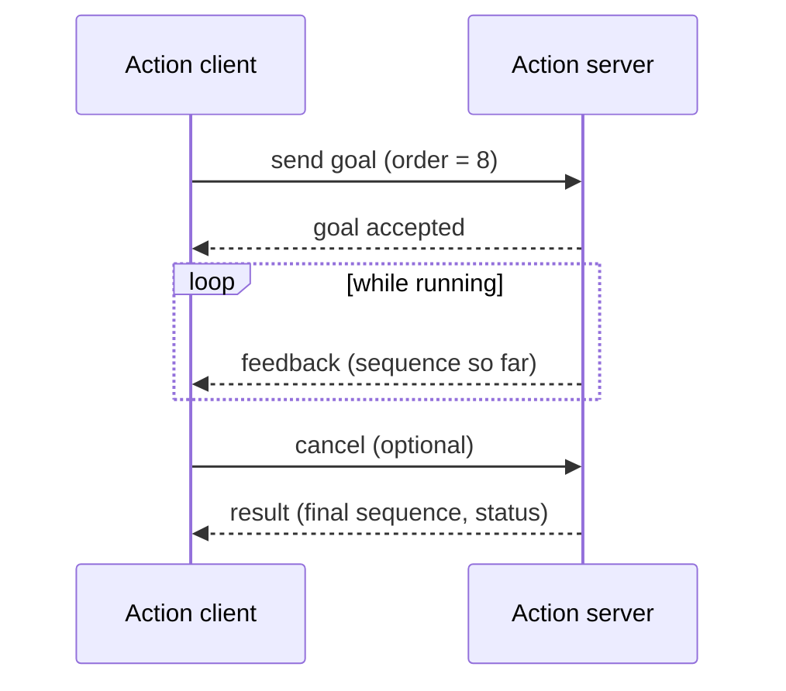

<LessonMeta level="Intermediate" time="45 min" prereqs={["rclpy کے ساتھ Nodes، topics اور services", "Python کلاسز اور callbacks"]} />

کسی روبوٹ کو یہ کہنا کہ "باورچی خانے میں جاؤ" کوئی فوری سوال نہیں ہے۔ اس میں ایک منٹ لگ سکتا ہے، آپ کو راستے میں پیش رفت کی اپ ڈیٹس (progress updates) چاہیے ہوں گی، اور آپ کو سفر کے دوران "روک دو، رہنے دو" کہنے کا ایک طریقہ بھی چاہیے۔ ایک سروس (service) یہ کام نہیں کر سکتی۔ دوسری طرف، نوڈ کے اندر رفتار کی حد کو ہارڈ کوڈ (hard-code) کرنے کا مطلب ہے ہر روبوٹ کے لیے کوڈ میں ترمیم کرنا، اور دس ٹرمینلز میں ہاتھ سے دس نوڈز شروع کرنا جلدی ہی زحمت بن جاتا ہے۔ یہ سبق **actions**، **parameters** اور **launch files** کے ذریعے ان تینوں مسائل کو حل کرتا ہے۔

ہم پچھلے سبق کے `kinemata_basics` پیکیج کی ہی توسیع کر رہے ہیں، لہذا اپنی ورک اسپیس کو تیار رکھیں۔

<Objectives>

- یہ وضاحت کریں کہ سروس یا ٹاپک (topic) کی بجائے ایکشن کا انتخاب کب کرنا ہے، اور ایکشن کا goal، feedback اور result پڑھیں۔
- `rclpy` میں ایک ایکشن سرور اور کلائنٹ لکھیں جو فیڈ بیک اور منسوخی (cancellation) کی حمایت کرتا ہو۔
- رن ٹائم پر پیرامیٹرز کو ڈکلیئر کریں، پڑھیں، ان کی تصدیق (validate) کریں اور ان میں تبدیلی کریں، اور انہیں YAML فائل سے لوڈ کریں۔
- آرگومنٹس، ری میپنگ (remapping)، نیم اسپیسز (namespaces) اور پیرامیٹر فائلوں کے ساتھ ایک Python لانچ فائل لکھیں۔

</Objectives>

## Actions: فیڈ بیک کے ساتھ طویل کام

ایک <Term def="طویل عرصے تک چلنے والے کاموں کے لیے ایک ROS 2 کمیونیکیشن ٹائپ: کلائنٹ ایک goal بھیجتا ہے، وقفے وقفے سے feedback حاصل کرتا ہے، منسوخ کر سکتا ہے، اور بالآخر result حاصل کرتا ہے">action</Term> کے تین میسج والے حصے ہوتے ہیں، جو تمام ایک ہی `.action` فائل میں بیان کیے جاتے ہیں:

- **Goal**: آپ کیا چاہتے ہیں ("پہلے 10 فبوناچی نمبرز کا حساب لگائیں"، "x=3, y=2 پر ڈرائیو کریں")۔
- **Feedback**: کام کے چلنے کے دوران وقفے وقفے سے پیش رفت ("ابھی تک کی ترتیب: 0, 1, 1, 2")۔
- **Result**: حتمی نتیجہ (final outcome)۔

اندرونی طور پر، ایک ایکشن صرف سروسز (goal بھیجنا، منسوخ کرنا، نتیجہ حاصل کرنا) اور ایک فیڈ بیک ٹاپک کا ایک مجموعہ ہے، اس لیے اسے کسی نئی مشینری کی ضرورت نہیں ہے۔ اس بنیادی اصول کا استعمال کریں:

| آپ چاہتے ہیں کہ… | استعمال کریں |
|---|---|
| مسلسل ڈیٹا اسٹریم کرنا | Topic |
| ایک تیز سوال پوچھنا اور جواب حاصل کرنا | Service |
| ایسا کام چلانا جس میں سیکنڈز یا منٹ لگتے ہوں، پیش رفت کی اطلاع کے ساتھ اور منسوخ کرنے کی صلاحیت ہو | Action |



ایک goal مختلف حالتوں (states) سے گزرتا ہے: مقبول (accepted)، جاری (executing)، اور پھر کامیا ب (succeeded)، ناکام (aborted) یا منسوخ (canceled)۔ ہم `example_interfaces` سے `Fibonacci` ایکشن استعمال کرتے ہیں: goal `int32 order` ہے، فیڈ بیک اور نتیجہ دونوں `int32[] sequence` ہیں۔

### سرور (server)

```python title="kinemata_basics/fibonacci_server.py"
import time

import rclpy
from example_interfaces.action import Fibonacci
from rclpy.action import ActionServer, CancelResponse, GoalResponse
from rclpy.callback_groups import ReentrantCallbackGroup
from rclpy.executors import ExternalShutdownException, MultiThreadedExecutor
from rclpy.node import Node


class FibonacciServer(Node):
    def __init__(self):
        super().__init__("fibonacci_server")
        self.action_server = ActionServer(
            self,
            Fibonacci,
            "fibonacci",
            execute_callback=self.execute,
            goal_callback=self.on_goal,
            cancel_callback=self.on_cancel,
            callback_group=ReentrantCallbackGroup(),
        )

    def on_goal(self, goal_request):
        """Accept or reject a goal before any work starts."""
        if not 1 <= goal_request.order <= 50:
            self.get_logger().warn(f"rejecting order {goal_request.order}")
            return GoalResponse.REJECT
        return GoalResponse.ACCEPT

    def on_cancel(self, goal_handle):
        self.get_logger().info("cancel requested")
        return CancelResponse.ACCEPT

    def execute(self, goal_handle):
        order = goal_handle.request.order
        self.get_logger().info(f"executing goal: order={order}")

        feedback = Fibonacci.Feedback()
        feedback.sequence = [0, 1]

        for i in range(1, order):
            if goal_handle.is_cancel_requested:
                goal_handle.canceled()
                result = Fibonacci.Result()
                result.sequence = feedback.sequence
                self.get_logger().info("goal canceled")
                return result

            feedback.sequence.append(feedback.sequence[i] + feedback.sequence[i - 1])
            goal_handle.publish_feedback(feedback)
            time.sleep(0.5)  # stand-in for slow work

        goal_handle.succeed()
        result = Fibonacci.Result()
        result.sequence = feedback.sequence
        return result


def main(args=None):
    rclpy.init(args=args)
    node = FibonacciServer()
    executor = MultiThreadedExecutor()
    executor.add_node(node)
    try:
        executor.spin()
    except (KeyboardInterrupt, ExternalShutdownException):
        pass
    finally:
        node.destroy_node()
        rclpy.try_shutdown()


if __name__ == "__main__":
    main()
```

تین تفصیلات اہم ہیں۔ **goal callback** کام شروع ہونے سے *پہلے* قبولیت کا فیصلہ کرتی ہے، تاکہ خراب درخواستیں جلدی ناکام ہو جائیں۔ **لوپ باقاعدگی سے `is_cancel_requested` کو چیک کرتا ہے**؛ منسوخی ایک مؤدبانہ درخواست ہے، اور آپ کے کوڈ کو اس کا احترام کرنا چاہیے۔ اور سرور **reentrant گروپ کے ساتھ multi-threaded executor** کا استعمال کرتا ہے تاکہ ایکشن منسوخ کرنے کی درخواست اس وقت بھی ہینڈل کی جا سکے جب طویل `execute` کال بیک ابھی بھی چل رہا ہو، جو اس ماڈیول کے پہلے سبق جیسا ہی ایکزیکیوٹر سبق ہے۔

### کلائنٹ (client)

```python title="kinemata_basics/fibonacci_client.py"
import sys

import rclpy
from example_interfaces.action import Fibonacci
from rclpy.action import ActionClient
from rclpy.node import Node


class FibonacciClient(Node):
    def __init__(self):
        super().__init__("fibonacci_client")
        self.action_client = ActionClient(self, Fibonacci, "fibonacci")

    def send_goal(self, order):
        self.action_client.wait_for_server()
        goal = Fibonacci.Goal()
        goal.order = order
        future = self.action_client.send_goal_async(goal, feedback_callback=self.on_feedback)
        future.add_done_callback(self.on_goal_response)

    def on_goal_response(self, future):
        goal_handle = future.result()
        if not goal_handle.accepted:
            self.get_logger().error("goal rejected")
            rclpy.shutdown()
            return
        self.get_logger().info("goal accepted")
        goal_handle.get_result_async().add_done_callback(self.on_result)

    def on_feedback(self, feedback_msg):
        self.get_logger().info(f"feedback: {list(feedback_msg.feedback.sequence)}")

    def on_result(self, future):
        result = future.result().result
        self.get_logger().info(f"result: {list(result.sequence)}")
        rclpy.shutdown()


def main(args=None):
    rclpy.init(args=args)
    node = FibonacciClient()
    node.send_goal(int(sys.argv[1]) if len(sys.argv) > 1 else 8)
    try:
        rclpy.spin(node)
    except KeyboardInterrupt:
        pass
    finally:
        node.destroy_node()
        rclpy.try_shutdown()


if __name__ == "__main__":
    main()
```

یہاں سب کچھ غیر مطابقت پذیر (asynchronous) ہے: `send_goal_async` ایک فیوچر (future) واپس کرتا ہے، جس کا done-callback تب چلتا ہے جب سرور جواب دیتا ہے، جو بدلے میں نتیجے کے فیوچر کا تقاضا کرتا ہے۔ کوئی کال بلاک نہیں ہوتی۔

## Parameters: کوڈ میں ترمیم کے بغیر سیٹنگز

ایک <Term def="نوڈ کے لیے ایک نامزد، ٹائپ شدہ ویلیو جسے اسٹارٹ اپ کے وقت، کسی فائل سے سیٹ کیا جا سکتا ہے، یا نوڈ کے چلنے کے دوران تبدیل کیا جا سکتا ہے">parameter</Term> آپ کو کوڈ میں ترمیم کیے بغیر نوڈ کے رویے کو تبدیل کرنے کی اجازت دیتا ہے: رفتار کی حد، ٹاپک کا نام، PID گین (gain)، یا کیمرے کی نمائش (exposure)۔ ڈیفالٹ اور ٹائپ کے ساتھ ہر پیرامیٹر کو ڈکلیئر کریں، اسے پڑھیں، اور اختیاری طور پر تبدیلیوں پر ردعمل دیں۔

```python title="kinemata_basics/speed_limiter.py"
import rclpy
from geometry_msgs.msg import Twist
from rcl_interfaces.msg import FloatingPointRange, ParameterDescriptor, SetParametersResult
from rclpy.executors import ExternalShutdownException
from rclpy.node import Node
from rclpy.parameter import Parameter


class SpeedLimiter(Node):
    """Clamps forward speed. Subscribes to cmd_vel_in, republishes on cmd_vel."""

    def __init__(self):
        super().__init__("speed_limiter")

        descriptor = ParameterDescriptor(
            description="Maximum forward speed in m/s",
            floating_point_range=[FloatingPointRange(from_value=0.0, to_value=2.0, step=0.0)],
        )
        self.declare_parameter("max_speed", 0.5, descriptor)
        self.declare_parameter("robot_name", "kinemata_bot")

        self.max_speed = self.get_parameter("max_speed").value
        name = self.get_parameter("robot_name").value
        self.get_logger().info(f"{name}: limiting speed to {self.max_speed} m/s")

        # Called before a change is applied; lets us accept or reject it.
        self.add_on_set_parameters_callback(self.on_parameters)

        self.pub = self.create_publisher(Twist, "cmd_vel", 10)
        self.sub = self.create_subscription(Twist, "cmd_vel_in", self.on_cmd, 10)

    def on_parameters(self, params):
        for p in params:
            if p.name == "max_speed":
                if p.type_ != Parameter.Type.DOUBLE:
                    return SetParametersResult(successful=False, reason="max_speed must be a float")
                self.max_speed = p.value
                self.get_logger().info(f"max_speed is now {self.max_speed}")
        return SetParametersResult(successful=True)

    def on_cmd(self, msg):
        out = Twist()
        out.linear.x = max(-self.max_speed, min(self.max_speed, msg.linear.x))
        out.angular.z = msg.angular.z
        self.pub.publish(out)


def main(args=None):
    rclpy.init(args=args)
    node = SpeedLimiter()
    try:
        rclpy.spin(node)
    except (KeyboardInterrupt, ExternalShutdownException):
        pass
    finally:
        node.destroy_node()
        rclpy.try_shutdown()


if __name__ == "__main__":
    main()
```

ڈسکرپٹر میں رینج کا مطلب ہے کہ خود ROS 5.0 کی `max_speed` کو مسترد کر دے گا۔ کال بیک آپ کے اپنے قوانین کا اضافہ کرتا ہے۔ نوڈ کے چلنے کے دوران کمانڈ لائن سے پیرامیٹرز کا معائنہ اور تبدیلی کی جا سکتی ہے:

```bash
ros2 param list
ros2 param get /speed_limiter max_speed
ros2 param set /speed_limiter max_speed 0.3
ros2 param dump /speed_limiter           # prints the node's parameters as YAML
```

پیرامیٹرز YAML فائل سے بھی آ سکتے ہیں، جہاں ٹاپ لیول کی (key) نوڈ کا نام ہوتا ہے:

```yaml title="config/limits.yaml"
speed_limiter:
  ros__parameters:
    max_speed: 0.8
    robot_name: "kinemata_bot"
```

:::note
اس سے پہلے کہ آپ باہر سے پیرامیٹر سیٹ کر سکیں، آپ کو اسے نوڈ میں **declare** کرنا مسٹ ہے۔ ڈیکلریشن اسے ایک ٹائپ بھی فراہم کرتا ہے، اور YAML یا کمانڈ لائن پر جو ویلیو آپ پاس کرتے ہیں وہ اس ٹائپ سے مماثل ہونی چاہیے۔ `0.5` ایک float ہے؛ `1` ایک integer ہوگا اور اوپر والا کال بیک اسے `max_speed` کے لیے مسترد کر دے گا۔
:::

## Launch files: پورے سسٹم کو شروع کرنا

ہر نوڈ کے لیے ایک الگ ٹرمینل کھولنا ایک پائیدار حل نہیں ہے۔ ایک <Term def="ایک Python (یا XML/YAML) اسکرپٹ جو ایک کمانڈ میں نوڈز کا پورا سیٹ ان کے پیرامیٹرز، ری میپنگز اور آرگومنٹس کے ساتھ شروع کرتی ہے">launch file</Term> سب کچھ ایک ساتھ شروع کرتی ہے، کسی ایسی چیز کو دوبارہ شروع نہیں کرتی جس کا آپ نے نہ کہا ہو، اور Ctrl+C پر سب کچھ بند کر دیتی ہے۔ Python لانچ فائلیں سب سے زیادہ لچکدار ہیں: یہ عام کوڈ ہیں جو `LaunchDescription` واپس کرتے ہیں۔

یہ ایک چھوٹی سی پائپ لائن بناتی ہے: `circle_driver` خام (raw) کمانڈز بناتی ہے، `speed_limiter` ان کو محدود کرتی ہے، اور `turtlesim` ان پر عمل کرتی ہے۔

```python title="launch/demo.launch.py"
import os

from ament_index_python.packages import get_package_share_directory
from launch import LaunchDescription
from launch.actions import DeclareLaunchArgument, LogInfo
from launch.substitutions import LaunchConfiguration
from launch_ros.actions import Node
from launch_ros.parameter_descriptions import ParameterValue


def generate_launch_description():
    config = os.path.join(get_package_share_directory("kinemata_basics"), "config", "limits.yaml")

    max_speed = LaunchConfiguration("max_speed")

    return LaunchDescription([
        DeclareLaunchArgument("max_speed", default_value="0.5",
                              description="Forward speed limit in m/s"),
        LogInfo(msg=["Launching with max_speed=", max_speed]),

        Node(package="turtlesim", executable="turtlesim_node", name="sim"),

        Node(
            package="kinemata_basics",
            executable="circle_driver",
            name="circle_driver",
            remappings=[("turtle1/cmd_vel", "raw_cmd")],
        ),

        Node(
            package="kinemata_basics",
            executable="speed_limiter",
            name="speed_limiter",
            parameters=[
                config,                                              # base values from the file
                {"max_speed": ParameterValue(max_speed, value_type=float)},  # launch argument wins
            ],
            remappings=[("cmd_vel_in", "raw_cmd"), ("cmd_vel", "turtle1/cmd_vel")],
        ),
    ])
```

قابلِ غور باتیں:

- **Arguments** (`DeclareLaunchArgument`, `LaunchConfiguration`) آپ کو کمانڈ لائن سے لانچ کو ترتیب دینے کی اجازت دیتے ہیں: `ros2 launch kinemata_basics demo.launch.py max_speed:=0.3`۔
- **Remappings** نوڈ کا کوڈ تبدیل کیے بغیر ٹاپکس کو دوبارہ جوڑتی ہیں۔ ڈرائیور کی آؤٹ پٹ اور لمٹر کی ان پٹ `raw_cmd` کے ذریعے جڑی ہوئی ہیں، اور لمٹر کی آؤٹ پٹ ٹرٹل (turtle) تک جاتی ہے۔
- **Parameters** ایک فائل اور ڈکشنری کو قبول کرتے ہیں؛ بعد میں آنے والے اندراجات پہلے والے اندراجات کو اوور رائیڈ (override) کر دیتے ہیں۔ `ParameterValue(..., value_type=float)` یقینی بناتا ہے کہ لانچ آرگومنٹ سے آنے والی اسٹرنگ ایک حقیقی float بن جائے۔
- **Namespaces** (یہاں استعمال نہیں ہوئے) ایک اور آرگومنٹ ہے، `namespace="robot1"`، جو ہر نام کے ساتھ پریفکس لگاتی ہے تاکہ آپ ایک ساتھ متعدد روبوٹس چلا سکیں۔

لانچ اور کانفگ فائلوں اور نکے ایگزیکیوٹیبلز کو انسٹال کرنے کے لیے، `setup.py` میں ڈیٹا فائلوں اور اینٹری پوائنٹس کو اپ ڈیٹ کریں:

```python title="setup.py (ترمیم شدہ حصے)"
import os
from glob import glob
from setuptools import find_packages, setup

package_name = "kinemata_basics"

setup(
    # ...name, version, packages as before...
    data_files=[
        ("share/ament_index/resource_index/packages", ["resource/" + package_name]),
        ("share/" + package_name, ["package.xml"]),
        (os.path.join("share", package_name, "launch"), glob("launch/*.launch.py")),
        (os.path.join("share", package_name, "config"), glob("config/*.yaml")),
    ],
    entry_points={
        "console_scripts": [
            # ...the five from the last lesson, plus:
            "fibonacci_server = kinemata_basics.fibonacci_server:main",
            "fibonacci_client = kinemata_basics.fibonacci_client:main",
            "speed_limiter = kinemata_basics.speed_limiter:main",
        ],
    },
)
```

نیز `package.xml` میں `<exec_depend>launch</exec_depend>`، `<exec_depend>launch_ros</exec_depend>`، `<exec_depend>turtlesim</exec_depend>` اور `<depend>rcl_interfaces</depend>` کا اضافہ کریں۔ `data_files` کی لائنوں کے بغیر لانچ فائل کبھی انسٹال نہیں ہوگی اور `ros2 launch` رپورٹ کرے گا کہ اسے فائل نہیں مل سکی۔

<KeyIdea title="کانفیگریشن کوڈ سے باہر کی چیز ہے">
کسی بھی ایسی چیز کو ہارڈ کوڈ نہ کریں جسے آپ روبوٹس، دنیاؤں یا دنوں کے حساب سے تبدیل کر سکتے ہوں: رفتارات، گینز (gains)، ٹاپک کے نام، فریم کے نام۔ انہیں پیرامیٹرز میں رکھیں، انہیں ڈیفالٹس دیں، YAML سے اوور رائیڈز لوڈ کریں، اور اہم چیزوں کو لانچ آرگومنٹس کے طور پر ظاہر کریں۔ پھر وہی کوڈ ایک کھلونے والے روبوٹ اور ایک حقیقی روبوٹ دونوں پر چلتا ہے۔
</KeyIdea>

## عملی لیب

<Steps>

1. نئی فائلیں شامل کریں (`fibonacci_server.py`, `fibonacci_client.py`, `speed_limiter.py`, `launch/demo.launch.py`, `config/limits.yaml`)، `setup.py` اور `package.xml` کو اپ ڈیٹ کریں، اور دوبارہ تعمیر (rebuild) کریں: `colcon build --packages-select kinemata_basics --symlink-install` اور پھر `source install/setup.bash`۔
2. ایک ٹرمینل میں `ros2 run kinemata_basics fibonacci_server` چلائیں۔ دوسرے ٹرمینل میں `ros2 run kinemata_basics fibonacci_client 10` چلائیں اور ہر نصف سیکنڈ میں فیڈ بیک آتے ہوئے دیکھیں۔
3. CLI کو آزمائیں: `ros2 action list`، `ros2 action info /fibonacci`، اور `ros2 action send_goal /fibonacci example_interfaces/action/Fibonacci "{order: 20}" --feedback`۔ منسوخی دیکھنے کے لیے راستے میں Ctrl+C دبائیں۔
4. `ros2 launch kinemata_basics demo.launch.py` چلائیں اور ٹرٹل کو ایک تنگ دائرہ بناتے ہوئے دیکھیں۔ دوسرے ٹرمینل میں `ros2 param set /speed_limiter max_speed 1.5` چلائیں اور دائرے کو بڑا ہوتے دیکھیں۔
5. غلط ویلیوز آزمائیں: `ros2 param set /speed_limiter max_speed 5.0` اور `ros2 param set /speed_limiter max_speed 1`۔ ایرر میسجز پڑھیں۔ دوبارہ `max_speed:=0.2` کے ساتھ لانچ کریں۔

</Steps>

آپ کو معلوم ہو جائے گا کہ کام ہو گیا ہے جب آپ ایکشن کو چلنے کے دوران منسوخ کر سکیں، براہ راست پیرامیٹر تبدیل کر کے اس کا اثر دیکھ سکیں، اور ایک کمانڈ سے پورا ڈیمو شروع کر سکیں۔

## مشقیں

<Exercise title="خراب Goals کو مسترد کریں" level="Beginner">
ایکشن سرور 1 سے 50 تک کے آرڈرز قبول کرتا ہے۔ جب دوسرا goal چل رہا ہو تو آپ کسی نئے goal کو کیسے مسترد کریں گے؟

<Solution>
نوڈ پر ایک فلیگ یا موجودہ goal handle رکھیں۔ `on_goal` میں، اگر کوئی goal فعال (active) ہو تو `GoalResponse.REJECT` واپس کریں، اور جب `execute` ختم ہو جائے تو فلیگ کو صاف کر دیں (`try/finally` استعمال کریں تاکہ منسوخی کے بعد بھی یہ صاف ہو جائے)۔ متبادل طور پر، `GoalResponse.ACCEPT` استعمال کریں اور پہلے پرانے goal کو منسوخ کر دیں، اگر جدید ترین درخواست کو ترجیح دینی ہو۔
</Solution>
</Exercise>

<Exercise title="لوپ کی تاخیر کے لیے پیرامیٹر" level="Intermediate">
فبوناچی سرور میں 0.5 s کی تاخیر کو `step_delay` نامی پیرامیٹر بنائیں جس کا ڈیفالٹ 0.5 ہو۔ آپ کو کیا تبدیل کرنے کی ضرورت ہے؟

<Solution>
`__init__` میں `self.declare_parameter("step_delay", 0.5)` شامل کریں۔ `execute` میں، اسے ہر بار `self.get_parameter("step_delay").value` کے ساتھ پڑھیں اور اسے `time.sleep(...)` میں استعمال کریں، تاکہ `ros2 param set` کے ذریعے کی گئی تبدیلیاں اگلے مرحلے پر لاگو ہوں۔ اسے float ڈیفالٹ کے ساتھ ڈکلیئر کرنے سے ROS ایک float کی توقع کرتا ہے، لہذا اسے `1` کی بجائے `0.2` جیسے اعشاریہ (decimal) کے ساتھ سیٹ کریں۔
</Solution>
</Exercise>

<Exercise title="دو روبوٹ، ایک لانچ فائل" level="Advanced">
دو ٹرٹلز کے لیے دو لمٹرز کو `robot1` اور `robot2` نیم اسپیسز میں شروع کرنے کے لیے لانچ فائل کو تبدیل کریں، جن میں سے ہر ایک کی اپنی رفتار ہو۔ اپنے طریقہ کار کو بیان کریں۔

<Solution>
نوڈز کے ہر گروپ کو `GroupAction` میں لپیٹیں جس میں `PushRosNamespace("robot1")` (`launch_ros.actions` سے) شامل ہو، یا ہر `Node` کو `namespace="robot1"` آرگومنٹ دیں۔ `DeclareLaunchArgument` کے ساتھ آرگومنٹس `speed1` اور `speed2` کی تعریف کریں، اور ہر ایک کو مربوط لمٹر میں پاس کریں۔ چونکہ نام نیم اسپیس کے لحاظ سے طے ہوتے ہیں، اس لیے `cmd_vel` بن جاتا ہے `/robot1/cmd_vel`۔ دوسرے روبوٹ کے لیے دوسرا ٹرٹل (`/spawn` سروس کے ساتھ بنایا گیا) یا دوسرا سمیلیشن انسٹنس استعمال کریں، اور دوبارہ چیک کریں کہ ری میپنگز درست نیم اسپیس کے اندر اشارہ کر رہی ہیں۔
</Solution>
</Exercise>

## اپنی سمجھ کی تصدیق کریں

<Quiz questions={[
  {q: "پیش رفت کی اپ ڈیٹس اور کینسل بٹن کے ساتھ \"باورچی خانے میں نیویگیٹ کریں\" کے لیے کون سی کمیونیکیشن ٹائپ سب سے موزوں ہے؟", options: ["Topic", "Service", "Action", "Parameter"], answer: 2, explain: "Actions کو فیڈ بیک اور منسوخی کے ساتھ طویل عرصے تک چلنے والے goals کے لیے ڈیزائن کیا گیا ہے۔ ایک سروس ایک ہی جواب واپس کرتی ہے، اور ٹاپک میں کسی goal کا مفہوم نہیں ہوتا۔"},
  {q: "Fibonacci سرور MultiThreadedExecutor اور ReentrantCallbackGroup کیوں استعمال کرتا ہے؟", options: ["فبوناچی نمبرز کو تیز تر بنانے کے لیے", "تاکہ execute کے چلنے کے دوران بھی منسوخی کی درخواستوں کو ہینڈل کیا جا سکے", "کیونکہ ایکشنز اس کے بغیر کام نہیں کرتے", "پیرامیٹرز کو ڈکلیئر کرنے سے بچنے کے لیے"], answer: 1, explain: "ایک طویل execute کال بیک ورنہ واحد تھریڈ پر قبضہ کر لے گا، اور منسوخی کی درخواست اس کے ختم ہونے تک پروسیس نہیں ہو سکے گی۔"},
  {q: "آپ max_speed:=0.3 کے ساتھ لانچ کرتے ہیں لیکن نوڈ اب بھی YAML ویلیو 0.8 استعمال کرتا ہے۔ اس کی سب سے زیادہ امکان کی وجہ کیا ہے؟", options: ["لانچ آرگومنٹس پیرامیٹرز سیٹ نہیں کر سکتے", "YAML فائل کے بعد نوڈ کی پیرامیٹرز لسٹ میں آرگومنٹ پاس نہیں کیا گیا تھا", "نوڈ کا نام بہت طویل ہے", "YAML ہمیشہ جیتتا ہے"], answer: 1, explain: "پیرامیٹرز کی فہرست میں بعد میں آنے والے اندراجات پہلے والے اندراجات کو اوور رائیڈ کرتے ہیں۔ مؤثر ہونے کے لیے لانچ آرگومنٹ کو Node میں پاس کیا جانا چاہیے، اور فائل کے بعد رکھا جانا چاہیے۔"},
  {q: "کمانڈ لائن سے نوڈ پر پیرامیٹر سیٹ کرنے سے پہلے آپ کو کیا کرنا مسٹ ہے؟", options: ["ROS کو دوبارہ شروع کریں", "نوڈ میں اسے ڈکلیئر کریں", "پوری ورک اسپیس کو دوبارہ بنائیں", "ایک سروس بنائیں"], answer: 1, explain: "ROS 2 میں پیرامیٹرز کا ڈکلیئر ہونا ضروری ہے۔ ڈیکلریشن ہر ایک کو ایک نام، ٹائپ اور ڈیفالٹ فراہم کرتی ہے۔"}
]} />

<Takeaways>

- طویل کاموں کے لیے actions استعمال کریں: ایک goal، وقفے وقفے سے feedback، ایک result، اور اختیاری منسوخی۔
- Action servers شروع میں ہی goals کو قبول یا مسترد کرتے ہیں، اپنے لوپ میں منسوخی کی درخواستوں کو چیک کرتے ہیں، اور کامیابی، منسوخی یا ابارٹ کی رپورٹ دیتے ہیں۔
- Parameters نوڈز کو قابلِ ترتیب بناتے ہیں؛ انہیں ٹائپس اور ڈیفالٹس کے ساتھ ڈکلیئر کریں، کال بیک کے ساتھ تبدیلیوں کی تصدیق کریں، اور انہیں YAML سے لوڈ کریں۔
- Launch files پورے سسٹمز کو شروع کرتی ہیں؛ کوڈ میں ترمیم کرنے کے بجائے آرگومنٹس، ری میپنگز، نیم اسپیسز اور پیرامیٹر فائلوں کا استعمال کریں۔
- ہر لانچ اور کانفگ فائل کو `setup.py` میں `data_files` میں رکھیں، ورنہ یہ انسٹال نہیں ہوگی۔
- کانفیگریشن کو کوڈ سے باہر رکھیں تاکہ وہی نوڈز مختلف روبوٹس پر کام کر سکیں۔

</Takeaways>

پھنس گئے ہیں؟ نیچے دائیں جانب کورس اسسٹنٹ **Rivet** سے پوچھیں۔

## مزید گہرائی میں جائیں

- [Python (Jazzy) میں ایکشن سرور اور کلائنٹ لکھنا](https://docs.ros.org/en/jazzy/Tutorials/Intermediate/Writing-an-Action-Server-Client/Py.html): اسی ساخت کے ساتھ آفیشل ٹیوٹوریل۔
- [ROS 2 پیرامیٹرز کو سمجھنا (Jazzy)](https://docs.ros.org/en/jazzy/Tutorials/Beginner-CLI-Tools/Understanding-ROS2-Parameters/Understanding-ROS2-Parameters.html): پیرامیٹرز کا CLI حصہ۔
- [لانچ فائلیں بنانا (Jazzy)](https://docs.ros.org/en/jazzy/Tutorials/Intermediate/Launch/Creating-Launch-Files.html): لانچ فائل کی خصوصیات کی تفصیل۔

اگلا: [TF2 اور URDF](./04-tf2-and-urdf.mdx)
