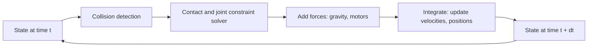

<LessonMeta level="Beginner" time="30 min" prereqs={["Python basics", "Basic calculus (derivative as a rate of change)"]} />

فرض کریں کہ آپ نے 40 کلوگرام کے ہیومنائیڈ (humanoid) کے لیے واکنگ کنٹرولر لکھا ہے۔ پہلی بار جب آپ اسے حقیقی روبوٹ پر چلاتے ہیں، تو وہ آگے کی طرف گرتا ہے اور ایک ہپ ایکچویٹر (hip actuator) توڑ دیتا ہے جس کی قیمت آپ کے لیپ ٹاپ سے بھی زیادہ ہے۔ اب تصور کریں کہ آپ یہی کنٹرولر راتوں رات، متوازی طور پر، دس ہزار بار چلا سکتے تھے، اور ہر ناکامی کی قیمت صفر ہوتی۔ سیمیولیشن (simulation) آپ کو یہی فائدہ دیتی ہے، اور یہی وجہ ہے کہ لیب کی ویڈیو میں آپ نے جو بھی روبوٹ دیکھا ہے، وہ پہلے ورچوئل دنیا میں ایک پروگرام تھا۔

<Objectives>

- روبوٹکس ٹیموں کے سیمیولیشن کرنے کی چار بڑی وجوہات بیان کریں: لاگت، حفاظت، ڈیٹا اور متوازییت (parallelism)۔
- وضاحت کریں کہ فزکس انجن دنیا کو ایک چھوٹے سے ٹائم سٹیپ (timestep) کے ذریعے کیسے آگے بڑھاتا ہے۔
- کوڈ کے ذریعے دکھائیں کہ ایک خراب انٹیگریٹر (integrator) یا بڑا ٹائم سٹیپ کس طرح خاموشی سے سیمیولیشن کو خراب کر دیتا ہے۔
- کانٹیکٹ (contact)، رگڑ (friction) اور سینسرز کے اہم تخمینوں (approximations) کے نام بتائیں، اور بتائیں کہ نتیجہ پر کب بھروسہ نہیں کرنا چاہیے۔

</Objectives>

## سیمیولیشن کی چار وجوہات

**لاگت (Cost)۔** ہاردوئیر ٹوٹتا ہے، گھستا ہے اور اسے ری سیٹ کرنے کے لیے ایک شخص کی ضرورت ہوتی ہے۔ ایک سیمیولیٹڈ روبوٹ ملی سیکنڈز میں دوبارہ ظاہر (respawn) ہو جاتا ہے۔ آپ ایسے روبوٹس کو بھی آزما سکتے ہیں جو ابھی موجود ہی نہیں ہیں: بازو کی ایک مختلف لمبائی، ایک وہیل بیس جو 10 سینٹی میٹر زیادہ چوڑی ہو، یا وہ سینسر جو آپ نے ابھی تک نہیں خریدا۔

**حفاظت (Safety)۔** ابتدائی کنٹرولرز غلط ہوتے ہیں۔ ایک کنٹرولر جو غلط سائن (sign) کے ساتھ ٹارک کمانڈ بھیجتا ہے، سیمیولیشن میں ایک بگ (bug) ہے لیکن انسان کے قریب موجود حقیقی روبوٹ پر ایک خطرہ ہے۔ سیمیولیشن وہ جگہ ہے جہاں آپ کو غلط ہونے کی اجازت ہے۔

**ڈیٹا (Data)۔** مشین لرننگ ماڈلز کو لیبل شدہ (labelled) ڈیٹا کی بڑی مقدار کی ضرورت ہوتی ہے۔ سیمیولیشن میں لیبلز مفت ہوتے ہیں: سیمیولیٹر پہلے سے جانتا ہے کہ ہر شے کہاں ہے، لہذا وہ ہر فریم کے ساتھ بہترین باؤنڈنگ باکسز، ڈیپتھ میپس اور سیگمنٹیشن ماسکس آؤٹ پٹ کر سکتا ہے۔

**متوازییت (Parallelism)۔** ایک حقیقی روبوٹ آپ کو ریئل ٹائم میں، ایک وقت میں ایک ہی تجربہ دیتا ہے۔ ایک سیمیولیٹر ریئل ٹائم سے زیادہ تیز چل سکتا ہے، اور ایک GPU سیمیولیٹر ایک وقت میں دنیا کی ہزاروں کاپیاں چلا سکتا ہے۔ اسی چیز نے روبوٹس کے لیے جدید ری اینفورسمنٹ لرننگ (reinforcement learning) کو عملی بنایا (آپ اسے روبوٹ لرننگ ماڈیول میں استعمال کریں گے)۔

:::note
سیمیولیشن حقیقی روبوٹ کا متبادل نہیں ہے۔ یہ ایک فلٹر ہے: یہ آپ کو 95% ان خیالات کو دور پھینکنے کی اجازت دیتا ہے جو ہاردوئیر کو چھونے سے پہلے ہی ظاہر ہے کہ خراب ہیں۔ آخری مرحلے کو ہمیشہ حقیقت کی ضرورت ہوتی ہے۔
:::

## فزکس انجن اصل میں کیا کرتا ہے

ایک <Term def="Software that advances the state of simulated rigid or soft bodies through time by solving the laws of motion, handling collisions and contact forces">فزکس انجن</Term> ایک ہی کام بار بار کرتا ہے۔ دنیا کی موجودہ حالت (ہر باڈی کی پوزیشنز اور ویلاسٹیز) اور اس پر لگنے والی فورسز کی بنیاد پر، وہ ایک چھوٹے سے لمحے کے بعد کی حالت کا حساب لگاتا ہے۔ وہ چھوٹا سا لمحہ <Term def="The fixed slice of simulated time, in seconds, that the engine advances per step; typical values for robots are 1 ms to 10 ms">ٹائم سٹیپ (timestep)</Term> کہلاتا ہے، جسے $\Delta t$ لکھا جاتا ہے۔

ہر لوپ کے تین اہم اجزاء ہوتے ہیں:

1. **ڈائنامکس (Dynamics)۔** ہر باڈی کے لیے نیوٹن کا دوسرا قانون، $m\ddot{x} = F$، جسے روٹیشن اور جوائنٹس سے جڑی باڈیز تک بڑھایا جاتا ہے (آپ نے ان مساواتوں کو [Dynamics essentials](../02-robot-fundamentals/04-dynamics-essentials.mdx) میں دیکھا تھا)۔
2. **تصادم کی شناخت (Collision detection)۔** یہ معلوم کرنا کہ کون سی شکلیں ایک دوسرے کے اوپر آ رہی ہیں یا چھو رہی ہیں۔ سادہ شکلیں (باکس، اسفیئر، سلنڈر) تیز ہوتی ہیں۔ تفصیلی ٹرائی اینگل میشز سست ہوتی ہیں، یہی وجہ ہے کہ روبوٹ ماڈلز ایک سادہ "collision" شیپ اور ایک خوبصورت "visual" شیپ استعمال کرتے ہیں۔
3. **پابندیوں کا حل (Constraint solving)۔** کانٹیکٹس اور جوائنٹس دراصل قوانین ہیں ("یہ پاؤں فرش کے اندر نہیں جا سکتا"، "یہ ہنج صرف ایک محور کے گرد گھومتا ہے")۔ انجن ایسی فورسز تلاش کرتا ہے جو ان قوانین کو پورا کرتی ہیں۔

عام انجنز جن کا آپ سامنا کریں گے: **ODE**، **Bullet**، **DART** (وہ انجنز جو Gazebo استعمال کر سکتا ہے)، **MuJoCo** (لرننگ ریسرچ کے لیے مقبول) اور **PhysX** (NVIDIA Isaac Sim کے ذریعے استعمال ہوتا ہے)۔ وہ رفتار، درستگی اور کانٹیکٹ سے نمٹنے کے طریقے کے درمیان مختلف سمجھوتے کرتے ہیں۔

## وقت کو سٹیپس میں تقسیم کیا جاتا ہے، اور اس کے نتائج ہوتے ہیں

وقت میں آگے بڑھنے کا سب سے سادہ طریقہ **explicit Euler** ہے: پوزیشن کو اپ ڈیٹ کرنے کے لیے موجودہ ویلاس
