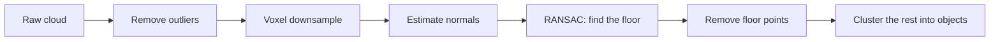

<LessonMeta level="Intermediate" time="45 min" prereqs={["کیمرے اور امیج پروسیسنگ", "نامپائی (NumPy)", "فریمز اور ریجڈ ٹرانسفارم (Frames and rigid transforms)"]} />

ایک کیمرے کی تصویر آپ کے روبوٹ کو بتاتی ہے کہ چیزیں کیسی دکھتی ہیں۔ مگ اٹھانے کے لیے، یا میز سے ٹکرانے سے بچنے کے لیے، روبوٹ کو یہ بھی جاننے کی ضرورت ہوتی ہے کہ چیزیں کتنی دور ہیں، اور وہ تین ابعاد (three dimensions) میں کہاں رکھی ہیں۔ یہ گہرائی کے سینسرز (depth sensors) اور لیدار (lidar) کا کام ہے۔ وہ آپ کو ایک **پوائنٹ کلاؤڈ** (point cloud) دیتے ہیں: روبوٹ کے ارد گرد کی سطحوں پر ہزاروں تھری ڈی پوائنٹس۔ اس سبق میں آپ ایک پوائنٹ کلاؤڈ بنائیں گے، اس میں فرش تلاش کریں گے، اور اس پر کھڑی اشیاء کو الگ کریں گے۔

<Objectives>

- وضاحت کریں کہ اسٹیریو کیمرے، اسٹرکچرڈ لائٹ یا ٹائم آف فلائٹ کیمرے، اور لیدار فاصلے کی پیمائش کیسے کرتے ہیں۔
- نامپائی (NumPy) کی مدد سے گہرائی کی تصویر یا لیزر اسکین کو تھری ڈی پوائنٹس میں تبدیل کریں۔
- اوپن تھری ڈی (Open3D) کے ساتھ پوائنٹ کلاؤڈ کو ڈاؤن سیمپل، صاف اور اس کے نارملز (normals) کا تخمینہ لگائیں۔
- RANSAC کے ساتھ گراؤنڈ پلین تلاش کریں اور کلسٹرنگ کے ذریعے اشیاء کو الگ کریں۔

</Objectives>

## گہرائی ناپنے کے چار طریقے

**اسٹیریو (Stereo):** دو کیمرے جو ایک دوسرے سے فاصلے $B$ پر ہیں (جسے **بیس لائن** یا baseline کہتے ہیں) ایک ہی نقطہ کو تھوڑا سا مختلف کالمز میں دیکھتے ہیں۔ فرق کو <Term def="اسٹیریو جوڑے کی بائیں اور دائیں تصاویر کے درمیان ایک ہی سینسر پوائنٹ کا افقی پکسل آفسیٹ؛ زیادہ فرق کا مطلب ہے قریب تر">ڈسپیریٹی (disparity)</Term> $d = u_L - u_R کہا جاتا ہے۔ ملتے جلتے مثلث (similar triangles) ہمیں یہ دیتے ہیں:

$$
Z = \frac{f\,B}{d}.
$$

قریب کی چیزوں میں ڈسپیریٹی زیادہ ہوتی ہے، دور کی چیزوں میں کم۔ مشتق (differentiating) کرنے سے اس کا نقص ظاہر ہوتا ہے: گہرائی کی خرابی $\delta Z \approx Z^2\,\delta d / (f B)$ ہوتی ہے، لہذا اسٹیریو کی درستگی **فاصلے کے مربع کے ساتھ کم ہوتی جاتی ہے**۔ پوائنٹس کا موازنہ کرنے کے لیے اسٹیریو کو ٹیکسچر کی ضرورت ہوتی ہے، اس لیے خالی سفید دیواریں ایک مسئلہ بن جاتی ہیں۔

**اسٹرکچرڈ لائٹ اور ٹائم آف فلائٹ (ToF) کیمرے:** یہ *ایکٹو* ہوتے ہیں: کیمرہ ایک معلوم انفراارڈ پیٹرن، یا روشنی کی پلسز پروجیکٹ کرتا ہے، اور پیٹرن کی خرابی یا روشنی کے سفر کے وقت سے فاصلہ معلوم کرتا ہے۔ یہ خالی دیواروں پر کام کرتے ہیں لیکن تیز دھوپ اور چمکدار یا شفاف سطحوں پر ناکام ہوجاتے ہیں۔

**لیدار (Lidar):** ایک <Term def="لائٹ ڈیಟೆکشن اینڈ رینجنگ: لیزر پلسز کی واپسی کے وقت سے فاصلہ ناپتا ہے۔">لیدار</Term> ایک لیزر کو گھماتا ہے اور ہر پلس کی واپسی کا وقت ناپتا ہے۔ ایک **ٹو ڈی لیدار (2D lidar)** ایک طیارے (plane) کو اسکین کرتا ہے اور رینجز کا ایک دائرہ واپس کرتا ہے، جو کہ فلیٹ فرش پر نیویگیشن کے لیے بہترین ہے۔ ایک **تھری ڈی لیدار (3D lidar)** میں عمودی طور پر کئی بیم اسٹیک ہوتے ہیں اور یہ ایک مکمل کلاؤڈ واپس کرتا ہے، جو بیرونی روبوٹس اور کاروں میں عام ہے۔

**لرنڈ ڈیپتھ (Learned depth):** نیورل نیٹ ورکس ایک ہی تصویر سے گہرائی کا تخمینہ لگا سکتے ہیں۔ نتیجہ قابلِ قبول ہوتا ہے لیکن پیمائش کے لحاظ سے قابل بھروسہ نہیں ہوتا، اس لیے اسے پیمائش کے بجائے ایک اشارے کے طور پر لیں۔

| سینسر | رینج | خوبیاں | کمزوریاں |
|---|---|---|---|
| اسٹیریو | چند میٹر | سستا، باہر کام کرتا ہے | ٹیکسچر کی ضرورت ہوتی ہے، فاصلے کے مربع کے ساتھ خرابی بڑھتی ہے |
| اسٹرکچرڈ لائٹ / ToF | 0.3 سے ~8 میٹر | گہری گہرائی، گھر کے اندر | دھوپ، گلاس، سیاہ یا چمکدار سطحیں |
| 2D لیدار | 10 میٹر اور اس سے زیادہ | درست، تیز، سادہ | صرف ایک طیارہ |
| 3D لیدار | دسیوں سے سینکڑوں میٹر | مکمل 3D، لمبی رینج | لاگت، کم ڈیٹا |

## گہرائی کی تصویر سے پوائنٹ کلاؤڈ تک

گہرائی کی تصویر ہر پکسل کے لیے آپٹیکل محور کے ساتھ فاصلہ $Z$ محفوظ کرتی ہے۔ ROS میں، گہرائی یا تو میٹر میں `32FC1` ہوتی ہے یا ملی میٹر میں `16UC1` (انکوڈنگ چیک کریں)۔ پچھلے سبق کے پن ہول ماڈل کو دوبارہ استعمال کرتے ہوئے، گہرائی $Z$ والا پکسل $(u, v)$ یہ بن جاتا ہے:

$$
X = \frac{(u - c_x)\,Z}{f_x}, \quad Y = \frac{(v - c_y)\,Z}{f_y}.
$$

```python title="depth_to_points.py"
import numpy as np


def depth_to_points(depth_m: np.ndarray, fx, fy, cx, cy) -> np.ndarray:
    """HxW depth image in metres -> Nx3 points in the camera optical frame."""
    h, w = depth_m.shape
    u, v = np.meshgrid(np.arange(w), np.arange(h))
    z = depth_m
    valid = np.isfinite(z) & (z > 0.1)          # drop NaN, zero and too-close values
    x = (u - cx) * z / fx
    y = (v - cy) * z / fy
    return np.column_stack([x[valid], y[valid], z[valid]])


# A flat wall 2 m in front of a 640x480 camera:
depth = np.full((480, 640), 2.0)
pts = depth_to_points(depth, fx=600, fy=600, cx=320, cy=240)
print(pts.shape, pts[:, 2].min(), pts[:, 2].max())    # (307200, 3) 2.0 2.0
```

ایک **2D لیدار** اور بھی آسان ہے۔ `LaserScan` میسج آپ کو زاویوں $\theta_i = \theta_\text{min} + i\,\Delta\theta$ پر رینجز $r_i$ کی ایک فہرست دیتا ہے، اور پوائنٹس یہ ہیں:

$$
x_i = r_i \cos\theta_i, \qquad y_i = r_i \sin\theta_i .
$$

```python title="scan_to_points.py"
import numpy as np


def scan_to_points(ranges, angle_min, angle_increment, range_min, range_max) -> np.ndarray:
    """Convert LaserScan fields to Nx2 points in the sensor frame, dropping invalid returns."""
    r = np.asarray(ranges, dtype=float)
    theta = angle_min + angle_increment * np.arange(len(r))
    ok = np.isfinite(r) & (r >= range_min) & (r <= range_max)
    return np.column_stack([r[ok] * np.cos(theta[ok]), r[ok] * np.sin(theta[ok])])


# A fake scan of a circular room of radius 3 m:
angles = np.linspace(-np.pi, np.pi, 360, endpoint=False)
pts = scan_to_points([3.0] * 360, -np.pi, angles[1] - angles[0], 0.12, 10.0)
print(pts.shape, np.round(np.hypot(pts[:, 0], pts[:, 1]).mean(), 3))   # (360, 2) 3.0
```

ROS 2 میں ایک 3D کلاؤڈ `sensor_msgs/msg/PointCloud2` کے طور پر آتا ہے، جو کہ ایک پیکڈ بائنری بفر ہے۔ `sensor_msgs_py` میں موجود ہیلپر اسے کھولتا ہے:

```python title="cloud_listener.py"
import numpy as np
import rclpy
from rclpy.node import Node
from rclpy.qos import qos_profile_sensor_data
from sensor_msgs.msg import PointCloud2
from sensor_msgs_py import point_cloud2


class CloudListener(Node):
    def __init__(self):
        super().__init__("cloud_listener")
        self.create_subscription(PointCloud2, "/depth_camera/points", self.on_cloud, qos_profile_sensor_data)

    def on_cloud(self, msg: PointCloud2):
        pts = point_cloud2.read_points(msg, field_names=("x", "y", "z"), skip_nans=True)
        xyz = np.column_stack([pts["x"], pts["y"], pts["z"]])
        self.get_logger().info(f"{len(xyz)} points, nearest {np.linalg.norm(xyz, axis=1).min():.2f} m")


def main():
    rclpy.init()
    rclpy.spin(CloudListener())


if __name__ == "__main__":
    main()
```

:::note
ہر کلاؤڈ ایک فریم میں رہتا ہے، جو `msg.header.frame_id` کے ذریعے دیا جاتا ہے۔ اس سے پہلے کہ آپ دو سینسرز کے کلاؤڈز کو یکجا کریں، یا کسی ایک کو نقشے کے ساتھ ملائیں، TF کا استعمال کرتے ہوئے انہیں ایک مشترکہ فریم میں تبدیل کریں۔ فریموں کو ملانا سب سے عام پوائنٹ کلاؤڈ بگ ہے۔
:::

## اوپن سی وی (OpenCV) میں اسٹیریو

اگر آپ کے پاس دو درست کی گئی (rectified) تصاویر ہیں (بائیں اور دائیں، ایک ہی صف کی سیدھ)، تو OpenCV ڈسپیریٹی کا حساب لگا سکتا ہے، اور آپ $Z = fB/d$ لاگو کرتے ہیں:

```python title="stereo.py"
import cv2
import numpy as np

left = cv2.imread("left.png", cv2.IMREAD_GRAYSCALE)
right = cv2.imread("right.png", cv2.IMREAD_GRAYSCALE)

matcher = cv2.StereoSGBM_create(minDisparity=0, numDisparities=64, blockSize=5)
disparity = matcher.compute(left, right).astype(np.float32) / 16.0   # SGBM returns fixed point x16

FOCAL_PX, BASELINE_M = 600.0, 0.12                                  # from your calibration
with np.errstate(divide="ignore"):
    depth = np.where(disparity > 0, FOCAL_PX * BASELINE_M / disparity, np.nan)
print("median depth:", np.nanmedian(depth), "m")
```

"Rectified" کا مطلب ہے کہ کیلیبریٹ کرنے سے مسخ (distortion) ختم ہو گئی ہے اور دونوں تصویر کے طیاروں کو اس طرح سیدھا کر دیا گیا ہے کہ ملتے جلتے پوائنٹس ایک ہی صف پر ہوں۔ `cv2.stereoCalibrate` اور `cv2.stereoRectify` کے ساتھ اسٹیریو جوڑے کو کیلیبریٹ کریں، یا ایسا کیمرہ استعمال کریں جو فیکٹری کیلیبریشن کے ساتھ آتا ہے۔

## اوپن تھری ڈی (Open3D) میں پوائنٹ کلاؤڈز کے ساتھ کام کرنا

<Term def="تھری ڈی ڈیٹا پروسیسنگ کے لیے ایک اوپن سورس لائبریری، جو پائتھون اور C++ میں پوائنٹ کلاؤڈ، میش اور رجسٹریشن کے آلات فراہم کرتی ہے">Open3D</Term> (`pip install open3d`؛ چیک کریں کہ آپ کا پائتھون ورژن موجودہ ریلیز کے ذریعے تعاون یافتہ ہے) آپ کو تیز، آسان ٹولز فراہم کرتا ہے۔ وہ ورک فلو جس کی پیروی تقریباً ہر پرسیپشن پائپ لائن کرتی ہے، یہ ہے:



ہر قدم اپنی جگہ بناتا ہے:

- **آؤٹ لائر کو ہٹانا (Outlier removal):** عکاسی یا شور کی وجہ سے آوارہ پوائنٹس بعد میں آنے والی ہر چیز کو الجھا دیتے ہیں۔ ایک *اسٹیٹسٹیکل* فلٹر ان پوائنٹس کو گرا دیتا ہے جن کے پڑوسی غیر معمولی طور پر دور ہیں۔
- **ووکسیل ڈاؤن سمپلنگ (Voxel downsample):** جگہ کو چھوٹے کیوبز (voxels) میں تقسیم کریں اور فی کیوب ایک پوائنٹ رکھیں۔ لاکھوں پوائنٹس کے کلاؤڈز دسیوں ہزار بن جاتے ہیں، اور کثافت برابر ہو جاتی ہے۔
- **نارملز (Normals):** ہر نقطہ پر <Term def="ایک نقطہ پر سطح کے عمودی ایک یونٹ ویکٹر؛ ہر نقطہ کے پڑوسیوں سے تخمینہ لگایا جاتا ہے">سطح کا نارمل (surface normal)</Term> آپ کو بتاتا ہے کہ سطح کا رخ کس طرف ہے۔ نارملز سطحوں کو تقسیم کرنے، کلاؤڈز کو سیدھا کرنے اور گرفت کی منصوبہ بندی کرنے میں مدد کرتے ہیں۔
- **RANSAC پلین فٹ:** سب سے بڑی فلیٹ چیز تلاش کریں، عام طور پر فرش۔
- **کلسٹرنگ (Clustering):** باقی پوائنٹس کو الگ الگ اشیاء میں گروپ کریں۔

<KeyIdea title="RANSAC: اندازہ لگائیں، چیک کریں، دہرائیں">
<Term def="رینڈم سیمپل کنسینس: بار بار ڈیٹا کے ایک چھوٹے سے بے ترتیب ذیلی سیٹ پر ماڈل فٹ کریں اور وہ ماڈل رکھیں جس سے زیادہ تر ڈیٹا متفق ہو">RANSAC</Term> ایسے ڈیٹا پر ماڈل فٹ کرنے کا معیاری طریقہ ہے جس میں بہت سے آؤٹ لائرز ہوں۔ پلین تلاش کرنے کے لیے: 3 تصادفی پوائنٹس چنیں، ان کے ذریعے پلین کا حساب لگائیں، گنیں کہ کتنے پوائنٹس اس سے تھوڑے فاصلے پر ہیں، اور دہرائیں۔ سب سے زیادہ انلائرز والے پلین کو رکھیں۔ لیسٹ اسکوائرز کو خانوں (boxes) کے ذریعے کھینچا جا سکتا ہے؛ RANSAC انہیں نظر انداز کرتا ہے۔
</KeyIdea>

یہاں نامپائی میں شروع سے RANSAC ہے تاکہ آپ اس خیال کو دیکھ سکیں۔ یہ اپنا ڈیٹا خود بناتا ہے: ایک فلیٹ فرش اور ایک ڈبہ۔

```python title="ransac_plane.py"
import numpy as np


def ransac_plane(points, threshold=0.02, iterations=200, seed=0):
    """Fit a plane n.x + d = 0 to Nx3 points. Returns (normal, d, inlier_mask)."""
    rng = np.random.default_rng(seed)
    best_mask, best_model = None, None
    for _ in range(iterations):
        a, b, c = points[rng.choice(len(points), 3, replace=False)]
        n = np.cross(b - a, c - a)
        norm = np.linalg.norm(n)
        if norm < 1e-9:                      # the three points were collinear
            continue
        n /= norm
        d = -n @ a
        mask = np.abs(points @ n + d) < threshold
        if best_mask is None or mask.sum() > best_mask.sum():
            best_mask, best_model = mask, (n, d)
    return best_model[0], best_model[1], best_mask


rng = np.random.default_rng(0)
floor = np.column_stack([rng.uniform(-3, 3, (6000, 2)), rng.normal(0, 0.005, 6000)])
box = rng.uniform(-0.5, 0.5, (800, 3)) * [0.4, 0.4, 0.5] + [1.0, 0.5, 0.25]
cloud = np.vstack([floor, box])

n, d, inliers = ransac_plane(cloud)
print("normal:", np.round(n, 3), "d:", round(d, 3), "inliers:", inliers.sum(), "of", len(cloud))
```

پرنٹ شدہ نارمل $(0, 0, \pm 1)$ کے قریب ہے اور $d$ 0 کے قریب ہے: فرش، جو اس حقیقت کے باوجود مل گیا کہ اس پر ڈبہ رکھا ہوا ہے۔ (پلین نارمل کی علامت صوابدیدی ہوتی ہے۔) درکار تکرار کی تعداد $N \approx \log(1-p)/\log(1-w^3)$ ہے، جہاں $w$ انلائرز کا کسر ہے اور $p$ مطلوبہ اعتماد؛ 88% انلائرز کے ساتھ، 200 تکرار ضرورت سے کہیں زیادہ ہے۔

اب اسی طرح کے مصنوعی منظر پر Open3D میں مکمل پائپ لائن:

```python title="pipeline.py"
import numpy as np
import open3d as o3d

rng = np.random.default_rng(0)
floor = np.column_stack([rng.uniform(-3, 3, (6000, 2)), rng.normal(0, 0.005, 6000)])
box1 = rng.uniform(-0.5, 0.5, (1500, 3)) * [0.4, 0.4, 0.5] + [1.0, 0.5, 0.25]
box2 = rng.uniform(-0.5, 0.5, (700, 3)) * [0.3, 0.3, 0.3] + [-1.0, -1.0, 0.15]
stray = rng.uniform(-3, 3, (40, 3)) * [1, 1, 0.5] + [0, 0, 0.8]          # flying outliers

pcd = o3d.geometry.PointCloud()
pcd.points = o3d.utility.Vector3dVector(np.vstack([floor, box1, box2, stray]))
print("raw points:", len(pcd.points))

# 1. Remove outliers: drop points far from their 20 nearest neighbours
pcd, _ = pcd.remove_statistical_outlier(nb_neighbors=20, std_ratio=2.0)

# 2. Voxel downsample to 3 cm
pcd = pcd.voxel_down_sample(voxel_size=0.03)
print("after filtering:", len(pcd.points))

# 3. Normals from the 30 nearest neighbours within 10 cm
pcd.estimate_normals(search_param=o3d.geometry.KDTreeSearchParamHybrid(radius=0.1, max_nn=30))

# 4. RANSAC: the biggest plane is the floor
(a, b, c, d), floor_idx = pcd.segment_plane(distance_threshold=0.02, ransac_n=3, num_iterations=1000)
print(f"floor plane: {a:.2f}x + {b:.2f}y + {c:.2f}z + {d:.2f} = 0, {len(floor_idx)} points")

# 5. Keep everything that is not floor, then cluster with DBSCAN
objects = pcd.select_by_index(floor_idx, invert=True)
labels = np.array(objects.cluster_dbscan(eps=0.1, min_points=10))

pts = np.asarray(objects.points)
for k in range(labels.max() + 1):
    cluster = pts[labels == k]
    print(f"object {k}: {len(cluster)} points, centre {np.round(cluster.mean(axis=0), 2)}, "
          f"size {np.round(np.ptp(cluster, axis=0), 2)}")
```

اسے چلائیں اور آپ کو دو اشیاء نظر آنی چاہئیں، (1.0, 0.5, 0.25) اور (-1.0, -1.0, 0.15) کے قریب، سائز خانوں کے طول و عرض کے قریب ہوں۔ (لبیل -1 والے پوائنٹس شور ہیں۔) اگر آپ کے پاس ڈسپلے ہے تو تھری ڈی میں دیکھنے کے لیے `o3d.visualization.draw_geometries([objects])` شامل کریں۔

DBSCAN کسی بھی ایسے نقطہ سے کلسٹر بڑھاتا ہے جس کے فاصلے `eps` کے اندر کم از کم `min_points` پڑوسی ہوں۔ `eps` کو کسی شے پر پوائنٹ اسپیسنگ سے تھوڑا بڑا، اور اشیاء کے درمیان کے فاصلے سے چھوٹا منتخب کریں۔

## عملی تجربہ (Hands-on lab)

<Steps>

1. `depth_to_points.py` اور `scan_to_points.py` چلائیں۔ پرنٹ شدہ شکلوں اور اقدار کی تصدیق کریں۔
2. `ransac_plane.py` چلائیں۔ `threshold` کو 0.2 پر تبدیل کریں اور دیکھیں کہ کتنے پوائنٹس انلائرز بن جاتے ہیں، پھر اسے 0.001 پر تبدیل کریں اور دیکھیں کیا ہوتا ہے۔
3. Open3D انسٹال کریں اور `pipeline.py` چلائیں۔ تصدیق کریں کہ آپ کو خانوں کے قریب مراکز کے ساتھ دو کلسٹرز ملتے ہیں۔
4. سمولیشن ماڈیول سے اپنی Gazebo دنیا میں، `/depth_camera/points` پر `cloud_listener.py` چلائیں اور چیک کریں کہ قریب ترین پوائنٹ کا فاصلہ سمولیٹر میں نظر آنے والے فاصلے سے مطابقت رکھتا ہے۔ اختیاری: ایک کلاؤڈ کو `.npy` فائل میں محفوظ کریں اور اس پر Open3D پائپ لائن چلائیں۔

</Steps>

یہ کامیاب رہا اگر پائپ لائن بالکل اتنی ہی اشیاء تلاش کرتی ہے جتنی آپ نے رکھی تھیں، اور فرش کے طیارے کا نارمل عمودی ہے۔

## مشقیں (Exercises)

<Exercise title="اسٹیریو گہرائی (Stereo depth)" level="Beginner">

ایک اسٹیریو کیمرے میں $f = 700$ px اور بیس لائن $B = 0.10$ m ہے۔ ایک نقطہ کی ڈسپیریٹی 14 px ہے۔ یہ کتنی دور ہے، اور اگر ڈسپیریٹی 1 px کی غلطی پر ہو تو گہرائی کتنی تبدیل ہوتی ہے؟

<Solution>

$Z = fB/d = 700 \cdot 0.10 / 14 = 5$ میٹر۔ $d = 13$ کے ساتھ، $Z = 70/13 \approx 5.38$ میٹر، تقریباً 0.38 میٹر کی خرابی۔ $d = 15$ کے ساتھ، $Z \approx 4.67$ میٹر۔ یہی وجہ ہے کہ طویل رینج پر اسٹیریو غیر درست ہوتا ہے۔

</Solution>
</Exercise>

<Exercise title="دیوار تک لیدار (Lidar to a wall)" level="Intermediate">

ایک 2D لیدار سیدھے آگے سے بائیں طرف 30 ڈگری کے زاویہ پر 2.0 میٹر کی رینج رپورٹ کرتا ہے (سینسر کا x محور آگے اور y بائیں طرف لیں)۔ وہ نقطہ سینسر فریم میں کہاں ہے؟

<Solution>

$x = 2.0\cos 30^\circ \approx 1.73$ میٹر اور $y = 2.0 \sin 30^\circ = 1.0$ میٹر۔ لہذا نقطہ 1.0 میٹر بائیں اور 1.73 میٹر آگے ہے۔

</Solution>
</Exercise>

<Exercise title="ووکسیل سائز کا انتخاب (Choosing the voxel size)" level="Intermediate">

آپ کے کلاؤڈ میں 5 ملی میٹر کا فاصلہ ہے، سب سے چھوٹی چیز جس کی آپ کو پرواہ ہے وہ 4 سینٹی میٹر کا کیوب ہے، اور آپ کو ریئل ٹائم اسپیڈ کی ضرورت ہے۔ ووکسیل سائز تجویز کریں اور تجارتی موازنہ (trade-off) کی وضاحت کریں۔

<Solution>

1 سینٹی میٹر سے 2 سینٹی میٹر جیسی کوئی چیز۔ یہ پوائنٹ کی گنتی کو فی محور جوڑے (کم پوائنٹس) کے لحاظ سے تقریباً 4x سے 16x تک کم کرتا ہے، جبکہ 4 سینٹی میٹر کا کیوب اب بھی فی سائیڈ کئی پوائنٹس رکھتا ہے۔ 10 سینٹی میٹر کا ووکسیل کیوب کی شکل کو مٹا دے گا؛ 5 ملی میٹر کا ووکسیل مشکل سے ہی ڈاؤن سیمپل کرے گا۔

</Solution>
</Exercise>

## اپنی سمجھ کو جانچیں (Check your understanding)

<Quiz questions={[
  {q: "فاصلے کے ساتھ اسٹیریو گہرائی کی خرابی کیسے بدلتی ہے؟", options: ["یہ مستقل ہے", "یہ فاصلے کے مربع کے ساتھ بڑھتی ہے", "یہ فاصلے کے ساتھ سکڑتی ہے", "یہ صرف اشیاء کے رنگ پر منحصر ہے"], answer: 1, explain: "چونکہ Z = fB/d ہے، ایک مقررہ ڈسپیریٹی خرابی Z کے مربع کے متناسب گہرائی کی خرابی پیدا کرتی ہے۔"},
  {q: "فرش تلاش کرنے کے لیے عام کم از کم مربع (ordinary least squares) کے بجائے RANSAC کیوں استعمال کریں؟", options: ["یہ ہمیشہ تیز ہوتا ہے", "یہ ان بہت سے پوائنٹس کو نظر انداز کرتا ہے جو فرش پر نہیں ہیں", "اسے کسی ڈیٹا کی ضرورت نہیں ہے", "یہ ایک درست فٹ کی ضمانت دیتا ہے"], answer: 1, explain: "RANSAC اتفاقی سیٹ (consensus set) پر فٹ بیٹھتا ہے اور آؤٹ لائرز کی بڑی تعداد جیسے فرش پر موجود اشیاء کے خلاف مضبوط ہے۔"},
  {q: "ووکسیل ڈاؤن سمپلنگ کیا کرتا ہے؟", options: ["کلاؤڈ کو رنگ دیتا ہے", "ہر چھوٹے کیوب میں تقریباً ایک نقطہ رکھتا ہے، کثافت کو کم اور برابر کرتا ہے", "کلاؤڈ کو گھماتا ہے", "فرش کو ہٹاتا ہے"], answer: 1, explain: "یہ ہر ووکسیل میں موجود پوائنٹس کو ایک نمائندہ نقطہ سے بدل دیتا ہے۔"},
  {q: "LaserScan رینج کے inf کا کیا مطلب ہے؟", options: ["ایک بہت قریب شے", "رینج کے اندر کوئی واپسی نہیں، لہذا اسے فلٹر کیا جانا چاہئے", "ایک سینسر کی خرابی جو ROS کو کریش کرتی ہے", "زیادہ سے زیادہ رینج پر بالکل ایک شے"], answer: 1, explain: "لامحدود اقدار کا مطلب ہے کہ کوئی گونج (echo) موصول نہیں ہوئی، اس لیے درست رینج فلٹرنگ کی ضرورت ہے۔"}
]} />

<Takeaways>

- گہرائی اسٹیریو، ایکٹو انفراارڈ سینسرز، لیدار یا سیکھے گئے تخمینوں سے آتی ہے، ہر ایک کی الگ خوبیاں اور ناکامی کے کیسز ہیں۔
- گہرائی کا پکسل $X = (u-c_x)Z/f_x$ اور $Y = (v-c_y)Z/f_y$ کے ساتھ ایک تھری ڈی پوائنٹ بن جاتا ہے؛ لیزر اسکین کوزائن اور سائن کے ساتھ پوائنٹس بن جاتا ہے۔
- اسٹیریو گہرائی کی خرابی $Z^2$ کے ساتھ بڑھتی ہے؛ لیدار اور ایکٹو گہرائی قیمت پر، رینج میں بہتر ہیں۔
- معیاری پائپ لائن: آؤٹ لائرز کو ہٹائیں، ووکسیل ڈاؤن سیمپل کریں، نارملز کا تخمینہ لگائیں، فرش کا RANSAC کریں، باقی کو کلسٹر کریں۔
- ہمیشہ جانیں کہ کلاؤڈ کس فریم میں ہے، اور سینسرز کو یکجا کرنے سے پہلے TF کے ساتھ ٹرانسفارم کریں۔
- کوئی بھی ریاضی کرنے سے پہلے غلط رینجز اور NaNs کو فلٹر کریں۔

</Takeaways>

## مزید گہرائی میں جائیں

- Open3D دستاویزات: [open3d.org/docs](https://www.open3d.org/docs/release/)
- ROS 2 `sensor_msgs` میسج کا حوالہ: [docs.ros.org](https://docs.ros.org)
- OpenCV اسٹیریو سبق: [docs.opencv.org](https://docs.opencv.org)
- پوائنٹ کلاؤڈ لائبریری، ایک C++ متبادل: [pointclouds.org](https://pointclouds.org)

پھنس گئے ہیں؟ کورس کے معاون **Rivet** سے نیچے دائیں طرف پوچھیں۔

اگلا: [پتہ لگانے اور تقسیم کرنے کے لیے گہرا سیکھنا (Deep learning for detection and segmentation)](./03-deep-learning-detection-segmentation.mdx)
