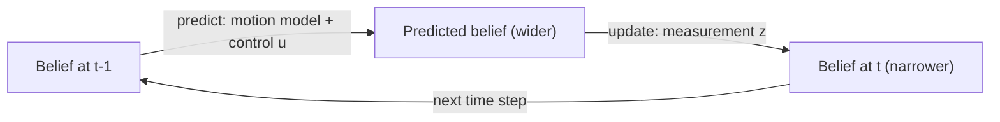

<LessonMeta level="Advanced" time="45 min" prereqs={["Probability for robots", "Linear algebra and transforms", "Python and NumPy", "ROS 2 topics and parameters"]} />

آپ کے روبوٹ کے وہیل انکوڈرز (wheel encoders) بتاتے ہیں کہ وہ 1.00 میٹر آگے بڑھا ہے، ایک IMU کہتا ہے کہ وہ 3 ڈگری مڑا ہے، اور ایک lidar بتاتا ہے کہ دیوار 2.31 میٹر دور ہے۔ ان میں سے کوئی بھی دوسرے سے مکمل متفق نہیں ہے، اور نہ ہی کوئی ایک بالکل سچ ہے۔ پہیے پھسلتے ہیں، gyros میں drift ہوتی ہے، lidars میں شور (noise) ہوتا ہے۔ اس کے باوجود روبوٹ کو ایک سیکنڈ میں کئی بار یہ فیصلہ کرنا ہوتا ہے کہ "میں کہاں ہوں اور میں کتنی تیزی سے جا رہا ہوں؟"۔ اس کام کا بنیادی ذریعہ **حالت کا تخمینہ** (state estimation) ہے، اور اس کا سب سے مشہور جزو Kalman filter ہے، جس نے خلابازوں کو چاند پر پہنچایا اور اب تقریباً ہر روبوٹ کے اندر کام کرتا ہے۔

<Objectives>

- Bayes filter کو پیشین گوئی (predict) اور تجدید (update) کے ایک لوپ کے طور پر بیان کریں، اور ایک سادہ discrete ورژن چلائیں۔
- Kalman gain کے پیچھے موجود فہم اخذ کریں اور NumPy میں predict اور update کے مراحل کوڈ کریں۔
- رینج اور بیئرنگ (bearing) پیمائش والے روبوٹ کے لیے ایک 2D Kalman filter اور ایک extended Kalman filter (EKF) تیار کریں۔
- ایک IMU کو قطعی ہیڈنگ (absolute heading) کے ساتھ فیوز کریں، اور ROS 2 میں وہیل اوڈومیٹری اور IMU کے لیے `robot_localization` کنفیگر کریں۔

</Objectives>

## حالت، یقین اور Bayes فلٹر {#state-belief-and-the-bayes-filter}

<Term def="نمبرز کا وہ سیٹ جو روبوٹ کے بارے میں وہ سب کچھ بیان کرتا ہے جو اس کے مستقبل کی پیشین گوئی کے لیے ضروری ہو، جیسے پوزیشن، رخ اور رفتار">حالت</Term> (state) $x_t$ وہ چیز ہے جو آپ جاننا چاہتے ہیں: زمینی روبوٹ کے لیے، شاید $(x, y, \theta)$۔ آپ اسے کبھی براہ راست نہیں دیکھ پاتے۔ آپ **پیمائشیں** (measurements) $z_t$ دیکھتے ہیں (سینسر ریڈنگز) اور آپ کو **کنٹرولز** $u_t$ معلوم ہوتے ہیں (جو آپ نے حکم دیا)۔ لہذا ایک حتمی جواب کے بجائے آپ ایک <Term def="روبوٹ کی طرف سے اب تک کی گئی تمام پیمائشوں اور کمانڈز کی بنیاد پر ممکنہ حالتوں پر مشتمل امکانی تقسیم">یقین</Term> (belief) برقرار رکھتے ہیں: یعنی ایک امکانی تقسیم (probability distribution) کہ روبوٹ کہاں ہو سکتا ہے۔

ہر تخمینہ کار (estimator) جس سے آپ کا واسطہ پڑے گا، دو مراحل دہراتا ہے۔

1. **پیشین گوئی (Predict):** وقت کے ساتھ یقین کو آگے بڑھانے کے لیے موشن ماڈل استعمال کریں۔ چونکہ حرکت میں شور ہوتا ہے، اس لیے یقین *پھیل* جاتا ہے (زیادہ غیر یقینی ہو جاتا ہے)۔
2. **تجدید (Update):** ایک نئی پیمائش موصول ہوتی ہے۔ یقین کو اس بات کے امکان سے ضرب دیں کہ ہر ممکنہ حالت میں وہ پیمائش کتنی درست ہو سکتی ہے، اور پھر اسے نارملائز (normalise) کریں۔ یقین *سکڑ* جاتا ہے (زیادہ واضح ہو جاتا ہے)۔



علامات کی صورت میں، جہاں $\eta$ ایک نارملائزنگ کانسٹنٹ ہے:

$$
\overline{bel}(x_t) = \int p(x_t \mid x_{t-1}, u_t)\, bel(x_{t-1})\, dx_{t-1}, \qquad
bel(x_t) = \eta\, p(z_t \mid x_t)\, \overline{bel}(x_t).
$$

آپ اس لوپ کو ایک چھوٹے مسئلے پر چلا سکتے ہیں۔ ایک روبوٹ 10 خانوں (cells) کی ایک راہداری میں ہے جس میں دروازے (D) اور دیواریں (W) ہیں۔ یہ صرف "دروازہ" یا "دیوار" کا پتہ لگا سکتا ہے، ایک ایسے سینسر کے ساتھ جو 80% درست ہے، اور اس کی حرکات بعض اوقات پھسل جاتی ہیں۔

```python title="histogram_filter.py"
import numpy as np

# A 1D corridor of 10 cells. D = door, W = wall.
world = np.array(list("WDWWDWWWDW"))
belief = np.full(len(world), 1.0 / len(world))          # start: no idea where we are

P_HIT, P_MISS = 0.8, 0.2                                # sensor is right 80% of the time


def sense(belief, reading):
    likelihood = np.where(world == reading, P_HIT, P_MISS)
    posterior = belief * likelihood                     # Bayes: prior x likelihood
    return posterior / posterior.sum()                  # normalise


def move(belief, steps):
    moved = np.roll(belief, steps)                      # shift right (the corridor wraps)
    return 0.8 * moved + 0.1 * np.roll(moved, 1) + 0.1 * np.roll(moved, -1)   # slip blur


for reading, step in [("D", 1), ("W", 1), ("W", 1), ("W", 1), ("D", 0)]:
    belief = sense(belief, reading)
    print("sense", reading, "->", np.round(belief, 2))
    belief = move(belief, step)

print("most likely cell now:", int(np.argmax(belief)))   # 8
```

یقین (belief) کے گراف پر غور کریں۔ پہلے "دروازے" کے بعد اس میں تین ابھار (bumps) بنتے ہیں (ہر دروازے کے لیے ایک)۔ اس کے بعد کی ہر ریڈنگ ان ابھاروں کو ختم کرتی جاتی ہے جو مطابقت نہیں رکھتے، یہاں تک کہ صرف ایک باقی رہ جاتا ہے۔ لوکلائزیشن (localization) کا خلاصہ یہی ہے، اور اگلے سبق میں AMCL پارٹیکلز کے ذریعے بالکل یہی کام کرتا ہے۔

<KeyIdea title="ہر فلٹر کا اصول: پہلے پیشین گوئی، پھر تجدید">
پیشین گوئی معلومات کو خرچ کرتی ہے (غیر یقینی بڑھتی ہے کیونکہ دنیا شوریلی ہے)۔ پیمائش معلومات واپس خریدتی ہے (غیر یقینی سکڑتی ہے)۔ ایک اچھا تخمینہ کار وہ ہے جو ہر ذریعے پر بالکل اتنا ہی بھروسہ کرے جتنی اس کی درستگی کی حقیقت ہو۔
</KeyIdea>

## Kalman فلٹر {#the-kalman-filter}

ہسٹوگرام فلٹر ہر خانے کے لیے ایک نمبر محفوظ کرتا ہے، جو کئی ڈائمینشنز میں بہت زیادہ پھیل جاتا ہے۔ <Term def="لکیری (linear) سسٹمز کے لیے گاسین شور کے ساتھ ایک بہترین ریکرسیو تخمینہ کار؛ یہ مکمل تقسیم کے بجائے اوسط اور کوویرینس کو ٹریک کرتا ہے">Kalman filter</Term> ایک سمجھوتہ کرتا ہے: فرض کریں کہ ہر چیز Gaussian ہے اور ماڈلز linear ہیں۔ تب یقین کو صرف دو چیزوں سے بیان کیا جا سکتا ہے: ایک اوسط $\hat{x}$ (بہترین اندازہ) اور ایک کوویرینس (covariance) $P$ (کتنی غیر یقینی ہے، اور مختلف متغیرات کی غلطیاں ایک دوسرے سے کیسے تعلق رکھتی ہیں)۔

### ایک ڈائمینشن کی بصیرت {#the-one-dimensional-intuition}

فرض کریں کہ کسی پوزیشن کے بارے میں آپ کی پیشین گوئی $\sigma_1^2$ کے تغیر (variance) کے ساتھ $\mu_1$ ہے، اور ایک سینسر $\sigma_2^2$ تغیر کے ساتھ $\mu_2$ بتاتا ہے۔ فیوز شدہ تخمینہ ایک وزنی اوسط (weighted average) ہوگا، جس کا وزن اعتماد پر منحصر ہے:

$$
\mu = \mu_1 + K(\mu_2 - \mu_1), \quad K = \frac{\sigma_1^2}{\sigma_1^2 + \sigma_2^2}, \quad
\sigma^2 = (1-K)\,\sigma_1^2 .
$$

$K$ کو یوں سمجھیں کہ "مجھے نئی پیمائش پر کتنا بھروسہ ہے؟"۔ اگر سینسر بہت درست ہے ($\sigma_2^2 \to 0$)، تو $K \to 1$ اور آپ فوراً اس کی قدر کو اپنا لیتے ہیں۔ اگر سینسر بیکار ہے ($\sigma_2^2 \to \infty$)، تو $K \to 0$ اور آپ اسے نظر انداز کر دیتے ہیں۔ فیوز شدہ تغیر ہمیشہ دونوں ان پٹس سے چھوٹا ہوتا ہے: دو غیر کامل ذرائع کو یکجا کرنا دونوں سے بہتر نتیجہ دیتا ہے۔

### مکمل فلٹر {#the-full-filter}

اب ویکٹرز کا استعمال کرتے ہیں۔ ماڈل یہ ہے:

$$
x_k = F x_{k-1} + w_k, \quad w_k \sim \mathcal{N}(0, Q), \qquad
z_k = H x_k + v_k, \quad v_k \sim \mathcal{N}(0, R).
$$

$F$ بیان کرتا ہے کہ حالت کیسے تبدیل ہوتی ہے (مثال کے طور پر، پوزیشن میں رفتار ضرب $\Delta t$ شامل ہوتی ہے)، $H$ وہ چیز منتخب کرتا ہے جس کی پیمائش سینسر کرتا ہے، $Q$ **پروسیس شور** (process noise) ہے (آپ کو اپنے موشن ماڈل پر کتنا عدم اعتماد ہے) اور $R$ **پیمائشی شور** (measurement noise) ہے (آپ کو سینسر پر کتنا عدم اعتماد ہے؛ عام طور پر ڈیٹا شیٹ سے ملتا ہے)۔ فلٹر یہ ہے:

| مرحلہ | مساوات |
|---|---|
| حالت کی پیشین گوئی (Predict state) | $\hat{x}^- = F \hat{x}$ |
| کوویرینس کی پیشین گوئی (Predict covariance) | $P^- = F P F^T + Q$ |
| اختراع (Innovation) | $y = z - H\hat{x}^-$ |
| اختراع کا کوویرینس (Innovation covariance) | $S = H P^- H^T + R$ |
| کالمین گین (Kalman gain) | $K = P^- H^T S^{-1}$ |
| حالت کی تجدید (Update state) | $\hat{x} = \hat{x}^- + K y$ |
| کوویرینس کی تجدید (Update covariance) | $P = (I - KH)\,P^-$ |

یہ میٹرکس گین دراصل 1D وزن کا ہی دوسرا روپ ہے: $P^- H^T$ کا مطلب ہے "پیمائش کی سمتوں میں پیشین گوئی کتنی غیر یقینی ہے" اور $S^{-1}$ کل غیر یقینی پر تقسیم کرتا ہے۔ **انوویشن** (innovation) $y$ حیرت کی مقدار ہے: یعنی پیمائش آپ کی پیشین گوئی سے کتنی مختلف ہے۔ بڑی حیرتیں سینسر کی خرابیوں کی نشاندہی بھی کرتی ہیں۔

### کوڈ: ایک متحرک ہدف کو ٹریک کرنا {#code-tracking-a-moving-target}

حالت $[x, y, v_x, v_y]$ ہے، اور ایک سینسر صرف شوریلی پوزیشن کی اطلاع دیتا ہے۔ فلٹر کو رفتار کا تخمینہ لگانا ہے، جسے وہ کبھی براہ راست نہیں دیکھتا۔

```python title="kalman_filter.py"
import numpy as np


class KalmanFilter:
    """Linear Kalman filter: x_k = F x_{k-1} + w (cov Q), z_k = H x_k + v (cov R)."""

    def __init__(self, F, H, Q, R, x0, P0):
        self.F, self.H, self.Q, self.R = F, H, Q, R
        self.x, self.P = x0.astype(float), P0.astype(float)

    def predict(self):
        self.x = self.F @ self.x
        self.P = self.F @ self.P @ self.F.T + self.Q

    def update(self, z):
        y = z - self.H @ self.x                       # innovation
        S = self.H @ self.P @ self.H.T + self.R       # innovation covariance
        K = self.P @ self.H.T @ np.linalg.inv(S)      # Kalman gain
        self.x = self.x + K @ y
        I_KH = np.eye(len(self.x)) - K @ self.H
        self.P = I_KH @ self.P @ I_KH.T + K @ self.R @ K.T   # Joseph form: stays symmetric
        return K


rng = np.random.default_rng(1)
dt = 0.1
F = np.array([[1, 0, dt, 0], [0, 1, 0, dt], [0, 0, 1, 0], [0, 0, 0, 1]], float)
H = np.array([[1, 0, 0, 0], [0, 1, 0, 0]], float)
Q = np.diag([1e-4, 1e-4, 1e-2, 1e-2])
R = np.eye(2) * 0.5**2

kf = KalmanFilter(F, H, Q, R, x0=np.zeros(4), P0=np.eye(4) * 10.0)

truth = np.array([0.0, 0.0, 1.0, 0.5])
meas_err, est_err = [], []
for _ in range(200):
    truth = F @ truth
    z = H @ truth + rng.normal(0, 0.5, 2)
    kf.predict()
    kf.update(z)
    meas_err.append(np.linalg.norm(z - truth[:2]))
    est_err.append(np.linalg.norm(kf.x[:2] - truth[:2]))

print("RMS position error, raw measurement: %.3f m" % np.sqrt(np.mean(np.square(meas_err))))
print("RMS position error, Kalman filter  : %.3f m" % np.sqrt(np.mean(np.square(est_err))))
print("estimated velocity: %.2f, %.2f (true 1.00, 0.50)" % tuple(kf.x[2:]))
```

اسے چلائیں: فلٹر کی پوزیشن کی غلطی خام سینسر کے مقابلے میں تقریباً ایک تہائی رہ جاتی ہے، اور یہ صرف پوزیشنز کی بنیاد پر رفتار کا بھی درست اندازہ لگا لیتا ہے (تھوڑی سی تاخیر کے ساتھ)۔ ابتدائی کوویرینس $P_0 = 10 I$ ظاہر کرتا ہے کہ "مجھے فی الحال کچھ معلوم نہیں ہے"، اس لیے شروع کی چند پیمائشیں غالب رہتی ہیں۔

:::tip[پیشہ ورانہ مشورہ: Q اور R کی ٹیوننگ]
$R$ سینسر کی تفصیلات (specifications) سے یا اسے ساکت حالت میں ناپ کر حاصل کیا جاتا ہے۔ $Q$ وہ پیمانہ ہے جسے آپ خود ٹیون کرتے ہیں۔ اگر یہ بہت چھوٹا ہو تو فلٹر ضدی ہو جاتا ہے اور اصل موڑ یا حرکات سے پیچھے رہ جاتا ہے؛ اگر بہت بڑا ہو تو یہ شوریلی پیمائشوں کی ہو بہو نقل کرنے لگتا ہے۔ انوویشنز کو پلاٹ کریں: اگر وہ زیرو اوسط (zero-mean) والے شور کی طرح دکھائی دیں جس کا پھیلاؤ فلٹر کی پیشین گوئی ($S$) کے مطابق ہو، تو آپ کی سیٹنگز درست ہیں۔
:::

## ایکسٹینڈڈ کالمین فلٹر (EKF) {#the-extended-kalman-filter}

روبوٹس لکیری (linear) نہیں ہوتے۔ ایک پہیوں والا روبوٹ $x = v\cos\theta$ کے مطابق حرکت کرتا ہے، اور ایک رینج-بیئرنگ سینسر میں اسکوائر روٹس اور arctangents شامل ہوتے ہیں۔ <Term def="Extended Kalman filter: ایک ایسا Kalman فلٹر جو غیر لکیری ماڈلز کو موجودہ تخمینے کے گرد Jacobians کے ذریعے لکیری بنا کر سنبھالتا ہے">EKF</Term> انہی مراحل پر عمل کرتا ہے لیکن $F$ اور $H$ کو نان لکیری فنکشنز $f$ اور $h$ کے **Jacobians** (جزوی مشتقات یا partial derivatives کے میٹرکس) سے بدل دیتا ہے، جن کا تخمینہ موجودہ حالت پر لگایا جاتا ہے:

$$
\hat{x}^- = f(\hat{x}, u), \quad P^- = F_J P F_J^T + Q, \qquad
y = z - h(\hat{x}^-), \quad H_J = \frac{\partial h}{\partial x}\Big|_{\hat{x}^-} .
$$

ایک یونی سائیکل روبوٹ کے لیے جس کی حالت $(x, y, \theta)$، رفتار $v$ اور گھومنے کی شرح $\omega$ ہو:

$$
f = \begin{bmatrix} x + v\cos\theta\,\Delta t \\ y + v\sin\theta\,\Delta t \\ \theta + \omega\,\Delta t \end{bmatrix}, \qquad
F_J = \begin{bmatrix} 1 & 0 & -v\sin\theta\,\Delta t \\ 0 & 1 & v\cos\theta\,\Delta t \\ 0 & 0 & 1 \end{bmatrix}.
$$

سینسر ایک معلوم پوزیشن $(l_x, l_y)$ پر موجود لینڈ مارک کے لیے فاصلہ (range) $r$ اور سمت (bearing) $\varphi$ ناپتا ہے۔ جہاں $d_x = l_x - x$ اور $d_y = l_y - y$ ہیں:

$$
h = \begin{bmatrix} \sqrt{d_x^2 + d_y^2} \\ \operatorname{atan2}(d_y, d_x) - \theta \end{bmatrix}, \qquad
H_J = \begin{bmatrix} -d_x/r & -d_y/r & 0 \\ d_y/r^2 & -d_x/r^2 & -1 \end{bmatrix}.
$$

```python title="ekf_landmarks.py"
import numpy as np

LANDMARKS = [np.array([5.0, 3.0]), np.array([-2.0, 4.0])]


def wrap(a):
    """Wrap an angle to (-pi, pi]."""
    return (a + np.pi) % (2 * np.pi) - np.pi


def motion(x, u, dt):
    """Unicycle model: state (x, y, theta), control (v, omega)."""
    v, w = u
    return np.array([x[0] + v * np.cos(x[2]) * dt,
                     x[1] + v * np.sin(x[2]) * dt,
                     wrap(x[2] + w * dt)])


def motion_jacobian(x, u, dt):
    v, _ = u
    return np.array([[1, 0, -v * np.sin(x[2]) * dt],
                     [0, 1, v * np.cos(x[2]) * dt],
                     [0, 0, 1]])


def measure(x, lm):
    """Range and bearing from the robot to a landmark at a known position."""
    dx, dy = lm - x[:2]
    return np.array([np.hypot(dx, dy), wrap(np.arctan2(dy, dx) - x[2])])


def measure_jacobian(x, lm):
    dx, dy = lm - x[:2]
    r2 = dx**2 + dy**2
    r = np.sqrt(r2)
    return np.array([[-dx / r, -dy / r, 0.0],
                     [dy / r2, -dx / r2, -1.0]])


rng = np.random.default_rng(3)
dt = 0.1
Q = np.diag([0.02, 0.02, 0.01]) ** 2          # process noise added per step
R = np.diag([0.2, np.radians(3)]) ** 2        # range (m) and bearing (rad) noise

truth = np.array([0.0, 0.0, 0.0])
x = np.array([0.5, -0.5, 0.2])                 # deliberately wrong initial guess
P = np.diag([1.0, 1.0, 0.3])
dead = x.copy()                                # same odometry, no landmark corrections

err_ekf, err_dead = [], []
for k in range(300):
    u = np.array([1.0, 0.3])                   # true command: drive in a circle
    truth = motion(truth, u, dt)
    u_odom = u + rng.normal(0, [0.05, 0.02])   # what the wheels report (noisy)

    F = motion_jacobian(x, u_odom, dt)         # predict
    x = motion(x, u_odom, dt)
    P = F @ P @ F.T + Q
    dead = motion(dead, u_odom, dt)

    if k % 2 == 0:                             # update with every landmark we can see
        for lm in LANDMARKS:
            z = measure(truth, lm) + rng.normal(0, [0.2, np.radians(3)])
            H = measure_jacobian(x, lm)
            S = H @ P @ H.T + R
            K = P @ H.T @ np.linalg.inv(S)
            innovation = z - measure(x, lm)
            innovation[1] = wrap(innovation[1])
            x = x + K @ innovation
            x[2] = wrap(x[2])
            P = (np.eye(3) - K @ H) @ P

    err_ekf.append(np.linalg.norm(x[:2] - truth[:2]))
    err_dead.append(np.linalg.norm(dead[:2] - truth[:2]))

print("final position error, dead reckoning: %.2f m" % err_dead[-1])
print("final position error, EKF           : %.2f m" % err_ekf[-1])
print("mean position error over the run    : %.2f m (EKF) vs %.2f m (dead reckoning)"
      % (np.mean(err_ekf), np.mean(err_dead)))
```

اسے چلائیں۔ EKF ایک غلط اندازے سے شروع ہوتا ہے اور چند اپ ڈیٹس کے اندر اصل حالت پر آ جاتا ہے، اور پھر اصل پوزیشن سے چند سینٹی میٹر کے فاصلے پر رہتا ہے، جبکہ صرف اوڈومیٹری ("dead reckoning") آہستہ آہستہ راستے سے بھٹک جاتی ہے۔ دو ایسی تفصیلات ہیں جنہیں نظر انداز کرنا عام غلطیوں کا باعث بنتا ہے: **زاویوں کو wrap کرنا ضروری ہے** (179 ڈگری اور -179 ڈگری کے درمیان فرق 2 ڈگری ہے، 358 نہیں)، اور Jacobians کا تخمینہ موجودہ *اندازے* پر لگایا جاتا ہے، حقیقت پر نہیں۔

EKF صرف اتنا ہی اچھا ہوتا ہے جتنا کہ اس کا لکیری تخمینہ (linearisation)۔ جب اندازہ بہت دور ہو یا ماڈلز بہت زیادہ خم دار ہوں، تو یہ حد سے زیادہ پراعتماد ہو کر ناکام (diverge) ہو سکتا ہے۔ متبادل کے طور پر unscented Kalman filter اور particle filters شامل ہیں، جن سے آپ اگلے سبق میں ملیں گے۔

## IMU کو دوسرے سینسر کے ساتھ فیوز کرنا {#fusing-an-imu-with-another-sensor}

ایک جائروسکوپ (gyroscope) موڑ کی شرح (turn rate) ناپتا ہے۔ اسے integrate کرنے سے ہیڈنگ (heading) ملتی ہے، لیکن ایک چھوٹا مستقل <Term def="سینسر کے آؤٹ پٹ میں آہستہ آہستہ تبدیل ہونے والا آفسیٹ جو حقیقی مقدار کے صفر ہونے پر بھی برقرار رہتا ہے">bias</Term> جمع ہو کر ایک بڑے انحراف (drift) کی شکل اختیار کر لیتا ہے۔ کسی دوسرے ذریعے سے ملنے والی ہیڈنگ (وہیل اوڈومیٹری، کمپاس، اسکین میچنگ) میں ڈرفٹ نہیں ہوتی لیکن وہ شوریلی یا کبھی کبھار غلط ہو سکتی ہے۔ مل کر وہ دونوں الگ الگ کے مقابلے میں کہیں بہتر کام کرتے ہیں۔ اصل ترکیب یہ ہے کہ اس bias کو حالت (state) کے اندر شامل کر دیا جائے، تاکہ فلٹر اسے *سیکھ* لے:

```python title="yaw_fusion.py"
import numpy as np

rng = np.random.default_rng(0)
dt = 0.01
true_rate = 0.2                      # rad/s, the robot turns slowly
gyro_bias = 0.05                     # rad/s of constant gyro bias
gyro_noise, heading_noise = 0.01, 0.1

# State: [yaw, gyro bias]. The gyro is the control input; an absolute heading
# (e.g. wheel odometry, a compass, or scan matching) is the measurement.
F = np.array([[1.0, -dt], [0.0, 1.0]])
B = np.array([dt, 0.0])
H = np.array([[1.0, 0.0]])
Q = np.diag([1e-6, 1e-8])
R = np.array([[heading_noise**2]])

x = np.zeros(2)
P = np.diag([1.0, 0.1])
yaw_true = 0.0
yaw_gyro_only = 0.0

for k in range(6000):               # 60 seconds
    yaw_true += true_rate * dt
    gyro = true_rate + gyro_bias + rng.normal(0, gyro_noise)
    yaw_gyro_only += gyro * dt
    x = F @ x + B * gyro
    P = F @ P @ F.T + Q
    if k % 10 == 0:                  # heading arrives at 10 Hz
        z = yaw_true + rng.normal(0, heading_noise)
        S = H @ P @ H.T + R
        K = P @ H.T / S
        x = x + (K * (z - H @ x)).ravel()
        P = (np.eye(2) - K @ H) @ P

print("yaw error, gyro integration only: %.3f rad" % abs(yaw_gyro_only - yaw_true))
print("yaw error, fused with heading   : %.3f rad" % abs(x[0] - yaw_true))
print("estimated gyro bias: %.3f rad/s (true %.3f)" % (x[1], gyro_bias))
```

60 سیکنڈ کے بعد صرف جائرو پر مبنی yaw تقریباً 3 ریڈینز غلط ہو جاتا ہے، جبکہ فیوز شدہ تخمینہ ایک ریڈین کے سوویں حصے کے اندر رہتا ہے اور اس نے bias کو بھی دریافت کر لیا ہے۔ یہ تصور (آہستہ آہستہ بدلنے والی غلطیوں کو حالت کا حصہ بنانا) ہر معیاری IMU فیوژن سسٹم کی بنیاد ہے۔

## ROS 2 میں robot_localization {#robot_localization-in-ros-2}

آپ شاذ و نادر ہی ایک حقیقی روبوٹ کے لیے خود فلٹر لکھتے ہیں۔ `robot_localization` پیکیج `ekf_node` (اور `ukf_node`) فراہم کرتا ہے، جو ایک YAML فائل کے مطابق اوڈومیٹری، IMU اور پوز کے کسی بھی امتزاج کو فیوز کرتا ہے۔ اصل چیز ہر سینسر کے لیے 15 عناصر پر مشتمل بولین (boolean) لسٹ ہے، اس ترتیب میں: پوزیشن $x, y, z$؛ رخ (orientation) roll, pitch, yaw؛ لکیری رفتار $x, y, z$؛ زاویائی رفتار roll, pitch, yaw؛ لکیری اسراع (linear acceleration) $x, y, z$۔ یہاں `true` کا مطلب ہے "اس سینسر سے یہ ویلیو استعمال کرو"۔

```yaml title="ekf.yaml"
ekf_filter_node:
  ros__parameters:
    use_sim_time: true
    frequency: 30.0
    two_d_mode: true              # planar robot: ignore z, roll, pitch
    publish_tf: true

    map_frame: map
    odom_frame: odom
    base_link_frame: base_link
    world_frame: odom             # this filter produces the odom -> base_link transform

    odom0: /odom                  # wheel odometry
    odom0_config: [false, false, false,
                   false, false, false,
                   true,  true,  false,     # use vx, vy
                   false, false, true,      # use yaw rate
                   false, false, false]
    odom0_differential: false

    imu0: /imu
    imu0_config: [false, false, false,
                  false, false, false,
                  false, false, false,
                  false, false, true,       # use yaw rate from the gyro
                  true,  false, false]      # use forward acceleration
    imu0_differential: false
    imu0_remove_gravitational_acceleration: true
```

```bash title="terminal"
ros2 run robot_localization ekf_node --ros-args --params-file ekf.yaml \
  -r odometry/filtered:=/odom/filtered
```

:::warning
پچھلے ماڈیول کے سمیلیٹر میں، `DiffDrive` پلگ ان پہلے ہی `odom` سے `base_link` ٹرانسفارم شائع کرتا ہے۔ اگر `ekf_node` بھی وہی ٹرانسفارم شائع کرے تو دونوں ذرائع میں ٹکراؤ ہوگا اور RViz لرزنے (flicker) لگے گا۔ اس صورت میں یا تو سمیلیٹر کے `/tf` کو برج نہ کریں، یا EKF پر `publish_tf: false` سیٹ کریں اور صرف اس کا آؤٹ پٹ ٹاپک استعمال کریں۔
:::

اہم عام سیٹنگز: ہر سینسر کے میسج میں درست کوویرینس فراہم کریں (فلٹر دی گئی اقدار پر بھروسہ کرتا ہے، اس لیے صفر کوویرینس والے میسج پر مکمل اعتماد کر لیا جائے گا)، اگر پوز میں اچانک چھلانگیں آئیں تو `_differential: true` استعمال کر کے اسے رفتار کی تبدیلیوں کے طور پر فیوز کریں، اور ایک دوسرے فلٹر انسٹینس میں `world_frame: map` سیٹ کریں جو GPS یا لوکلائزیشن پوز کو بھی فیوز کرتا ہو۔

## عملی لیب {#hands-on-lab}

<Steps>

1. `histogram_filter.py` کو چلائیں۔ سینسر کی درستگی `P_HIT` کو 0.6 پر تبدیل کریں اور دیکھیں کہ کسی ایک خانے کے واضح طور پر جیتنے میں کتنے مراحل لگتے ہیں۔
2. `kalman_filter.py` کو چلائیں۔ سمیلیشن میں پیمائشی شور میں اضافہ کریں (`rng.normal` کے اندر `0.5` کو بڑھائیں) لیکن `R` کو تبدیل نہ کریں، اور دیکھیں کہ فلٹر کس طرح حد سے زیادہ پراعتماد ہو جاتا ہے۔ پھر `R` کو حقیقت کے مطابق درست کریں۔
3. `ekf_landmarks.py` چلائیں۔ دوسرے لینڈ مارک کو ہٹا دیں اور غلطی کا موازنہ کریں۔ پھر مرحلہ 100 کے بعد کی تمام اپ ڈیٹس کو ہٹا دیں (`LANDMARKS = []` سیٹ کریں) اور دیکھیں کہ غلطی کیسے دوبارہ بڑھتی ہے۔
4. `yaw_fusion.py` چلائیں۔ `gyro_bias` کو 0.2 پر سیٹ کریں اور تصدیق کریں کہ فلٹر اب بھی اسے سیکھ لیتا ہے۔
5. اپنی Gazebo دنیا میں `ekf.yaml` کے ساتھ `ekf_node` شروع کریں، روبوٹ کو کی بورڈ سے چلائیں، اور RViz میں یا `ros2 topic echo` کے ساتھ `/odom` کا `/odom/filtered` سے موازنہ کریں۔

</Steps>

یہ لیب کامیاب سمجھی جائے گی اگر فیوز شدہ تخمینے کسی بھی ایک سینسر کے مقابلے میں واضح طور پر زیادہ مستحکم ہوں اور آپ یہ بتا سکیں کہ آپ نے `Q` اور `R` میں سے کس کو بدلا اور کیوں بدلا۔

## مشقیں {#exercises}

<Exercise title="اسکیلر کالمین گین" level="Beginner">

آپ کی پیشین گوئی بتاتی ہے کہ روبوٹ 4.0 کے تغیر کے ساتھ 10.0 میٹر پر ہے۔ ایک سینسر 1.0 کے تغیر کے ساتھ 12.0 میٹر ریڈنگ دیتا ہے۔ فیوز شدہ تخمینہ اور اس کا تغیر کیا ہوگا؟

<Solution>

$K = 4 / (4 + 1) = 0.8$۔ تخمینہ $= 10 + 0.8(12 - 10) = 11.6$ میٹر۔ تغیر $= (1 - 0.8) \cdot 4 = 0.8$، جو دونوں ان پٹس کے تغیر سے کم ہے۔

</Solution>
</Exercise>

<Exercise title="ایک ضدی فلٹر کو ڈیبگ کرنا" level="Intermediate">

آپ کا فلٹر روبوٹ کے ساتھ روانی سے چلتا ہے لیکن جب روبوٹ تیزی سے مڑتا ہے تو اس کا نوٹس لینے میں کئی سیکنڈ لیتا ہے۔ ممکنہ طور پر کون سا میٹرکس بہت چھوٹا ہے، اور آپ کیا تبدیل کریں گے؟

<Solution>

پروسیس شور $Q$ بہت چھوٹا ہے، اس لیے فلٹر اپنے ہموار موشن ماڈل پر حد سے زیادہ بھروسہ کرتا ہے اور پیمائشوں کو کم وزن دیتا ہے۔ $Q$ کو بڑھائیں (خاص طور پر رفتار کی شرائط کے لیے)۔ انوویشنز کو پلاٹ کر کے تصدیق کریں: موڑ کے دوران ان میں ایک ہی علامت (positive یا negative) کی ایک طویل قطار نظر آئے گی۔

</Solution>
</Exercise>

<Exercise title="کنفیگریشن کا انتخاب" level="Advanced">

ایک روبوٹ کے پاس وہیل اوڈومیٹری (قابل اعتماد رفتارب، پہیے پھسلنے پر ہیڈنگ میں سست ڈرفٹ) اور جائرو کے ساتھ ایک IMU ہے۔ `robot_localization` میں، آپ ہر ایک سے yaw سے متعلق کون سے ان پٹس استعمال کریں گے، اور دونوں سے absolute yaw کیوں استعمال نہیں کریں گے؟

<Solution>

جائرو سے yaw rate استعمال کریں (ہموار اور تیز ردعمل) اور اوڈومیٹری سے لکیری رفتار لیں؛ اوڈومیٹری سے yaw rate صرف اس صورت میں لیں اگر اس کا کوویرینس حقیقت پسندانہ ہو۔ دونوں سے absolute yaw کو فیوز کرنا فلٹر کو ڈرفٹ ہونے والی ہیڈنگ پر دو بار بھروسہ کرنے پر مجبور کر سکتا ہے؛ اگر IMU ایک کیلیبریٹڈ مکمل رخ (magnetometer کے ساتھ) فراہم کرتا ہے، تو اسے yaw کے لیے استعمال کریں۔ ہمیشہ ہر میسج میں موجود کوویرینس کی جانچ کریں۔

</Solution>
</Exercise>

## اپنی سمجھ کی جانچ کریں {#check-your-understanding}

<Quiz questions={[
  {q: "Kalman فلٹر میں، پروسیس شور Q کس چیز کی نمائندگی کرتا ہے؟", options: ["سینسر کی غیر درستگی", "مراحل کے درمیان موشن ماڈل پر آپ کو کتنا عدم اعتماد ہے", "نقشے کا سائز", "لوپ کی فریکوئنسی"], answer: 1, explain: "Q کو پیشین گوئی میں کوویرینس میں شامل کیا جاتا ہے، جو اس بات کی غیر یقینی کو ظاہر کرتا ہے کہ حالت کیسے آگے بڑھتی ہے۔ R سینسر کے لیے مخصوص ہے۔"},
  {q: "پیشین گوئی کے مرحلے اور تجدید کے مرحلے کے دوران غیر یقینی صورتحال کا کیا ہوتا ہے؟", options: ["پیشین گوئی میں بڑھتی ہے، تجدید میں سکڑتی ہے", "پیشین گوئی میں سکڑتی ہے، تجدید میں بڑھتی ہے", "دونوں میں یکساں رہتی ہے", "دونوں میں بڑھتی ہے"], answer: 0, explain: "حرکت سے شور شامل ہوتا ہے، لہذا کوویرینس بڑھتا ہے۔ پیمائش سے معلومات ملتی ہیں، لہذا یہ سکڑ جاتا ہے۔"},
  {q: "EKF میں Jacobians کا استعمال کیوں کیا جاتا ہے؟", options: ["کوڈ کو مختصر بنانے کے لیے", "موجودہ تخمینے کے گرد غیر لکیری حرکتی اور پیمائشی ماڈلز کو لکیری بنانے کے لیے", "شور کے ماڈلز کی ضرورت ختم کرنے کے لیے", "کیمرے کی رفتار تیز کرنے کے لیے"], answer: 1, explain: "کالمین مساوات کو لکیری ماڈلز کی ضرورت ہوتی ہے، اس لیے EKF مقامی لکیری تخمینے کے ذریعے f اور h کی تقریب (approximation) کرتا ہے۔"},
  {q: "IMU فیوژن فلٹر کی حالت میں جائرو بائیس (gyro bias) کو کیوں شامل کیا جائے؟", options: ["کیونکہ بائیس ہر مرحلے پر بے ترتیب ہوتا ہے", "تاکہ فلٹر آہستہ آہستہ بڑھتے ہوئے آفسیٹ کا تخمینہ لگا سکے اور اسے منسوخ کر سکے", "حالت کے ویکٹر کو بڑا بنانے کے لیے", "کیونکہ بائیس yaw کے برابر ہوتا ہے"], answer: 1, explain: "ایک مستقل آفسیٹ جمع ہو کر ڈرفٹ بن جاتا ہے۔ حالت میں بائیس کو شامل کرنے سے، ایک قطعی پیمائش فلٹر کو اسے سیکھنے اور ختم کرنے کی اجازت دیتی ہے۔"}
]} />

<Takeaways>

- حالت کا تخمینہ حالت کے بارے میں ایک یقین برقرار رکھتا ہے اور پیشین گوئی (غیر یقینی بڑھتی ہے) اور تجدید (غیر یقینی سکڑتی ہے) کو دہراتا ہے۔
- Kalman gain پیشین گوئی اور پیمائش کو ان کے اعتماد کی بنیاد پر وزن دیتا ہے؛ فیوز شدہ تغیر دونوں میں سے کسی بھی ذریعے سے کم ہوتا ہے۔
- $Q$ ماڈل پر عدم اعتماد کو ظاہر کرتا ہے، $R$ سینسر پر عدم اعتماد کو؛ $Q$ کو ٹیون کریں، $R$ کی پیمائش کریں۔
- EKF جیکوبینز کی مدد سے غیر لکیری ماڈلز کو لکیری بناتا ہے؛ زاویوں کو wrap کریں اور اگر تخمینہ بہت دور ہو تو خرابی کی توقع رکھیں۔
- آہستہ آہستہ تبدیل ہونے والی غلطیوں، جیسے gyro bias، کو حالت میں شامل کریں تاکہ فلٹر انہیں خود سیکھ لے۔
- ROS 2 میں، `robot_localization` ایک YAML فائل کی مدد سے اوڈومیٹری اور IMU کو فیوز کرتا ہے؛ دو نوڈز کو ایک ہی TF شائع کرنے سے روکیں۔

</Takeaways>

## مزید گہرائی میں جائیں {#go-deeper}

- `robot_localization` کی دستاویزات: [docs.ros.org/en/jazzy](https://docs.ros.org/en/jazzy/)
- Thrun, Burgard اور Fox، *Probabilistic Robotics* (MIT Press)، اس پورے شعبے کی معیاری درسی کتاب۔
- Roger Labbe، *Kalman and Bayesian Filters in Python*، GitHub پر نوٹ بکس کی ایک مفت کتاب۔
- Kalman، "A New Approach to Linear Filtering and Prediction Problems" (1960)، اصل تحقیقی مقالہ۔

کہیں پھنس گئے ہیں؟ نیچے دائیں جانب کورس کے معاون **Rivet** سے پوچھیں۔

اگلا: [SLAM اور لوکلائزیشن](./05-slam-and-localization.mdx)
