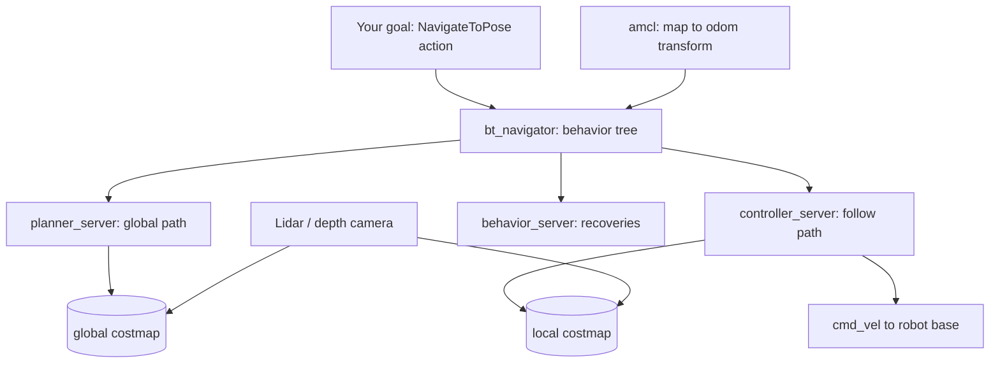

<LessonMeta level="Intermediate" time="45 min" prereqs={["ROS 2 nodes, topics and services", "ROS 2 actions and launch files", "Gazebo basics", "SLAM and localization"]} />

آپ کے ڈیلیوری روبوٹ کے پاس عمارت کا نقشہ ہے اور وہ جانتا ہے کہ وہ کہاں موجود ہے۔ کوئی شخص "room 214 میں جاؤ" پر ٹیپ کرتا ہے۔ اس ٹیپ اور روبوٹ کے راہداری میں آگے بڑھنے کے درمیان بہت کچھ ہونا ہوتا ہے: ایک راستے کی منصوبہ بندی کرنا (route plan کرنا)، اس پر عمل کرتے ہوئے آگے بڑھنا جب کہ کوئی انسان راستے میں آ جائے، دیواروں کے قریب رفتار دھیمی کرنا، اور اگر پھنس جائے تو ریکوری (recovery) کرنا۔ **Nav2** ایک اوپن سورس ROS 2 اسٹیک ہے جو یہ تمام کام کرتا ہے، اور آپ کو خود اس کے لیے کوڈ لکھنے کی شاذ و نادر ہی ضرورت پڑتی ہے۔

<Objectives>

- اہم Nav2 سرورز کے نام بتائیں اور وضاحت کریں کہ ہر ایک کیا کام کرتا ہے۔
- وضاحت کریں کہ costmaps رکاوٹوں کی نمائندگی کیسے کرتے ہیں اور inflation روبوٹ کے راستوں کو کیسے ترتیب دیتی ہے۔
- کسی دیے گئے روبوٹ کے لیے عام planner اور controller پلگ انز کے درمیان انتخاب کریں۔
- سیمولیٹڈ روبوٹ کے ساتھ Nav2 لانچ کریں اور simple commander API کے ساتھ Python اسکرپٹ سے اہداف (goals) بھیجیں۔

</Objectives>

## بڑی تصویر (The big picture)

Nav2 صرف ایک پروگرام نہیں ہے۔ یہ باہم تعاون کرنے والے ROS 2 نوڈز کا ایک سیٹ ہے، جن میں سے زیادہ تر **lifecycle nodes** ہیں (منظم شدہ اسٹارٹ اپ اسٹیٹس والے نوڈز) جنہیں ایک مینیجر صحیح ترتیب میں فعال کرتا ہے۔ بنیادی نوڈز درج ذیل ہیں:

| Node | Job |
|---|---|
| `planner_server` | روبوٹ سے ہدف (goal) تک گلوبل راستے (global path) کا حساب لگاتا ہے |
| `controller_server` | مقامی طور پر (locally) اس راستے کی پیروی کرتا ہے اور رفتار کے کمانڈز (velocity commands) شائع کرتا ہے |
| `smoother_server` | پلاننگ کے بعد راستے کو ہموار (smooth) بناتا ہے |
| `behavior_server` | ریکوری ایکشنز جیسے کہ گھومنا (spin)، پیچھے ہٹنا (back up) اور انتظار کرنا (wait) |
| `bt_navigator` | بیہیویئر ٹری (behavior tree) چلاتا ہے جو یہ فیصلہ کرتا ہے کہ اوپر دیئے گئے نوڈز میں سے کس کو اور کب کال کرنا ہے |
| `map_server` اور `amcl` | ایک محفوظ شدہ نقشہ فراہم کرتے ہیں اور اس پر روبوٹ کو لوکلائز (localize) کرتے ہیں |
| `lifecycle_manager` | لائف سائیکل نوڈز کو ترتیب وار شروع اور بند کرتا ہے |

روبوٹ کو خود کچھ چیزیں فراہم کرنی ہوں گی: `map`، `odom` اور `base_link` فریمز کے ساتھ ایک ٹرانسفارم ٹری (transform tree)، ایک اوڈومیٹری سورس (odometry source)، اور ایک سنسر جو رکاوٹوں کو دیکھ سکے (2D lidar یا depth camera)۔ اگر آپ SLAM اور tf2 کے اسباق مکمل کر چکے ہیں، تو آپ پہلے ہی جانتے ہیں کہ یہ کہاں سے آتے ہیں۔



## Costmaps: Nav2 دنیا کو کیسے دیکھتا ہے

پلانرز خام سنسر ڈیٹا (raw sensor data) کو نہیں دیکھتے۔ وہ **costmap** کو دیکھتے ہیں، جو ایک 2D گریڈ ہوتا ہے جہاں ہر سیل میں 0 (آزاد / free) سے لے کر 254 (مہلک رکاوٹ / lethal obstacle) تک کی قیمت (cost) ہوتی ہے۔ سیل کی قیمت 255 کا مطلب غیر معروف (unknown) ہے۔ Nav2 دو قسم کے costmaps رکھتا ہے:

- **global costmap** پورے نقشے کو ڈھانپتا ہے اور طویل فاصلے کی پلاننگ کے لیے استعمال ہوتا ہے۔
- **local costmap** ایک چھوٹا ونڈو ہوتا ہے جو روبوٹ کے ساتھ منتقل ہوتا ہے اور کنٹرولر اسے ان چیزوں سے بچنے کے لیے استعمال کرتا ہے جن کا نقشے میں پتہ نہیں تھا۔

ہر costmap تہہ در تہہ **layers** سے مل کر بنتا ہے:

- **Static layer**: محفوظ شدہ نقشہ۔
- **Obstacle or voxel layer**: براہ راست سنسر ریڈنگز (lidar hits, depth points)۔
- **Inflation layer**: ہر رکاوٹ کے گرد تدریجی طور پر کم ہوتی ہوئی قیمت (decaying cost) پھیلاتا ہے۔

انفلیشن (Inflation) ایک ذہین طریقہ کار ہے۔ یہ پچھلے سبق سے configuration-space کے تصور کو دوبارہ استعمال کرتا ہے: رکاوٹ کے روبوٹک رداس (robot's radius) کے اندر موجود سیل کو "inscribed" کے طور پر نشان زد کیا جاتا ہے، تاکہ روبوٹ کا مرکز کبھی اس میں داخل نہ ہو سکے۔ دور کے سیلز کو ایسی قیمت ملتی ہے جو فاصلے کے ساتھ کم ہوتی جاتی ہے، اس لیے پلانر دیواروں کے قریب جانے پر پابندی کے بغیر راہداریوں کے درمیان میں رہنے کو ترجیح دیتا ہے۔

```yaml title="nav2_params.yaml (excerpt)"
local_costmap:
  local_costmap:
    ros__parameters:
      update_frequency: 5.0
      rolling_window: true
      width: 3
      height: 3
      resolution: 0.05
      robot_radius: 0.22
      plugins: ["voxel_layer", "inflation_layer"]
      inflation_layer:
        plugin: "nav2_costmap_2d::InflationLayer"
        inflation_radius: 0.7
        cost_scaling_factor: 3.0
```

<KeyIdea title="Costmaps دنیا کو ایسے اعداد میں بدل دیتے ہیں جن کا ایک پلانر موازنہ کر سکتا ہے">
Nav2 جس چیز کی بھی منصوبہ بندی کرتا ہے یا جس سے بچتا ہے، وہ costmap کے ذریعے ہوتی ہے۔ اگر روبوٹ کونوں سے ٹکراتا ہے، دیواروں کے بہت قریب ڈرائیو کرتا ہے یا کسی دروازے میں داخل ہونے سے انکار کرتا ہے، تو سب سے پہلے `robot_radius` (یا footprint)، `inflation_radius` اور `cost_scaling_factor` کو دیکھیں۔ نیویگیشن کے زیادہ تر بگز (navigation bugs) اصل میں costmap سیٹنگز کی وجہ سے ہوتے ہیں۔
</KeyIdea>

## Planners اور controllers

Nav2 **plugin-based** ہے۔ پلانرز، کنٹرولرز، کاسٹ میپ لیئرز اور بیہیویئرز یہ تمام پلگ انز ہیں جن کے نام ایک YAML فائل میں دیے جاتے ہیں، تاکہ آپ کوڈ تبدیل کیے بغیر الگورتھمز کو تبدیل کر سکیں۔

**Planners** (گلوبل، ضرورت کے مطابق چلتے ہیں):

- **NavFn** کاسٹ میپ پر ایک کلاسیکی Dijkstra یا A\* پلانر ہے۔ سادہ اور تیز، ایسے گول روبوٹس کے لیے اچھا ہے جو ایک ہی جگہ پر گھوم سکتے ہیں (turn on the spot)۔
- **Smac Planner** ایک فیملی ہے: 2D (grid A\*)، Hybrid-A\* (کار کی طرح کے ٹرننگ ریڈیس کی پاسداری کرتا ہے) اور State Lattice (ممكنہ حرکات کی لائبریری کا استعمال کرتا ہے)۔ ایسے روبوٹس کے لیے Hybrid-A\* یا Lattice کا انتخاب کریں جو ایک جگہ پر روٹیٹ (rotate) نہیں ہو سکتے۔
- **Theta\*** کھلی جگہوں پر کم موڑوں کے ساتھ کسی بھی زاویے (any-angle) والے راستے بناتا ہے۔

**Controllers** (لوکل، تقریباً 20 Hz پر چلتے ہیں):

- **DWB** رفتار کی کمانڈز کا نمونہ (sample velocity commands) لیتا ہے اور ان کی چھوٹی رفتاروں کا تنقیدی جائزہ (critics) لیتا ہے (راستے کے قریب رہنا، رکاوٹوں سے بچنا، ہدف تک پہنچنا)۔
- **Regulated Pure Pursuit** راستے میں آگے کے ایک نقطے (lookahead point) کی پیروی کرتا ہے اور رکاوٹوں اور تیز موڑوں کے قریب رفتار دھیمی کرتا ہے۔ قابل پیش گوئی (predictable) اور ڈفرنشل ڈرائیو (differential-drive) روبوٹس کے لیے ایک عام انتخاب۔
- **MPPI** (Model Predictive Path Integral) بہت سے بے ترتیب راستوں کے نمونے لیتا ہے اور ایک موزوں ترین راستہ منتخب کرتا ہے۔ لچکدار اور تنگ جگہوں کو اچھی طرح سے سنبھالتا ہے، لیکن زیادہ کمپیوٹیشن کی قیمت پر۔

یہ تقسیم ایک انسانی ڈرائیور کی طرح ہے: پلانر نقشے پر راستے کا انتخاب کرتا ہے، کنٹرولر اس پر گاڑی چلاتا ہے اور بالکل سامنے آنے والی چیزوں پر ردعمل دیتا ہے۔

## Behavior trees

`bt_navigator` یہ فیصلہ کرتا ہے کہ آگے کیا کرنا ہے ایک **behavior tree** (BT) کے ذریعے، جو چھوٹے کاموں کا ایک درخت ہوتا ہے جو کامیا بی (success)، ناکامی (failure) یا جاری (running) کا نتیجہ واپس کرتا ہے۔ Nav2 BehaviorTree.CPP لائبریری کا استعمال کرتا ہے اور XML فائلوں کے طور پر تیار شدہ درخت فراہم کرتا ہے۔ یہاں ایک سادہ درخت کا خاکہ پیش کیا گیا ہے (ہر لائن ایک XML عنصر ہے):

```text title="simplified navigation tree (outline of the XML)"
RecoveryNode (retry up to 3 times)
├── PipelineSequence "NavigateWithReplanning"
│   ├── RateController (1 Hz)
│   │   └── ComputePathToPose   -> writes {path}
│   └── FollowPath              -> reads {path}
└── Sequence "Recovery"
    ├── ClearEntireCostmap (local)
    ├── Spin (1.57 rad)
    └── Wait (2 s)
```

اسے ایک ترکیب کے طور پر پڑھیں: راستے پر چلتے ہوئے ہر سیکنڈ میں ایک بار منصوبہ بندی کریں۔ اگر کچھ ناکام ہو جاتا ہے، تو ریکوری کی ترتیب (recovery sequence) چلائیں (مقامی کاسٹ میپ کو صاف کریں، گھومیں، انتظار کریں)، پھر تین بار تک دوبارہ کوشش کریں۔ چونکہ لاجک XML میں موجود ہے، آپ C++ کو دوبارہ بلڈ کیے بغیر روبوٹ کے رویے کو تبدیل کر سکتے ہیں، مثال کے طور پر یہ کہنا کہ "بھیڑ والی راہداری میں کبھی نہ گھومیں"۔

:::note
اوپر دیا گیا درخت تدریسی سادگی کے لیے ہے، جس میں XML ایٹریبیوٹس چھوڑ دیے گئے ہیں۔ `nav2_bt_navigator` پیکیج میں اصل ڈیفالٹ درخت زیادہ طویل ہیں، جن میں زیادہ ریکوری کے آپشنز ہیں۔ یہ دیکھنے کے لیے کہ وہ کیسے کام کرتے ہیں، انہیں کھول کر دیکھیں۔
:::

## سیمولیٹڈ روبوٹ کے ساتھ Nav2 چلانا

ROS 2 Jazzy پر Nav2 اور اس کا برنگ اپ (bringup) پیکیج انسٹال کریں:

```bash title="terminal"
sudo apt install ros-jazzy-navigation2 ros-jazzy-nav2-bringup
```

Nav2 bringup پیکیج میں ایک لانچ فائل شامل ہے جو TurtleBot 3 ورلڈ، Nav2 اسٹیک اور RViz کو ایک ساتھ Gazebo میں شروع کرتی ہے۔ مختلف ریلیزز کے درمیان ماحول کے تغیرات (environment variables) اور اضافی سیمولیشن پیکیجز تبدیل ہوئے ہیں، اس لیے Jazzy کے لیے navigation.ros.org پر موجود موجودہ "Getting Started" صفحہ کی پیروی کریں، پھر لانچ کریں:

```bash title="terminal"
export TURTLEBOT3_MODEL=waffle
ros2 launch nav2_bringup tb3_simulation_launch.py headless:=False
```

RViz میں، روبوٹ کو یہ بتانے کے لیے **2D Pose Estimate** کا استعمال کریں کہ وہ کہاں سے شروع ہوتا ہے (یہ لوکلائزیشن کی بنیاد رکھتا ہے)، costmaps کے ظاہر ہونے کا انتظار کریں، پھر منزل پر کلک کرنے کے لیے **Nav2 Goal** کا استعمال کریں۔ گلوبل پاتھ (پلانر کا خیال) اور لوکل پاتھ (کنٹرولر جو کر رہا ہے) کا مشاہدہ کریں۔

## Python سے اہداف (goals) بھیجنا

RViz میں کلک کرنا ڈیمو کے لیے ٹھیک ہے۔ حقیقی ایپلیکیشنز کوڈ سے اہداف بھیجتی ہیں۔ Nav2 ایک `NavigateToPose` ایکشن فراہم کرتا ہے، اور `nav2_simple_commander` پیکیج اسے ایک آسان Python کلاس `BasicNavigator` میں باہم مربوط کرتا ہے۔

```bash title="terminal"
sudo apt install ros-jazzy-nav2-simple-commander
```

```python title="go_to_pose.py"
import math

import rclpy
from geometry_msgs.msg import PoseStamped
from nav2_simple_commander.robot_navigator import BasicNavigator, TaskResult


def make_pose(navigator, x, y, yaw):
    pose = PoseStamped()
    pose.header.frame_id = "map"
    pose.header.stamp = navigator.get_clock().now().to_msg()
    pose.pose.position.x = x
    pose.pose.position.y = y
    pose.pose.orientation.z = math.sin(yaw / 2.0)
    pose.pose.orientation.w = math.cos(yaw / 2.0)
    return pose


def main():
    rclpy.init()
    navigator = BasicNavigator()

    navigator.setInitialPose(make_pose(navigator, 0.0, 0.0, 0.0))
    navigator.waitUntilNav2Active()

    goal = make_pose(navigator, 1.5, 0.5, math.pi / 2)
    navigator.goToPose(goal)

    while not navigator.isTaskComplete():
        feedback = navigator.getFeedback()
        if feedback:
            print(f"distance remaining: {feedback.distance_remaining:.2f} m")

    result = navigator.getResult()
    if result == TaskResult.SUCCEEDED:
        print("Arrived.")
    elif result == TaskResult.CANCELED:
        print("Goal was canceled.")
    else:
        print("Navigation failed.")

    navigator.lifecycleShutdown()
    rclpy.shutdown()


if __name__ == "__main__":
    main()
```

چند باتیں قابل غور ہیں۔ Poses کو `map` فریم میں اسٹیمپ کیا جاتا ہے، اور سمت بندی (orientation) ایک کواٹرنین (quaternion) ہوتی ہے، اس لیے ہیڈنگ اینگل $\psi$ کے لیے $z = \sin(\psi/2)$، $w = \cos(\psi/2)$ بن جاتا ہے۔ `goToPose` نان بلاکنگ (non-blocking) ہے: یہ ایکشن شروع کرتا ہے اور واپس آ جاتا ہے، اس لیے آپ `isTaskComplete()` کو پول (poll) کرتے ہیں اور `navigator.cancelTask()` کے ساتھ منسوخ کر سکتے ہیں۔ یہی کلاس پوز کی فہرست کے لیے `followWaypoints` اور ایک ہی راستے پر موجود تمام پوزز سے گزرنے کے لیے `goThroughPoses` بھی پیش کرتی ہے۔ نوٹ کریں کہ `lifecycleShutdown()` پورے Nav2 اسٹیک کو بند کر دیتا ہے، لہذا اگر آپ چاہتے ہیں کہ اسکرپٹ ختم ہونے کے بعد بھی Nav2 چلتا رہے تو اسے چھوڑ دیں۔

:::warning
آزاد جگہ (free space) میں اہداف منتخب کریں۔ کسی سوجھے ہوئے / پھولے ہوئے (inflated) رکاوٹ کے اندر دیا گیا ہدف مسترد کر دیا جائے گا یا بار بار ناکام ہو جائے گا، اور ایسا لگے گا کہ Nav2 خراب ہے حالانکہ اصل وجہ غلط ہدف ہے۔
:::

## عملی لیب (Hands-on lab)

<Steps>

1. Nav2، برنگ اپ پیکیج اور سمپل کمانڈر انسٹال کریں، پھر اوپر دکھائے گئے طریقے کے مطابق TurtleBot 3 سیمولیشن لانچ کریں۔
2. RViz میں، ابتدائی پوز مرتب کریں، پھر **Nav2 Goal** ٹول کا استعمال کرتے ہوئے ایک ہدف بھیجیں۔ تصدیق کریں کہ روبوٹ پہنچ گیا ہے۔
3. RViz میں **Global Costmap** اور **Local Costmap** ڈسپلے کو فعال کریں اور دیواروں کے گرد سوجھے ہوئے (inflated) علاقے کی شناخت کریں۔
4. دوسرے ٹرمینل میں `go_to_pose.py` چلائیں (اپنے ROS 2 ماحول کے سورس ہونے کے ساتھ)۔ اپنے نقشے میں ایک آزاد نقطہ کے مطابق کوآرڈینیٹس کو ایڈجسٹ کریں۔ کامیابی: یہ کم ہوتے ہوئے فاصلے پرنٹ کرتا ہے اور پھر "Arrived" پرنٹ کرتا ہے۔
5. ڈیفالٹ پیرامیٹرز کاپی کریں، `inflation_radius` بڑھائیں، اور اپنے پیرامیٹرز کے ساتھ دوبارہ لانچ کریں۔ بیان کریں کہ روبوٹ کے راستے کیسے بدلتے ہیں۔

</Steps>

## مشقیں

<Exercise title="دروازے کو ٹھیک کریں" level="Beginner">

روبوٹ 0.8 میٹر کے دروازے سے گزرنے سے انکار کرتا ہے۔ اس کا ریڈیس 0.30 میٹر ہے اور انفلیشن ریڈیس 0.9 میٹر ہے۔ آپ کیا تبدیل کریں گے اور کیوں؟

<Solution>

0.9 میٹر انفلیشن ریڈیس کے ساتھ، دروازے کے دونوں اطراف کا کاسٹ زون درمیان میں اوورلیپ ہوتا ہے اور پورا دروازہ مہنگا (expensive) ہو جاتا ہے۔ `inflation_radius` کو کم کریں (مثال کے طور پر تقریباً 0.5 میٹر تک) یا `cost_scaling_factor` کو بڑھائیں تاکہ قیمتیں تیزی سے کم ہوں۔ روبوٹ جسمانی طور پر فٹ ہو سکتا ہے (0.8 میٹر میں 0.6 میٹر قطر)، لیکن پلانر کا خیال ہے کہ دروازہ بہت مہنگا ہے۔

</Solution>
</Exercise>

<Exercise title="پلگ انز کا انتخاب کریں" level="Intermediate">

آپ 1 میٹر کے کم از کم ٹرننگ ریڈیس کے ساتھ کار جیسا روبوٹ بنا رہے ہیں۔ آپ پہلے کون سے پلانر اور کون سے کنٹرولر کا تجربہ کریں گے، اور کیوں؟

<Solution>

ایک ایسا پلانر جو ٹرننگ ریڈیس کا احترام کرے: Smac Hybrid-A\* یا State Lattice پلانر۔ NavFn اور 2D پلانرز تیز موڑوں والے راستے تیار کریں گے جن پر روبوٹ نہیں چل سکتا۔ کنٹرولر کے لیے، Regulated Pure Pursuit یا MPPI، کیونکہ دونوں کار جیسی حرکت کے ساتھ کام کر سکتے ہیں، جبکہ DWB ایک ایسے ویلوسیٹی سیمپلنگ ماڈل کو فرض کرتا ہے جو ڈفرنشل ڈرائیو کے لیے زیادہ مناسب ہے۔

</Solution>
</Exercise>

<Exercise title="پٹرولنگ اسکرپٹ" level="Intermediate">

روبوٹ کو بالترتیب تین وے پوائنٹس کا دورہ کروانے اور نتیجہ پرنٹ کرنے کے لیے `BasicNavigator` کا استعمال کریں۔ آپ کون سا طریقہ استعمال کریں گے؟

<Solution>

تین `PoseStamped` پیغاموں کی ایک فہرست بنائیں اور `navigator.followWaypoints(waypoints)` کو کال کریں۔ پھر پہلے کی طرح `isTaskComplete()` کو پول کریں اور `getResult()` چیک کریں۔ اگر آپ ہر ایک پر رکنے کے بجائے پوزز کے ذریعے ایک واحد ہموار راستہ چاہتے ہیں تو اس کے بجائے `goThroughPoses` کا استعمال کریں۔

</Solution>
</Exercise>

## اپنی سمجھ کی جانچ کریں

<Quiz questions={[
  {q: "کاسٹ میپ کی انفلیشن لیئر (inflation layer) کیا کرتی ہے؟", options: ["نقشے کو بڑا بناتی ہے", "رکاوٹوں کے گرد اخراجات کا اضافہ کرتی ہے تاکہ راستے محفوظ فاصلہ برقرار رکھیں", "محفوظ شدہ نقشہ اسٹور کرتی ہے", "راستے کو ہموار بناتی ہے"], answer: 1, explain: "انفلیشن رکاوٹوں سے تدریجی طور پر کم ہوتی ہوئی قیمت پھیلاتی ہے، جو روبوٹ کے سائز کا حساب رکھتی ہے اور محفوظ فاصلے کی حوصلہ افزائی کرتی ہے۔"},
  {q: "کون سا Nav2 نوڈ بیہیویئر ٹری کو چلاتا ہے؟", options: ["planner_server", "controller_server", "bt_navigator", "map_server"], answer: 2, explain: "bt_navigator اس درخت کو چلاتا ہے جو پلانر، کنٹرولر اور ریکوری بیہیویئرز کو کال کرتا ہے۔"},
  {q: "ان میں سے کون سا لوکل کنٹرولر پلگ ان ہے؟", options: ["NavFn", "Smac Planner", "Regulated Pure Pursuit", "AMCL"], answer: 2, explain: "NavFn اور Smac گلوبل پلانرز ہیں، AMCL ایک لوکلائزیشن نوڈ ہے۔ Regulated Pure Pursuit مقامی طور پر ایک راستے کی پیروی کرتا ہے۔"},
  {q: "navigator.goToPose(goal) کیا کرتا ہے؟", options: ["روبوٹ کے پہنچنے تک بلاک کرتا ہے", "ایک NavigateToPose ایکشن شروع کرتا ہے اور واپس آتا ہے، تاکہ آپ isTaskComplete() کو پول کر سکیں", "روبوٹ کو ٹیلی پورٹ کرتا ہے", "صرف سیمولیشن میں کام کرتا ہے"], answer: 1, explain: "یہ کال نان بلاکنگ ہے۔ آپ مکمل ہونے کے لیے پول کرتے ہیں اور بعد میں نتیجہ پڑھتے ہیں۔"}
]} />

<Takeaways>

- Nav2 لائف سائیکل نوڈز کا ایک سیٹ ہے: پلانر، کنٹرولر، اسمودھر، بیہیویئر سرور اور بیہیویئر ٹری نیویگیٹر۔
- Costmaps (گلوبل اور لوکل، جو لیئرز سے بنتے ہیں) Nav2 کے دنیا کو دیکھنے کا طریقہ ہیں۔ انفلیشن سیٹنگز راستوں کی شکل طے کرتی ہیں۔
- Planners اور controllers پلگ انز ہیں۔ اپنے روبوٹ کے موشن ماڈل سے میل کھاتے ہوئے ان کا انتخاب کریں۔
- Behavior trees "پلان بنائیں، پیروی کریں، ریکور کریں" لاجک کو XML میں بیان کرتے ہیں جسے آپ ری کمپائل کیے بغیر ایڈٹ کر سکتے ہیں۔
- `BasicNavigator` آپ کو ابتدائی پوز سیٹ کرنے، اہداف اور وے پوائنٹس بھیجنے اور Python سے نتائج پڑھنے کی اجازت دیتا ہے۔

</Takeaways>

## مزید گہرائی میں جائیں

- navigation.ros.org پر Nav2 دستاویزات، خاص طور پر Getting Started، Configuration Guide اور Behavior Trees۔
- Nav2 GitHub ریپوزیٹری میں `nav2_simple_commander` کی مثالیں۔
- Macenski et al., "The Marathon 2: A Navigation System" (arxiv.org/abs/2003.00368)، Nav2 کے ڈیزائن کے پیچھے تحقیقی مقالہ۔
- behaviortree.dev پر BehaviorTree.CPP کی دستاویزات۔

اگلا: [MoveIt 2 کے ساتھ مینیپولیشن](./03-manipulation-with-moveit2.mdx)
