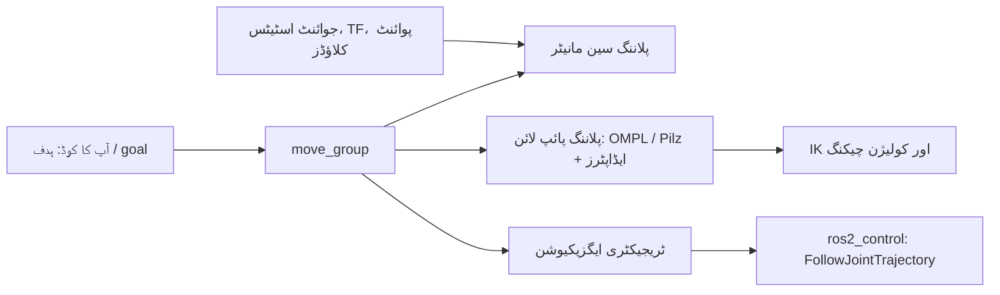

<LessonMeta level="Intermediate" time="45 min" prereqs={["Path planning algorithms", "Forward and inverse kinematics", "ROS 2 actions, parameters and launch", "TF2 and URDF"]} />

ایک روبوٹک بازو (robot arm) ایک میز کے پاس رکھا ہے جس پر ایک مگ موجود ہے۔ آپ چاہتے ہیں کہ گریپر (gripper) مگ کے اوپر پہنچ جائے، بغیر اس کے کہ اس کی کہنی (elbow) پاس رکھے لیمپ کو گرائے۔ اس کے لیے شروع سے ایک پلانر لکھنا یعنی کائنامیٹکس (kinematics)، کولیژن چیکنگ (collision checking)، ایک سیمپلنگ پلانر، ٹائم پیرامیٹرائزیشن اور کنٹرولر ہینڈ آف کو خود سنبھالنا۔ **MoveIt 2** ایک ایسا ROS 2 فریم ورک ہے جو اس تمام عمل کو یکجا کرتا ہے، اور یہ بازو کی مینیپولیشن (arm manipulation) کے لیے بنیادی نقطہ آغاز ہے۔

<Objectives>

- `move_group`، پلاننگ سین (planning scene) اور پلاننگ پائپ لائن کے کرداروں کی وضاحت کریں۔
- کولیژن آبجیکٹس (collision objects) کو شامل اور خارج کریں تاکہ پلانز واقعی رکاوٹوں سے بچ سکیں۔
- جوائنٹ گول (joint goal) اور پوز گول (pose goal) کے لیے پلاننگ کریں، اور ایک سیدھی لائن میں کارٹیزین پاتھ (Cartesian path) پر عمل کریں۔
- اپنے پروجیکٹ کے لیے MoveItPy Python API، C++ انٹرفیس اور ROS میسجز کے درمیان انتخاب کریں۔

</Objectives>

## MoveIt 2 کن اجزاء سے مل کر بنتا ہے

MoveIt موٹرز کو خود نہیں چلاتا۔ یہ ٹریجیکٹریز (trajectories) کا حساب لگاتا ہے اور انہیں آپ کے ROS 2 کنٹرولرز کے حوالے کر دیتا ہے۔ وہ اجزاء جنہیں جاننا ضروری ہے:

- **`move_group`**: مرکزی نوڈ (central node)۔ یہ روبوٹ ماڈل، پلاننگ سین، پلانرز اور کائنامیٹکس سالورز کو کنٹرول کرتا ہے، اور انہیں ROS 2 ایکشنز، سروسز اور ٹاپکس کے طور پر فراہم کرتا ہے۔
- **روبوٹ ماڈل**: آپ کے روبوٹ کی URDF اور ایک معاون SRDF سے پڑھا جاتا ہے، جو <Term def="Semantic Robot Description Format: names planning groups, named poses and which link pairs may safely touch">SRDF</Term> معلومات شامل کرتا ہے جیسے کہ پلاننگ گروپ `panda_arm` (وہ جوائنٹس جو ایک ساتھ پلان ہوتے ہیں)، `ready` جیسے نامزد پوزز (named poses)، اور وہ کولیژن پیئرز (collision pairs) جنہیں نظر انداز کیا جا سکتا ہے۔
- **پلاننگ سین (Planning scene)**: دنیا کی وہ تصویر جو MoveIt دیکھتا ہے: روبوٹ کی موجودہ حالت کے ساتھ ساتھ رکاوٹیں، جڑے ہوئے آبجیکٹس (attached objects) اور آپ کے سینسرز سے حاصل کردہ آکیوپینسی میپ (occupancy map)۔
- **پلاننگ پائپ لائن (Planning pipeline)**: ایک پلانر (بائی ڈیفالٹ OMPL، یا Pilz انڈسٹریل موشن پلانر، CHOMP، STOMP) اور *ریکویسٹ ایڈاپٹرز* کا ایک سلسلہ جو نتائج کو پہلے اور بعد میں پروسیس کرتے ہیں، جیسے کہ ٹائم پیرامیٹرائزیشن۔
- **کائنامیٹکس پلگ ان (Kinematics plugin)**: انورس کائنامیٹکس (IK) کو حل کرتا ہے (بائی ڈیفالٹ KDL، جبکہ TRAC-IK اور تحلیلی IKFast جیسے دیگر متبادل بھی موجود ہیں)۔
- **کنٹرولر انٹرفیس**: ٹریجیکٹری کو ایک `FollowJointTrajectory` کنٹرولر کو بھیجتا ہے، جو عام طور پر `ros2_control` کا حصہ ہوتا ہے۔



<KeyIdea title="MoveIt دنیا کے حقیقی وجود کے بجائے اس کے ماڈل کی بنیاد پر پلاننگ کرتا ہے">
پلانز صرف اتنے ہی محفوظ ہوتے ہیں جتنا کہ آپ کا پلاننگ سین درست ہوتا ہے۔ اگر میز پر ایک باکس موجود ہے لیکن وہ سین میں نہیں ہے، تو MoveIt بلا جھجھک اس کے آر پار جانے کا پلان بنا لے گا۔ اپنے سینسرز یا خود شامل کیے گئے کولیژن آبجیکٹس کے ذریعے سین کو حقیقت کے مطابق رکھنا MoveIt کے بہترین استعمال کی بنیاد ہے۔
</KeyIdea>

## پہلے اسے خود آزمائیں

MoveIt 2 اور Panda arm کی تیار شدہ کنفیگریشن کو ROS 2 Jazzy پر انسٹال کریں:

```bash title="terminal"
sudo apt install ros-jazzy-moveit ros-jazzy-moveit-resources-panda-moveit-config
ros2 launch moveit_resources_panda_moveit_config demo.launch.py
```

RViz ایک **MotionPlanning** پینل کے ساتھ کھلے گا۔ اینڈ ایفیکٹر (end effector) پر موجود نارنجی رنگ کے انٹرایکٹو مارکر کو ایک نئے پوز پر گھسیٹیں، ٹریجیکٹری کے پیش نظارہ (preview) کے لیے **Plan** دبائیں، اور پھر **Execute**۔ فرضی (fake) کنٹرولرز کے ساتھ، بازو صرف RViz میں حرکت کرے گا۔ ہدف کو میز کے اندر گھسیٹنے کی کوشش کریں اور دیکھیں کہ پلانر یا تو انکار کر دیتا ہے یا پھر اس کے گرد سے راستہ تلاش کرتا ہے۔

آپ کے اپنے بازو کے لیے، **MoveIt Setup Assistant** (`ros2 launch moveit_setup_assistant setup_assistant.launch.py`) آپ کی URDF فائل سے کنفیگ پیکیج تیار کرتا ہے: جس میں پلاننگ گروپس، نامزد پوزز، کنٹرولرز اور کولیژن میٹرکس شامل ہوتے ہیں۔

## کوڈ کے ذریعے پلاننگ کرنا

MoveIt کو کمانڈ دینے کے تین اہم طریقے ہیں، اور یہ زبان اور لیول کے لحاظ سے مختلف ہیں۔

**MoveItPy** C++ پلاننگ اسٹیک کے لیے Python بائنڈنگ ہے۔ یہ پلاننگ کے اجزاء کو آپ کے اپنے پروسیس کے اندر چلاتا ہے، اس لیے آپ کو صرف پلان کے لیے الگ سے `move_group` نوڈ کی ضرورت نہیں ہوتی۔ آپ اسے ایک لانچ فائل کے ذریعے MoveIt پیرامیٹر فائلوں کے ساتھ کنفیگر کرتے ہیں۔ ایک نامزد پوز (named pose) کے لیے پلان اس طرح نظر آتا ہے:

```python title="plan_to_named_pose.py"
import rclpy
from moveit.planning import MoveItPy


def main():
    rclpy.init()
    robot = MoveItPy(node_name="moveit_py")
    arm = robot.get_planning_component("panda_arm")

    arm.set_start_state_to_current_state()
    arm.set_goal_state(configuration_name="ready")   # SRDF سے نامزد پوز (named pose)

    result = arm.plan()
    if result:
        robot.execute(result.trajectory, controllers=[])
    else:
        print("Planning failed")

    rclpy.shutdown()


if __name__ == "__main__":
    main()
```

اسے نوڈ کو پاس کیے گئے روبوٹ کی ڈسکرپشن، SRDF، کائنامیٹکس اور پلاننگ پیرامیٹرز کے ساتھ لانچ کیا جانا چاہیے، جسے MoveIt کی ٹیوٹوریلز ایک لانچ فائل میں دکھاتی ہیں۔ ایک سادہ `python3 plan_to_named_pose.py` انہیں تلاش نہیں کر پائے گا۔

**C++ `MoveGroupInterface`** دیرینہ اور سب سے مکمل انٹرفیس ہے۔ یہ ایک چلتے ہوئے `move_group` نوڈ کے ساتھ بات چیت کرتا ہے۔ یہ پوز ٹارگٹس، جوائنٹ ٹارگٹس، `computeCartesianPath`، سین مینیپولیشن اور بہت کچھ پیش کرتا ہے، اور زیادہ تر آفیشل ٹیوٹوریلز اسی کو استعمال کرتے ہیں۔ اگر آپ کو کسی خصوصیت (feature) کی ضرورت ہے اور MoveItPy میں وہ موجود نہیں ہے، تو یہ بہترین متبادل ہے۔

**خام (Raw) ROS انٹرفیسز** کسی بھی زبان سے کام کرتے ہیں۔ `move_group` ایکشن `MoveGroup` (پلان اور ایگزیکیوٹ)، سروسز جیسے `/compute_cartesian_path` اور `/apply_planning_scene`، اور `/planning_scene` ٹاپک فراہم کرتا ہے۔ Python نوڈز جنہیں صرف سین میں ترمیم کرنے یا کارٹیزین پاتھ کی درخواست کرنے کی ضرورت ہوتی ہے، وہ اکثر انہیں براہ راست استعمال کرتے ہیں۔

:::info
MoveItPy کو MoveIt 2 کے ساتھ ہی تیار کیا گیا ہے اور اس کا دائرہ کار C++ انٹرفیس سے کم ہے۔ اس بات کو فرض کرنے کے بجائے کہ C++ طریقہ کار کا بالکل ایک جیسا Python ورژن موجود ہے، تازہ ترین معلومات کے لیے اپنے ریلیز کے مطابق MoveIt کی دستاویزات چیک کریں۔
:::

### پوز گولز بمقابلہ جوائنٹ گولز

ایک **جوائنٹ گول (joint goal)** بالکل واضح طور پر بتاتا ہے کہ آپ کو کون سے اینگلز (angles) چاہئیں۔ اس میں کوئی ابہام نہیں ہوتا۔ ایک **پوز گول (pose goal)** بتاتا ہے کہ اینڈ ایفیکٹر کو کہاں ہونا چاہیے (پوزیشن اور اورینٹیشن) اور جوائنٹ ویلیوز تلاش کرنے کا کام IK پر چھوڑ دیتا ہے۔ یہ کئی وجوہات کی بنا پر ناکام ہو سکتا ہے: پوز پہنچ سے باہر ہے، IK کو کوئی ایسا حل نہیں ملتا جو کولیژن سے پاک ہو، یا پلانر کا ٹائم آؤٹ ہو جاتا ہے۔ جب یہ ناکام ہو جائے، تو یہ فرض کرنے کے بجائے کہ پلانر خراب ہے، یہ پوچھیں کہ کون سا مرحلہ ناکام ہوا۔

## کولیژن آبجیکٹس اور پلاننگ سین

بازو کو میز سے دور رکھنے کے لیے، MoveIt کو اس کے بارے میں بتائیں۔ ایک `moveit_msgs/CollisionObject` کسی شکل (باکس، اسفیئر، سلنڈر، میش)، اس کے پوز اور آپریشن (شامل کریں، ہٹائیں، منتقل کریں) کو بیان کرتا ہے۔ آپ اسے پلاننگ سین میں ایک *diff* (فرق) کے طور پر شائع (publish) کر سکتے ہیں:

```python title="add_table.py"
import time

import rclpy
from geometry_msgs.msg import Pose
from moveit_msgs.msg import CollisionObject, PlanningScene
from rclpy.node import Node
from shape_msgs.msg import SolidPrimitive


class SceneAdder(Node):
    def __init__(self):
        super().__init__("scene_adder")
        self.pub = self.create_publisher(PlanningScene, "/planning_scene", 10)

    def add_table(self):
        box = SolidPrimitive()
        box.type = SolidPrimitive.BOX
        box.dimensions = [0.8, 1.2, 0.04]       # میٹرز میں x, y, z

        pose = Pose()
        pose.position.x = 0.6
        pose.position.z = 0.3
        pose.orientation.w = 1.0

        obj = CollisionObject()
        obj.header.frame_id = "panda_link0"      # روبوٹ کا بیس فریم
        obj.id = "table"
        obj.primitives = [box]
        obj.primitive_poses = [pose]
        obj.operation = CollisionObject.ADD

        scene = PlanningScene()
        scene.is_diff = True                     # صرف تبدیلیاں، پورا سین نہیں
        scene.world.collision_objects = [obj]
        self.pub.publish(scene)


def main():
    rclpy.init()
    node = SceneAdder()
    time.sleep(1.0)          # پبلشر کو کنیکٹ ہونے کا وقت دیں
    node.add_table()
    rclpy.spin_once(node, timeout_sec=0.5)
    rclpy.shutdown()


if __name__ == "__main__":
    main()
```

جب Panda ڈیمو چل رہا ہو تو اسے بھی چلائیں، اور میز RViz میں ظاہر ہو جائے گی۔ پلانز اب اس سے بچ کر بنیں گے۔ اسے ڈیلیٹ کرنے کے لیے اسی `id` کے ساتھ `CollisionObject.REMOVE` کا استعمال کریں۔

### اٹیچ شدہ آبجیکٹس (Attached objects)

جب گریپر کسی کپ کو پکڑتا ہے، تو وہ کپ کولیژن کے مقاصد کے لیے روبوٹ کا حصہ بن جاتا ہے: یہ ہاتھ کے ساتھ حرکت کرتا ہے، اور اسے باہر کی دنیا سے نہیں ٹکرانا چاہیے۔ MoveIt اسے ایک **اٹیچڈ کولیژن آبجیکٹ (attached collision object)** کے طور پر ماڈل کرتا ہے، جسے آپ ایک لنک (عام طور پر ہاتھ) سے منسلک کرتے ہیں۔ آپ ان لنکس کی فہرست بھی بناتے ہیں جنہیں آبجیکٹ چھو سکتا ہے، جیسے کہ انگلی کے لنکس (finger links)، تاکہ کپ کو پکڑنے والے گریپر کو کولیژن نہ شمار کیا جائے۔ کسی چیز کو پکڑنے کے بعد اسے اٹیچ کرنا بھول جانا ایک عام وجہ ہے جس سے بازو پکڑی ہوئی چیز کو دیگر رکاوٹوں سے ٹکرا دیتا ہے۔

### سین میں سینسرز (Sensors in the scene)

MoveIt اپنے octomap سپورٹ کا استعمال کرتے ہوئے پوائنٹ کلاؤڈز یا ڈیپتھ امیجز سے **آکیوپینسی میپ (occupancy map)** بھی بنا سکتا ہے۔ اس سے ہر چیز کو ہاتھ سے بیان کیے بغیر سین حقیقت کے قریب رہتا ہے۔ یہ سہولت کے بدلے نوائز (noise) اور کمپیوٹ پاور کا تبادلہ کرتا ہے، اس لیے بہت سی ٹیمیں اہم چیزوں کو ہاتھ سے ماڈل کرتی ہیں اور نامعلوم اشیاء کے لیے octomap کا استعمال کرتی ہیں۔

## کارٹیزین پاتھس (Cartesian paths)

بعض اوقات آپ چاہتے ہیں کہ ہاتھ ایک سیدھی لائن میں حرکت کرے: جیسے گریپر کو کسی چیز پر نیچے لانا، میز صاف کرنا، یا پلگ لگانا۔ ایک عام پلانر جوائنٹ اسپیس (joint-space) کا کوئی بھی راستہ منتخب کرنے کے لیے آزاد ہوتا ہے، اور ہاتھ ایک مڑے ہوئے راستے پر چلتا ہے۔ اس کے برعکس **کارٹیزین پلاننگ (Cartesian planning)** ایک لائن کے ساتھ (یا وے پوائنٹس کے ذریعے) پوزز کو انٹرفولیٹ (interpolate) کرتی ہے اور ہر قدم پر IK کو حل کرتی ہے۔

آپ MoveIt کو وے پوائنٹس کی ایک فہرست، میٹرز میں زیادہ سے زیادہ قدم کا سائز (max step size)، اور یہ بھیجتے ہیں کہ آیا کولیژنز سے بچنا ہے یا نہیں۔ یہ ایک ٹریجیکٹری اور 0.0 اور 1.0 کے درمیان ایک **فریکشن (fraction)** واپس کرتا ہے جو آپ کو بتاتا ہے کہ IK کے ناکام ہونے یا کولیژن آنے سے پہلے پاتھ کا کتنا حصہ حاصل کیا جا سکا۔ اسے ہمیشہ چیک کریں:

```python title="cartesian_service.py (اہم حصہ)"
from moveit_msgs.srv import GetCartesianPath

req = GetCartesianPath.Request()
req.group_name = "panda_arm"
req.header.frame_id = "panda_link0"
req.waypoints = waypoints          # geometry_msgs/Pose کی ایک فہرست
req.max_step = 0.01                # انٹرفولیٹڈ پوزز کے درمیان میٹرز
req.avoid_collisions = True

future = client.call_async(req)    # /compute_cartesian_path سروس کے لیے کلائنٹ
# ... اس کے مکمل ہونے کے بعد:
response = future.result()
if response.fraction < 0.99:
    print(f"Only {response.fraction:.0%} of the path is reachable")
```

C++ `computeCartesianPath` کال کا رویہ بھی بالکل یہی ہے۔ 1.0 سے کم فریکشن کا مطلب جزوی کامیابی ہے۔ اسے بغیر دیکھے ایگزیکیوٹ کرنے کا نتیجہ یہ ہوتا ہے کہ بازو پک اینڈ پلیس کے آدھے راستے میں ہی رک جاتا ہے۔

اگر آپ قابلِ پیشگوئی ٹائمنگ کے ساتھ صنعتی طرز کی لکیری (linear) اور دائرہ نما (circular) حرکات چاہتے ہیں، تو **Pilz industrial motion planner** پلاننگ پائپ لائن کے طور پر `PTP`، `LIN` اور `CIRC` موشن ٹائپس فراہم کرتا ہے۔

## ایک سنگل موشن سے آگے

حقیقی کام سلسلوں پر مشتمل ہوتے ہیں: قریب جانا، پکڑنا، اٹھانا، منتقل کرنا، رکھنا، اور واپس پیچھے ہٹنا۔ **MoveIt Task Constructor** آپ کو ایسے مراحل کو یکجا کرنے کی اجازت دیتا ہے اور پورے سلسلے کو ایک مستقل انداز میں پلان کرتا ہے، تاکہ آپ کا منتخب کردہ گراسپ پوز (grasp pose) اٹھانے کے عمل کو بھی ممکن بنائے۔ یہ پک اینڈ پلیس کے لیے عام طور پر استعمال ہونے والا ٹول ہے۔ آپ ان مفاہمتوں کو اگلے سبق میں استعمال کریں گے۔

:::tip[پرو ٹپ]
RViz میں پلاننگ سین پر موجود ہر چیز کو چیک کرنے سے شروعات کریں۔ جب پلاننگ ناکام ہوتی ہے، تو اس کی وجہ تقریباً ہمیشہ وہاں دکھائی دیتی ہے: ایک غائب آبجیکٹ، ایک شروعاتی حالت جو پہلے سے کولیژن میں ہے، یا ایک ہدف کا پوز جو ورک اسپیپ (workspace) سے بالکل باہر ہے۔
:::

## عملی لیب (Hands-on lab)

<Steps>

1. MoveIt 2 اور Panda کنفیگریشن انسٹال کریں، پھر `moveit_resources_panda_moveit_config` سے `demo.launch.py` لانچ کریں۔
2. MotionPlanning پینل میں، `ready` نامزد پوز پر پلان اور ایگزیکیوٹ کریں، اور پھر کسی بھی بے ترتیب درست ہدف پر۔
3. `add_table.py` چلائیں اور تصدیق کریں کہ RViz میں ایک باکس ظاہر ہوتا ہے۔ ایک ایسے ہدف کا پلان بنائیں جو اس کے اندر سے گزرتا ہو اور دیکھو کہ پلانر راستہ بدلتا ہے یا ناکام ہوتا ہے۔
4. ہاتھ سے ایک دوسری رکاوٹ شامل کرنے کے لیے پینل کا **Scene Objects** ٹیب استعمال کریں۔ دوبارہ پلان کریں۔
5. ایک چھوٹا اسکرپٹ لکھیں جو 10 سینٹی میٹر کے فاصلے پر دو وے پوائنٹس کے ساتھ `/compute_cartesian_path` کو کال کرے۔ فریکشن پرنٹ کریں۔ کامیابی: پہنچ میں موجود لائن کے لیے 1.0 کا فریکشن اور جب آپ کا ہدف میز کے اندر ہو تو کم ویلیو۔

</Steps>

## مشقیں

<Exercise title="اس نے میرے باکس کے آر پار پلان کیوں بنایا؟" level="Beginner">

آپ کیمرے کے ذریعے میز پر ایک باکس دیکھ سکتے ہیں، لیکن بازو سیدھا اس جگہ کے آر پار جانے کا پلان بناتا ہے۔ اس کی سب سے زیادہ کا امکان وجہ کیا ہے؟

<Solution>

باکس پلاننگ سین میں موجود نہیں ہے۔ MoveIt صرف ان چیزوں سے بچتا ہے جن کے بارے میں اسے بتایا گیا ہو۔ باکس کے لیے کولیژن آبجیکٹ شامل کریں، یا ڈیپتھ کیمرے سے آکیوپینسی میپ کو فعال کریں تاکہ سین اس پر نظر رکھ سکے۔

</Solution>
</Exercise>

<Exercise title="فریکشن کی ریڈنگ کرنا" level="Intermediate">

ایک کارٹیزین پاتھ کی درخواست `fraction = 0.6` واپس کرتی ہے۔ دو وجوہات بتائیں اور ہر ایک کے لیے آپ کیا کوشش کریں گے؟

<Solution>

(1) راستہ بازو کی پہنچ والے ورک اسپیپ سے باہر نکل جاتا ہے، یا IK جوائنٹ لمٹ یا سنگولیریٹی (singularity) سے ٹکرا جاتا ہے۔ آبجیکٹ یا بیس کو منتقل کرنے کی کوشش کریں، ایک مختلف شروعاتی کنفیگریشن یا راستے میں ایک مختلف اورینٹیشن اپنائیں۔ (2) لائن کے ساتھ آدھے راستے میں کولیژن ظاہر ہوتا ہے۔ RViz میں سین چیک کریں، راستے کی لمبائی کم کریں، یا ایک درمیانی وے پوائنٹ شامل کریں جو موڑ فراہم کرے۔ کم فریکشن والی ٹریجیکٹری کو اس طرح ایگزیکیوٹ نہ کریں جیسے وہ مکمل ہو۔

</Solution>
</Exercise>

<Exercise title="کپ کو پکڑنا" level="Advanced">

کپ پر گریپر بند کرنے کے بعد، آپ کا بازو ایک ایسی حرکت کا پلان بناتا ہے جو کپ کو شیلف سے ٹکرا دیتی ہے۔ آپ کون سا قدم بھول گئے، اور آپ کو اس کے ساتھ کیا کنفیگر کرنا چاہیے؟

<Solution>

کپ کو ایک اٹیچڈ کولیژن آبجیکٹ کے طور پر ہینڈ لنک سے اٹیچ کریں، تاکہ MoveIt اسے روبوٹ کا حصہ سمجھے اور کولیژنز کے لیے اس کی جانچ کرے۔ انگلی اور ہاتھ کے لنکس کو ٹچ لنکس کے طور پر لسٹ کریں تاکہ کپ کو پکڑنے والے گریپر کو کولیژن نہ سمجھا جائے۔ جب آپ اسے نیچے رکھیں تو اٹیچمنٹ کو ہٹا دیں۔

</Solution>
</Exercise>

## اپنی سمجھ کی تصدیق کریں

<Quiz questions={[
  {q: "پلاننگ سین (planning scene) کیا ہے؟", options: ["RViz ونڈو", "روبوٹ کی حالت اور دنیا کا MoveIt کا ماڈل، بشمول رکاوٹیں", "ایک محفوظ شدہ ٹریجیکٹری", "URDF فائل"], answer: 1, explain: "پلاننگ سین میں روبوٹ کی حالت، کولیژن آبجیکٹس، اٹیچڈ آبجیکٹس اور آکیوپینسی میپ شامل ہوتے ہیں۔ پلاننگ اس کے مقابلے میں کولیژنز کی جانچ کرتی ہے۔"},
  {q: "ایک کارٹیزین پاتھ کی درخواست فریکشن 0.4 واپس کرتی ہے۔ اس کا کیا مطلب ہے؟", options: ["راستہ 40 سینٹی میٹر لمبا ہے", "درخواست کردہ راستے کا صرف 40% کا حساب لگایا جا سکا", "بازو 40% کی رفتار سے حرکت کرے گا", "پلان نے وقت کی حد کا 40% استعمال کیا"], answer: 1, explain: "فریکشن یہ بتاتا ہے کہ IK یا کولیژن چیکنگ ناکام ہونے سے پہلے راستے کا کتنا حصہ حاصل کرنا ممکن تھا۔"},
  {q: "MoveItPy کیا ہے؟", options: ["OMPL کا ایک Python ری-امپلیمنٹیشن", "MoveIt C++ پلاننگ اسٹیک کے لیے ایک Python بائنڈنگ", "صرف Python پر مبنی سمیلیٹر", "ros2_control کا ایک متبادل"], answer: 1, explain: "MoveItPy ،MoveIt کے پلاننگ اجزاء کو Python کے سامنے پیش کرتا ہے۔ اس کی خصوصیات کا دائرہ کار C++ انٹرفیس سے کم ہے، لہذا اپنے ریلیز کی تصدیق کریں۔"},
  {q: "سین میں پکڑی گئی چیز کو ہاتھ سے اٹیچ کیوں کیا جاتا ہے؟", options: ["تاکہ یہ مختلف رنگ میں نظر آئے", "تاکہ یہ ہاتھ کے ساتھ حرکت کرے اور روبوٹ کے حصے کے طور پر کولیژن چیک ہو", "IK کو تیز کرنے کے لیے", "گریپر کو لاک کرنے کے لیے"], answer: 1, explain: "ایک اٹیچڈ آبجیکٹ روبوٹ کے ساتھ سفر کرتا ہے۔ اسے منسلک کیے بغیر، MoveIt کو معلوم نہیں ہوتا کہ بازو کسی چیز کو لے جا رہا ہے۔"}
]} />

<Takeaways>

- MoveIt ٹریجیکٹریز کا حساب لگاتا ہے اور انہیں ros2_control کو پاس کرتا ہے۔ یہ موٹرز کو خود نہیں چلاتا۔
- `move_group` روبوٹ ماڈل، پلاننگ سین، پلاننگ پائپ لائن، IK اور ایگزیکیوشن کو آپس میں جوڑتا ہے۔
- پلانز صرف اتنے ہی محفوظ ہیں جتنا کہ آپ کا پلاننگ سین محفوظ ہے۔ کولیژن آبجیکٹس یا آکیوپینسی میپ شامل کریں، اور پکڑی ہوئی اشیاء کو اٹیچ کریں۔
- کارٹیزین پاتھس ہاتھ کی سیدھی لائن میں حرکت دیتے ہیں اور ایک فریکشن واپس کرتے ہیں۔ اسے ہمیشہ چیک کریں۔
- ضرورت کے مطابق انٹرفیس منتخب کریں: Python اسکرپٹس کے لیے MoveItPy، تمام خصوصیات کے لیے C++ انٹرفیس، یا کسی بھی دوسری چیز کے لیے خام ROS ایکشنز اور سروسز۔

</Takeaways>

## مزید گہرائی میں جائیں

- moveit.picknik.ai پر MoveIt 2 دستاویزات اور ٹیوٹوریلز۔
- Coleman et al., "Reducing the Barrier to Entry of Complex Robotic Software: a MoveIt! Case Study" (arxiv.org/abs/1404.3785)۔
- MoveIt Task Constructor دستاویزات، moveit.picknik.ai سے لنک شدہ۔
- کنٹرولر کی سائڈ کے لیے control.ros.org پر `ros2_control` دستاویزات۔

اگلا: [Grasping](./04-grasping.mdx)
