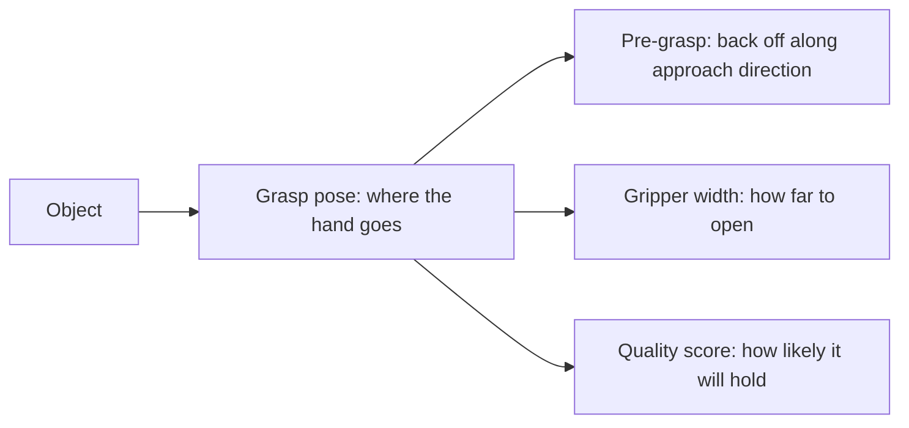
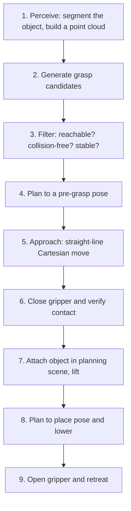

<LessonMeta level="اعلیٰ درجے کا (Advanced)" time="35 منٹ" prereqs={["MoveIt 2 کے ساتھ جوڑ توڑ (Manipulation)", "ڈیپتھ، پوائنٹ کلاؤڈز اور لائیڈار", "شناخت اور تقسیم (segmentation) کے لیے ڈیپ لرننگ"]} />

کسی چیز کو اٹھانے کے لیے بازو کو کسی پوز تک لانا تو آسان آدھا حصہ ہے۔ اصل مشکل آدھا حصہ آخری چند سینٹی میٹرز ہیں: انگلیاں بالکل کہاں چھونی چاہئیں، انہیں کتنی سختی سے دبانا چاہیے، اور تب کیا ہوگا جب چیز ایک پھسلنے والی، شفاف بوتل ہو جو آپ نے پہلے کبھی نہ دیکھی ہو؟ گرفت (Grasping) وہ مقام ہے جہاں جیومیٹری، رگڑ (friction)، سینسنگ اور لرننگ آپس میں ٹکراتے ہیں، اور یہ اب بھی روبوٹکس کے حل طلب مسائل میں سے ایک ہے۔

<Objectives>

- گرفت کی عام نمائندگیوں کی وضاحت کریں، بشمول دو جہتی (planar) چار ڈگری آف فریڈم سے لے کر مکمل چھ ڈگری آف فریڈم (6-DoF) پوز تک۔
- Antipodal شرط اور رگڑ کی مخروط (friction cones) کی مدد سے force closure کے پیچھے موجود فہم کی وضاحت کریں۔
- بتائیں کہ تربیت یافتہ (learned) گرفت کا پتہ لگانے والے نظام کیسے کام کرتے ہیں اور کہاں ناکام ہوتے ہیں۔
- ایک مکمل pick-and-place پائپ لائن کا خاکہ بنائیں اور بتائیں کہ ہر مرحلے پر کیا خرابی پیش آ سکتی ہے۔

</Objectives>

## گرفت (Grasp) کیا ہے؟

ایک <Term def="ہاتھ کی ایک ایسی پوز اور انگلیوں کی ترتیب جو ہاتھ کو کسی چیز کو محفوظ طریقے سے پکڑنے کی اجازت دیتی ہے">گرفت (grasp)</Term> اس سوال کا جواب ہے: میں ہاتھ کہاں رکھوں، اسے کتنا چوڑا کھولوں، اور کس سمت سے قریب آؤں؟ کوڈ میں، گرفت عام طور پر ایک چھوٹا سا ڈیٹا اسٹرکچر ہوتی ہے۔

- **پلانر (4-DoF) گرفت**: میز پر بالکل سیدھا نیچے کی طرف دیکھنے والے کیمرے کے لیے۔ یہ گرفت ایک نقطہ $(x, y)$، تصویری سطح پر ایک گردشی زاویہ (rotation angle)، اور گرپر کی چوڑائی پر مشتمل ہوتی ہے۔ گرپر ہمیشہ اوپر سے قریب آتا ہے۔ یہ سادہ ہے اور بن سے اشیاء چننے (bin picking) کے لیے حیرت انگیز طور پر مؤثر ہے۔
- **6-DoF گرفت**: تھری ڈی (3D) میں ایک مکمل پوز (پوزیشن اور سمت بندی) کے ساتھ گرپر کی چوڑائی۔ یہ ہاتھ کو سائیڈ سے یا کسی زاویے سے قریب آنے کی اجازت دیتی ہے، جس کی ضرورت گنجان الماریوں اور ٹیڑھی میڑھی چیزوں کے لیے ہوتی ہے۔
- **ملٹی فنگر گرفت (Multi-finger grasps)**: ایک لچکدار ہاتھ (dexterous hand) کے لیے، گرفت میں انگلیوں کے تمام جوڑوں کے زاویے بھی شامل ہوتے ہیں۔ آپ ان سے ہیومنائیڈز کے ماڈیول میں ملیں گے۔

زیادہ تر نمائندگیوں کے ساتھ ایک **کوالٹی اسکور** بھی ہوتا ہے، یہ ایک ایسا نمبر ہے جو بتاتا ہے کہ گرفت کے کامیاب ہونے کا کتنا امکان ہے۔ پلانرز اور تربیت یافتہ ماڈلز اس کی بنیاد پر امیدواروں کی درجہ بندی کرتے ہیں۔



## گرفت کیوں برقرار رہتی ہے: رگڑ اور فورس کلوزر

دو انگلیوں کے درمیان ایک پنسل کو دبانے کے بارے میں سوچیں۔ اگر آپ اسے بیچ سے دبائیں تو یہ رک جاتی ہے۔ اگر آپ انگلیوں کو پنسل کے خلاف کسی زاویے پر دبائیں تو یہ پھسل کر باہر نکل جاتی ہے۔ فزکس بتاتی ہے کہ ایسا کیوں ہوتا ہے۔

ہر رابطہ (contact) پر، انگلی سطح کے عمود (surface normal) کے ساتھ دباؤ ڈال سکتی ہے اور رگڑ کے ذریعے سائیڈ کی طرف بھی کھینچ سکتی ہے۔ کولمب کا رگڑ کا ماڈل (Coulomb friction model) کہتا ہے کہ سائیڈ کی فورس زیادہ سے زیادہ نارمل فورس کے $\mu$ گنا ہو سکتی ہے:

$$
\|f_t\| \le \mu \, f_n
$$

یہ حد رابطہ کے نارمل کے گرد ایک **رگڑ کا مخروط (friction cone)** تشکیل دیتی ہے، جس کا نصف زاویہ (half-angle) $\alpha = \arctan(\mu)$ ہوتا ہے۔ مخروط کے اندر لگنے والی کوئی بھی قوت بغیر پھسلے لگائی جا سکتی ہے۔ اس سے باہر انگلی پھسل جاتی ہے۔

دو انگلیوں کی گرفت کے لیے، **اینٹی پوڈل شرط (antipodal condition)** کہتی ہے: دونوں رابطے کے نکات کو ملانے والی سیدھی لکیر دونوں رابطوں پر رگڑ کے مخروط کے اندر ہونی چاہیے۔ جب ایسا ہوتا ہے تو دونوں انگلیاں براہ راست ایک دوسرے کے خلاف دباؤ ڈال سکتی ہیں، اور قوت کی لکیر دونوں مخروطوں میں سے گزرتی ہے، اس لیے چیز نہیں پھسلتی۔

<KeyIdea title="اینٹی پوڈل کا مطلب ہے کہ دباؤ کی لکیر دونوں رگڑ کے مخروطوں کے اندر رہتی ہے">
اگر آپ کی دو انگلیوں کے پوروں کے درمیان کی لکیر کسی بھی سطح کے نارمل سے رگڑ کے زاویے سے زیادہ جھک جاتی ہے، تو چیز پھسل کر باہر نکل جائے گی۔ چپٹی، متوازی سطحیں (ایک ڈبہ) آسان ہوتی ہیں۔ چکنی، پھسلنے والی مڑی ہوئی چیزوں کے مخروط صرف اسی وقت چوڑے ہوتے ہیں جب رگڑ زیادہ ہو، یہی وجہ ہے کہ ربر کی بنی انگلیوں کے پور اتنی زیادہ مدد کرتے ہیں۔
</KeyIdea>

ایک گرفت میں **فورس کلوزر (force closure)** تب ہوتا ہے جب رابطے رگڑ کے مخروط کے اندر رہتے ہوئے رابطہ فورسز کو ایڈجسٹ کر کے کسی بھی بیرونی قوت اور ٹارک (کسی بھی "wrench") کا مقابلہ کر سکیں۔ دو رگڑ والے پوائنٹ رابطوں کے ساتھ پکڑی گئی دو جہتی چیز کے لیے، اینٹی پوڈل شرط فورس کلوزر کے لیے کافی ہے۔ 3D میں، پوائنٹ رابطوں اور رگڑ کے ساتھ، آپ کو ایسی رابطہ فورسز کی ضرورت ہوتی ہے جو تمام چھ سمتوں میں خلل کو متوازن کر سکیں، جس کے لیے تین یا اس سے زیادہ رابطوں کی ضرورت پڑ سکتی ہے، یا پھر ٹورسنل رگڑ (torsional friction) والے رابطے (ایک نرم انگلی کے پور) کی ضرورت ہوتی ہے۔

آپ کو ہر گرفت کے لیے دستی طور پر یہ ثابت کرنے کی ضرورت نہیں ہے، لیکن یہ بنیادی فہم ہر چیز کی رہنمائی کرتی ہے: رابطے ایک دوسرے کے آمنے سامنے ہوں، گرفت والی سطحوں پر ہوں، اور چیز کے سینٹر آف ماس (مرکز ثقل) کے قریب ہوں تاکہ کشش ثقل چیز کو انگلیوں سے گھما کر گرا نہ دے۔

### اینٹی پوڈل کی جانچ کے لیے چلنے کے قابل کوڈ

```python title="antipodal.py"
import math

import numpy as np


def antipodal(p1, n1, p2, n2, mu=0.5):
    """Two-finger frictional point contacts.
    p1, p2 are contact points; n1, n2 are unit surface normals pointing OUT of the object."""
    alpha = math.atan(mu)                       # half-angle of the friction cone
    line = p2 - p1
    line = line / np.linalg.norm(line)          # direction from contact 1 to contact 2
    a1 = math.acos(np.clip(np.dot(line, -n1), -1, 1))    # angle between squeeze line and inward normal 1
    a2 = math.acos(np.clip(np.dot(-line, -n2), -1, 1))   # same at contact 2
    return a1 <= alpha and a2 <= alpha


# a 4 cm wide box, fingers on opposite faces
left_p, left_n = np.array([-0.02, 0.0]), np.array([-1.0, 0.0])
right_p, right_n = np.array([0.02, 0.0]), np.array([1.0, 0.0])
print(antipodal(left_p, left_n, right_p, right_n))                # True

# the right finger is 3 cm higher, so the squeeze line tilts
right_p2 = np.array([0.02, 0.03])
print(antipodal(left_p, left_n, right_p2, right_n, mu=0.5))       # False
print(antipodal(left_p, left_n, right_p2, right_n, mu=1.0))       # True (grippier fingers)
```

دیکھیں کہ کس طرح رگڑ کو 0.5 سے بڑھا کر 1.0 کرنے سے دوسری گرفت سنبھل جاتی ہے۔ ایک ہی جیومیٹری صرف رابطہ کے میٹریل کی بنیاد پر برقرار رہتی ہے یا پھسل جاتی ہے۔

## گرفت تلاش کرنا

**تجزیاتی اور ماڈل پر مبنی طریقوں (Analytic and model-based methods)** کو چیز کے 3D ماڈل کی ضرورت ہوتی ہے۔ وہ سطح پر امیدوار رابطہ کے جوڑوں کا نمونہ لیتے ہیں اور ان کا جائزہ اوپر دیے گئے اینٹی پوڈل ٹیسٹ جیسے پیمانوں سے لیتے ہیں، یا یہ دیکھتے ہیں کہ گرفت کس حد تک سب سے بڑی خلل پیدا کرنے والی قوت (wrench) کو روک سکتی ہے۔ وہ جانی پہچانی اشیاء کے لیے اچھے کام کرتے ہیں لیکن ماڈل غلط یا غائب ہونے پر ناکام ہو جاتے ہیں۔

**تربیت یافتہ گرفت کی شناخت (Learned grasp detection)** ماڈل پر انحصار نہیں کرتی۔ ایک نیورل نیٹ ورک گہرائی کی تصویر (depth image) یا پوائنٹ کلاؤڈ کو دیکھتا ہے اور براہ راست کوالٹی اسکورز کے ساتھ گرفت کی تجاویز پیش کرتا ہے۔ ٹریننگ کا ڈیٹا سیمولیشن سے آتا ہے (جہاں فزکس لاکھوں گرفتوں کا تجربہ کر سکتی ہے)، یا حقیقی دنیا کی آزمائش اور غلطی سے، یا پھر انسانی لیبلز سے۔

- Dex-Net 2.0 (Mahler et al., arxiv.org/abs/1703.09312) نے مصنوعی پوائنٹ کلاؤڈز پر ایک نیٹ ورک کو تربیت دی جن کی جانچ تجزیاتی گرفت کے معیار سے کی گئی تھی، اور پھر ٹیسٹ کے وقت پلانر گرفتوں کی درجہ بندی کی۔
- GG-CNN (Morrison, Corke, Leitner) ہر پکسل کے لیے گرفت کا معیار، زاویہ اور چوڑائی کی پیش گوئی کرتا ہے، جو کلوزڈ لوپ کنٹرول کے لیے کافی تیز ہے۔
- Contact-GraspNet (Sundermeyer et al., arxiv.org/abs/2103.14127) بے ترتیب اور الجھے ہوئے ماحول کے پوائنٹ کلاؤڈ سے براہ راست 6-DoF گرفتیں تجویز کرتا ہے۔

یہ طریقے اچھے ڈیپتھ ڈیٹا والی گھریلو اشیاء پر بہترین کام کرتے ہیں۔ وہ شفاف یا بہت چمکدار اشیاء (جہاں ڈیپتھ سینسر فیل ہو جاتے ہیں)، شدید چھپی ہوئی اشیاء اور ایسی اشیاء کے ساتھ مشکل میں پڑ جاتے ہیں جو ٹریننگ کے ڈیٹا سے بہت مختلف ہوں۔ ان ناکامیوں کے لیے منصوبہ بندی کریں: گرفت تلاش کرنے والا نظام *امیدواروں* کا ایک اچھا ذریعہ ہے، کوئی حتمی ضمانت نہیں۔

:::note
فاؤنڈیشن ماڈل پر مبنی نئے طریقے اور گرفت کے بڑے پری ٹرینڈ ماڈلز تیزی سے بہتر ہو رہے ہیں۔ کسی ایک مخصوص ماڈل پر انحصار کرنے کے بجائے موجودہ ریلیزز کو چیک کریں، اور ہمیشہ اپنی اشیاء پر پیمائش کریں۔
:::

## Pick-and-place پائپ لائن

ایک کام کرنے والی pick-and-place ایک زنجیر کی مانند ہے، اور ہر کڑی ٹوٹ سکتی ہے۔



1. **ادراک (Perceive):** ہدف کی شناخت اور سیگمنٹیشن کریں، پھر اس کی 3D شکل یا پوائنٹ کلاؤڈ حاصل کریں۔ کیمرے اور روبوٹ کے درمیان کیلیبریشن (hand-eye calibration) بہترین ہونی چاہیے، کیونکہ کیمرے سے بیس کے ٹرانسفارم میں 1 سینٹی میٹر کی غلطی کا مطلب اصل میں 1 سینٹی میٹر کا نشانہ چوک جانا ہے۔
2. **گرفت کے امکانات بنائیں (Generate grasps):** ماڈل پر مبنی سیمپلر یا ٹرینڈ ڈیٹیکٹر کا استعمال کریں۔
3. **فلٹر کریں (Filter):** ان امیدواروں کو مسترد کر دیں جہاں بازو پہنچ نہیں سکتا (IK فیل ہو جاتا ہے)، جو میز یا آس پاس کی چیزوں سے ٹکراتے ہیں، یا جن کے قریب آنے کی سمت مسدود ہے۔ باقی بچ جانے والوں کو معیار کے مطابق ترتیب دیں۔
4. **پہلے سے گرفت کی پوز (Pre-grasp):** گرفت کے زاویے سے چند سینٹی میٹر پیچھے، کھلے ہوئے گرپر کے ساتھ خالی جگہ میں حرکت کی منصوبہ بندی کریں۔
5. **قریب جانا (Approach):** گرفت کی پوز تک بالکل سیدھی لکیر میں (Cartesian path) حرکت کریں۔ چیز کے قریب رفتار کم کریں۔
6. **بند کرنا اور جانچنا (Close and check):** گرپر بند کریں اور تصدیق کریں کہ آپ نے کچھ پکڑا ہے: رکنے پر انگلی کی چوڑائی، موٹر کرنٹ یا ٹیکٹائل سینسر کے ذریعے۔
7. **منسلک کرنا اور اٹھانا (Attach and lift):** چیز کو پلاننگ سین میں ہاتھ کے ساتھ منسلک کر دیں تاکہ موشن پلاننگ اس کا خیال رکھے، پھر سیدھا اوپر اٹھائیں۔
8. **رکھنا (Place):** رکھنے سے پہلے والی پوز پر جائیں، نیچے لائیں اور چھوڑ دیں۔
9. **پیچھے ہٹنا (Retreat):** گرپر کھولیں اور سیدھی لکیر میں پیچھے ہٹیں تاکہ آپ اس چیز کو نہ ٹکرائیں جسے ابھی رکھا ہے۔

MoveIt Task Constructor، جس کا ذکر پچھلے سبق میں کیا گیا تھا، آپ کو ان تمام مراحل کو ایک ٹاسک کے طور پر بیان کرنے دیتا ہے اور ان سب کی ایک ساتھ منصوبہ بندی کرتا ہے تاکہ، مثال کے طور پر، مرحلہ 2 میں منتخب کی گئی گرفت مرحلہ 7 میں اٹھانے کو یقینی بنائے۔

:::warning
پوری رفتار سے حرکت کرنے سے پہلے ہمیشہ گرفت کی تصدیق کریں۔ ایک ناکام گرفت جس کا پتہ نہ چلے، بازو کو خالی گرپر کے ساتھ، یا اس سے بھی بدتر، ڈھیلی ڈھالی پکڑی ہوئی چیز کے ساتھ حرکت کرنے پر مجبور کر دیتی ہے۔
:::

### کلوزڈ لوپ اور ناکامی کی بحالی

اوپن لوپ پائپ لائنز (ایک بار دیکھو، پھر حرکت کرو) اس وقت ناکام ہو جاتی ہیں جب انگلیاں بند ہونے کے دوران چیز ہل جائے۔ بہتر سسٹمز قریب آتے وقت دوبارہ مشاہدہ کرتے ہیں، گرفت فیل ہونے پر اگلے بہترین امیدوار سے دوبارہ کوشش کرتے ہیں اور کامیابی کی شرح کو ٹریک کرتے ہیں۔ گرفت کی کامیابی کو اعداد و شمار کے طور پر دیکھیں: ہر کوشش کو لاگ کریں؛ سینکڑوں آزمائشوں میں 90% کامیابی کی شرح والی پائپ لائن اکیلے ایک کامیاب ڈیمو کے مقابلے میں بہت کچھ بتاتی ہے۔

## عملی لیب (Hands-on lab)

<Steps>

1. `antipodal.py` کو محفوظ کریں اور اسے چلائیں۔ تصدیق کریں کہ تینوں نتائج کمنٹس سے میل کھاتے ہیں۔
2. ایک تیسرا ٹیسٹ شامل کریں: 2 سینٹی میٹر رداس (radius) والے دائرے پر دو رابطے 0 اور 170 ڈگری کے زاویوں پر (سطح کے نارمل باہر کی طرف اشارہ کر رہے ہوں)۔ رگڑ کا سب سے چھوٹا کوفیشنٹ معلوم کریں جس پر یہ گرفت اینٹی پوڈل ٹیسٹ پاس کر لے۔
3. اوپر دی گئی پائپ لائن کو ازگر (Python) فنکشن سکیلیٹن کے طور پر لکھیں، جس میں ہر مرحلے کے لیے ایک خالی فنکشن ہو۔ ہر ایک کے لیے، ایک جملہ لکھیں کہ ناکامی کیسی نظر آئے گی اور آپ اسے کیسے پکڑیں گے۔
4. اختیاری: پچھلے سبق کے MoveIt Panda ڈیمو میں، کولیژن آبجیکٹ کے طور پر ایک باکس شامل کریں اور MotionPlanning پینل کا استعمال کرتے ہوئے اس کے اوپر پہلے سے گرفت کی پوز اور پھر سیدھی لکیر میں قریب آنے کی منصوبہ بندی کریں۔

</Steps>

## مشقیں

<Exercise title="رگڑ کا زاویہ (Friction angle)" level="Beginner">

پلاسٹک کی بوتل پر ربڑ کی انگلی کے پور کا فرکشن کوفیشنٹ $\mu = 0.8$ ہے۔ رگڑ کے مخروط کا نصف زاویہ (half-angle) کیا ہے، اور کیا ایسی گرفت اینٹی پوڈل ہوگی جس کے دباؤ کی لکیر رابطے کے نارمل سے 35 ڈگری دور ہو؟

<Solution>

$\alpha = \arctan(0.8) \approx 38.7^\circ$۔ چونکہ دباؤ کی لکیر نارمل سے 35 ڈگری پر ہے جو کہ مخروط کے اندر ہے، اس لیے (اگر دوسرے رابطے پر بھی یہی صورتحال ہو) گرفت اینٹی پوڈل شرط کو پورا کرتی ہے۔ پھسلنے والی پلاسٹک کی انگلی اور $\mu = 0.3$ کے ساتھ، $\alpha \approx 16.7^\circ$ ہوگا اور وہی گرفت پھسل جائے گی۔

</Solution>
</Exercise>

<Exercise title="تربیت یافتہ ڈیٹیکٹرز کہاں ناکام ہوتے ہیں؟" level="Intermediate">

ایسی دو قسم کی اشیاء کے نام بتائیں جو عام طور پر ڈیپتھ پر مبنی ٹرینڈ گرفت ڈیٹیکٹرز کے لیے مسائل پیدا کرتی ہیں، اور ہر ایک کے لیے ایک حل بتائیں۔

<Solution>

شفاف اشیاء (شیشہ، شفاف پلاسٹک) ڈیپتھ ڈیٹا غلط دیتی ہیں یا بالکل نہیں دیتیں۔ حل میں ڈیپتھ کمپلیشن ماڈل استعمال کرنا، RGB پر مبنی یا ملٹی ویو طریقے اپنانا، یا اشیاء کو ایسے سینسر کے سامنے رکھنا شامل ہے جو انہیں پڑھ سکے۔ بے ترتیب اور آپس میں اٹی ہوئی یا اوورلیپ شدہ اشیاء نامکمل پوائنٹ کلاؤڈز پیدا کرتی ہیں۔ اس کے حل میں کئی زاویوں سے دیکھنا، ہر بار چیز اٹھانے کے بعد دوبارہ دیکھنا، یا پہلے اشیاء کو دھکیل کر الگ کرنا شامل ہے۔

</Solution>
</Exercise>

<Exercise title="تصدیق کی جانچ کا ڈیزائن بنائیں" level="Intermediate">

آپ کے گرپر میں کوئی ٹیکٹائل سینسر نہیں ہے۔ آپ اٹھانے سے پہلے کیسے بتا سکتے ہیں کہ گرفت کامیاب ہوئی یا نہیں؟

<Solution>

بند ہونے کے بعد گرپر کی چوڑائی چیک کریں: اگر یہ مکمل طور پر بند ہو گیا (یا چیز کے سائز سے بہت کم چوڑائی پر بند ہوا)، تو آپ نے کچھ نہیں پکڑا۔ موٹر کرنٹ یا قوت (effort) چیک کریں: کسی چیز کو پکڑنے سے چیز کے سائز کے قریب گرپر رک جاتا ہے اور کرنٹ بڑھ جاتا ہے۔ آپ چند سینٹی میٹر اٹھا کر چوڑائی اور کرنٹ کو دوبارہ بھی چیک کر سکتے ہیں، جس سے ان اشیاء کا پتہ چلتا ہے جو اٹھانے کے دوران پھسل جاتی ہیں۔

</Solution>
</Exercise>

## اپنی سمجھ کی جانچ کریں

<Quiz questions={[
  {q: "دو انگلیوں کی گرفت کے لیے اینٹی پوڈل شرط کیا تقاضا کرتی ہے؟", options: ["انگلیوں کا سائز ایک جیسا ہونا چاہیے", "رابطوں کے درمیان کی لکیر دونوں رابطوں پر رگڑ کے مخروط کے اندر ہونی چاہیے", "چیز کا متناسب (symmetric) ہونا ضروری ہے", "گرپر کا مکمل کھلا ہونا ضروری ہے"], answer: 1, explain: "اگر دباؤ کی لکیر دونوں رگڑ کے مخروطوں کے اندر رہے تو رابطے بغیر چیز کے پھسلے ایک دوسرے کے خلاف دباؤ ڈال سکتے ہیں۔"},
  {q: "فرکشن کوفیشنٹ mu کے لیے رگڑ کے مخروط کا نصف زاویہ ہے:", options: ["mu", "arctan(mu)", "arcsin(mu)", "1/mu"], answer: 1, explain: "ٹینجینشل قوت نارمل فورس کے زیادہ سے زیادہ mu گنا ہوتی ہے، اس لیے مخروط کا نصف زاویہ arctan(mu) ہوتا ہے۔"},
  {q: "پہلے سے گرفت والی پوز اور سیدھی لکیر کی اپروچ کیوں استعمال کی جاتی ہے؟", options: ["یہ تیز تر ہے", "یہ گرپر کو محفوظ سمت سے قریب آنے دیتی ہے بغیر چیز یا اس کے آس پاس کو ٹکرائے", "اس سے IK کی ضرورت ختم ہو جاتی ہے", "یہ رگڑ کو بہتر بناتی ہے"], answer: 1, explain: "صاف سمت سے سیدھی لکیر میں قریب آنے سے انگلیاں بند ہونے سے پہلے چیز کو ٹکرانے سے بچاتی ہیں۔"},
  {q: "ایک ٹرینڈ گرفت ڈیٹیکٹر آپ کو ایک اعلیٰ اسکور والی گرفت دیتا ہے۔ پائپ لائن کو اب بھی کیا کرنا چاہیے؟", options: ["اسے فوراً لاگو کریں", "اس کی رسائی اور تصادم کے لیے جانچ کریں، پھر بند ہونے کے بعد گرفت کی تصدیق کریں", "ماڈل کو دوبارہ ٹرین کریں", "پلاننگ کو چھوڑ دیں"], answer: 1, explain: "ڈیٹیکٹر امیدوار تجویز کرتے ہیں۔ روبوٹ کو اب بھی IK اور کولیژن چیک کی ضرورت ہوتی ہے، اور اسے تصدیق کرنی چاہیے کہ چیز واقعی پکڑی گئی ہے۔"}
]} />

<Takeaways>

- ایک گرفت ہاتھ کی پوز کے علاوہ گرپر کی سیٹنگز پر مشتمل ہوتی ہے، اکثر کوالٹی اسکور کے ساتھ۔ پلانر 4-DoF گرفتیں سادہ اور موثر ہیں، جبکہ 6-DoF گرفتیں زیادہ ہمہ گیر ہوتی ہیں۔
- رگڑ کے مخروط واضح کرتے ہیں کہ گرفتیں کیوں قائم رہتی ہیں۔ اینٹی پوڈل شرط کا مطلب ہے کہ دباؤ کی لکیر دونوں مخروطوں کے اندر رہتی ہے۔
- فورس کلوزر کا مطلب ہے کہ رابطے کسی بھی بیرونی قوت کا مقابلہ کر سکتے ہیں۔ بنیادی فہم: مخالف رابطے، اچھی رگڑ، سینٹر آف ماس کے قریب۔
- تربیت یافتہ ڈیٹیکٹرز ماڈل کے بغیر ڈیپتھ ڈیٹا سے گرفت تجویز کرتے ہیں، اور شفاف، چمکدار اور چھپی ہوئی اشیاء پر ناکام ہو جاتے ہیں۔
- Pick-and-place ایک مکمل پائپ لائن ہے: ادراک کریں، امکانات بنائیں، فلٹر کریں، گرفت سے پہلے کی پوز پر جائیں، قریب آئیں، بند کریں اور تصدیق کریں، منسلک کریں، اٹھائیں، رکھیں، پیچھے ہٹیں۔ کئی آزمائشوں پر کامیابی کی پیمائش کریں۔

</Takeaways>

## مزید گہرائی میں جائیں

- مرے، لی اور سستری، *A Mathematical Introduction to Robotic Manipulation*، گرفت کے تجزیے پر کلاسک کتاب (مصنفین کی ویب سائٹ سے مفت دستیاب ہے)۔
- مہلر وغیرہ، "Dex-Net 2.0" (arxiv.org/abs/1703.09312)۔
- سنڈرمائیر وغیرہ، "Contact-GraspNet" (arxiv.org/abs/2103.14127)۔
- moveit.picknik.ai پر MoveIt دستاویزات، بشمول MoveIt Task Constructor pick-and-place ٹیوٹوریل۔

اگلا: [روبوٹکس کے لیے ML کا اعادہ](../07-robot-learning/01-ml-refresher-for-robotics.mdx)
