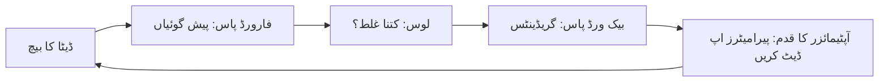

<LessonMeta level="Intermediate" time="40 منٹ" prereqs={["روبوٹکس کے لیے Python", "کیلکولس اور آپٹیمائزیشن", "روبوٹس کے لیے پروبیبلٹی"]} />

آپ کے روبوٹ کے بازو میں ایک خامی ہے: گیئر باکس کے بیک لیش (gearbox backlash) کی وجہ سے جب آپ جوائنٹ کے زاویے (joint angle) کا حکم دیتے ہیں، تو ہاتھ کی اصل اونچائی کتابی فارمولے کے عین مطابق نہیں ہوتی۔ آپ اسے ہاتھ سے ماڈل کر سکتے ہیں، یا پھر چند سو پیمائشیں ریکارڈ کر کے ایک چھوٹے نیورل نیٹ ورک کو یہ میپنگ سیکھنے دے سکتے ہیں۔ روبوٹ لرننگ کا بنیادی طریقہ کار یہی ہے: ایک ایسا فارمولا جسے آپ لکھ نہیں سکتے، اس کی جگہ ڈیٹا کے مطابق ڈھالا گیا فنکشن استعمال کریں۔

<Objectives>

- ان پُٹس، ٹارگٹس، ماڈل اور لوس کے تناظر میں نگران لرننگ (supervised learning) کی وضاحت کریں۔
- بیان کریں کہ گریڈینٹ ڈیسنٹ نیٹ ورک کو کیسے ٹرین کرتا ہے اور لرننگ ریٹ کیا کام کرتا ہے۔
- اوور فٹنگ کی شناخت کریں اور اسے پکڑنے کے لیے توثیقی سیٹ (validation set) کا استعمال کریں۔
- مکمل PyTorch ٹریننگ لوپ لکھیں اور چلائیں۔

</Objectives>

## لرننگ ایک فنکشن کو فٹ کرنا ہے

**نگران لرننگ (supervised learning)** میں آپ کے پاس ان پُٹس $x$ کی درست آؤٹ پُٹس $y$ کے ساتھ جوڑیاں ہوتی ہیں، اور آپ ایک ایسا فنکشن $f_\theta(x)$ چاہتے ہیں جو ان دیکھے ان پُٹس کے لیے $y$ کی پیش گوئی کر سکے۔ یہاں $\theta$ ماڈل کے **پیرامیٹرز (parameters)** کی علامت ہے، یعنی وہ اعداد جنہیں ٹریننگ کا عمل ایڈجسٹ کرتا ہے۔

روبوٹکس کی مثالیں ہر جگہ موجود ہیں:

| ان پُٹ $x$ | آؤٹ پُٹ $y$ | کام (Task) |
|---|---|---|
| کیمرے کی تصویر | آبجیکٹ کا لیبل | درجہ بندی (Classification) |
| کیمرے کی تصویر | گرفت کا نقطہ (Grasp point) | ریگریشن (Regression) |
| جوائنٹ کے زاویے اور ٹارکس | اگلے جوائنٹ کے زاویے | ڈائنامکس ماڈل |
| تصویر اور روبوٹ کی حالت | اگلا ایکشن | پالیسی (نقل کے ذریعے سیکھنا / imitation learning) |

جب $y$ کوئی زمرہ یا کیٹیگری ہو، تو ہم اسے **درجہ بندی (classification)** کہتے ہیں۔ جب $y$ کوئی عدد یا ویکٹر ہو، تو یہ **ریگریشن (regression)** کہلاتا ہے۔ دونوں کی ٹریننگ کا طریقہ ایک ہی ہے۔

ایک نیورل نیٹ ورک تہوں (layers) پر مشتمل ایک لچکدار فنکشن ہوتا ہے: ہر تہہ میٹرکس سے ضرب دیتی ہے، ایک بائیس (bias) شامل کرتی ہے اور نتیجے کو غیر خطی (non-linearity) فنکشن جیسے ReLU ($\max(0, z)$) سے گزارتی ہے۔ چند تہوں کو ایک دوسرے کے اوپر رکھیں تو نیٹ ورک انتہائی پیچیدہ فنکشنز کا بھی اندازہ لگا سکتا ہے۔ یہ میٹرکسز اور بائیسز دراصل $\theta$ ہیں۔

## لوس: غلطیوں کا حساب لگانا

ماڈل کو ٹرین کرنے کے لیے، ہمیں ایک ایسے عدد کی ضرورت ہوتی ہے جو بتائے کہ ماڈل کتنا غلط ہے۔ وہ عدد **لوس (loss)** کہلاتا ہے۔ ریگریشن کے لیے، عام طور پر مین اسکوائرڈ ایرر (mean squared error) منتخب کیا جاتا ہے:

$$
L(\theta) = \frac{1}{N} \sum_{i=1}^{N} \left( f_\theta(x_i) - y_i \right)^2
$$

درجہ بندی کے لیے، عام لوس **کراس اینٹروپی (cross-entropy)** ہے، جو پُراعتماد غلط جوابات پر بھاری جرمانہ عائد کرتا ہے۔ لوس کا انتخاب دراصل یہ طے کرنا ہے کہ "اچھا" ہونے کا کیا مطلب ہے۔ اگر آپ کسی گرفت کی پیش گوئی کرنے والے کو ایسے لوس کے ساتھ ٹرین کرتے ہیں جو تمام غلطیوں کو برابر سمجھتا ہے، تو اسے اس بات کی پرواہ نہیں ہوگی کہ 2 سینٹی میٹر کی چوک گرفت کو برباد کر دیتی ہے جبکہ 2 ملی میٹر کی چوک سے کوئی فرق نہیں پڑتا، تاوقتیکہ آپ لوس یا ڈیٹا کو اس حقیقت کی عکاسی کے لیے ڈیزائن نہ کریں۔

## گریڈینٹ ڈیسنٹ

ٹریننگ کا مطلب ایسے $\theta$ کی تلاش ہے جو $L$ کو کم سے کم کرے۔ لوس تمام پیرامیٹرز پر پھیلا ہوا ایک منظر نامہ (landscape) ہے، اور **گریڈینٹ** $\nabla_\theta L$ اوپر کی جانب اشارہ کرتا ہے۔ اس لیے ہم نیچے کی طرف قدم بڑھاتے ہیں:

$$
\theta \leftarrow \theta - \eta \, \nabla_\theta L
$$

قدم کا حجم $\eta$ دراصل **لرننگ ریٹ (learning rate)** ہے۔ بہت چھوٹا ہو، تو ٹریننگ سست پڑ جاتی ہے۔ بہت بڑا ہو، تو لوس اچھلنے کودنے لگتا ہے یا حد سے باہر نکل جاتا ہے۔ فریم ورکس **بیک پروپیگیشن (backpropagation)** کے ذریعے گریڈینٹس کا حساب خود بخود لگاتے ہیں، جو لوس سے لے کر ہر تہہ کے ذریعے الٹی سمت میں چین رول (chain rule) کا اطلاق کرتا ہے۔

عملی طور پر آپ ہر قدم کے لیے پورے ڈیٹا سیٹ کا استعمال نہیں کرتے۔ **اسٹوکاسٹک گریڈینٹ ڈیسنٹ (SGD)** ایک چھوٹا بے ترتیب **بیچ (batch)** استعمال کرتا ہے، جو تیز تر ہوتا ہے اور مددگار شور (noise) بھی شامل کرتا ہے۔ **Adam** ایک مقبول آپٹیمائزر ہے جو ہر پیرامیٹر کے لیے قدم کا سائز خود بخود ایڈجسٹ کرتا ہے اور یہ ایک بہترین بنیادی انتخاب ہے۔

تمام ٹریننگ ڈیٹا سے ایک بار گزرنے کو ایک **ایپوک (epoch)** کہا جاتا ہے۔

<KeyIdea title="ٹریننگ لوپ ہمیشہ انہی چار مراحل پر مشتمل ہوتا ہے">
پیش گوئی کریں، لوس کا حساب لگائیں، گریڈینٹ کو الٹی سمت میں منتقل کریں (backpropagate)، پیرامیٹرز کو اپ ڈیٹ کریں۔ روبوٹکس میں آپ کا سامنا جس نیورل نیٹ ورک سے بھی ہوگا، چاہے وہ ایک معمولی ریگریسر ہو یا ایک بہت بڑا vision-language-action ماڈل، وہ ڈیٹا کے بیچز پر انہی چار مراحل کو دہرا کر ٹرین ہوتا ہے۔
</KeyIdea>



## اوور فٹنگ اور توثیق

ماڈل پیٹرن سیکھنے کے بجائے اپنی ٹریننگ کی مثالوں کو زبانی یاد کر سکتا ہے۔ اسے **اوور فٹنگ (overfitting)** کہتے ہیں۔ یہ اس ڈیٹا پر تو بہترین اسکور کرتا ہے جو اس نے دیکھا ہوتا ہے، لیکن نئے ڈیٹا پر بری طرح ناکام ہوتا ہے، جبکہ اصل روبوٹ پر اصل اہمیت نئے ڈیٹا کی ہی ہوتی ہے۔

اس سے بچاؤ کا معیاری طریقہ اپنے ڈیٹا کو تقسیم کرنا ہے:

- **ٹریننگ سیٹ (Training set)**: پیرامیٹرز کو اپ ڈیٹ کرنے کے لیے استعمال ہوتا ہے۔
- **توثیقی سیٹ (Validation set)**: الگ رکھا جاتا ہے اور صرف کارکردگی کی پیمائش اور ترتیبات منتخب کرنے کے لیے استعمال ہوتا ہے۔
- **ٹیسٹ سیٹ (Test set)**: ایماندارانہ حتمی اسکور کے لیے آخر میں صرف ایک بار استعمال کیا جاتا ہے۔

فرق پر نظر رکھیں۔ اگر ٹریننگ لوس گرتا رہے لیکن توثیقی لوس میں بہتری آنا بند ہو جائے یا وہ بڑھنے لگے، تو آپ اوور فٹنگ کا شکار ہو رہے ہیں۔ اس کے علاج میں مزید ڈیٹا (جو تقریباً ہمیشہ بہترین حل ہے)، ایک چھوٹا ماڈل، **ریگولرائزیشن (regularisation)** جیسے کہ ویٹ ڈیکے (weight decay) یا ڈراپ آؤٹ (dropout)، **ڈیٹا آگمینٹیشن (data augmentation)**، اور **ارلی اسٹاپنگ (early stopping)** شامل ہیں (یعنی جب توثیقی لوس بہتر ہونا بند ہو جائے تو ٹریننگ روک دیں)۔

:::warning
روبوٹکس میں، ٹریننگ اور توثیقی سیٹوں کے درمیان معلومات کا لیک ہو جانا آسان بھی ہے اور نقصان دہ بھی۔ اگر ایک ہی مظاہرے (demonstration) کے فریم دونوں میں شامل ہو جائیں، تو ماڈل مہارت سیکھنے کے بجائے اس قسط (episode) کو پہچان لیتا ہے، اور آپ کا توثیقی اسکور بہترین نظر آتا ہے جبکہ حقیقی روبوٹ ناکام ہو جاتا ہے۔ فریم کے لحاظ سے نہیں، بلکہ قسط کے لحاظ سے ڈیٹا تقسیم کریں۔
:::

## ایک مکمل PyTorch ٹریننگ لوپ

یہاں چلانے کے قابل ایک مکمل مثال موجود ہے۔ ہم فرض کرتے ہیں کہ جوائنٹ اینگل $q$ اور ہاتھ کی اونچائی کے درمیان اصل تعلق $\sin(q)$ ہے، اس میں پیمائش کا شور شامل کرتے ہیں، اور اسے دوبارہ حاصل کرنے کے لیے ایک چھوٹے نیٹ ورک کو ٹرین کرتے ہیں۔

```python title="train_toy.py"
import torch
from torch import nn

torch.manual_seed(0)

# کھلونا کام: جوائنٹ کے زاویے سے ہاتھ کی اونچائی کی پیش گوئی کریں۔ "اصل" تعلق sin(q) جمع شور ہے۔
q = torch.rand(400, 1) * 3.0                       # جوائنٹ اینگل [0, 3] ریڈین میں
y = torch.sin(q) + 0.05 * torch.randn_like(q)      # شور کے ساتھ ماپی گئی اونچائی

perm = torch.randperm(400)
train_idx, val_idx = perm[:300], perm[300:]
x_train, y_train = q[train_idx], y[train_idx]
x_val, y_val = q[val_idx], y[val_idx]

model = nn.Sequential(nn.Linear(1, 32), nn.ReLU(), nn.Linear(32, 32), nn.ReLU(), nn.Linear(32, 1))
loss_fn = nn.MSELoss()
opt = torch.optim.Adam(model.parameters(), lr=1e-2)

for epoch in range(301):
    model.train()
    pred = model(x_train)
    loss = loss_fn(pred, y_train)
    opt.zero_grad()
    loss.backward()
    opt.step()

    if epoch % 50 == 0:
        model.eval()
        with torch.no_grad():
            val_loss = loss_fn(model(x_val), y_val)
        print(f"epoch {epoch:3d}  train {loss.item():.4f}  val {val_loss.item():.4f}")
```

pytorch.org سے PyTorch انسٹال کریں (اس کام کے لیے CPU ورژن کافی ہے) اور اسے چلائیں۔ دونوں نقصانات (losses) تیزی سے گرنے چاہئیں اور شور کی سطح (تقریباً $0.05^2 = 0.0025$) کے قریب مستحکم ہونے چاہئیں۔ چونکہ ڈیٹا میں شور موجود ہے، اس لیے لوس صفر نہیں ہو سکتا۔ ایسا ماڈل جس کا ٹریننگ لوس شور کی سطح سے بہت نیچے چلا جائے، وہ دراصل شور کو فٹ کر رہا ہے، جو کہ اوور فٹنگ ہے۔

چند تفصیلات جو نوآموزوں کو الجھا دیتی ہیں:

- `opt.zero_grad()` پرانے گریڈینٹس کو صاف کرتا ہے۔ PyTorch انہیں از خود جمع کرتا رہتا ہے۔
- `model.train()` اور `model.eval()` ڈراپ آؤٹ جیسی تہوں کو فعال یا غیر فعال کرتے ہیں۔ اس چھوٹے ماڈل میں ان سے کوئی فرق نہیں پڑتا، لیکن اسے اپنی عادت بنا لیں۔
- `torch.no_grad()` گریڈینٹ کے حساب کتاب کو چھوڑ دیتا ہے جب آپ کو صرف پیش گوئیوں کی ضرورت ہو۔

حقیقی ڈیٹا سیٹس کے لیے، اپنے ڈیٹا کو `Dataset` اور `DataLoader` میں لپیٹیں، جو بیچنگ اور شفلنگ کو خود سنبھالتا ہے۔ لوپ میں ایک اندرونی `for batch in loader:` کا اضافہ ہو جاتا ہے اور باقی سب کچھ ویسا ہی رہتا ہے۔

## روبوٹکس میں کیا مختلف ہوتا ہے

روبوٹ ڈیٹا کی کچھ ایسی خصوصیات ہیں جو عام بینچ مارکس چھپا دیتے ہیں:

- **وقت اہمیت رکھتا ہے۔** لگاتار فریم تقریباً ایک جیسے ہوتے ہیں، اس لیے دس لاکھ فریم دراصل چند سو مختلف صورتحال ہو سکتے ہیں۔ قسط (episode) کے لحاظ سے تقسیم کریں اور گنیں۔
- **ڈیٹا مہنگا ہے۔** روبوٹ کے حقیقی گھنٹے سست ہوتے ہیں، اس لیے ڈیٹا کا مؤثر استعمال (آگمینٹیشن، پہلے سے ٹرین شدہ ماڈلز) بہت اہمیت رکھتا ہے۔
- **غلطیوں کی مادی قیمت ہوتی ہے۔** وژن کلاسیفائر میں 5 ڈگری کی پیش گوئی کی غلطی معمولی بات ہے۔ جوائنٹ کمانڈ میں یہی غلطی گریپر کو توڑ سکتی ہے۔
- **ٹریننگ ڈیٹا رویے کو تشکیل دیتا ہے۔** ایک ماڈل صرف انہی حالات کو جانتا ہے جو اسے دکھائے گئے تھے۔ یہ اگلے سبق میں covariate-shift کے مسئلے کی جڑ ہے۔
- **پہلے سے ٹریننگ (Pretraining) طاقتور ہے۔** ایک ایسے ماڈل سے شروعات کرنا جو تصاویر یا متن کے بڑے ڈیٹا سیٹس پر پہلے سے ٹرین ہو، اور پھر اسے اپنے روبوٹ ڈیٹا پر **فائن ٹیون (fine-tune)** کرنا، عام طور پر بالکل ابتدا سے ٹرین کرنے سے بہتر نتائج دیتا ہے۔

## عملی لیب

<Steps>

1. PyTorch انسٹال کریں اور `train_toy.py` کو محفوظ کریں۔ اسے چلائیں اور حتمی ٹریننگ اور توثیقی لوس کو نوٹ کریں۔
2. `lr` کو تبدیل کر کے `1e-4` اور پھر `1.0` کریں۔ بیان کریں کہ ہر بار لوس کے ساتھ کیا ہوتا ہے۔
3. ٹریننگ سیٹ کو کم کر کے 20 نمونوں (`perm[:20]`) تک محدود کریں اور نیٹ ورک کو بڑا بنائیں (ہر تہہ میں 64 یونٹس)۔ 2000 ایپوکس تک ٹرین کریں۔ ٹریننگ اور توثیقی لوس کا موازنہ کریں۔ کیا یہ اوور فٹ ہو رہا ہے؟
4. ڈیٹا کو بحال کریں، پھر Adam آپٹیمائزر میں `weight_decay=1e-3` شامل کریں۔ کیا دونوں نقصانات کا درمیانی فرق کم ہوتا ہے؟
5. کامیابی کا معیار یہ ہے: آپ پرنٹ شدہ نمبروں کو دیکھ کر وضاحت کر سکیں کہ کون سا رن اوور فٹ ہوا اور کیوں۔

</Steps>

## مشقیں

<Exercise title="مسئلہ پہچانیں" level="Beginner">

آپ کا ٹریننگ لوس 0.01 ہے اور توثیقی لوس 0.40 ہے۔ کیا ہو رہا ہے، اور دو ایسے طریقے بتائیں جو آپ آزما سکتے ہیں۔

<Solution>

ماڈل اوور فٹ ہو رہا ہے: یہ ٹریننگ ڈیٹا کو تو اچھی طرح فٹ کر رہا ہے لیکن عمومی نتائج (generalisation) خراب دے رہا ہے۔ مزید ٹریننگ ڈیٹا استعمال کریں، ایک چھوٹا ماڈل اپنائیں، ویٹ ڈیکے یا ڈراپ آؤٹ شامل کریں، ڈیٹا آگمینٹیشن کا استعمال کریں، یا ٹریننگ کو پہلے ہی روک دیں۔

</Solution>
</Exercise>

<Exercise title="درست تقسیم کریں" level="Intermediate">

آپ نے 200 فریمز پر مشتمل 50 مظاہرے (demonstrations) ریکارڈ کیے۔ آپ تمام 10,000 فریمز کو بے ترتیب (shuffle) کرتے ہیں اور 80% ٹریننگ کے لیے اور 20% توثیق کے لیے استعمال کرتے ہیں۔ توثیقی اسکور گمراہ کن کیوں ہے، اور آپ اسے کیسے درست کریں گے؟

<Solution>

ایک ہی مظاہرے کے قریبی فریم تقریباً ایک جیسے نظر آتے ہیں، اس لیے توثیقی سیٹ میں ٹریننگ فریمز کی ہو بہو کاپیاں شامل ہو جاتی ہیں۔ یہ اسکور دراصل یادداشت (memorisation) کی پیمائش کر رہا ہے۔ اس کے بجائے قسط (episode) کے لحاظ سے تقسیم کریں: مثال کے طور پر، 40 مظاہروں پر ٹرین کریں اور باقی 10 پر توثیق کریں۔

</Solution>
</Exercise>

<Exercise title="ارلی اسٹاپنگ شامل کریں" level="Intermediate">

ٹریننگ لوپ میں ایسی ترمیم کریں کہ جب توثیقی لوس لگاتار 20 ایپوکس تک بہتر نہ ہو تو ٹریننگ رک جائے، اور بہترین پیرامیٹرز محفوظ رہیں۔ کوڈ کا خاکہ بنائیں۔

<Solution>

`best_val` اور `best_state` کا ریکارڈ رکھیں۔ ہر ایپوک کے بعد، توثیقی لوس کا حساب لگائیں۔ اگر یہ `best_val` سے کم ہے، تو `best_val` کو اپ ڈیٹ کریں، `copy.deepcopy(model.state_dict())` کو محفوظ کریں اور کاؤنٹر کو دوبارہ 0 کر دیں۔ بصورت دیگر کاؤنٹر میں ایک کا اضافہ کریں، اور جب یہ 20 تک پہنچ جائے تو لوپ کو توڑ (break) دیں۔ لوپ کے بعد، `model.load_state_dict(best_state)` کو کال کریں۔

</Solution>
</Exercise>

## اپنی سمجھ کی جانچ کریں

<Quiz questions={[
  {q: "لرننگ ریٹ کس چیز کو کنٹرول کرتا ہے؟", options: ["کتنے ایپوکس چلانے ہیں", "پیرامیٹر اپ ڈیٹ کے ہر قدم کا سائز", "بیچ کا سائز", "تہوں کی تعداد"], answer: 1, explain: "اپ ڈیٹ کی مساوات تھیٹا منفی ایٹا ضرب گریڈینٹ ہے۔ ایٹا، یعنی لرننگ ریٹ، قدم کے سائز کا تعین کرتا ہے۔"},
  {q: "ٹریننگ لوس مسلسل گر رہا ہے جبکہ توثیقی لوس بڑھ رہا ہے۔ یہ کیا ہے:", options: ["انڈر فٹنگ (Underfitting)", "اوور فٹنگ (Overfitting)", "بیک پروپیگیشن میں خرابی (bug)", "نارمل اور مطلوبہ صورتحال"], answer: 1, explain: "ماڈل ٹریننگ ڈیٹا کو زبانی یاد کر رہا ہے۔ یہ عمومی نتائج اخذ کرنا بند کر دیتا ہے۔"},
  {q: "روبوٹ ڈیٹا کو فریم کے بجائے قسط (episode) کے لحاظ سے کیوں تقسیم کیا جاتا ہے؟", options: ["یہ تیز تر ہے", "ایک قسط کے فریم تقریباً ایک جیسے ہوتے ہیں، لہذا فریم کی تقسیم سے ڈیٹا توثیق میں لیک ہو جاتا ہے", "PyTorch کا یہ تقاضا ہے", "یہ ڈیٹا سیٹ کے سائز کو بڑھاتا ہے"], answer: 1, explain: "دونوں سیٹوں میں تقریباً ایک جیسے فریم موجود ہونے سے توثیقی اسکور ضرورت سے زیادہ پرامید نظر آتے ہیں۔"},
  {q: "PyTorch لوپ میں opt.zero_grad() کیا کام کرتا ہے؟", options: ["ماڈل کے ویٹس کو دوبارہ صفر کر دیتا ہے", "اگلے بیک ورڈ پاس سے پہلے جمع شدہ گریڈینٹس کو صاف کرتا ہے", "ٹریننگ کو روک دیتا ہے", "لرننگ ریٹ کو صفر پر سیٹ کرتا ہے"], answer: 1, explain: "PyTorch تمام بیک ورڈ کالز کے دوران گریڈینٹس کو جمع کرتا رہتا ہے، اس لیے ہر مرحلے پر انہیں صاف کرنا ضروری ہے۔"}
]} />

<Takeaways>

- نگران لرننگ (supervised learning) مثالوں پر لوس کو کم سے کم کر کے ان پُٹس سے ٹارگٹس تک کا فنکشن فٹ کرتی ہے۔
- ٹریننگ چار مراحل کو دہراتی ہے: پیش گوئی، لوس کا حساب، بیک پروپیگیشن، پیرامیٹرز کو اپ ڈیٹ کرنا۔
- لرننگ ریٹ قدم کے سائز کا تعین کرتا ہے۔ Adam ایک بہترین ڈیفالٹ آپٹیمائزر ہے۔
- اوور فٹنگ ٹریننگ اور توثیقی لوس کے درمیان فرق کی صورت میں ظاہر ہوتی ہے۔ اس سے نمٹنے کے لیے سب سے پہلے مزید ڈیٹا کا استعمال کریں۔
- روبوٹکس میں، ڈیٹا کو قسط کے لحاظ سے تقسیم کریں، ڈیٹا کو مہنگا تصور کریں، اور جب ممکن ہو پہلے سے ٹرین شدہ ماڈلز کو فائن ٹیون کرنے کو ترجیح دیں۔

</Takeaways>

## مزید مطالعہ

- pytorch.org/tutorials پر سرکاری PyTorch ٹیوٹوریلز، خاص طور پر "Learn the Basics"۔
- گڈفیلو، بینجیو اور کورویل کی کتاب *Deep Learning* (deeplearningbook.org)، آن لائن مفت دستیاب ہے۔
- آندرے کارپاتھی کا مضمون "A Recipe for Training Neural Networks" (karpathy.github.io)، ایک عملی چیک لسٹ۔

اگلا: [نقل کے ذریعے سیکھنا (Imitation learning)](./02-imitation-learning.mdx)
